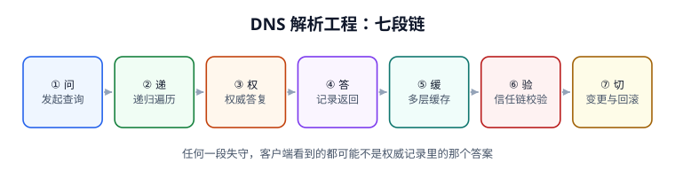

# DNS 解析工程与域名治理

<p style="text-align:center;"></p>

一条域名查询，从「敲下回车」到「连上正确的那台机器」，中间隔着七道判定：问的是谁、谁去递归、谁有权回答、答案怎么回来、被谁缓存了多久、凭什么可信、改了以后怎么退回去。这些判定大多不报错——`dig` 有输出、页面能开、监控一片绿，只有换 IP 一小时后还有人打旧地址、或者换 DNS 服务商后某个地区集体 `SERVFAIL` 时，才发现问题不在「解析成功」，而在**没人能说清成功的是哪一个答案**。

本册讲的是**解析链的可判定性与变更治理**：怎么把「域名解析到了」变成「哪个答案、对谁、在哪一层、到什么时候」，以及一次 zone 变更凭什么可灰度、可回滚、可举证。至于 DNS 是什么、`dig` 怎么用、`resolv.conf` 怎么配，都在既有的[网络基础 · DNS 解析与配置](../Network/Dns/index.md)里，这里不重复。

::: info 本册定位与版本
适用对象：要负责域名切换、多区域调度、证书签发、权威/递归排障的运维与平台工程师；读者已经会用 `dig`，但需要对「解析结果」承担工程责任。

协议事实已联网核对（2026-11-11 检索，以 RFC Editor / IETF / DNS Flag Day 官方页面为准）：[RFC 1034](https://www.rfc-editor.org/info/rfc1034) / [RFC 1035](https://www.rfc-editor.org/info/rfc1035)（域名概念与报文格式）、[RFC 2308](https://www.rfc-editor.org/info/rfc2308)（负缓存，权威构造 SOA 时取 `min(SOA.MINIMUM, SOA TTL)`）、[RFC 4033](https://www.rfc-editor.org/info/rfc4033) / 4034 / 4035（DNSSEC）、[RFC 6891](https://www.rfc-editor.org/info/rfc6891)（EDNS(0)）、[RFC 7766](https://www.rfc-editor.org/info/rfc7766)（TCP 必选）、[RFC 7858](https://www.rfc-editor.org/info/rfc7858)（DoT，853）、[RFC 8484](https://www.rfc-editor.org/info/rfc8484)（DoH，443）、[RFC 9250](https://www.rfc-editor.org/info/rfc9250)（DoQ，2022）、[RFC 7871](https://www.rfc-editor.org/info/rfc7871)（ECS）、[RFC 8659](https://www.rfc-editor.org/info/rfc8659)（CAA，2019，已废止 RFC 6844）、[RFC 8767](https://www.rfc-editor.org/info/rfc8767)（serve-stale）；[DNS Flag Day 2020](https://www.dnsflagday.net/) 建议 EDNS 缓冲区默认 **1232 字节**（IPv6 MTU 1280 减 48 字节头部），并要求权威与递归都能在 `TC=1` 时切 TCP。

本册全部读数来自本机 **Python 3.13.12 标准库**按上述 RFC 语义建模的仿真（固定种子 `271`，脚本不入库、读者可照文档复现），**不是生产网络的基准测量**；涉及延迟、命中率、收敛时间的结论，上线前请以本地实测替换。
:::

## 一、为什么是「改层不改题」

轮换表第 271 行原题「DNS 解析工程与域名治理」，建议章节为总览、解析流程、记录语义、缓存与一致性、信任链、加密传输、变更治理、实战、FAQ。动手前按「**邻页行数 + 未回答的问题**」双判据逐项核查：

| 邻页 | 规模 | 它已经回答了什么 | 本册不重复什么 |
| --- | --- | --- | --- |
| [网络基础 · DNS 解析与配置](../Network/Dns/index.md) | 156 行 | 解析流程、`dig`/`nslookup`、`/etc/resolv.conf`、三类常见故障、降 TTL 切换 | 不再讲记录类型清单与本机配置怎么写 |
| [边缘计算与 CDN](../EdgeCDN/CDNPrinciple/index.md) | 183 行 | CDN 调度与回源、缓存键、边缘节点 | 不再讲 CDN 自身的调度架构 |
| [多活与单元化](../MultiActive/TrafficSwitch/index.md) | 185 行 | 切流三段时间、四层路由、单元归属 | 不再讲业务侧的流量切换编排 |
| [Kubernetes · Service](../Kubernetes/Service/index.md) | 95 行 | ClusterIP、CoreDNS、服务发现 | 不再讲集群内名字怎么解析 |
| [邮件送达 · DNS 与密钥](../../Backend/EmailDeliverability/DnsAndKeys/index.md) | 229 行 | SPF / DKIM / DMARC / DANE 的记录形状 | 不再讲邮件认证记录怎么填 |
| [云上架构 · 负载均衡](../CloudArchitecture/LoadBalancing/index.md) | 194 行 | LB 选型、健康检查、会话保持 | 不再讲四七层负载均衡 |

逐词检索（`git grep`，2026-11-11，限定 `docs/**/*.md`）：`DoH` **0 篇**、`DoQ` **0 篇**、`DoT` **0 篇**、`胶水记录` **0 篇**、`SOA serial` **0 篇**；`DNSSEC` 只在邮件页里出现 **1 次**（DANE 表格中的一句），`负缓存` **1 篇**，`EDNS` **1 篇**，`CAA` **2 篇**（证书签发页与 CDN FAQ 各一处）。全库没有任何 `DnsResolution` / 解析链 / 信任链的独立主题。

::: danger 判「已覆盖」不能只看关键词命中数
「DNS 解析」命中 27 篇，看起来全被写过了；但打开会发现它们分散在容器网络、K8s Service、邮件 DNS、CDN 调度各自的一节里，回答的是**本组件内部**那一段。**空白不在主题，在层**：没有一处系统回答「同一个名字在同一时刻有三个不同的答案时，以哪个为准、怎么证明、怎么收口」。所以本册保留题名，把范围收窄到**解析链的可判定性与变更治理层**。
:::

## 二、三个「这个答案」


| 名字 | 英文 | 定义 | 能证明什么 | 典型误用 |
| --- | --- | --- | --- | --- |
| 权威记录 | Authoritative answer | 权威服务器上 zone 文件（或 API）里当前的值 | 只证明「权威此刻怎么答」 | 拿它当「所有客户端已经看到的值」 |
| 递归缓存 | Recursive cache | 递归器在 TTL 内复用的那份答复 | 证明「这个递归器会答什么」 | 用一家公共 DNS 的结果代表全球 |
| 客户端所见 | Stub view | 应用/OS/运行时缓存、hosts、split-horizon 之后的最终值 | 证明「这次连接实际连到了谁」 | 忽略 JVM、浏览器、容器的独立缓存 |

三者主语不同，「生效」也就不是一件事：

1. **权威 ⇄ 递归**的一致，靠 **SOA serial 与 referral**（第 2、8 章）；
2. **递归 ⇄ 客户端**的一致，靠 **TTL 与缓存层级**（第 4 章）；
3. **这条答案本身可信**，靠 **DNSSEC 信任链**（第 5 章），而**传输不被偷看**靠加密传输（第 6 章）——两者互不替代。

把三者混成一句「DNS 已经生效了」，是这类变更最常见的收工方式，也是最难验收的收工方式。

## 三、七段链与六个安静的失败



| 段 | 做什么 | 安静的失败 | 本册实测 |
| --- | --- | --- | --- |
| 问 | 构造 QNAME、选 QTYPE、选递归器 | 标签超 63 字节 / 全名超 255 字节 | 200 个名字往返 **200/200**，63 字节 PASS、64 字节 REJECT |
| 递 | 根 → TLD → 权威三段 referral | 缺胶水且 NS 落在子域内 → 循环依赖 | 正常链 **3 次**查询；缺胶水第 **2** 步即 `SERVFAIL` |
| 权 | 权威按 zone 给出答复或否定证明 | 先查后建，NXDOMAIN 被缓存 | 负缓存 **900 s**，记录建好后仍不可见 |
| 答 | 报文编码、压缩指针、EDNS 与 TC 切 TCP | 防火墙只放 UDP/53，大答复被截断 | 压缩把 68 B 压到 **23 B（省 66.18%）** |
| 缓 | 递归器 / OS / 运行时多层缓存 | 不提前降 TTL，收敛上限就是旧 TTL | 10,000 客户端：p50 **1782.2 s**、p99 **3553.9 s**、max **3599.3 s** |
| 验 | DS → DNSKEY → RRSIG 全链校验 | 只验末级签名就宣布「已启用 DNSSEC」 | 只验末级时替换公钥**照样通过**（跳过 3 层） |
| 切 | 降 TTL、灰度、改记录、观察、回切 | serial 回退 / 回滚后仍打新 IP | serial 回退 **0/8** 从服务器更新；回滚后 **17.21%** 客户端仍打新 IP |

## 四、三条贯穿全册的主张

1. **TTL 是变更延迟预算，不是「生效时间」。** 改完记录在权威上立刻可见，但客户端的收敛上限等于**改动前那次缓存的 TTL**。本机 10,000 客户端仿真里有 **49.46%** 在变更后 1 小时内仍拿旧值；提前 `2×旧 TTL` 把 TTL 降下来，收敛上限才从 3600 s 变成 60 s。
2. **DNSSEC 与加密 DNS 是两件事，谁也替不了谁。** DNSSEC 给**真实性**（答案没被改），DoT/DoH/DoQ 给**机密性**（路上没人看），且加密只覆盖 **stub → 递归**这一跳，递归器仍看到 100% 的查询，递归 → 权威一跳通常仍是明文。
3. **调度精度与缓存命中率是同一枚硬币。** 打开 ECS 后本地命中率从 **25.0% 升到 98.0%**，但缓存键从「域名」变成「域名 + 客户端子网」，条目从 1 条涨到 200 条、命中率从 92% 掉到 41%。把 ECS 当成免费的「更准」是错的。

::: tip 一句话理解
基础页回答「怎么把域名查出来」，本册回答「**查出来之后，凭什么说这个答案是对的、是全部人看到的、是能退回去的**」。前者错了当场就断，后者错了往往要等一次切换、一次换服务商、或一次跨区域投诉才暴露。
:::

## 五、版本目录：按解析栈代际拆，不按域名年份拆

本主题确实存在**同一份需求、两套不兼容配置写法**，因此按 `AGENTS.md` 第 3 节「大版本管理」建两个版本目录，旧内容原样保留、标注状态、不覆盖：

| 目录 | 覆盖内容 | 维护状态 | 新项目是否使用 |
| --- | --- | --- | --- |
| [旧版解析栈（仅存量项目使用）](ClassicResolver/index.md) | UDP/53 明文、512 字节上限、手工 zone 文件、`nslookup`/`dig` 排障、无 EDNS0 / 无 DNSSEC | **仅存量项目使用 · 已停止新增** | 否，只用于维护存量与做迁移映射 |
| [当前主线解析栈](ModernResolver/index.md) | DoT 853 / DoH 443 / DoQ 0-RTT、DNSSEC 自动签名、EDNS 1232、ECS、CAA（RFC 8659） | **当前主线 · 持续维护** | 是 |

三条理由写在这里，避免后来者误判：

1. **换代的是传输与签名契约，不是判据。** 本册 12 族判据（QNAME 边界、referral、记录语义、TTL、信任链、传输、调度、变更……）在两代栈上都成立，按「问题」切成正文；若硬按产品把全部章节复制两遍，90% 正文会重复。
2. **真正需要版本目录的是「同一件事两套写法」。** 旧栈里 `$TTL` 缺失时 `SOA.MINIMUM` 曾被当作默认 TTL，而 [RFC 2308](https://www.rfc-editor.org/info/rfc2308) 明确规定它现在只用于负缓存、并引入 `$TTL` 指令；CAA 从 RFC 6844 换成 RFC 8659 后 tree-climbing 规则也变了。这与库内 `Spring5 / Spring6`、`Vue2 / Vue3`、`Nacos2 / Nacos3`、[事件集成的旧版/新版采集栈](../../Backend/EventIntegration/index.md)是同一类差异，故只把**写法与迁移映射**拆成两个版本目录。
3. **域名本身没有大版本。** 按「注册年份」或「顶级域」建目录会造出多份几乎相同的正文；小版本差异（如签名算法轮换、EDNS 选项）在第 5、6 章用 `::: info` 说明即可。

::: warning 旧版目录的处置纪律
`ClassicResolver/` 的内容不改写、不删除、不与新版合并；目录页与侧边栏同时保留入口，并在该页顶部标注「仅存量项目使用 · 已停止新增」。需要新增能力时一律写进 `ModernResolver/`，需要迁移说明时只在旧页补一张映射表。
:::

## 六、本册结构与判据族

| 页 | 判据族 | 这一族管什么 | 条数 |
| --- | --- | --- | --- |
| [总览：四个角色与三种答案](Overview/index.md) | `DNO-A` ~ `DNO-H` | 边界、术语与判定语言 | 8 |
| [解析链：referral、胶水与 CNAME 预算](ResolutionPath/index.md) | `DNR-A` ~ `DNR-H` | 三次 referral 与报文边界 | 8 |
| [记录语义：类型、wire 格式与 CAA](RecordSemantics/index.md) | `DND-A` ~ `DND-H` | 记录类型与编码约束 | 8 |
| [TTL 与缓存一致性](TtlConsistency/index.md) | `DNT-A` ~ `DNT-H` | 收敛、负缓存与 serve-stale | 8 |
| [DNSSEC 信任链](DnssecChain/index.md) | `DNX-A` ~ `DNX-H` | DS/DNSKEY/RRSIG 与 bogus | 8 |
| [加密传输：DoT / DoH / DoQ](EncryptedTransport/index.md) | `DNE-A` ~ `DNE-H` | 机密性边界与降级 | 8 |
| [流量调度与 ECS](TrafficSteering/index.md) | `DNG-A` ~ `DNG-H` | 调度精度与缓存代价 | 8 |
| [变更治理与回滚](ChangeGovernance/index.md) | `DNC-A` ~ `DNC-H` | serial、灰度与回滚窗口 | 8 |
| [实战：十条可判定门禁](Practice/index.md) | `DNP-A` ~ `DNP-H` | 可复跑的验收脚本 | 8 |
| [常见问题与症状分诊](FAQ/index.md) | `DNQ-A` ~ `DNQ-H` | 七类症状的判定路径 | 8 |
| [旧版解析栈（存量）](ClassicResolver/index.md) | `DNL-A` ~ `DNL-H` | 旧写法与迁移映射 | 8 |
| [当前主线解析栈](ModernResolver/index.md) | `DNM-A` ~ `DNM-H` | 当前基线与升级路径 | 8 |

全册共 **12 族 / 96 条判据**。判据表列序固定为「页 | 判据族 | 这一族管什么 | 条数」，它是巡检契约的一部分，不是排版自由。

## 七、如何验证本册

所有命令都在仓库根目录执行；实战页的脚本可整段复制后单独运行，不依赖仓库内任何文件。

```shell
# 1. 看 12 族判据是否都能在本册里找到定义
grep -oE 'DN[A-Z]-[A-H]' docs/Ops/DnsResolution/*/index.md | sort -u | wc -l
# 期望：96

# 2. 检查 12 张示意图与 Logo 都在
ls docs/Ops/DnsResolution/assets/*.svg | wc -l
# 期望：12

# 3. 复跑实战页的验收脚本（把 Practice/index.md 里的脚本存成 /tmp/dns_gate.py）
python3 /tmp/dns_gate.py
# 期望：DNS 10 / 10 PASS / EXIT=0

# 4. 站点构建
pnpm docs:build
# 期望：build complete，0 条死链
```

## 参考资料

- [RFC 1034 — Domain Names: Concepts and Facilities](https://www.rfc-editor.org/info/rfc1034)
- [RFC 1035 — Domain Names: Implementation and Specification](https://www.rfc-editor.org/info/rfc1035)
- [RFC 2308 — Negative Caching of DNS Queries](https://www.rfc-editor.org/info/rfc2308)
- [RFC 4033 — DNS Security Introduction and Requirements](https://www.rfc-editor.org/info/rfc4033)
- [RFC 6891 — Extension Mechanisms for DNS (EDNS(0))](https://www.rfc-editor.org/info/rfc6891)
- [RFC 7766 — DNS Transport over TCP](https://www.rfc-editor.org/info/rfc7766)
- [RFC 7858 — DNS over TLS](https://www.rfc-editor.org/info/rfc7858)
- [RFC 8484 — DNS Queries over HTTPS](https://www.rfc-editor.org/info/rfc8484)
- [RFC 9250 — DNS over Dedicated QUIC Connections](https://www.rfc-editor.org/info/rfc9250)
- [RFC 7871 — Client Subnet in DNS Queries](https://www.rfc-editor.org/info/rfc7871)
- [RFC 8659 — DNS Certification Authority Authorization](https://www.rfc-editor.org/info/rfc8659)
- [RFC 8767 — Serving Stale Data to Improve DNS Resilience](https://www.rfc-editor.org/info/rfc8767)
- [DNS Flag Day 2020 — EDNS buffer 1232](https://www.dnsflagday.net/)
- [本库：网络基础 · DNS 解析与配置](../Network/Dns/index.md)
