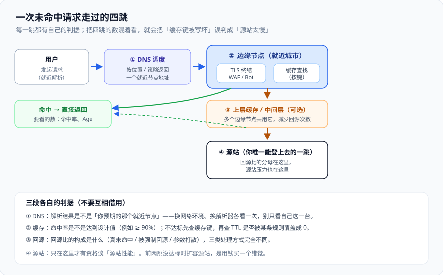

# CDN 原理：从调度到回源

接入 CDN 之后，你的请求不再直接到达源站，而是先落在一个**你选不了、也看不到的节点**上。这一页讲清这条链路：请求凭什么去了那个节点、节点凭什么把内容直接发回去、没命中时它又向谁要。

一句话定位：**把「一次请求的四跳」讲清楚，并给每一跳配一个可以对答案的指标。** 适用于准备接入 CDN、正在排查「CDN 好像没生效」、以及需要给命中率与回源比定口径的人。



## 一、第一跳：DNS 调度决定「去哪个城市」

用户请求一个域名，第一步是解析。CDN 与普通站点最大的不同就在这一步：**同一个域名，要给不同的用户返回不同的地址**。

三种主流调度方式，代价与精度不同：

| 方式 | 怎么工作 | 精度 | 代价 |
| --- | --- | --- | --- |
| **基于 LocalDNS 的地理/线路调度** | 权威 DNS 看**递归解析器**的来源 IP，返回对应区域的节点 | 粗（可能整省、整运营商共用一个结果） | 大范围解析器（公共 DNS）会把精度拉低 |
| **EDNS Client Subnet（ECS）** | 递归解析器把用户网段前缀带给权威 DNS | 细（可到 /24 一级） | 支持度不齐，且涉及用户网段隐私 |
| **Anycast（任播）** | 多个节点宣告**同一个 IP**，由网络本身把包送到最近的一个 | 由路由决定，通常很准 | 迁移与排障更难，且「最近」按路由跳数而非物理距离 |
| **HTTP 层重定向 / 接入层调度** | 先到任意节点，再由这一层 302 或内部转发 | 可编程、可覆盖规则 | 多一次往返（302 会额外增加 RTT） |

::: tip 这一跳的判据
**「我解析到的是不是预期的那个节点」是这一跳唯一该问的问题。** 验证方式必须换环境：同一台机器上换解析器（`dig @8.8.8.8` 与 `dig @1.1.1.1`）、换网络（手机热点）各来一次，你才可能看到不同的答案。
:::

::: danger DNS 调度的三个高频坑
1. **以为改完记录就生效**：TTL 决定传播时间。切 CDN、回切直连都受它约束——**切换预案要写「等多久」**，而不是「改一下」。
2. **只留一条解析记录**：CDN 出问题时没有可切的直连地址。至少在切换预案里保留一条**源站 A 记录**（哪怕平时权重为 0）。
3. **把「节点多」当成「我这里快」**：节点数多只说明覆盖广；你真正的指标是**用户所在地到其命中节点的 RTT**。拿一个位于欧洲的站点去比节点总数没有意义。
:::

## 二、第二跳：边缘节点做了什么

请求到达节点后，按固定顺序过三关：

1. **TLS 终结**：证书在节点上（由平台托管或被托管），这一步决定握手开销；边缘函数如果要在请求阶段读头，必须在这之后。
2. **安全判定**：WAF 规则、Bot 判定、限速。这一步的特点是**可以在进入你源站之前就把请求打死**——这也是边缘安全的主要价值。
3. **缓存查找**：用**缓存键**算出「这是不是同一份内容」，命中就直接返回。

三关的顺序是工程约定，通常**不可调**（你无法让 WAF 跑在 TLS 之前）。所以「为什么我的防护没拦住」很多时候答案是「它在缓存之后」——**已被缓存的静态内容不会再经过完整的缓存判定**，而被缓存的响应也不会重新触发源站侧的鉴权。

## 三、第三跳：没命中时向谁要——分层缓存

未命中并不意味着直接打到源站。主流做法是**分层**：

| 层级 | 位置 | 作用 | 代价 |
| --- | --- | --- | --- |
| **边缘层（L1）** | 用户最近的城市 | 最快 | 容量小、命中率取决于该点流量分布 |
| **中间层 / 上层缓存（L2）** | 区域中心或平台骨干 | 多个 L1 共用一份副本，显著降低回源 | 多一跳，未命中时延迟增加 |
| **源站（Origin）** | 你的机房 | 权威副本 | 是你的 GPU/CPU/数据库在这里真正付钱的地方 |

「Origin Shield」「Tiered Cache」这类产品名指的都是**中间层**。要不要开，判据很具体：

- **地理分散、单点流量小**（例如全球都有用户，但每个城市每天只有几百个请求）：**开**。不开的话每个点都要各自回源一次，源站会收到大量重复请求。
- **单点流量已经很大**（单个大城市就有显著并发）：可以不开，L1 自己就够撑起命中率，中间层反而增加一段潜在延迟。
- **源站耐受不了并发**：开。中间层天然把回源并发收敛到每层一份。

## 四、第四跳：回源的成本与形态

回源是**唯一会打到你自己机器的一跳**，所以它值得单独定口径。

回源请求的三种构成，处理方式完全不同：

| 构成 | 现象 | 处理方向 |
| --- | --- | --- |
| **真未命中** | 该内容从没被缓存或已过期 | 拉长 TTL、预热热点内容 |
| **被强制回源** | 请求里带了让缓存绕过的信号（`Cache-Control: no-cache` 来自客户端、`Authorization`、`Set-Cookie`） | 去掉不必要的绕过信号；把身份判断从「绕过缓存」改成「进缓存键」 |
| **被参数打散** | 同一个资源的 URL 因为追踪参数、时间戳而千变万化 | 在边缘**规范化 URL**（去掉无用参数再算缓存键），或让页面别再生成随机参数 |

回源还有一处容易忽略的**放大效应**：一次「回源」可能不是一个请求。例如边缘拿到了一个 `Range` 请求、或需要重新校验（`If-None-Match`），可能与源站发生多次交互。所以「源站 QPS」通常不等于「回源比 × 用户 QPS」，排障时要以**源站自己的指标**为准。

## 五、命中率与回源比：三个必须先定的口径

这两个数是 CDN 上最容易「各说各话」的指标。定口径要回答三问：

1. **分母是什么**：全部请求，还是「可缓存的请求」？把 API 与静态资源混在一起算，命中率会失真。
2. **哪些算命中**：边缘返回的 4xx（比如 404）算不算命中？有的平台算，有的不算。
3. **按什么维度拆**：必须能按**路径前缀**与**状态码**拆开看，否则一个长尾路径就能把整体数字拉低而没人发现。

一个可用的最小口径示例（写进你自己的监控文档，而不是留在脑子里）：

| 指标 | 定义 | 目标示例 | 不达标的常见原因 |
| --- | --- | --- | --- |
| 静态命中率 | `命中请求数 ÷ 静态资源请求数` | ≥ 90% | 文件名没带哈希、TTL 被覆盖成 0 |
| 回源比 | `回源请求数 ÷ 总请求数` | ≤ 15% | 参数打散、缓存键包含无意义的头 |
| 边缘错误率 | `边缘侧 5xx ÷ 总请求数` | ≤ 0.1% | 边缘函数超限、子请求超时 |
| 节点回源 P95 | 回源耗时 P95 | 与源站 P95 相差一个固定量 | 源站慢（这时才轮到源站优化） |

::: danger 三个会静默算错账的坑
1. **拿浏览器缓存命中当一个数**：浏览器命中与 CDN 命中是两件事。浏览器命中时**请求根本没到 CDN**，所以你的回源比会显得更好看，而真实用户感知可能是「首屏仍慢」。
2. **命中率按小时平均值看**：发布、预热、长尾峰值都会被平均值抹平。判断「有没有效果」必须看**时间序列**，不看平均数。
3. **只看整体命中率，不拆路径**：一个无参数的 `/index.html` 会把命中率撑得很好看，而真正的成本中心（大文件、动态 JSON）可能一条都没命中。
:::

## 六、预热与淘汰

- **预热（pre-warm）**：在开放流量之前，主动把将要热的内容拉进节点。它解决的是「第一波用户承担冷启动」。预热不是必须，但在**发布后立刻有大促流量**这类场景里很值。
- **淘汰（eviction）**：节点容量有限，冷内容会被挤出去。所以**长 TTL 不等于永远在**：TTL 只决定「多久之后必须重新校验」，不保证「期间一定留在节点上」。
- **回源收敛**：同一个内容在过期瞬间可能被多个节点同时回源（缓存击穿）。平台侧的「合并回源 / Request Collapsing」能缓解，但**不能指望**——源站侧仍要能承受这个瞬时并发。

## 七、常用清单

| 目的 | 命令 | 看什么 |
| --- | --- | --- |
| 看解析到哪个节点 | `dig +short example.com` | 解析结果是否属于预期区域 |
| 换解析器再看 | `dig @1.1.1.1 +short example.com` | 不同解析器是否返回不同节点 |
| 看是否命中缓存 | `curl -sI https://example.com/a.js` | `Age` 是否递增、`Cache-Status` / 厂商头是否命中 |
| 看回源响应头 | `curl -sI https://origin.example.com/a.js` | 源站侧不应有边缘的缓存状态头 |
| 看 TTL 是否被覆盖 | `curl -sI ... \| grep -i cache-control` | 是否出现 `no-store` / `max-age=0` |
| 看边缘与源站内容是否一致 | `curl -s https://example.com/a.js \| md5` 与源站比对 | 哈希不同说明缓存里是旧版本 |

## 八、易错点与最佳实践

::: danger 五个坑，附正确写法
1. **把 CDN 的 TTL 与源站的 `Cache-Control` 当成两套独立设置**：多数平台是「源站没给指令时才用平台默认」，也有平台是「平台规则优先」。**冲突时的优先级必须查一次文档并写下来**，否则你会在「为什么改了没生效」上花掉半天。
2. **用 `curl` 单次请求判断命中**：可能落到未预热节点。正确做法是连续请求两次，比较 `Age` 与缓存状态头。
3. **在没有中间层的情况下用「多节点」解释高回源比**：先把「参数打散」与「强制回源」两类排掉，再考虑加中间层。
4. **把 CDN 的 4xx 当成源站问题**：边缘可以直接返回 4xx（例如 WAF 拦截）。看日志时要区分**哪一层产生的状态码**。
5. **回源域名与用户域名混用**：应给回源单独配一个域名（并在源站只接受来自边缘的回源），否则用户可以绕过 CDN 直连你的源站，缓存与防护一起失效。
:::

::: tip 三条值得先做的实践
- **给「回源」单独建一个源站入口域名**，并在源站只放行边缘出口网段；这是让 CDN 真正成为「唯一入口」的前提。
- **把查询参数分成「参与缓存键」与「忽略」两类**并写成表：追踪参数一律忽略，业务参数一律参与。
- **给发布流程加一步「刷新」**，并把「刷新耗时」写进发布检查单——刷新不是瞬时动作。
:::

## 九、验证方式

```shell
# 1) 调度是否就近：换解析器，看结果是否随来源变化
dig +short www.example.com
dig @223.5.5.5 +short www.example.com

# 2) 是否命中：连续两次请求同一静态资源，看 Age 是否递增
curl -sI https://www.example.com/static/app.9f2c1a.js | grep -Ei 'age|x-cache|cf-cache-status|cache-status'
curl -sI https://www.example.com/static/app.9f2c1a.js | grep -Ei 'age|x-cache|cf-cache-status|cache-status'

# 3) 是否真的回源：请求一个不存在的路径，看是哪一层给的 404
curl -sI https://www.example.com/__not_exist__ | grep -Ei 'server|via|x-cache|cache-status'

# 4) 内容是否与源站一致：比对哈希
curl -s https://www.example.com/static/app.9f2c1a.js | shasum
curl -s https://origin.example.com/static/app.9f2c1a.js | shasum
```

| 观察 | 结论 |
| --- | --- |
| 两次请求 `Age` 递增 | 命中，且落在同一节点 |
| 两次都几乎没有 `Age` | 未命中：先查缓存键与 `Cache-Control`，再看该节点是否刚被淘汰 |
| 出现 `Age` 但内容哈希与源站不同 | 缓存里是旧版本：去查 [缓存策略](../CacheStrategy/index.md) 的失效流程 |
| 解析结果与用户所在地明显不符 | 调度问题：检查线路策略 / ECS 支持 / 是否被本地 DNS 劫持 |

## 十、参考资料

- RFC 9111 · HTTP Caching（缓存与回源校验的权威定义）：https://www.rfc-editor.org/rfc/rfc9111
- RFC 9211 · The Cache-Status HTTP Response Header Field（用标准头判断命中）：https://www.rfc-editor.org/rfc/rfc9211
- 阿里云 CDN 文档 · 缓存配置与回源配置：https://help.aliyun.com/zh/cdn/
- 腾讯云 EdgeOne 文档 · 站点加速与缓存配置：https://cloud.tencent.com/document/product/1552
- Amazon CloudFront 开发者指南 · Cache key 与 Origin Shield：https://docs.aws.amazon.com/AmazonCloudFront/latest/DeveloperGuide/understanding-the-cache-key.html
- Cloudflare 文档 · Tiered Cache（分层缓存）：https://developers.cloudflare.com/cache/advanced-configuration/tiered-cache/
- 本专题相邻页：[总览：边缘与 CDN 的四条边界](../Overview/index.md)、[缓存策略：键、时效与失效](../CacheStrategy/index.md)

## 与「对象存储工程」专题的分工（第 173 天补充）

| 问题 | 归本页 | 归[文件与对象存储工程](../../../Backend/ObjectStorage/index.md) |
| --- | --- | --- |
| 缓存层级、回源、`Cache-Control` 与刷新 | ✅ | — |
| 覆盖写之后「读到的是不是最新的」 | — | ✅ [一致性与并发写](../../../Backend/ObjectStorage/ConsistencyModel/index.md) |
| 边缘节点的存储与淘汰 | ✅ | — |
| 对象 key 该不该可变、什么时候必须换 key | — | ✅ [键空间与命名](../../../Backend/ObjectStorage/KeysLayout/index.md) |

一句话边界：本页讲「边缘怎么缓存一份字节」，专题讲「源站那份字节什么时候变、变了以后谁来通知」。

::: danger 本页特有的坑：把 `302` 到预签名 URL 的跳转缓存下来
下载接口常写成「`302` → 预签名 URL」。如果这个 `302` 被 CDN 缓存（默认按 URL 缓存、不看响应语义），会发生两件事：
1. 窗口期内**所有用户共用同一个签名 URL** —— 签名本是 bearer token，缓存它等于把它公开；
2. 该 URL 过期后，所有请求一起拿到 `403`，直到缓存 TTL 到期。

正确写法：该响应必须 `Cache-Control: no-store`；或把签名放到边缘（边缘签名），不把签名结果交给共享缓存。

:::

