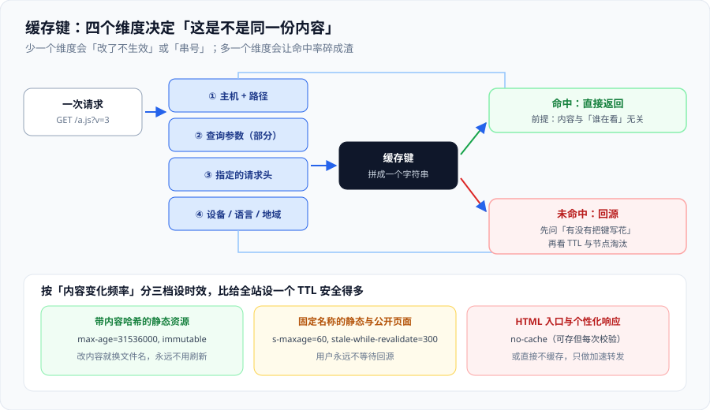

# 缓存策略：键、时效与失效

缓存策略是 CDN 上唯一一件「配错了不会报错、只会悄悄错」的事：构建绿、页面能开、`curl` 返回 200，但**用户看到的是别人的数据，或者是你三天前的内容**。这一页把三件事讲清：**什么算同一份内容（键）**、**能留多久（时效）**、**怎么让它立刻消失（失效）**。

一句话定位：**把「缓存」从一堆指令变成一张可评审的表——路径模式、缓存键、时效、失效方式四列。** 适用于要给出缓存策略、要排查「改了不生效」、要排查「用户看到别人的内容」的人。



## 一、缓存键：四个维度

「两次请求是不是同一份内容」由缓存键决定。绝大多数平台的**默认键只有主机 + 路径**，其余全靠你显式加：

| 维度 | 默认是否参与 | 加入的理由 | 不加入的后果 |
| --- | --- | --- | --- |
| 主机名 + 路径 | ✅ 参与 | 不同资源天然不同 | —— |
| 查询参数 | ⚠️ 部分平台全含、部分可裁剪 | `?page=2` 与 `?page=1` 是不同内容 | 不参与会串内容；**全参与**会被 `?utm_source=` 之类打散 |
| 请求头（如 `Accept-Encoding`、`Accept-Language`、`Authorization`） | ❌ 默认不参与（除少数） | 压缩、语言、身份确实影响响应体 | 不参与会「给不支持 gzip 的客户端发 gzip」或**串号** |
| 地域 / 设备（`Vary` 或平台维度） | ❌ 不参与 | 按国家给不同价格、按设备给不同图 | 不参与会「一个人看到另一个地区的版本」 |

### 正确的做法是「显式白名单」

不要依赖默认值，而是明确写下：

1. **查询参数**：列出**参与缓存键**的白名单（业务参数），其余一律忽略。这一条能立刻提升命中率，且风险可控。
2. **请求头**：只加真正影响响应体的那几个（`Accept-Encoding`、`Accept-Language`），**绝不要把 `User-Agent` 整个加进去**——它的取值几乎是无限的，会把命中率打碎。
3. **身份**：需要按用户区分时，**不要**把 `Authorization` 加进共享缓存键，而是：要么对该路径**不缓存**，要么在边缘函数里把身份落到一个**低基数**的键上（如「会员等级」而不是「用户 ID」）。

::: danger 「按用户缓存」的三种错误实现
1. **把 `Authorization` 头加进缓存键**：每个 token 是唯一的 → 命中率归零，CDN 退化成一条昂贵的代理（更糟的是，你还以为在加速）。
2. **把用户 ID 放进 URL（如 `?uid=123`）**：命中率同样归零，且把用户标识泄漏进了日志与 Referer。
3. **用 `Vary: Cookie`**：Cookie 的取值组合数量极大，命中率接近 0，而且**同一个人的 Cookie 变化也会导致未命中**。正确做法是把「影响内容的那个维度」单独抽出来做键，而不是把整个 Cookie 当键。
:::

## 二、时效：四个响应头字段的分工

| 字段 | 管谁 | 语义 | 什么时候用 |
| --- | --- | --- | --- |
| `max-age` | **浏览器**（私有缓存） | 多少秒内直接用本地副本 | 控制用户端，不控制 CDN |
| `s-maxage` | **共享缓存（CDN）** | 覆盖 `max-age`，专管中间层 | 应当成为你控制 CDN 的主要手段 |
| `stale-while-revalidate` | 共享缓存与浏览器 | 过期后**先给旧内容**，同时后台去取新的 | 想让用户「永远不等回源」时的首选（RFC 5861） |
| `stale-if-error` | 共享缓存与浏览器 | 回源失败时允许给旧内容 | 源站抖动时的兜底（RFC 5861） |

三种典型组合，可以直接抄：

```http
# ① 带内容哈希的静态资源：一年，且明确「不会原地变化」
Cache-Control: public, max-age=31536000, immutable

# ② 固定文件名的静态资源与公开页面：1 分钟新鲜 + 5 分钟「先给旧的」
Cache-Control: public, s-maxage=60, stale-while-revalidate=300

# ③ 入口 HTML 与个性化响应：可以存，但每次都要回源校验
Cache-Control: no-cache
```

::: danger `no-cache` 与 `no-store` 不是一回事
1. **`no-cache` = 可以存，但每次必须回源校验**（配合 `ETag` 通常只换来一个 304）。它**不会**提升性能，但也不会让你看到旧内容——入口 HTML 用它是对的。
2. **`no-store` = 完全不存**。写在静态资源上会让 CDN 彻底失效，此时你付了 CDN 的钱、拿到了直连的性能。
3. **最危险的组合是「以为写了 `no-cache` 就等于不缓存」**：结果 CDN 仍然存了响应，只是每次都去校验——如果上游校验被跳过（例如源站不支持 `ETag` 或中间还有一层），你依然可能拿到旧内容。
:::

## 三、失效：主动清、被动等、以及「时间旅行」

内容改了之后，只有三条路让用户看到新的：

| 方式 | 生效速度 | 代价 | 适合 |
| --- | --- | --- | --- |
| **改文件名（内容哈希）** | 立即，且有缓存也不会错 | 需要构建流程配合 | **首选**：静态资源全部走这条 |
| **主动刷新（purge / invalidate）** | 秒级到分钟级（取决于平台与是否全网） | 有配额；刷太频繁会显著增加回源 | 固定文件名的资源、配置下发、紧急修内容 |
| **等 TTL 自然过期** | 最长等于 TTL | 用户在此期间看到旧的 | 只适合「旧一点没关系」的内容 |

::: tip 「刷新」这个词在各平台的含义不同
至少问清三件事：**只刷当前节点还是全网**、**刷新是否连带刷掉中间层**、**刷新量是否有限额**。这三条没问清，就会得到「我刷新了但用户还是看到旧的」——而你并不知道是刷新没生效，还是刷新生效了但另一层还有副本。
:::

### 把失效写进发布流程

一个可用的最小发布检查单：

1. **静态资源**：文件名带内容哈希 → 发布后**不需要刷新**，只需刷新入口 HTML。
2. **入口 HTML**：`no-cache` → 通常无需主动刷新；若需要立即生效，刷一次。
3. **配置类响应（如 `/config.json`）**：主动刷新，并在发布脚本里打印**刷新任务 ID 或返回条数**。
4. **验收**：改一条可观测的内容（例如页面角标或响应头），用 `curl -sI` 连续请求两次，确认第二次返回的是新值。

## 四、诊断：为什么「改了不生效」

按下面顺序排除，每一步都有明确判据：

| 步 | 检查 | 判据 |
| --- | --- | --- |
| 1 | 源站本身更新了吗 | 直接请求源站域名，看内容是否已变；没变就不用查 CDN 了 |
| 2 | 响应头里缓存指令是什么 | `curl -sI` 看 `Cache-Control` / `Age` / `Expires`；是否被某条平台规则覆盖成 `no-store` 或 `max-age=0` |
| 3 | 缓存键是否被写花 | 对比两次请求的完整 URL（含参数）是否一致；带追踪参数的就是命中率杀手 |
| 4 | 是否有第二层副本 | 换节点（不同网络 / 不同解析器）再请求一次，看是否还是旧内容 |
| 5 | 刷新是否落到所有层 | 看刷新返回条数与平台文档；必要时刷新后再查一次 `Age` 是否归零 |

## 五、常用清单

| 目的 | 配置 / 命令 | 备注 |
| --- | --- | --- |
| 让某路径不缓存 | `Cache-Control: no-store` 或平台规则设为「不缓存」 | 也会禁掉浏览器缓存 |
| 只让 CDN 缓存、浏览器不缓存 | `Cache-Control: private, max-age=0, s-maxage=600` | 实现「CDN 上共享、浏览器上不共享」 |
| 只看 CDN、不管浏览器 | 只用 `s-maxage` | 注意部分平台要求同时给 `public` |
| 让压缩生效且不串内容 | 缓存键加入 `Accept-Encoding` | 否则可能出现「给不支持 gzip 的客户端发 gzip」 |
| 排查命中的哪一层 | 响应头 `Cache-Status`（RFC 9211） | 标准头优先于厂商私有头 |
| 立即刷新 | 平台的 purge / invalidate API | 记录刷新后回源比会短时上升，这是预期 |

## 六、易错点与最佳实践

::: danger 六个坑，逐条给正确写法
1. **给入口 HTML 设长 TTL**：用户会长期看到旧版本，且新发布的静态资源引用可能已经不存在。正确写法：入口 HTML 用 `no-cache`，把长 TTL 留给带哈希的资源。
2. **把 `Vary` 当成「按用户区分」的手段**：`Vary` 的分桶基数是维度取值的笛卡尔积，很容易爆炸。正确写法：把影响内容的维度**显式设计成低基数**（等级、地区、语言），而不是把整个头丢进去。
3. **忘了 `Set-Cookie` 这条硬信号**：带 `Set-Cookie` 的响应被共享缓存后，下一个用户可能收到别人的会话标记。正确写法：带 `Set-Cookie` 的响应一律不共享缓存，或先剥离再缓存（并确认这是你要的语义）。
4. **同一路径两种身份语义**：`/api/me` 既返回匿名数据又返回登录数据，缓存无论如何都会错。正确写法：**拆路径**——`/api/public/me` 可缓存，`/api/me` 不缓存。
5. **把 TTL 当成「一定留在节点上」**：TTL 只是「多久之后必须校验」，节点容量不足时照样淘汰。正确写法：热门内容做预热，长尾内容别指望命中。
6. **发布时忘记刷新配置类响应**：表现为「改了配置要等半小时」，然后有人把 TTL 调成 5 秒，命中率一起崩。正确写法：配置类响应**短 TTL + 主动刷新**，不要用「短 TTL」代替「刷新」。
:::

::: tip 三条实践
- **缓存策略写成一张表放在仓库里**：四列（路径模式、缓存键、时效、失效方式），改前先评审。散落在控制台的规则永远没人能回答「现在生效的到底是什么」。
- **同一份内容只允许一个权威来源**（要么源站定、要么边缘定），冲突时你会在「谁覆盖了谁」上花掉半天。
- **给缓存加一条「内容一致性」巡检**：定期对比边缘与源站的内容哈希，尤其是入口 HTML 与配置文件。
:::

## 七、验证方式

```shell
# 1) 看实际下发的缓存指令（以入口 HTML 为例）
curl -sI https://www.example.com/ | grep -i cache-control
# 期望：no-cache 或 s-maxage 很短的组合；出现 max-age=3600 就要确认是不是漏了区分

# 2) 验证静态资源长缓存且不串内容
curl -sI https://www.example.com/static/app.9f2c1a.js | grep -i -E 'cache-control|age'
curl -sI https://www.example.com/static/app.9f2c1a.js | grep -i -E 'cache-control|age'

# 3) 验证查询参数没有互相污染
curl -s 'https://www.example.com/api/items?page=1' | shasum
curl -s 'https://www.example.com/api/items?page=2' | shasum
# 期望：两个哈希不同

# 4) 验证「改了能立刻生效」：先记录，刷新后再看
curl -sI https://www.example.com/config.json | grep -i age     # 刷新前
# 执行平台刷新（purge）后
curl -sI https://www.example.com/config.json | grep -i age     # 期望：Age 归零或明显变小

# 5) 验证追踪参数不会打散缓存
curl -sI 'https://www.example.com/a.js?utm_source=x' | grep -i -E 'x-cache|age'
curl -sI 'https://www.example.com/a.js?utm_source=y' | grep -i -E 'x-cache|age'
# 期望：两次都命中（说明参数已被忽略）
```

| 观察 | 结论 |
| --- | --- |
| 第 3 步两个哈希相同 | 查询参数没有进入缓存键，正在串内容——**最严重的一类**，立刻改 |
| 第 5 步两次均未命中 | 追踪参数打散了缓存键，去改参数裁剪规则 |
| 第 4 步刷新后 `Age` 没归零 | 刷新没有落到所有层，或另有中间层副本 |
| 第 1 步看到很长的 `max-age` | 入口 HTML 被长缓存，去查是源站给的还是平台规则覆盖的 |

## 八、参考资料

- RFC 9111 · HTTP Caching（`no-cache`、`no-store`、`Age`、校验的权威定义）：https://www.rfc-editor.org/rfc/rfc9111
- RFC 5861 · `stale-while-revalidate` 与 `stale-if-error`：https://www.rfc-editor.org/rfc/rfc5861
- RFC 9211 · `Cache-Status`：https://www.rfc-editor.org/rfc/rfc9211
- Cloudflare 文档 · Cache Rules 与 Cache Key 定制：https://developers.cloudflare.com/cache/
- Amazon CloudFront 开发者指南 · 缓存策略与 TTL 设置：https://docs.aws.amazon.com/AmazonCloudFront/latest/DeveloperGuide/Expiration.html
- MDN · `Cache-Control`：https://developer.mozilla.org/zh-CN/docs/Web/HTTP/Reference/Headers/Cache-Control
- 本专题相邻页：[CDN 原理：从调度到回源](../CDNPrinciple/index.md)、[边缘计算与边缘函数](../EdgeCompute/index.md)
