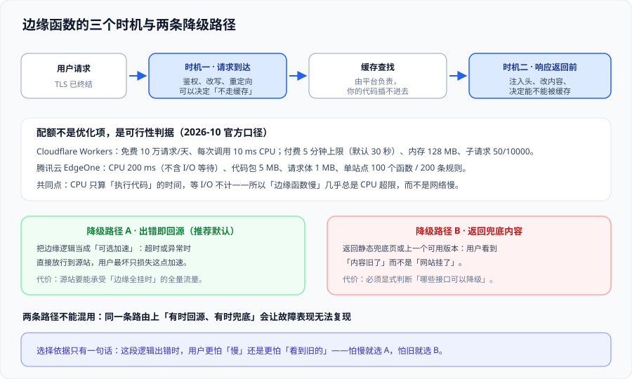

# 边缘计算与边缘函数

边缘函数看起来像「把后端的一小段搬到了 CDN 上」，上手也确实是几行代码。但它有一条与常规后端完全不同的前提：**你写的是运行在几百个节点、每个节点都可能随时回收的代码，而 CPU 预算是毫秒级的。**

一句话定位：**先接受限额，再设计逻辑——限额不是调优目标，是可行性边界。** 适用于准备把鉴权、改写、A/B、图片处理放到边缘的人，也适用于已经放了、但偶尔出现 5xx 或超时的人。



## 一、执行模型：三个时机，你的代码只能插进两个

| 时机 | 谁在执行 | 你能做什么 | 你不能做什么 |
| --- | --- | --- | --- |
| **请求到达（before cache）** | 边缘函数 | 鉴权、改写 URL、重定向、决定是否绕过缓存、A/B 分组 | 不能改变平台的缓存查找算法 |
| **缓存查找** | 平台 | ——（你插不进去） | 不能自定义「命中判定」的实现 |
| **响应返回（after cache）** | 边缘函数 | 注入/删除响应头、改写内容、改状态码、决定是否可缓存 | 不能把已经发给用户的字节撤回 |

这个顺序解释了三类高频困惑：

1. **「我在响应阶段加了 `Cache-Control` 为什么没生效？」**：因为该响应**已经被缓存过**了。要改缓存指令，得在请求阶段决定绕过，或先刷新。
2. **「为什么 WAF 没拦住这个请求？」**：安全判定通常在缓存查找之前，但**已被缓存的静态内容不会再走完整的源站鉴权**——防护与缓存是两套判定，不能互相指望。
3. **「为什么函数里读不到某个头？」**：有些头在到达节点时已被平台处理（`Host` 改写、`X-Forwarded-*`），要以平台文档为准，不要凭直觉。

## 二、限额对照：五种运行时的硬边界

下表按 **2026-10** 官方文档整理。用它来判断「这段逻辑能不能放边缘」，而不是用来比较谁更强：

| 平台 / 形态 | 运行时与语言 | CPU 预算 | 内存 | 单包 / 其它硬限制 |
| --- | --- | --- | --- | --- |
| **Cloudflare Workers（免费）** | V8 isolate；JS/TS、Rust、Python（部分）、Go（经 Wasm） | **每次调用 10 ms** | 128 MB | 子请求 50/请求；Worker 包 64 MiB；每天 10 万请求 |
| **Cloudflare Workers（付费）** | 同上 | 默认 30 秒、最大 **5 分钟** | 128 MB | 子请求 10000/请求；包 64 MiB |
| **Fastly Compute** | **WebAssembly**（Wasmtime）；Rust / Go / JS 等可编译到 Wasm 的语言 | 按计算计费，单次限制较宽 | 由沙箱决定 | 与 VCL 可叠加；**没有边缘 SQL**，只有 KV / Config Store |
| **腾讯云 EdgeOne 边缘函数** | JavaScript | **200 ms**（不含 I/O 等待） | 128 MB | 代码包 5 MB；请求体 1 MB；单站点 100 函数 / 200 条触发规则；循环上限 10 万次 |
| **阿里云 ESA / EdgeRoutine** | JavaScript（Service Worker 风格 API） | 按平台配额 | 由平台定 | **仅 HTTPS**，不支持 WebSocket 与 TCP/UDP 接入 |
| **AWS CloudFront Functions** | JavaScript（轻量运行时） | 极短（设计上只做头处理） | 很小 | 仅在查看器请求/响应两个时机；**无网络访问** |
| **AWS Lambda@Edge** | Node.js / Python | 秒级 | 更大 | 运行在区域边缘缓存；**可以发起出网请求** |

::: info 一条比数字更重要的判断
**「CPU 只算执行代码的时间」是所有平台的共同口径**：`fetch()` 等待、KV 读取、数据库查询都不计 CPU。所以边缘函数的超时几乎总是**代码本身算得太重**（大 JSON 解析、正则回溯、图片编码），而不是「网络慢」。
:::

::: danger 三类「本地能跑、上线就超」的代码
1. **大对象的 `JSON.parse` / `JSON.stringify`**：几百 KB 的载荷解析一次就可能吃掉十几毫秒。正确做法：把聚合逻辑放回源站，边缘只做「取哪个字段」。
2. **正则回溯**：一条写宽的 `.*` 在恶意输入上能把 CPU 吃满。正确做法：限制输入长度、避免嵌套量词、必要时改用字符串判断。
3. **图片编码与 PDF 生成**：CPU 与内存双高。正确做法：放到源站或用专门的处理服务，边缘只负责**改写 URL 指向处理服务**。
:::

## 三、能做什么、不能做什么

| 场景 | 结论 | 理由 |
| --- | --- | --- |
| 请求头改写、简单重定向、URL 规范化 | ✅ 非常适合 | CPU 几乎为零，收益立刻可见 |
| A/B 分组、灰度分流 | ✅ 适合 | 只需生成/读取一个分组标识 |
| 基于签名 Token 的访问控制 | ✅ 适合 | 一次 HMAC 校验的成本很低 |
| 轻量鉴权（校验 JWT 的签名与过期） | ✅ 可以 | 注意密钥管理与时钟偏差 |
| 响应头注入（安全头、缓存头） | ✅ 适合 | 但要在**请求阶段**决定是否绕过缓存 |
| 服务端渲染（SSR） | ⚠️ 视框架与预算 | 简单的模板渲染可行；带数据聚合的 SSR 很容易超 CPU |
| 多个外部 API 聚合 | ⚠️ 谨慎 | 子请求数有限额，串行等待会吃满墙钟时间 |
| 图片实时处理 | ⚠️ 用专门服务 | 见上文「三类上线就超」 |
| 依赖关系数据库的事务写入 | ❌ 不适合 | 边缘没有事务语义，且跨城写延迟高 |
| 长连接、WebSocket 服务端 | ❌ 多数平台不支持 | 例如 ESA 明确不支持 WebSocket 接入，这是可行性问题 |
| 定时批处理、长任务 | ❌ 不适合 | CPU 与墙钟都有上限；这类任务用区域的定时任务 |

## 四、两条降级路径（必须二选一）

边缘层是**你看不见的一层**，出错时的行为必须在写代码时就定死：

| 路径 | 行为 | 代价 | 适合 |
| --- | --- | --- | --- |
| **A · 出错即回源** | 捕获异常 / 超时 → 直接放行到源站 | 源站要能承受「边缘全挂时」的全量流量 | 边缘逻辑是**可选加速**（改写、A/B、头注入） |
| **B · 返回兜底内容** | 返回静态兜底页或上一个可用版本 | 必须显式声明「哪些路由可以降级」 | 边缘逻辑是**关键路径**（鉴权、限流），且用户更怕报错 |

::: danger 混用两条路径是最糟的选择
同一条路由上「有时回源、有时兜底」，会让故障表现**无法复现**：同一次事故里，一部分用户看到兜底页、一部分被放行到源站，排障时看到的两组现象互相矛盾。正确做法：**按路由显式声明降级策略**，并把它写进配置而不是散在代码分支里。
:::

## 五、与缓存的先后关系

边缘函数与缓存的关系只有三种，写配置时必须选一种：

1. **绕过缓存（bypass）**：请求阶段直接让这个请求不走缓存。用于鉴权失败、调试、强制回源。代价是回源比上升。
2. **允许缓存，但改键**：在请求阶段规范化 URL / 加一个低基数维度。用于 A/B、多语言。这是**唯一**能既命中又不串号的做法。
3. **不介入**：交给平台默认。用于不需要任何逻辑的路径。

::: tip 一个可复用的判断顺序
先问「这段逻辑会改变响应内容吗」——不会（只改头）就随便放；会，就问「改变后的结果对所有人都一样吗」——一样就可以缓存，不一样就必须**进缓存键**或**绕过**。三个问题问完，配置方案自动浮现。
:::

## 六、常用清单

| 需求 | 关键动作 | 注意 |
| --- | --- | --- |
| 给所有响应注入安全头 | 在响应阶段统一改写 | 别在已被缓存的响应上指望生效，先绕过或先刷新 |
| 按国家/地区分流 | 读平台提供的地理信息 | 地理信息是「近似」，不要用于合规判定 |
| 校验签名 URL | 请求阶段校验 HMAC 与过期时间 | 时钟偏差要留容差；密钥必须有轮换方案 |
| 做 A/B 分组 | 用低基数维度（如 0~99 的桶）写入 Cookie 或头 | 分组标识一定要进缓存键，否则两组看到同一份缓存 |
| 记录边缘侧埋点 | 发**异步**子请求到采集端点 | 不要阻塞响应；子请求失败不能影响主流程 |
| 调试 | 注入一个自定义响应头（如 `x-edge-build`） | 上线前保留它，用来判断「请求到底过没过边缘」 |

## 七、易错点与最佳实践

::: danger 六个坑，附正确写法
1. **所有子请求都不设超时**：一个外部依赖抖动就把边缘层变成 5xx 工厂。正确写法：每个子请求显式设超时（几百毫秒量级），超时即走降级路径。
2. **在边缘函数里请求自己的站点域名**：会再走一次完整链路，可能形成环并放大延迟。正确写法：用上游地址（源站域名）直接发子请求。
3. **把密钥写进边缘代码**：代码会被分发到所有节点，且容易泄漏在版本库里。正确写法：用平台的密钥/环境变量能力，并定期轮换。
4. **在事件循环里用同步阻塞写法**：在 isolate 模型下会直接吃掉 CPU 预算。正确写法：只用异步 API。
5. **依赖「函数会保持热」**：调用间隔一长，实例可能被回收，缓存过的变量就没了。正确写法：需要跨调用保留的状态放 KV，而不是模块级变量。
6. **把边缘当成「最后一次改响应的机会」**：一旦响应开始流出，你改不了已发送的头与字节。正确写法：把需要改的东西全放在响应开始之前。
:::

::: tip 三条实践
- **每个边缘函数都要有可观测标记**：一条 `x-edge-*` 头 + 一个子请求埋点，让你随时能回答「这个请求过了边缘吗」。
- **给边缘代码单独的门禁**：本地测过不算过，要在**目标节点**上跑一次冒烟（至少覆盖目标地区的一个节点）。
- **把「限额」写进接口契约**：这段逻辑的 CPU 预算、子请求上限、超时值，写成契约的一部分，改代码时要一起看。
:::

## 八、验证方式

```shell
# 1) 确认请求确实过了边缘函数（注入标记头）
curl -sI https://www.example.com/ | grep -i 'x-edge-build'
# 期望：能看到你注入的值；看不到说明函数没有绑到这条路由

# 2) 确认改写结果符合预期
curl -sI 'https://www.example.com/old-path' | grep -Ei 'location|HTTP/'
# 期望：301/302 指向新路径（如果这就是函数职责）

# 3) 确认降级路径真的兜底（人为让函数报错：例如把上游地址改成一个不可达地址）
curl -s -o /dev/null -w "%{http_code}\n" https://www.example.com/
# 期望：返回 200（走了 A 路径回源）或你设计的兜底页（B 路径），而不是 5xx

# 4) 确认子请求没有阻塞主流程（观察边缘 P95 是否随外部依赖抖动而抖动）
curl -s -o /dev/null -w "time_total=%{time_total}\n" https://www.example.com/
```

| 观察 | 结论 |
| --- | --- |
| 第 1 步看不到标记头 | 函数没绑上，或请求命中了缓存（缓存响应没有经过你的响应阶段） |
| 第 3 步返回 5xx | 降级路径没实现，或异常没被捕获 |
| 第 4 步 `time_total` 随外部依赖抖动 | 子请求没有超时约束，正在把上游延迟透传给用户 |
| 函数偶发超限但代码很简单 | 检查是不是有正则回溯或大对象解析；也检查某次调用是否触发了冷启动 |

## 九、参考资料

- Cloudflare Workers · Limits（CPU、内存、子请求、包体积）：https://developers.cloudflare.com/workers/platform/limits/
- Cloudflare Workers · Pricing（请求与 CPU 时间两个计费维度）：https://developers.cloudflare.com/workers/platform/pricing
- 腾讯云 EdgeOne · 边缘函数限制与计费：https://cloud.tencent.com/document/product/1145/68358
- 阿里云 ESA · EdgeRoutine 说明（协议支持范围）：https://help.aliyun.com/zh/edge-security-acceleration/
- Fastly Compute · Wasm 运行时与边缘数据：https://www.fastly.com/products/edge-compute
- AWS · CloudFront Functions 与 Lambda@Edge 的差异：https://docs.aws.amazon.com/AmazonCloudFront/latest/DeveloperGuide/edge-functions.html
- 本专题相邻页：[边缘数据与状态](../EdgeData/index.md)、[缓存策略：键、时效与失效](../CacheStrategy/index.md)
