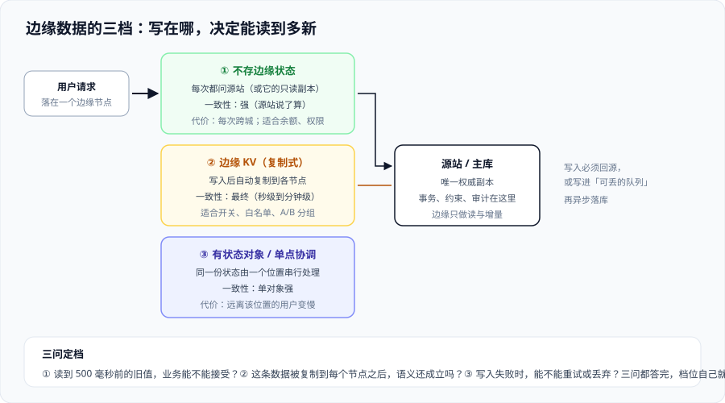

# 边缘数据与状态

边缘函数默认是**无状态的**：同一个函数在不同节点、不同实例上并发执行，上一次请求留下的变量不会留给下一次。想在边缘「记住点东西」，就必须显式选择一种数据形态——而每一种形态都在拿一致性换延迟。

一句话定位：**把「边缘能不能存数据」这个问题换算成「能接受多旧的读」和「能接受多慢的写」。** 适用于要在边缘做开关下发、A/B、频次限制、会话粘性、热点计数的人。



## 一、先分清三样东西

「边缘上有数据」在工程上其实是三件不同的事，混着说必然出事故：

| 形态 | 本质 | 会不会过期 | 能不能写 |
| --- | --- | --- | --- |
| **缓存** | 响应的副本 | 会（TTL / 失效） | 不直接写，靠回源与刷新 |
| **边缘存储（KV/对象）** | 你自己放进去的数据 | 不会自动过期（除你设 TTL） | 可以写，但**有传播延迟** |
| **有状态对象** | 一个可串行处理请求的实体 | 不会 | 可以写，且**单对象强一致** |

::: danger 最容易混的一处：把「缓存」当成「存储」
把开关、白名单这类「必须准确」的数据放进 CDN 缓存，然后用刷新来更新——这在**没有刷新权限或刷新有配额**的时候会直接变成事故：配置改了，但一部分节点还在用旧值，而这些节点不会被你的刷新覆盖到。正确做法：**要准确就用存储，要快才用缓存**；两者可以并存（存储做权威，缓存做加速），但必须能回答「谁是权威」。
:::

## 二、三档一致性：先选档，再选产品

所有边缘存储产品都能落到这三档里：

| 档 | 读到的可能是什么 | 典型延迟 | 适用 | 不适用 |
| --- | --- | --- | --- | --- |
| **① 回源读** | 最新（源站为权威） | 跨城 RTT + 源站处理 | 余额、权限、库存、任何写后立即读的场景 | 高频读、热门路径 |
| **② 复制式 KV** | 秒级到分钟级前的值 | 本地毫秒级 | 开关、白名单、A/B 分组、静态配置 | 需要「写后立刻读到」的场景 |
| **③ 有状态对象** | 单对象强一致 | 取决于该对象所在地与用户的距离 | 计数器、房间、协作会话、限流桶 | 全球用户都要低延迟的热点计数 |

判据只有三个问题：

1. **读到 500 毫秒前的旧值，业务上能不能接受？**（不能 → ① 或 ③）
2. **这条数据被复制到每个节点之后，语义还成立吗？**（不成立 → ③，因为复制会破坏「唯一性」）
3. **写入失败时能不能重试或丢弃？**（不能丢 → ①；能丢 → 写进队列异步落库）

## 三、写路径：边缘写入必须先回答「谁说了算」

边缘的写入有三种形态，风险完全不同：

| 形态 | 做法 | 代价 | 何时可用 |
| --- | --- | --- | --- |
| **写回源（推荐默认）** | 边缘校验 + 转发给源站，由源站落库 | 一次跨城 RTT | 默认选择。语义最清晰：**源站是唯一权威** |
| **写边缘 KV + 异步同步回源** | 先写边缘，后台任务批量同步 | 同步窗口内数据不一致；失败需要补偿 | 只适用于**可重新生成**的数据（如统计、画像） |
| **写边缘有状态对象** | 由单点串行处理后再落库 | 远地区用户变慢；对象迁移需额外设计 | 需要串行语义（计数器、房间状态） |

::: tip 一条比技术更重要的纪律
**只要涉及钱、库存、权限，边缘一律不做权威写入。** 边缘可以做的是「提前拦住明显非法的请求」（比如签名不对、限流超了），把合法请求交给源站。这样边缘的收益（挡住流量）与风险（改变语义）就被分开了。
:::

## 四、读路径：三种典型模式

1. **缓存旁路（cache-aside）**：边缘先读 KV，没有就回源并把结果写回 KV。注意**写回要设 TTL**，否则一条错数据会被永久保留。
2. **版本号 + 短 TTL**：KV 里存的是「带版本号的数据」，同时用短 TTL 兜底。版本号让「立即失效」成为可能，短 TTL 让「忘记失效」不至于永久错下去。
3. **只读副本 + 回源确认**：KV 只提供「快速答案」，关键判断仍回源确认（例如「是否被加黑」可以从 KV 快速排除大多数请求，但真正的下单仍然去源站查一次完整状态）。

```js
// 伪代码：缓存旁路 + 短 TTL + 显式失效版本（概念示意，不同平台 API 名不同）
export default {
  async fetch(request, env) {
    const key = "feature:checkout:v3";              // 版本号在键里，天然支持「换版本即失效」
    let cfg = await env.EDGE_KV.get(key, "json");
    if (!cfg) {
      const resp = await fetch("https://origin.example.com/config/checkout.json", {
        signal: AbortSignal.timeout(300),           // 显式超时：不可达就走默认值
      });
      if (!resp.ok) return new Response("checkout disabled", { status: 503 });
      cfg = await resp.json();
      await env.EDGE_KV.put(key, JSON.stringify(cfg), { expirationTtl: 300 });
    }
    return new Response(JSON.stringify(cfg), { headers: { "content-type": "application/json" } });
  },
};
```

这段示意里有三条被刻意写出来的东西：**超时**（没有它就等着上游抖动拖垮边缘）、**回写时设 TTL**（防止错数据永久驻留）、**版本号进键**（让「立即失效」不依赖平台的刷新能力）。

## 五、失效传播：要等多久，必须量化

复制式存储的「最终一致」不是一个模糊词，它有量级：

| 场景 | 经验量级 | 你要做的决定 |
| --- | --- | --- |
| 同平台内 KV 写入到多数节点可见 | 秒级（官方文档通常给出「数十秒内」的上界） | 关键开关变更后，等这个量级再宣布「已生效」 |
| 跨平台同步（边缘 ↔ 源站） | 分钟级，取决于你的同步任务周期 | 同步任务的延迟要写进 SLO |
| 有状态对象迁移 | 不适用（对象本身不迁移，请求被路由过去） | 用「就远用户变慢」换「语义简单」，要提前评估用户分布 |

::: danger 三个「以为已经生效」的场景
1. **限流开关关掉了，但用户还在被拦**：复制式存储的旧值还在部分节点生效。正确做法：把「变更后的观察窗口」写进操作手册，不要在产品里承诺「立即」。
2. **A/B 分组改了，但一部分用户仍落在旧组**：分组标识写在 KV 里且被缓存。正确做法：分组逻辑设计成**由用户标识确定性计算**（哈希取模），而不是查表——查表会把一致性问题带进业务。
3. **黑名单加了但没生效**：安全类数据不应用复制式存储作为唯一依据。正确做法：**安全判定回源**，KV 只作为「快速拒绝」的加速层。
:::

## 六、把边缘数据写进设计文档的最小结构

| 项 | 要回答的问题 |
| --- | --- |
| 权威来源 | 这条数据最终由谁决定？源站、边缘，还是两者（读边缘写源站） |
| 一致性档位 | ① / ② / ③，以及「能接受多旧」的具体数值 |
| 失效方式 | TTL 多长、是否主动失效、失效后预计多久全网生效 |
| 写入路径 | 写回源 / 写 KV 异步同步 / 写有状态对象，失败如何补偿 |
| 降级行为 | 存储不可达时：回源、用默认值，还是拒绝服务 |

这一张表填完，边缘数据的设计就基本没有留给临场的空间了。

## 七、易错点与最佳实践

::: danger 六个坑
1. **边缘 KV 写回时忘记设 TTL**：一次错误回源的结果会被永久保留。正确做法：**所有缓存式写入都必须有 TTL**，且 TTL 要写进代码而不是留在默认值里。
2. **把用户 ID 当 KV 的键**：键基数爆炸 → 存储成本与延迟同时上升，而且写入量会打满配额。正确做法：键设计成**低基数**（按地区、按等级、按桶），个人化逻辑放回源站。
3. **模块级变量当缓存**：实例被回收后变量消失，行为随流量波动。正确做法：需要跨调用保留的状态放 KV。
4. **写入不幂等**：边缘重试很常见，重复写会放大副作用。正确做法：写入带幂等键（如请求 ID + 业务键）。
5. **把「读写延迟」当成唯一指标**：复制式存储真正的风险是**读到旧值**，而不是慢。正确做法：监控「配置变更到生效」的时延，而不是只看 P95 读延迟。
6. **没有「存储全挂」的预案**：KV 不可达时边缘代码抛异常，用户看到 5xx。正确做法：所有读取都必须有明确的失败分支（默认值、回源、拒绝）。
:::

::: tip 三条实践
- **把开关类数据设计成「带版本号的不可变对象」**：每次变更生成新版本，读方按版本读，天然规避一致性问题，也让回滚变得简单。
- **给边缘数据加一条「权威对比」巡检**：定期抽样比对边缘与源站的取值，差异要能被发现，而不是等用户举报。
- **限流与风控放边缘的「快速层」，最终裁决放源站**：这是唯一能同时拿到性能与正确性的组合。
:::

## 八、验证方式

```shell
# 1) 确认边缘数据读取路径是否生效（观察是否带上你的数据版本标记）
curl -sI https://www.example.com/api/config | grep -i 'x-data-version'

# 2) 验证「变更后的传播时间」：改一次开关，按时间点连续观察
for i in $(seq 1 10); do curl -s https://www.example.com/api/config | sha1sum; sleep 10; done
# 期望：能观察到「第 N 次开始全部为新值」，这个 N×10 秒就是你的传播窗口

# 3) 验证降级分支：把存储不可达时的行为压出来（例如临时改掉上游地址）
curl -s -o /dev/null -w "%{http_code}\n" https://www.example.com/api/config
# 期望：返回你设计的默认值或明确的状态码，而不是 5xx

# 4) 验证写入幂等：同一请求重复提交两次
curl -s -X POST https://www.example.com/api/events -H 'x-idempotency-key: test-001' -d '{}'
curl -s -X POST https://www.example.com/api/events -H 'x-idempotency-key: test-001' -d '{}'
# 期望：第二次不产生重复副作用
```

| 观察 | 结论 |
| --- | --- |
| 第 2 步传播窗口远大于预期 | 你的同步任务周期或 TTL 比设计值大，去核对配置 |
| 第 3 步返回 5xx | 降级分支缺失，这是上线前必须补的 |
| 第 4 步产生两条记录 | 写入不幂等，重复投递会放大副作用 |
| 第 1 步看不到版本标记 | 边缘没有读到你写的数据，键或命名空间配置错了 |

## 九、参考资料

- Cloudflare Workers KV 文档（最终一致性与传播时间说明）：https://developers.cloudflare.com/kv/
- Cloudflare Durable Objects 文档（有状态对象与一致性）：https://developers.cloudflare.com/durable-objects/
- Fastly KV Store 与 Config Store：https://www.fastly.com/products/edge-data
- 腾讯云 EdgeOne · Edge KV 与边缘存储能力：https://cloud.tencent.com/document/product/1552
- 本专题相邻页：[边缘计算与边缘函数](../EdgeCompute/index.md)、[性能与成本](../PerformanceCost/index.md)
