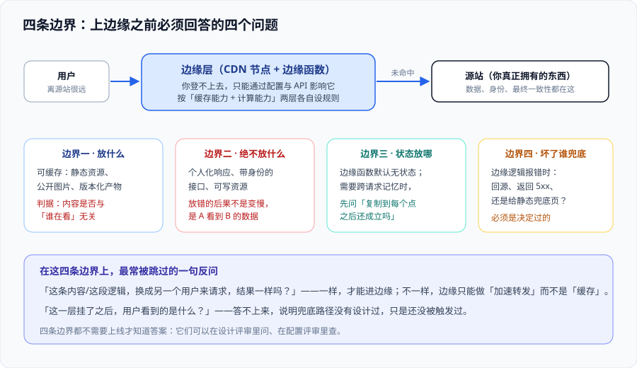

# 总览：边缘与 CDN 的四条边界

边缘这件事的上手成本很低：填一个域名、等证书签发、刷新一下页面，看起来就「接上 CDN 了」。**真正决定成败的不是接入动作，而是接入之前的四个判断**——放什么、绝不放什么、状态放哪、坏了谁兜底。这一页把这四个判断写成可复述的边界，并给出「先别上边缘」的反面判据。

一句话定位：**在把任何东西搬到离用户更近的位置之前，先回答「它搬过去之后还是不是同一个东西」。** 适用于准备接入 CDN、准备在边缘跑逻辑、或者已经在跑但说不清「命中了没有」的人。



## 一、先分清三个被混着说的词

「CDN」「边缘计算」「边缘函数」在会议室里几乎同义，但在工程上分工清楚：

| 词 | 准确含义 | 判据（它能做什么） | 典型代表 |
| --- | --- | --- | --- |
| **CDN（Content Delivery Network，内容分发网络）** | 一组分布在不同位置的反向代理节点，**只负责把内容从近处发出去** | 能按 URL 与请求头决定「发缓存还是回源」 | CloudFront、阿里云 CDN、腾讯云 EdgeOne 的加速部分 |
| **边缘计算（Edge Computing）** | 把这些节点**顺便当成算力**用，在节点上执行你的代码 | 能在请求链路上**改内容、做判断、发子请求** | Cloudflare Workers、Fastly Compute、ESA EdgeRoutine |
| **边缘函数（Edge Function）** | 边缘计算最常见的一种交付形态：**单个函数 + 触发条件** | 能在一个明确的时机（请求前 / 响应后）跑一段有严格限额的代码 | EdgeOne 边缘函数、CloudFront Functions |

三者的关系是**包含**而不是并列：边缘计算 ⊃ 边缘函数；CDN 与边缘计算**共用同一条接入链路**（同一批节点、同一套 TLS、同一套访问日志），所以现实里很少只买其中一个。

::: tip 一句话分清
**CDN 决定「这份内容从哪个城市的哪台机器发出去」，边缘计算决定「这份内容在发出去之前还能不能被改一改」。** 前者是搬东西，后者是搬逻辑。
:::

## 二、四条边界

### 边界一：什么该放上去

判据只有一条，而且必须用一句话回答：**这份响应「换成另一个用户来请求，结果一样吗？」**

| 类型 | 放边缘 | 依据 |
| --- | --- | --- |
| 静态资源（JS / CSS / 字体 / 图标） | ✅ 必放 | 内容与身份无关，且改动通常伴随文件名版本号 |
| 公开图片与视频 | ✅ 放，但注意单对象大小上限 | CDN 缓存对象有上限（CloudFront 512 MB 档、Cloudflare 512 MB / 5 GB 档），超过就得回源或分片 |
| 公开的 HTML 页面 | ✅ 可以放，但要显式声明时效 | 默认缓存 HTML 是事故高发区，见 [缓存策略](../CacheStrategy/index.md) |
| 公开 API 的只读响应 | ⚠️ 谨慎放 | 只有当响应**只由 URL 决定**才能放；带 `Authorization` 的请求原则上不共享缓存 |
| 带身份的接口（购物车、消息、账单） | ❌ 不放 | 共享缓存 + 个性化 = 串号事故 |
| 会写数据的接口 | ❌ 不放 | 幂等性与重试语义会被中间层静默改写 |

### 边界二：什么绝不能放

这条边界的特别之处是：**放错的后果不是「变慢」，而是「错」**。所以它不该靠「注意一下」，而该靠**默认拒绝**：

1. **默认不给 HTML 与 JSON 设公共缓存**，只有显式声明的路径才进缓存；漏配的后果是回源（慢），错配的后果是串号（错）——两者的代价不对称，所以默认值要选代价小的那个。
2. **`Set-Cookie` 与 `Authorization` 是硬信号**：响应里有 `Set-Cookie`、或请求里有 `Authorization`，除非你非常确定，否则不共享缓存。
3. **同一路径不允许两种身份语义**：`/api/user` 一会儿返回匿名数据一会儿返回登录数据，是这个路径最终一定会被缓错的根因。

::: danger 三个最常见的「以为不会发生」
1. **把 `Vary: User-Agent` 当成了「按用户缓存」**：它按「浏览器型号」分桶，不按人分桶——同一个浏览器型号的不同用户仍然共享缓存。正确做法是把身份放进 **缓存键**（见 [缓存策略](../CacheStrategy/index.md) 的缓存键四维度），或在边缘做**鉴权后的定向回源**。
2. **在边缘判断登录态、然后缓存结果**：判断本身没问题，问题是**判断结果进没进缓存键**。没进，就是「先请求的人看到什么，后面所有人都看到什么」。
3. **把 `s-maxage` 与 `max-age` 当成同一件事**：`max-age` 管浏览器，`s-maxage` 管共享缓存（也就是 CDN）。只写 `max-age=60` 时，CDN 常常按自己的默认策略走，你以为了解命中的其实没了解。
:::

### 边界三：状态放哪

边缘函数**默认是无状态的**：同一个函数会在不同节点、不同实例上并发执行，上一个请求的变量不会留给下一个请求（这也是它能做到「无冷启动」的原因）。

需要跨请求记忆时，只有三档选择：

| 做法 | 一致性 | 代价 | 适合什么 |
| --- | --- | --- | --- |
| **不带状态，全部回源** | 强（源站说了算） | 每个请求都跨城 | 需要绝对正确的：余额、库存、权限 |
| **边缘 KV / 缓存式存储** | 最终一致（秒级到分钟级） | 写入后短时间读到旧值 | 配置、开关、A/B 分组、风控名单的「允许名单」 |
| **边缘有状态对象 / 单点协调** | 单对象强一致 | 请求会被**粘到同一个位置**，距远地区用户变慢 | 需要串行化的：计数器、房间、协作会话 |

选哪一档不看技术，看一个问题：**「读到 500 ms 之前的旧值，业务上能不能接受？」** 能，才用中间那档。

### 边界四：坏了谁兜底

边缘层是**你登不上去的一层**，所以「它坏了怎么办」必须提前写成决定，而不是故障当天临场发挥：

| 边缘层的失败形态 | 不设计兜底的后果 | 提前写下的决定 |
| --- | --- | --- |
| 边缘函数报错或 CPU 超限 | 用户看到 5xx，而你的源站完全健康 | **回源兜底**：把这段逻辑设计成「可选加速」，出错即回源（见 [边缘计算](../EdgeCompute/index.md) 的降级路径） |
| 缓存配置写错（全都不缓存） | 性能下降没人发现，账单上升也没人发现 | 命中率告警：**低于阈值就告警**，别等用户投诉 |
| CDN 节点到源站的回源链路抖动 | 表现为「时快时慢」，很难复现 | 源站侧保留**最小可用能力**：CDN 故障时能切直连（DNS 记录别只留一条） |
| 证书续期失败 | 到了续期日整站 TLS 报错 | 证书到期告警（见 [边缘安全](../Security/index.md)） |

::: warning 一句必须纠正的误读
**「接了 CDN 就等于有了容灾」是错的。** 多节点防的是「距离」与「单点网络故障」，它**不防你自己的源站挂掉**：源站不可用时，未命中的请求照样全部失败。容灾档位的问题属于 [备份与容灾](../../BackupDR/index.md)，不要用 CDN 的节点数去回答 RTO。
:::

## 三、一次请求在边缘链路上的完整旅程

把链路写清楚，是为了知道「每一段分别该看哪个数」：

1. **DNS 解析**：权威 DNS 按用户位置（或按策略）返回一个**就近节点**的地址。这一步决定「去哪个城市」，通常也是**最快能改、也最容易被缓存误导**的一跳（改完记录要等 TTL）。
2. **TLS 握手**：在边缘节点终结（证书由平台或被托管）。这一步决定首字节之前的固定开销。
3. **边缘请求处理**：可能先经过 WAF / Bot 判定，再进入边缘函数（如果配了）。
4. **缓存查找**：按**缓存键**（URL + 指定的头 + 指定的查询参数）查本地缓存。命中 → 直接返回；未命中 → 进入下一步。
5. **回源（或逐级回源）**：向源站或**上层缓存**取内容。注意这是链路里**唯一会打到你自己机器**的一跳，也是「回源比」这个指标的分子。
6. **响应处理与写回缓存**：按 `Cache-Control` / `s-maxage` 等决定能不能存、存多久。

每一段的判据不同，混着看就会得出错误结论：

| 现象 | 该看哪一段 | 常见误判 |
| --- | --- | --- |
| 首屏慢但服务器很闲 | 第 2~4 段（握手与缓存查找） | 误以为是「源站性能问题」而扩容 |
| 源站负载没降下来 | 第 4~5 段（缓存键命中率、回源比） | 误以为是「CDN 没生效」，其实是缓存键把命中打散了 |
| 内容改了但用户看到旧的 | 第 6 段（存多久、怎么失效） | 误以为是「CDN 缓存坏了」，其实是自己设了长 TTL |

## 四、什么内容适合、什么不适合

| 场景 | 结论 | 依据 |
| --- | --- | --- |
| 纯静态站点 / 文档站 | 非常适合，收益最大 | 内容与身份无关，且可版本化 |
| 图片、视频、字体等大体积静态资源 | 非常适合 | 单位成本下降最明显 |
| 公开的商品列表、文章详情（可容忍秒级旧值） | 适合 | 用短 TTL + `stale-while-revalidate` |
| 登录态页面（订单、消息、后台） | 不适合缓存，但适合**加速转发** | 边缘只做 TLS 终结与就近接入，缓存绕过 |
| 支付、库存、券码核销 | 不适合 | 一致性要求高于延迟要求 |
| 实时协作（WebSocket / SSE） | 视平台而定 | 部分平台（如 ESA）不支持 WebSocket 接入，这是**可行性**问题而非性能问题 |
| 图片实时处理（缩放、水印、格式转换） | 适合，但受 CPU 与内存限额硬约束 | 见 [边缘计算](../EdgeCompute/index.md) 的限额对照与「什么时候该放回源站」 |

## 五、什么时候不需要做到这个程度

边缘不是必需品。下面五种情况，**先别上**：

1. **用户与源站在同一个城市、同一张网内**（内部系统、区域业务）：省下的是几毫秒，赔上的是可观测性与运维面。
2. **日请求量很小、出口带宽不贵**：CDN 的价值随流量放大，小流量下它只是一层新的故障面。
3. **内容几乎全是个人化且不可缓存**：那就只剩「就近接入」的收益，往往不值得引入一整层配置管理。
4. **团队还没有可信的监控**：边缘层是**你看不见的一层**，没有命中率与回源比，接上去等于把性能与成本一起交给运气。
5. **合规要求数据不得离开特定地域**：节点分布与数据落地的关系要先确认，这不是配置项能解决的。

::: tip 一句话总结这一节
**边缘层的收益是「省距离」，代价是「看不见」。** 当省下的距离（延迟、带宽、源站压力）仍然大于「看不见」带来的风险时，才值得上。
:::

## 六、最小起步三步

1. **先量基线**：在接入之前，采一次 TTFB（首字节时间）与源站出口带宽，按**内容类型分开**记录（HTML / JS / 图片 / 接口各一组）。没有基线，后面所有「快了没」都是感觉。
2. **只接静态资源**：把 `assets/`、`static/` 一类路径先接上去，TTL 设为长（如 30 天），文件名带内容哈希。这一步的目标不是「快」，而是**把命中率与回源比这两个数采起来**。
3. **加一条命中率告警**：例如「命中率低于 80% 持续 10 分钟」告警。这条告警的价值不在告警本身，而在于**它会逼你把缓存键与 TTL 看一遍**。

## 七、术语对齐表

| 术语 | 含义 | 容易混的地方 |
| --- | --- | --- |
| **回源（origin fetch）** | 边缘节点向上游取内容的动作 | 与「回源比」不是一个概念，后者是比率指标 |
| **回源比 / 回源率** | 回源请求数 ÷ 总请求数（= 1 − 命中率的近似） | 各平台定义可能含「回源状态码」过滤，跨平台对比前先看定义 |
| **命中率（hit ratio）** | 由边缘直接返回的比例 | 有的平台把「边缘 4xx 短路」也算命中，口径必须写下来 |
| **边缘节点 / PoP** | Point of Presence，边缘机房 | 「节点数多」不等于「你这里快」，要看**你的用户分布** |
| **缓存键（cache key）** | 判定「两次请求是不是同一份内容」的输入 | 缓存键里少写一个头，就会出现「改了不生效」或「串号」 |
| **失效 / 刷新（purge / invalidate）** | 主动删除缓存内容 | 「刷新」在各平台的含义不同（有的只删单节点，有的是全网） |
| **签名 URL / Token** | 带时效凭证的访问地址 | 凭证进入 URL 后，缓存键会把它算进去，必须显式剥离 |

## 八、易错点与最佳实践

::: danger 五个高频错误，逐条给出正确写法
1. **把 CDN 当成「源站的备份」**：源站挂掉时未命中请求全部失败。正确做法：DNS 保留一条可切直连的记录，并把「切直连」写成演练过的动作。
2. **不区分的默认 TTL**：全站设一个 `max-age=3600`，HTML 与带哈希的 JS 一视同仁。正确做法：**按内容变化频率分组设 TTL**（见 [缓存策略](../CacheStrategy/index.md)）。
3. **在边缘函数里调用自己的源站接口**：多一次跨城往返，延迟比直接把请求交给源站更差，还容易形成环。正确做法：边缘只做「不需要它的逻辑」，需要数据的走**子请求到上游**并设短超时。
4. **只按 `curl` 一次来判断缓存是否生效**：单次请求可能落到未预热节点。正确做法：**连续请求同一 URL，看第二次的响应头**（`Age` 递增、`Cache-Status` 命中）。
5. **边缘函数没有超时与回退**：一次外部依赖抖动就把自己的边缘层变成 5xx 工厂。正确做法：给所有子请求设**显式超时**，并约定「超时即回源」或「超时即返回兜底内容」。
:::

::: tip 三条值得先做的实践
- **把「缓存策略」写成表而不是散在配置里**：路径模式、TTL、缓存键、失效方式四列，改之前先看表。
- **同一条内容只允许一个权威来源**：要么源站定 TTL，要么边缘定 TTL，不要两处都设（冲突时你会花半天确认「谁生效了」）。
- **给边缘逻辑写「关掉它会怎样」**：这一句写不出来，说明边缘里塞了不可替代的东西，那是设计问题，不是运维问题。
:::

## 九、验证方式

以下命令在**接入之后**执行，用来证明「边缘这一层真的在工作」。它们与平台无关（只看标准响应头）：

```shell
# 1) 缓存是否命中：同一 URL 连续请求两次，看第二次的 Age 与缓存状态头
curl -sI https://example.com/assets/app.9f2c1a.js | grep -i -E 'age|cache-status|x-cache|cf-cache-status'
curl -sI https://example.com/assets/app.9f2c1a.js | grep -i -E 'age|cache-status|x-cache|cf-cache-status'
# 期望：第二次的 Age 增大（或命中标志出现）；两次 Age 都是 0 说明没命中

# 2) 回源是否真的发生了：直接请求源站地址，比对响应头
curl -sI https://origin.example.com/assets/app.9f2c1a.js | grep -i -E 'age|cache-control'
# 期望：源站响应里没有 CDN 的缓存状态头（它没经过边缘），Cache-Control 与边缘侧一致

# 3) 缓存键是否正确：带不同查询参数请求，确认没有互相污染
curl -sI 'https://example.com/api/items?page=1' | grep -i -E 'x-cache|age'
curl -sI 'https://example.com/api/items?page=2' | grep -i -E 'x-cache|age'
# 期望：两条互不影响；若 page=2 命中了 page=1 的缓存，说明查询参数没进缓存键

# 4) 边缘函数是否生效：请求一个由边缘注入的头
curl -sI https://example.com/ | grep -i 'x-edge-'
# 期望：能看到你注入的标记；看不到说明函数没绑到这条路由
```

三种结果的判读：

| 观察 | 结论 |
| --- | --- |
| 第二次请求 `Age` 递增，且带命中标志 | 缓存生效，且命中的是**同一节点** |
| 两次 `Age` 都是 0 或都很小 | 没有命中：先查缓存键（是不是被某个头或参数打散），再查 TTL 是否被 0 覆盖 |
| 命中率很高但用户看到旧内容 | 不是「没生效」而是「生效得太久」：去查 [缓存策略](../CacheStrategy/index.md) 的失效流程 |

## 十、参考资料

- 本专题的目录与专题地图：[边缘计算与 CDN](../index.md)
- 命中率与回源比的口径：[CDN 原理：从调度到回源](../CDNPrinciple/index.md)
- 缓存键与时效的完整写法：[缓存策略：键、时效与失效](../CacheStrategy/index.md)
- 边缘函数的限额与降级：[边缘计算与边缘函数](../EdgeCompute/index.md)
- 容灾档位（为什么 CDN 不算容灾）：[备份与容灾](../../BackupDR/index.md)
- RFC 9111 · HTTP Caching：https://www.rfc-editor.org/rfc/rfc9111
- MDN · HTTP 缓存（`Cache-Control` 语义速查）：https://developer.mozilla.org/zh-CN/docs/Web/HTTP/Guides/Caching
