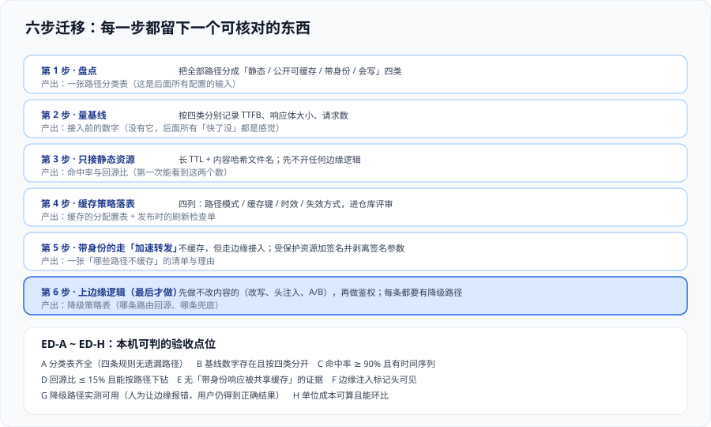

# 实战：把一个站点与 API 迁到边缘

前面几页讲了判据，这一页把它们串成一次可执行的迁移：**一个文档站（纯静态）+ 一个只读商品接口（公开、可缓存）**，从直连迁到「静态走长缓存 + 接口走短缓存 + 少量边缘逻辑」。每一步都有可核对的产出，最后给出 `ED-A ~ ED-H` 八条验收判据。

一句话定位：**这份实战的目标不是「迁上去」，而是「迁上去之后能证明它是按设计工作的」。** 适用于第一次接 CDN、或接了但说不清命中率的团队。



## 一、目标系统与边界

| 项 | 内容 |
| --- | --- |
| 站点 | 文档站，纯静态产物（HTML + JS + CSS + 图片），构建时输出带哈希的文件名 |
| 接口 | `GET /api/items?page=N`，公开只读，允许 60 秒旧值 |
| 不迁移 | 登录、购物车、下单等带身份或写操作的路径（走「加速转发」，不缓存） |
| 明确不做 | 边缘数据库、边缘鉴权（本期不做，见第八节） |
| 验收目标 | 静态命中率 ≥ 90%、回源比 ≤ 15%、首屏 TTFB 相对基线下降、单位成本可算 |

## 二、第 1 步：盘点——把路径分成四类

这一步的产出是一张表，**后面所有配置都从这张表生成**：

| 类别 | 路径示例 | 缓存策略 | 身份 | 失效方式 |
| --- | --- | --- | --- | --- |
| 静态产物 | `/assets/*`、`/img/*` | `public, max-age=31536000, immutable` | 无 | 换文件名，不刷新 |
| 静态入口 | `/`、`/guide/*.html` | `public, s-maxage=60, stale-while-revalidate=300` | 无 | 发布后刷新一次 |
| 公开接口 | `/api/items` | `public, s-maxage=60` | 无 | 短 TTL，必要时刷新 |
| 带身份 / 写 | `/api/me`、`/api/cart`、`/api/order` | `no-store`（边缘只做转发） | 有 | 不适用 |
| 私有资源 | `/files/*.pdf` | 签名 URL，剥离签名参数后缓存 | 有（签名） | 签名过期即失效 |

::: danger 盘点最容易漏的三类路径
1. **健康检查与探针路径**（`/healthz`、`/metrics`）：它们通常在防火墙后，但一旦被 CDN 缓存，你的监控就会读到缓存里的旧状态。
2. **静态站点生成器顺带产出的路径**（`/sitemap.xml`、`/robots.txt`、`/404.html`）：前两个需要短 TTL，第三个需要正确状态码。
3. **接口的「空结果」形态**（`/api/items?page=9999`）：如果 404 被当作可缓存，页面的空状态会被固化下来。
:::

## 三、第 2 步：量基线（接入前必须做）

按四类分别记录，至少记录三项：**TTFB、响应体大小、请求数**。

```shell
# 逐类采样：静态产物 / 入口 HTML / 公开接口 / 带身份接口
for u in \
  "https://origin.example.com/assets/app.9f2c1a.js" \
  "https://origin.example.com/" \
  "https://origin.example.com/api/items?page=1" \
  "https://origin.example.com/api/me" ; do
  curl -s -o /dev/null -w "%{url_effective} ttfb=%{time_starttransfer} size=%{size_download}\n" "$u"
done
```

把结果写进一张表（下面是一份示例的**格式**，数字要换成你自己的实测值）：

| 类别 | TTFB 基线 | 响应体 | 备注 |
| --- | --- | --- | --- |
| 静态产物 | 待填 | 待填 | 通常最大，也是收益最大的一类 |
| 入口 HTML | 待填 | 待填 | 决定首屏，不能用长 TTL |
| 公开接口 | 待填 | 待填 | 注意响应体随分页变化 |
| 带身份接口 | 待填 | 待填 | 只作为「不缓存」的对照 |

::: tip 为什么必须在接入前做
接入之后你再也拿不到「没有 CDN 时用户侧的真实延迟」——所有测量都会经过边缘。基线是唯一的对照组。
:::

## 四、第 3 步：只接静态资源

先只接 `/assets/*` 与 `/img/*`，TTL 设为一年（因为文件名带哈希）。这一步**不加任何边缘逻辑**，目的只有一个：把命中率与回源比采起来。

```shell
# 接入后连续请求两次，确认第二次命中
curl -sI https://www.example.com/assets/app.9f2c1a.js | grep -Ei 'age|cache-status|x-cache|cf-cache-status'
curl -sI https://www.example.com/assets/app.9f2c1a.js | grep -Ei 'age|cache-status|x-cache|cf-cache-status'
```

验收：**第二次请求的 `Age` 大于第一次**（或出现命中标志）。

## 五、第 4 步：缓存策略落表

把第二步的四列表变成仓库里的一份配置文件或文档，并明确**谁优先**（源站响应头还是平台规则）。最小可用形态：

```yaml
# cache-policy.yaml —— 缓存的「单一事实来源」（示意；字段名按平台文档填写）
rules:
  - match: "/assets/*"
    cache_key: [host, path]                       # 不带查询参数，追踪参数一律忽略
    ttl: 31536000
    stale_while_revalidate: 0
  - match: "/img/*"
    cache_key: [host, path]
    ttl: 31536000
  - match: "/guide/*.html"
    cache_key: [host, path]
    ttl: 60
    stale_while_revalidate: 300
  - match: "/api/items"
    cache_key: [host, path, query:page]           # 只有 page 参与缓存键
    ttl: 60
  - match: [ "/api/me", "/api/cart", "/api/order" ]
    bypass_cache: true                            # 只做加速转发
  - match: "/files/*"
    cache_key: [host, path]                       # 签名参数不参与缓存键
    ttl: 300
```

三条纪律写在这份文件旁边：

1. **`/assets/*` 的键里没有查询参数**：追踪参数不会打散缓存。
2. **`/api/items` 的键里只有 `page`**：`utm_*`、时间戳一律无效。
3. **`/files/*` 的签名参数不参与键**：否则每个链接都是新键，命中率为零。

## 六、第 5 步：带身份的路径走「加速转发」

对这些路径**不缓存**，但保留边缘接入带来的收益（就近 TLS 终结、协议优化、WAF）。要点：

- 明确把 `Authorization`、`Set-Cookie` 视为**不进共享缓存**的硬信号。
- 受保护资源的签名参数，在缓存键里剥离。
- 若确实需要按身份区分内容，只允许**低基数**维度（如会员等级）进键，绝不放用户 ID。

## 七、第 6 步：上边缘逻辑（最后一步）

顺序建议：**先做不改内容的，再做改内容的，最后才做鉴权**。

| 顺序 | 逻辑 | 风险 | 降级路径 |
| --- | --- | --- | --- |
| 1 | 注入响应头（安全头、`x-edge-build`） | 极低 | 不适用（失败即不注入） |
| 2 | URL 规范化（去追踪参数、补斜杠） | 低 | 原样放行 |
| 3 | A/B 分组（按确定性哈希） | 中 | 默认进 A 组 |
| 4 | 轻量鉴权（签名校验） | 高 | **回源校验**（不能默认放行） |

第 4 步的降级路径必须选「回源」而不是「放行」——**放行等于关掉鉴权**。这一点与 [边缘计算](../EdgeCompute/index.md) 的两条降级路径一致：安全类逻辑只能选 B（兜底）或回源，绝不能「出错就放行」。

## 八、本期明确不做的四件事

1. **不在边缘做数据写入**：下单、改数量一律回源（见 [边缘数据与状态](../EdgeData/index.md)）。
2. **不用边缘数据库**：接口的数据来自源站，边缘只缓存只读结果。
3. **不做图片实时处理**：交给源站或专门服务，避免踩 CPU 与内存限额。
4. **不追求「零回源」**：回源比目标定在 15% 以内，而不是 0——追求 0 会导致 TTL 过长、失效困难。

## 九、判据：`ED-A ~ ED-H`

八条**本机可判**（不需要平台后台权限），逐条给命令或核对方式：

| 编号 | 判据 | 怎么判 |
| --- | --- | --- |
| ED-A | 路径分类表齐全，四条规则无遗漏路径 | 人工核对：站点入口、构建产物、接口清单是否都能对上某一类 |
| ED-B | 基线数字存在，且按四类分开 | 检查基线表四行都填了数（见第三节） |
| ED-C | 静态命中率 ≥ 90%，且**看的是时间序列** | 平台指标页按时间看，不看小时平均值 |
| ED-D | 回源比 ≤ 15%，且能按路径下钻 | 能回答「回源最多的前三条路径是什么」 |
| ED-E | 没有「带身份响应被共享缓存」的证据 | 用两个不同登录态请求同一路径，比对响应体哈希必须不同 |
| ED-F | 边缘注入的标记头可见 | `curl -sI` 能看到 `x-edge-build` 之类的标记 |
| ED-G | 降级路径实测可用 | 人为让边缘逻辑报错，用户仍得到正确结果（回源或兜底页） |
| ED-H | 单位成本可算且能环比 | 按 [性能与成本](../PerformanceCost/index.md) 的公式算一次每千次请求成本 |

::: warning 一条「看起来通过、其实没过」的陷阱
`ED-E` 不能只靠 `curl` 一次来判断：**必须用两个不同的登录态**（两组 Cookie）请求同一路径，再比对响应体哈希。只用一个身份请求，得到「响应一致」的结论毫无意义。
:::

## 十、发布检查单（每次发布都跑一遍）

| # | 动作 | 期望 |
| --- | --- | --- |
| 1 | 构建产物文件名是否带内容哈希 | 是；否则第 2 条失去意义 |
| 2 | 刷新入口 HTML 与配置类响应 | 刷新返回成功，并记录条数或任务 ID |
| 3 | 连续请求入口 HTML 两次 | 第二次内容已是新版本 |
| 4 | 抽查一个接口的 `Cache-Control` | 与缓存策略表一致 |
| 5 | 抽查一个带身份路径 | `no-store` 或绕过缓存 |
| 6 | 看一次单位成本与回源比 | 无异常跳变（跳变通常来自参数打散或爬虫） |

## 十一、易错点与最佳实践

::: danger 六个坑
1. **先接全站再慢慢收紧**：等于把带身份的路径先暴露在共享缓存的风险里。正确顺序：**先静态、再公开接口、最后才碰带身份的路径**。
2. **基线没量就上线**：无法回答「到底快了多少」。正确做法：接入前必须量一次。
3. **发布流程里没有「刷新」这一步**：表现为「改了要等半小时」。正确做法：把刷新写进发布脚本并记录返回值。
4. **降级路径选了「放行」**：鉴权失败时放行等于关掉鉴权。正确做法：安全类逻辑出错时**回源**。
5. **只在一个网络环境里验证**：`Age` 与命中判断都可能因节点而异。正确做法：至少换一次网络（手机热点）复验。
6. **上线后不再复核分类表**：新增路径不会自动进入你的表，默认行为可能是「可缓存」。正确做法：把「新增路径归类」写进开发流程。
:::

::: tip 三条实践
- **给每条缓存规则写一行「为什么」**：例如「`/files/*` 剥离签名参数是因为每个链接的签名都不同」。三个月后这行字能救一次事故。
- **把边缘标记头当成永久设施**：它成本为零，却是排查「请求到底过没过边缘」的唯一手段。
- **第一次上线先只放一小部分流量**（按地域或按路径），确认无异常再全量。
:::

## 十二、参考资料

- 本专题的边界与判据：[总览：边缘与 CDN 的四条边界](../Overview/index.md)
- 缓存策略的四列表与命令：[缓存策略：键、时效与失效](../CacheStrategy/index.md)
- 边缘逻辑的限额与降级：[边缘计算与边缘函数](../EdgeCompute/index.md)
- 成本公式与单位成本口径：[性能与成本](../PerformanceCost/index.md)
- 交付验收的通用做法：[完整项目交付 · 一键部署与上线验收](/docs/Others/ProjectDelivery/Delivery/index.md)
- RFC 9111 · HTTP Caching：https://www.rfc-editor.org/rfc/rfc9111
