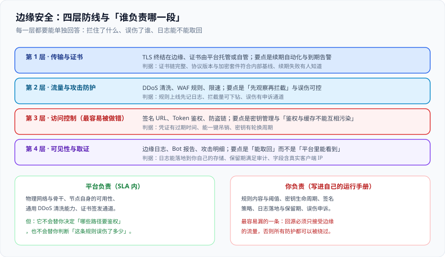

# 边缘安全

边缘是唯一能在**流量进入你机房之前**做判断的位置，所以安全能力天然应该放在这里。但边缘安全有一处与常规安全完全不同的约束：**你看不到那颗 CPU，也看不到那份日志**——所有判断都要靠「平台给什么」来决定「你能做什么」。

一句话定位：**把边缘安全的四层防线拆开，每层都回答三个问题——拦住了什么、误伤了谁、日志能不能取回。** 适用于要上线生产流量、要做访问控制、要处理攻击的人。



## 一、第 1 层：传输与证书

| 项 | 关键判断 | 常见错误 |
| --- | --- | --- |
| 证书归属 | 平台托管（自动续期）还是自管（你自己传证书） | 自管却没人盯到期日——到期当天整站 TLS 报错 |
| 协议版本 | 按内部基线禁用弱协议 | 为了兼容老客户端长期开着弱套件 |
| 回源加密 | 边缘到源站是否也走 TLS（很多平台可配「仅 HTTPS 回源」） | 回源是明文，等于内网也暴露内容 |
| 证书覆盖范围 | 通配符还是逐个域名；新增子域是否需要重新签发 | 新加一个子域忘了签，表现为「主站正常、新站报证书错」 |

::: danger 证书这件事只有一条纪律
**必须有一条独立的到期告警，且它的通知渠道与业务告警分开。** 靠平台自动续期是好的，但自动续期失败（验证方式变更、DNS 记录被改、权限被收回）时，你必须比用户先知道。
:::

## 二、第 2 层：流量与攻击防护

DDoS 清洗通常在套餐里、默认开启；**需要你自己做决策的是 WAF 与限速规则**：

| 手段 | 能拦什么 | 上线纪律 |
| --- | --- | --- |
| DDoS 清洗 | 大流量泛洪 | 通常无需配置；但要确认「清洗档位」与业务峰值匹配 |
| WAF 托管规则集 | 常见注入、扫描器特征 | **先日志模式跑一段时间**，统计误伤，再切拦截 |
| 自定义规则 | 你的业务特有攻击面（如撞库、刷券） | 规则要能按路径下钻，避免全站一刀切 |
| 限速 | 单 IP / 单会话的频率 | 阈值按「正常峰值 × 2」设，并在告警里给出触发样例 |
| Bot 管理 | 爬虫与自动化流量 | 明确「哪些 Bot 是你要的」（搜索引擎、监控探针） |

::: tip 「先观察再拦截」不是保守，是正确顺序
一条没有任何观察期的拦截规则，等于把用户当成攻击者试一遍。可用的最小流程是：**日志模式 → 统计命中量与误伤 → 小范围拦截 → 全量拦截**，每一步都留下数字。
:::

## 三、第 3 层：访问控制

这是最容易被做错的一层，因为「鉴权」与「缓存」天生冲突：鉴权要按人判断，缓存要按内容复用。

| 方案 | 做法 | 优点 | 风险点 |
| --- | --- | --- | --- |
| **签名 URL** | URL 里带签名与过期时间（由源站或边缘签发） | 无需共享 Cookie，适合 CDN 私有资源、下载链接 | 签名参数会进入缓存键，必须显式剥离；链接一旦泄漏在有期内都有效 |
| **Token 鉴权（边缘校验）** | 边缘校验 JWT 或自定义 Token 的签名与过期 | 拦截在边缘，源站压力小 | 密钥要能轮换；时钟偏差要留容差；**鉴权结果若被缓存，等于没鉴权** |
| **防盗链（Referer / Origin 校验）** | 校验来源页 | 实现简单 | Referer 可伪造、可被隐私策略剥离，只能当「减噪」不能当「防线」 |
| **Cookie + 边缘判断** | 边缘读 Cookie 决定放行与否 | 与现有登录体系一致 | Cookie 不能进共享缓存键；要防止「登录后拿到的是匿名缓存」 |

::: danger 三个会「静默失效」的鉴权实现
1. **鉴权通过后把响应缓存起来**：第二个未登录用户命中同一份缓存，直接拿到内容。正确做法：鉴权结果要么进**低基数缓存键**，要么该路径**不缓存**。
2. **签名参数包含在缓存键里**：每个用户的签名不同 → 命中率归零，私有资源全部回源，CDN 变成昂贵的转发器。正确做法：**规范化 URL 时剥离签名参数**，或按「剥离后路径」做键。
3. **密钥写死在边缘代码或配置里且从不轮换**：一旦泄漏，无法只吊销一个入口。正确做法：用平台密钥能力 + 支持**双密钥并存**的轮换方案（新钥上线 → 旧钥继续验证一段时间 → 下线旧钥）。
:::

## 四、第 4 层：可见性与取证

边缘安全的另一半价值在**事后**：攻击发生时，你至少要知道「打了什么、从哪里来、拦掉了多少」。

| 需求 | 平台通常能给 | 你要做的 |
| --- | --- | --- |
| 攻击量与时序 | 边缘访问日志与安全事件 | 落地到你自己的存储（对象存储 + 查询引擎），别只留在平台控制台 |
| 真实客户端 IP | 特定请求头（`X-Forwarded-For` 等） | 在源站侧只信任边缘写入的那一段，**不要直接信任客户端传的同名头** |
| 拦截明细 | WAF 事件（含规则 ID 与匹配内容片段） | 保留足够长的窗口（与审计要求对齐），便于回溯误伤 |
| Bot 流量结构 | Bot 分类与路径分布 | 定期复核「被拦的 Bot 里有没有你自己的探针」 |

::: warning 一条最容易踩的取证坑
**源站看到的 IP 可能是边缘节点的 IP。** 如果你的源站直接解析 `X-Forwarded-For` 的第一个值，攻击者只要自己伪造这个头就能把日志写成任意 IP。正确做法：**只信任边缘注入的那一段**（通常是最后一个，或平台专有的头），并把源站配置成只接受边缘回源网段。
:::

## 五、回源保护：让边缘成为唯一入口

这一条独立成节，因为它是**前四层全部生效的前提**：

1. **源站只放行边缘的回源出口网段**（安全组 / 防火墙 / 平台提供的私网连接）。
2. **源站校验回源标识**（共享密钥头、mTLS，视平台能力）。
3. **源站解析记录不对公网暴露**（不要用 `origin.example.com` 直接对外解析）。
4. **定期验证**：从外部网络直接请求源站地址，**期望被拒绝**。这条要写进巡检，因为配置漂移会让它悄悄失效。

## 六、上线自查清单

| # | 项 | 通过标准 |
| --- | --- | --- |
| S1 | 证书续期与到期告警 | 有一条独立告警，且有明确的接收人 |
| S2 | 回源加密 | 边缘到源站全程 TLS，或走私网 |
| S3 | 源站只接受边缘流量 | 从外部直连源站地址被拒绝（已实测并留档） |
| S4 | WAF 规则 | 有观察期的记录，以及当前的拦截量 |
| S5 | 限速阈值 | 阈值有依据（正常峰值 × 2），并有人复核 |
| S6 | 鉴权与缓存的关系 | 每个受保护路径都写明了「进缓存键 / 不缓存」 |
| S7 | 密钥管理 | 有轮换周期与吊销路径，支持双密钥并存 |
| S8 | 日志落地 | 日志已进入自己的存储，保留期满足审计要求 |
| S9 | 真实客户端 IP | 源站只信任边缘注入的头部 |
| S10 | 误伤处置 | 有反馈渠道与快速放行/回滚流程 |

## 七、易错点与最佳实践

::: danger 六个坑
1. **把防盗链当防线**：`Referer` 可伪造。正确做法：私有资源用签名 URL，防盗链只用来减少无意义流量。
2. **在边缘做「永久有效」的访问凭证**：泄漏即永久泄漏。正确做法：凭证一律带过期时间，且过期时间越短越好（配合边缘校验的低成本）。
3. **WAF 规则直接切拦截**：误伤会先于攻击被发现。正确做法：先日志模式跑一段，用数据决定是否拦截。
4. **只信任平台控制台里的日志**：控制台有保留期与查询限制，事故复盘时往往已经过期。正确做法：日志落地到自己的存储。
5. **源站同时对外开放**：所有防护都可以绕过。正确做法：源站只接受边缘回源，且把这条做成可自动巡检的项。
6. **给静态资源加签名后忘了缓存键**：命中率归零且账单翻倍。正确做法：剥离签名参数后再算缓存键。
:::

::: tip 三条实践
- **把「谁能访问这个路径」写成表**（路径模式 × 是否需要身份 × 缓存策略 × 鉴权方式），规则从表里生成而不是在控制台里点。
- **给安全规则加上「最近一次变更」的时间标记**，事故时能一眼看出「是不是刚改过」。
- **每季度做一次「绕过验证」**：从外部直连源站、尝试无签名访问受保护资源，确认都失败。
:::

## 八、验证方式

```shell
# 1) 证书与协议基线
echo | openssl s_client -connect www.example.com:443 -servername www.example.com 2>/dev/null | openssl x509 -noout -dates -issuer
# 期望：notAfter 在告警覆盖范围内；issuer 是你预期的签发者

# 2) 源站是否真的只接受边缘回源（从外部直连源站地址，期望被拒绝）
curl -s -o /dev/null -w "%{http_code}\n" --max-time 5 https://origin.example.com/
# 期望：连接被拒绝 / 超时，而不是 200

# 3) 受保护资源是否真的需要签名
curl -s -o /dev/null -w "%{http_code}\n" https://www.example.com/private/file.pdf
# 期望：403（无签名），而不是 200

# 4) 真实客户端 IP 是否可信（观察源站收到的头）
curl -s -H 'X-Forwarded-For: 1.2.3.4' https://www.example.com/whoami
# 期望：源头来自边缘的注入，而不是 1.2.3.4（若返回 1.2.3.4 说明源站信任了客户端伪造值）

# 5) 安全头是否由边缘统一注入
curl -sI https://www.example.com/ | grep -Ei 'strict-transport-security|content-security-policy|x-content-type-options'
```

| 观察 | 结论 |
| --- | --- |
| 第 2 步返回 200 | 源站可被绕过——**最高优先级修复**，前四层防护此时形同虚设 |
| 第 3 步返回 200 | 受保护资源没有生效鉴权，或签名被缓存绕过 |
| 第 4 步返回伪造 IP | 源站信任了客户端传入的头，日志与风控全部不可信 |
| 第 5 步缺安全头 | 头没由边缘统一下发：改一处要等缓存失效面清，所以一定要统一 |

## 九、参考资料

- OWASP · Web Security Testing Guide（安全头与访问控制的检查项）：https://owasp.org/www-project-web-security-testing-guide/
- RFC 8446 · TLS 1.3：https://www.rfc-editor.org/rfc/rfc8446
- Cloudflare 文档 · WAF 与 Bot 管理：https://developers.cloudflare.com/waf/
- 腾讯云 EdgeOne · 安全防护（DDoS、WAF、Bot）：https://cloud.tencent.com/document/product/1552
- 阿里云 ESA · 安全加速能力：https://help.aliyun.com/zh/edge-security-acceleration/
- AWS CloudFront · 签名 URL 与签名 Cookie：https://docs.aws.amazon.com/AmazonCloudFront/latest/DeveloperGuide/PrivateContent.html
- 本专题相邻页：[边缘数据与状态](../EdgeData/index.md)、[常见问题与最佳实践](../FAQ/index.md)
