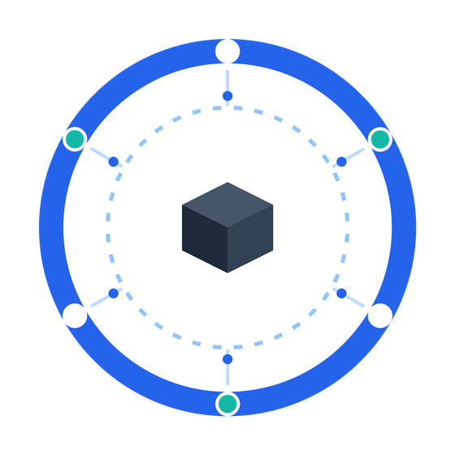
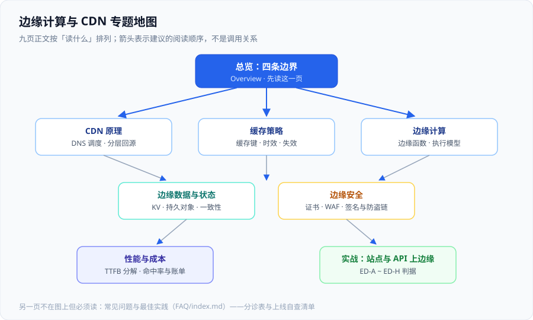

# 边缘计算与 CDN

边缘计算与 CDN 回答的是同一个问题的两面：**当用户离你很远、当源站不能扛下所有请求时，把哪些东西搬到离用户更近的地方去算、去存、去拦。** CDN 解决的是「把静态内容放近」；边缘计算解决的是「把会变的逻辑也放近」。两者共用同一条链路、同一套缓存规则、同一个计费口径，所以必须放在一起讲。

本专题讲的是**位置换了之后，判断标准跟着变的地方**：缓存放在哪一层、失效怎么传播、边缘能跑多重的代码、状态放哪、证书在哪终结、钱按什么维度记。它不讲 HTTP 协议本身（那是 [网络基础](../Network/index.md) 的职责），也不讲单机反向代理的配置写法（那是 [Nginx](../Nginx/index.md) 的职责）。

::: tip 一句话理解
CDN 把「内容离用户多远」从一个物理问题变成了一个**配置问题**；边缘计算把「这段逻辑跑在哪台机器上」也变成了配置问题。代价是：**你再也看不到那台机器**。所以边缘工程的真正难点不是「怎么把东西放上去」，而是**「放上去之后，怎么知道它到底有没有生效」**——本专题每一页都在回答这个「怎么知道」。
:::

## 与相邻专题的分工

「CDN」「边缘」「云原生」「反向代理」四个词经常混着用，边界必须写死：

| 专题 | 讲什么 | 与本专题的关系 |
| --- | --- | --- |
| 本专题 | **位置维度**：调度与回源、缓存策略、边缘函数、边缘数据、边缘安全、性能与成本 | —— |
| [Nginx](../Nginx/index.md) | 单机反向代理的**语法与配置**（`proxy_pass`、`proxy_cache`、`limit_req`） | 那边是**你自己维护的一个进程**，本专题是**租出去的一张网**；`location` 与缓存指令的写法可以互借，但「谁兜底、谁升级、谁背 SLA」完全不同 |
| [网络基础](../Network/index.md) | TCP/IP、DNS、HTTP/HTTPS 的**协议本身** | 协议是普适的；CDN 只是把这些协议**在几百个点上各跑一遍**，多出来的是「一致性」与「可观测性」 |
| [网络基础 · DNS](../Network/Dns/index.md) | DNS 记录类型与解析过程 | CDN 的第一跳是 **DNS 调度**：同一个域名要给不同用户不同答案，本专题只讲这一层多出来的部分 |
| [云上架构](../CloudArchitecture/index.md) | VPC、负载均衡、弹性伸缩、可用区、成本 | 那边回答「**你自己的机房/云账号里怎么摆**」，本专题回答「**摆到别人的网里之后多出什么**」；两页在「入口在哪终结 TLS」处相遇 |
| [云上架构 · 负载均衡](../CloudArchitecture/LoadBalancing/index.md) | 四层/七层分界、健康检查、跨可用区 | 负载均衡选**哪台机器**，CDN 选**哪个城市**；跨区开关与跨城调度是两件事，都不做会得到「多可用区是假的」与「多节点是白付钱」 |
| [云原生 · Serverless](../CloudNative/Serverless/index.md) | 托管运行时的**五层光谱**与冷启动治理 | 那边讲「把服务写成函数」的通用判断，本专题讲「**函数跑到边缘之后**剩下的约束」：CPU 预算、无状态、跨点一致 |
| [云原生 · 函数工程](../CloudNative/FunctionEngineering/index.md) | 函数粒度、幂等、配置与密钥、可观测 | 边缘函数是函数工程的一个**更窄的变体**——限制更硬（见 [边缘计算](./EdgeCompute/index.md) 的限额对照表），所以那页的通用纪律在这里一个都不能省 |
| [前端 · SSR 缓存](../../Frontend/SSR/Caching/index.md) | 服务端渲染的**缓存分层与缓存键** | 渲染与缓存的原理归那边；本专题只多一处：**渲染可以发生在边缘节点上**，随之而来的键设计与失效面变大 |
| [前端 · 资源优化](../../Frontend/Others/PerformanceOptimization/Resources/index.md) | 压缩、图片格式、资源加载顺序 | 那边优化**产物本身**，本专题优化**产物从哪发出去**；两者相乘，不可互替 |
| [前端 · 浏览器缓存](../../Frontend/Basic/Browser/Cache/index.md) | 浏览器端的 `Cache-Control` 语义与强缓存/协商缓存 | 浏览器缓存是链路的**最后一跳**，CDN 是**中间跳**；同一套响应头在不同跳上的含义不同，这是最容易混的一处 |
| [前端 · 安全响应头](../../Frontend/Others/Security/Headers/index.md) | CSP、HSTS、跨域等**响应头语义** | 头的语义归那边；本专题管「**这些头由哪里下发**」——一旦 CDN 缓存了它，改一处要等失效面全清 |
| [网关深入](../../Backend/GatewayDeep/index.md) | 南北向流量的**产品与插件**（路由、灰度、限流） | 网关在你自己的机房、管**东西向之后的南北向**；边缘在你的机房之外，管**进入你机房之前的南北向**——两者是串联关系，判据可互借，配置不可互搬 |
| [安全加固](../SecurityHardening/index.md) | 主机与集群的**加固基线** | 那边加固**你能登上去的机器**，本专题处理**你登不上去的那一层**：TLS 证书、WAF 规则、签名鉴权 |
| [监控告警](../Monitoring/index.md) | 指标模型与告警规则方法论 | 本专题只列**边缘侧该额外采集哪几个数**（命中率、回源比、边缘函数错误与 CPU 超限），方法论不重复 |
| [备份与容灾](../BackupDR/index.md) | 容灾档位与 RTO / RPO | CDN 的「多节点」常被误当成容灾——它防的是**距离**，不防**你自己的源站挂掉**；这处误读的代价写在本专题 [常见问题](./FAQ/index.md) |
| [完整项目交付 · 一键部署](/docs/Others/ProjectDelivery/Delivery/index.md) | 部署与上线验收的标准动作 | 本专题的 [实战](./Practice/index.md) 是它在「有边缘层」时的特例：验收清单要加一条「**边缘上的内容确实换了**」 |

## 专题地图

| 页面 | 内容 | 适合谁读 |
| --- | --- | --- |
| [总览：边缘与 CDN 的四条边界](./Overview/index.md) | 什么该放边缘、什么绝不能放、状态放哪、坏了谁兜底 | 所有人，先读 |
| [CDN 原理：从调度到回源](./CDNPrinciple/index.md) | DNS 调度、就近接入、分层缓存、回源链路与命中率的口径 | 要接 CDN 的人，**重点读** |
| [缓存策略：键、时效与失效](./CacheStrategy/index.md) | 缓存键设计、`Cache-Control` 在中间跳的含义、刷新与失效、诊断手法 | 所有人，**重点读** |
| [边缘计算与边缘函数](./EdgeCompute/index.md) | 执行模型、限额对照、能做什么/不能做什么、与缓存的先后顺序 | 想在边缘跑逻辑的人 |
| [边缘数据与状态](./EdgeData/index.md) | 边缘 KV、有状态对象、一致性权衡、写回源 | 要在边缘读写数据的人 |
| [边缘安全](./Security/index.md) | 证书与续期、WAF 与 Bot、签名 URL、防盗链、日志取回 | 安全与运维 |
| [性能与成本](./PerformanceCost/index.md) | TTFB 分解、命中率与账单的关系、计费维度对照、降本排序 | 负责人与开发 |
| [实战：把一个站点与 API 迁到边缘](./Practice/index.md) | 六步迁移与 `ED-A ~ ED-H` 验收判据，含可执行命令 | 想看完整过程的人 |
| [常见问题与最佳实践](./FAQ/index.md) | 分诊表、高频十二问、上线自查清单、术语表 | 所有人 |

## 事实与规格速览（2026-10 口径）

下表的数字来自**厂商官方文档与计价页**（2026-10 联网核对）。边缘平台的**价格与限额变动非常频繁**，凡涉及预算，请以官方计价页当场核对为准：

| 项 | 当前事实（2026-10） | 对判断的影响 |
| --- | --- | --- |
| Cloudflare Workers 免费版 | **10 万请求/天**、**每次调用 10 ms CPU** | 10 ms 只能做「看一眼请求头改个字段」；鉴权校验、大 JSON 解析、SSR 一定会超 |
| Cloudflare Workers 付费版 | $5/月起，含 **1000 万请求 + 3000 万 CPU 毫秒**；超出 **$0.30/百万请求**、**$0.02/百万 CPU 毫秒** | 计费是**双维度**：请求数是一个账单，CPU 时间是另一个，缓存命中仍算请求但不计 CPU |
| Workers 运行上限 | 单次 CPU 最长 **5 分钟**（默认 30 秒）、内存 **128 MB/isolate**、子请求 **50（免费）/ 10000（付费）**、Worker 包 **64 MiB** | 「无限算力」是错觉；128 MB 决定了在边缘做图片处理与做数据聚合的边界 |
| Cloudflare 缓存对象上限 | **512 MB**（Free / Pro / Business）、**5 GB**（Enterprise） | 大文件（视频、安装包）超过这个数就得回源或改用分片，别把 CDN 当对象存储 |
| AWS CloudFront 网络 | **410+ 个入网点（PoP）** | 「节点数」不是性能指标，**离用户最近的节点有没有缓存**才是 |
| CloudFront 永久免费额度 | 每月 **1 TB 出网 + 1000 万请求 + 200 万次 CloudFront Functions 调用** | 个人与小体量站点可以在免费额度内跑很久，判断成本前先看额度 |
| CloudFront 固定费率套餐 | Free / **Pro $15** / **Business $200** / **Premium $1000**（每个分配一个），含 WAF、DDoS、DNS、证书；2026-03 起支持 Lambda@Edge 与 WAF CAPTCHA | 「把 CDN + WAF + DNS 打包成一个固定价」是省钱还是更贵，取决于你的**流量占比与请求数占比** |
| 边缘函数的两种形态（AWS） | **CloudFront Functions**：只在查看器请求/响应两个时机、无网络访问；**Lambda@Edge**：代码运行在区域边缘缓存，**可以发起出网请求** | 需要调用外部 API 的逻辑放不进 CloudFront Functions——这条限制常被忽略，直到上线才发现 |
| 边缘函数的两种运行时 | **V8 isolate**（Cloudflare、EdgeOne、ESA）与 **WebAssembly**（Fastly Compute，Wasmtime） | isolate 冷启动通常以毫秒计，Wasm 实例化可以到微秒级；两者**并发模型不同**，跑密集计算时的表现也不同 |
| Fastly Compute 的数据能力 | KV Store、Config Store；**没有边缘 SQL 原语** | 「边缘能不能查关系库」的答案通常是「不能，要么预生成，要么回源」 |
| 腾讯云 EdgeOne 边缘函数 | JavaScript；代码包 **5 MB**、请求体 **1 MB**、CPU **200 ms**、内存 **128 MB**；单站点 **100 个函数 / 200 条触发规则** | 200 ms CPU 比 Cloudflare 免费版宽 20 倍，但**仍不是通用计算**；循环 10 万次上限是硬约束 |
| 阿里云 ESA（含 EdgeRoutine） | **3200+ 节点**；仅 JavaScript；**仅 HTTPS**，不支持 WebSocket 与 TCP/UDP | 需要 WebSocket 或 TCP 接入的业务，ESA 这一层直接不可用——选型前先确认协议 |
| 国内两家的计费维度 | EdgeOne 按「**流量 + 请求数**」，ESA 主要按「**流量**」、请求数不限 | 小文件多、请求数大的业务在两种口径下**账单可能差出量级** |
| 缓存相关的标准 | **RFC 9111**（HTTP 缓存）、**RFC 5861**（`stale-while-revalidate` / `stale-if-error`）、**RFC 9211**（`Cache-Status`）、**RFC 8297**（`103 Early Hints`） | 「降级给旧内容」「返回命中与否」都有标准做法；用厂商私有头做判据会把自己锁死 |

::: info 版本组织说明
本专题**不另开版本目录**。CDN 与边缘平台没有破坏性的「主版本」边界：它们的演进以**新功能开关、新的边缘运行时版本、新的限额档位**形式出现，且旧接口长期保留。需要按版本目录组织的是**框架与语言**类主题，仓库里的做法可以直接对照 [Spring5](../../Backend/Java/Frame/Spring/Spring5/index.md) / [Spring6](../../Backend/Java/Frame/Spring/Spring6/index.md) 与 Spring Boot [v2](../../Backend/Java/Frame/SpringBoot/v2/index.md) / [v3](../../Backend/Java/Frame/SpringBoot/v3/index.md) / [v4](../../Backend/Java/Frame/SpringBoot/v4/index.md)——**旧版本一律保留并标注维护状态、不覆盖**。
:::

## 成熟度五档

边缘这件事最容易「上一半」：接入了 CDN，但没人知道命中了没有。按下面五档对照自己：

| 档位 | 特征 | 只补一件事 |
| --- | --- | --- |
| L0 | 源站直连，DNS 里没有 CDN 记录 | 先量一次 TTFB 与出口带宽，作为后面所有对比的基线 |
| L1 | 接了 CDN，静态资源走边缘 | **打开命中率观测**：没有命中率数据的接入，等于把成本与性能一起交给运气 |
| L2 | 按内容类型分别设了缓存策略，能说出「哪一类必须回源」 | 把**失效流程**写成可执行动作（改完内容之后怎么刷、刷多久生效） |
| L3 | 边缘承接了一部分逻辑（鉴权、重定向、改写），并有错误率与 CPU 超限告警 | 给边缘逻辑定**降级路径**：边缘报错时回源还是返回 5xx，必须是决定过的 |
| L4 | 边缘与源站之间有一份可核对的契约（路径、头、缓存键、责任边界），且有定期复核 | 定期做一次「**关掉边缘会怎样**」的推演，避免把 CDN 当成容灾 |

## 学习路径

1. **先读 [总览](./Overview/index.md)**：它给出四条边界与「什么情况下先别上边缘」的反面判据。跳过它会犯最典型的错——把会变、带身份的内容推上去。
2. **接 CDN 的人按顺序读 [CDN 原理](./CDNPrinciple/index.md) → [缓存策略](./CacheStrategy/index.md)**：先知道请求在哪一层被拦住，再谈每一层该存多久。顺序颠倒会写出「TTL 设了但没人知道命没命中」的配置。
3. **想在边缘跑逻辑，先读 [边缘计算与边缘函数](./EdgeCompute/index.md) 的限额表**，再决定这段逻辑放边缘还是放源站——**限额不是优化项，是可行性判据**。
4. **要在边缘读写数据，读 [边缘数据与状态](./EdgeData/index.md)**：一致性、失效传播与「写回源」三件事决定这层数据能不能用。
5. **上线前用 [边缘安全](./Security/index.md) 的清单扫一遍**：证书是谁在续、签名密钥存在哪、日志能不能取回——三问答不上来就不要开生产流量。
6. **负责人读 [性能与成本](./PerformanceCost/index.md)**：命中率、回源比与账单是同一件事的三个侧面。
7. **要完整走一遍，跟 [实战](./Practice/index.md) 的 `ED-A ~ ED-H` 判据**，再用 [常见问题](./FAQ/index.md) 的自查清单收尾。

## 参考资料

- RFC 9111 · HTTP Caching（缓存语义的权威定义，替代原 RFC 7234）：https://www.rfc-editor.org/rfc/rfc9111
- RFC 5861 · HTTP Cache-Control Extensions for Stale Content（`stale-while-revalidate` / `stale-if-error`）：https://www.rfc-editor.org/rfc/rfc5861
- RFC 9211 · The Cache-Status HTTP Response Header Field：https://www.rfc-editor.org/rfc/rfc9211
- RFC 8297 · An HTTP Status Code for Indicating Hints（`103 Early Hints`）：https://www.rfc-editor.org/rfc/rfc8297
- Cloudflare Developers · Workers Limits（CPU、内存、子请求、包体积上限）：https://developers.cloudflare.com/workers/platform/limits/
- Cloudflare Developers · Workers Pricing（请求与 CPU 时间两个计费维度）：https://developers.cloudflare.com/workers/platform/pricing
- Amazon CloudFront 产品与定价（入网点数量、永久免费额度、固定费率套餐）：https://aws.amazon.com/cn/cloudfront/pricing/
- Fastly Compute 文档（Wasm 运行时、KV Store 与 Config Store）：https://www.fastly.com/products/edge-compute
- 腾讯云 EdgeOne · 边缘函数限制与执行费用：https://cloud.tencent.com/document/product/1145/68358
- 阿里云边缘安全加速 ESA · EdgeRoutine 产品说明：https://help.aliyun.com/zh/edge-security-acceleration/
- MDN · HTTP 缓存（面向读者的 `Cache-Control` 语义速查）：https://developer.mozilla.org/zh-CN/docs/Web/HTTP/Guides/Caching
