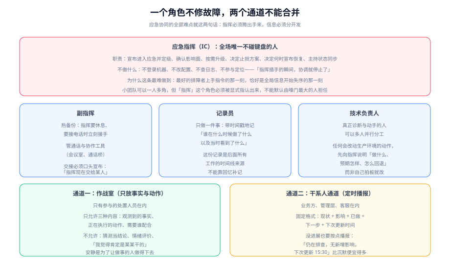

# 应急指挥与协同

应急协同的全部难点可以压缩成两句话：**指挥必须腾出手来，信息必须分开发**。前者是关于「谁动键盘」，后者是关于「谁知道什么」。这两件事做不好，技术能力再强也会在事故里显得笨拙——不是因为修得慢，而是因为**在修的同时还在互相打断**。



## 一句话定位

本页管的是「人怎么组织」。它不重复 [定位与止损](../Diagnosis/index.md) 里的技术动作，也不重复 [值班制度](../OnCall/index.md) 里的排班，只解决一件事：**当超过三个人同时参与处置时，局面怎么不失控**。

::: tip 一句话理解
事故现场最贵的资源不是人的技能，而是**注意力**。指挥的全部工作就是保护处置人员的注意力，代价是自己不碰键盘。
:::

## 五种角色

下面这套角色划分源自应急管理领域成熟的指挥体系（Incident Command System），在软件行业被普遍采用：

| 角色 | 英文 | 职责 | 明确不做 |
| --- | --- | --- | --- |
| **应急指挥** | Incident Commander（IC） | 宣布进入应急、定级、确认影响面、按需升级、决定止损方案、主持状态同步、决定何时宣布恢复 | **不登录机器、不改配置、不查日志、不参与定位** |
| **副指挥** | Deputy | 指挥的热备份：指挥休息、接电话、被占用时立刻接手；管理协作工具与通话 | 不替代技术负责人的技术判断 |
| **记录员** | Scribe | 带时间戳地记录「谁在什么时候做了什么、当时看到了什么」 | 不参与决策，不筛选「重要」信息 |
| **技术负责人** | Ops Lead / SME | 诊断与动手：执行止损、定位根因、准备修复 | 不在未向指挥说明前改动生产环境 |
| **对外联络** | Customer Liaison | 起草并发布对用户的状态更新与公告 | 不自行发布：**每条对外信息都由指挥确认后发出** |
| **对内联络** | Internal Liaison | 对接管理层、法务、财务、客服等干系人 | 不把干系人的追问直接抛进作战室 |

小团队必然一人多角，但有一条底线：**「指挥」这个角色必须被显式指认出来**，哪怕同一个人的头上同时挂着「技术负责人」。指认的动作是口头的、可听见的：

> 「我现在是这次事故的指挥，所有改动前先说一句要做什么。」

如果没有这句话，现场就会退化成「谁声音大谁指挥」，而嗓门大小与判断力无关。

## 最重要的一条：指挥不修故障

这条规则看起来反直觉，值得单独解释。

**不修故障的理由**：指挥一旦打开终端开始查日志，协调就停止了。具体会发生三件事：

1. **状态更新停止**：没有人再对外播报，干系人开始各自找人来问，作战室里开始涌入追问。
2. **决策积压**：技术负责人想回滚，需要有人拍板；但指挥正在看日志，于是技术负责人自己拍了——**所有人同时开始改动生产**。
3. **时间线断裂**：指挥看到的关键细节没有被记录下来，两小时后没人能说清「当时到底做了什么」。

**为什么这条最难做到**：团队里最懂系统的人往往就是被指认为指挥的人；而他有能力直接定位问题，看着别人慢吞吞地查，手会很痒。这不是纪律问题，是**角色设计问题**——正确做法是**把最懂系统的人放在技术负责人的位置上，把指挥交给另一个能掌握全局的人**。

::: danger 注意
三个「看起来无害、实际违反这条规则」的动作：

1. **指挥顺手登录看了一眼监控**——从这一刻起，他的注意力就锚定在具体指标上，对全局的感知开始衰减。
2. **指挥直接给下游厂商打电话**——这本该是对内/对外联络的活；指挥占线时会漏掉内部的升级请求。
3. **指挥自己写状态更新**——和上一条同源，写作会占掉指挥最宝贵的那几分钟。
:::

## 双通道：作战室与干系人通道

信息必须**分开发**，因为两类读者的需求完全相反：

| 通道 | 谁在里面 | 允许的内容 | 不允许的内容 |
| --- | --- | --- | --- |
| **作战室**（Working Channel） | 只有参与处置的人 | 观测到的事实、正在执行的动作、需要谁配合 | 猜测当结论、情绪评价、追责、闲聊 |
| **干系人通道**（Stakeholder Channel） | 业务方、管理层、客服、其他团队 | 定时播报：现状 + 影响 + 已做 + 下一步 + 下次更新 | 未经验证的技术细节、内部责任讨论 |

两条纪律：

- **作战室越安静，处置越快**。一个常见的坏习惯是让业务方进作战室「旁观以了解情况」——他们的存在会让处置人员不自觉地开始解释，而解释的成本是双份注意力的损耗。
- **干系人通道必须定时播报，即使没有进展**。沉默会让干系人自己去猜、自己去问、自己去找人，最终这些追问会以另一种方式回到作战室。

## 状态更新：格式固定，节奏固定

播报不需要文采，需要**可预测**。用固定五段式，任何人在任何时刻都能一眼找到自己要的信息：

```text
[INC-2026-1013-01] SEV-2 更新 #3   15:30
现状：下单接口错误率从 9% 降到 0.6%，成功率回升到 97%
影响：约 12% 的下单请求在 14:20~15:05 之间失败；无资金错误
已做：① 重启异常实例（保留线程栈）② 关闭推荐/榜单两个非核心出口
下一步：① 定位相似商品查询的慢 SQL ② 观察 30 分钟后逐步放回降级
下次更新：16:00（若提前恢复会先发一条「已恢复」）
```

节奏按级别定，**宁可频繁也不可稀疏**：

| 级别 | 对外（干系人）播报节奏 | 备注 |
| --- | --- | --- |
| SEV-1 | 每 15 分钟 | 即使内容与上次完全相同，也要发 |
| SEV-2 | 每 30 分钟 | 恢复时单独发一条「已恢复」 |
| SEV-3 | 每 2 小时 | 进展不大时可以合并 |
| SEV-4/5 | 结单时一次 | 走工单流程 |

::: tip 提示
「没有进展也要按点播报」这条是**干系人通道的核心价值**。一句「仍在排查，影响面未扩大，下次更新 16:00」的信息量看起来是零，实际上它消除了对方 15 分钟内的所有追问——这就是它的价值。
:::

## 指挥的交接

超过两小时的事故，指挥必须换班。交接是**口头宣布**的，且三件事要同时完成：

1. **正式宣布**：「我现在把指挥交给某人」，且新指挥要复述一次当前状态与正在执行的动作为确认。
2. **移交清单**：当前级别、已答应的对外承诺、正在跑的动作、下一步计划、还没解决的问题。
3. **通知两边通道**：作战室与干系人通道都要知道「后面的信息来自新的指挥」。

不宣布的交接是最危险的一种：干系人继续按老指挥的节奏等更新，作战室以为对面还在协调，中间出现一段**没人负责的空窗**。

## 对外沟通：一条许可规则与三条禁区

**许可规则**：所有对外信息（状态页、公告、客服话术）**由指挥确认后发布**。理由不是控制欲，而是防止「未经验证的技术判断」以官方口径流出去——一旦说错了原因，后面要花十倍的成本纠正。

**三条禁区**（写进话术模板里，避免临场发挥）：

| 禁区 | 为什么 | 正确做法 |
| --- | --- | --- |
| **不猜根因** | 说错原因会让用户与客服拿到错误的应对依据 | 只说已确认的事实与影响，原因待确认后再补一条更新 |
| **不甩锅** | 把原因指向某个供应商或某位同事，会让后续协作立刻恶化 | 只描述「我们正在做什么」，责任归属不在对外信息里 |
| **不承诺时间** | 「10 分钟内恢复」一旦不成立，信任的损失远大于「暂不承诺时间」 | 用「下次更新时间」代替「恢复时间」：这两个是完全不同的承诺 |

## 实战：一次 SEV-1 的指挥视角

下面把一次 SEV-1 的前 40 分钟按指挥的动作拆开。**注意指挥在其中的每一步都没有碰过机器**：

| 时刻 | 指挥的动作 | 为什么在这一刻做 |
| --- | --- | --- |
| T+0 | 接到升级，宣布进入应急并定级 SEV-1 | 「宣布」这个动作本身就是把责任显式化，它让后面所有的调度都有依据 |
| T+2 | 指认技术负责人与记录员，开作战室与干系人通道 | 通道越早开越好，晚开一小时，前一个小时的信息就永久丢失 |
| T+4 | 向技术负责人要「三句话」：什么现象、影响谁、最近改了什么 | 这三句话决定止损方向；要求「三句话」是防止技术负责人一开始就陷入细节 |
| T+8 | 拍板第一档止损：回滚两小时前的发布 | **不要求先证明发布是原因**——发布与故障时间相关即构成回滚理由（回滚成本低、见效快） |
| T+14 | 对外第一条播报：影响面 + 已做动作 + 下次更新 | 早发第一条比发一条完美的更有价值 |
| T+20 | 影响面比预估大，主动升级通知范围（加业务负责人与客服） | 「它还在变大」本身就是升级理由，不需要等到确认最终规模 |
| T+32 | 技术负责人报告回滚未完全恢复，指挥决定并行第二个动作（限制非核心出口的流量） | 此时允许两个动作并行，因为影响面仍在扩大——但要记录「这次是并行」 |
| T+40 | 第二次对外播报 + 记录员标记「指挥第一次交接将在 22:00」 | 提前预告交接时间，避免交接发生在没人预料的时候 |

**这次处置里三个值得记住的决策点**：

1. **T+8 的回滚不需要先证明根因**——这是「先止损后定位」在指挥层面的具体体现。
2. **T+20 的升级是「影响面在扩大」触发的**，而不是「拖了多久」触发的。前者是主动的，后者是被动的。
3. **从 T+0 到 T+40，指挥没有看到任何一行日志**，但作战室里所有人都知道现在该做什么。

## 验证方式

```shell
# 1) 角色是否被显式指认：预案/模板里应能看到四个角色的名字与职责
grep -n "应急指挥\|记录员\|技术负责人\|对外联络" docs/Ops/IncidentResponse/Command/index.md | wc -l

# 2) 播报节奏是否写成了数字（不是"定期"）
grep -n "15 分钟\|30 分钟\|每 2 小时" docs/Ops/IncidentResponse/Command/index.md | head -4

# 3) 禁区是否进了话术模板：三条关键词应出现
grep -c "不猜根因\|不甩锅\|不承诺时间" docs/Ops/IncidentResponse/Command/index.md
```

这三条都是**静态可判**的。第 3 条的预期输出是 3（三条禁区各一次以上）；如果输出 0，说明对外话术模板会把三条禁区再犯一遍。

## 参考资料

- Google SRE 关于事件指挥体系（Incident Command System，IC / Ops Lead / Communications Lead / Scribe）的公开章节
- PagerDuty 等值守平台公开的事件角色定义与「指挥不参与修复」的官方说明
- GB/T 28827.3-2012《信息技术服务 运行维护 第3部分：应急响应规范》（组织与职责部分）
- [故障定级](../Severity/index.md)（指挥的定级权来源）、[应急预案与运行手册](../Runbook/index.md)（指挥执行的依据）
