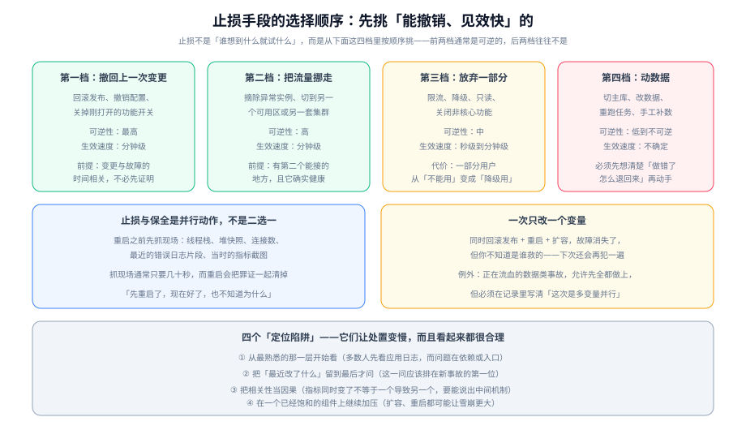

# 定位与止损

事故现场有两个目标，它们永远在抢同一样东西——时间。**定位**追求「找到真正的原因」，**止损**追求「让用户先不受影响」。这两件事在事故中**必须并行且不同人负责**，而顺序上永远是从止损开始的。



## 一句话定位

本页管「手上怎么动」。它不重复 [应急预案](../Runbook/index.md) 里写的具体命令，而是给出**在多种可能动作之间如何选择**的判断依据。什么时候动手由 [故障定级](../Severity/index.md) 决定，动手时谁负责由 [应急指挥](../Command/index.md) 协调。

::: tip 一句话理解
**止损不需要知道原因，定位不需要停止服务**。把这两句话刻在脑子里，能省下事故现场一半的争执时间。
:::

## 先止损，后定位

这条原则有一个非常具体的判据：

> **如果这次故障发生前不久有过变更（发布、配置、开关、依赖升级、证书轮换、容量调整），那么立即回滚它，不必先证明它就是原因。**

理由是一道简单的算术：

| 动作 | 成本 | 见效速度 | 最坏结果 |
| --- | --- | --- | --- |
| 回滚一次发布 | 低（版本是现成的） | 分钟级 | 回滚本身可能引入新问题，但版本是已知可用的 |
| 先花 20 分钟证明「就是这次发布导致的」 | 20 分钟的用户痛苦 | —— | 证明过程中故障可能扩大 |

「先证明再回滚」在课堂上是严谨的，在事故现场是**把验证成本转嫁给了用户**。

::: warning 说明
唯一的例外是**不可逆变更**：破坏性的数据库迁移、已发出的消息、已经写入外部系统的数据。这类动作无法用回滚解决，因此它必须在发布前就准备好前向兼容方案（详见 [应急预案 · 发布类](../Runbook/index.md)）。事故现场才第一次思考「怎么退回来」，本身就说明发布流程缺了一步。
:::

## 四档止损手段

止损不是「谁想到什么就试什么」，而是从上到下按顺序挑：

| 档位 | 手段 | 可逆性 | 生效速度 | 前提条件 |
| --- | --- | --- | --- | --- |
| **第一档** | 撤回上一次变更：回滚发布、撤销配置、关闭功能开关 | 最高 | 分钟级 | 变更与故障在时间上相关即可，**不需要证明因果** |
| **第二档** | 把流量挪走：摘除异常实例、切到另一个可用区或另一套集群 | 高 | 分钟级 | 有第二个能接的地方，且它**确实健康**（这一点必须验证，不能假设） |
| **第三档** | 放弃一部分：限流、降级、只读、关闭非核心功能 | 中 | 秒级到分钟级 | 已经知道「哪部分可以不要」，这个判断必须**事前**做好 |
| **第四档** | 动数据：切主库、修改数据、重跑任务、手工补数 | 低到不可逆 | 不确定 | 必须先想清楚「做错了怎么退回来」再动手 |

选择顺序的判断依据是**可逆性优先，其次才是速度**。原因很实在：事故现场的信息是不完整的，一个动作很可能是错的，此时「能撤销」比「够快」更值钱。

第三档里的「关闭非核心功能」值得单独强调：它是**性价比最高的一档**，因为它的动作是预先定义好的开关，执行成本近乎零。**前提是你要事前把「哪些功能可以关」列出来**——事故现场再去判断「推荐接口能不能关」，会耗掉最宝贵的十分钟。

## 证据保全与止损不冲突

最常见的错误是「先重启，重启完就好了，但不知道为什么」。重启确实是最快的动作，代价是**把证据一起清掉了**：线程栈没了、连接数回落了、内存里的现场归零了。

正确做法是**抓现场和止损并行，一般只需要几十秒**：

```shell
# 一分钟现场包：重启/摘除之前先执行（按需裁剪）
TS=$(date +%Y%m%d-%H%M%S)
mkdir -p /tmp/incident-$TS

# 1) 线程栈（Blocked / Waiting 的线程在哪里，是并发类问题最直接的证据）
kubectl exec -n prod deploy/order-service -- jstack 1 > /tmp/incident-$TS/jstack.txt

# 2) 连接与端口数（连接泄漏、被限流的最快线索）
kubectl exec -n prod deploy/order-service -- sh -c 'cat /proc/net/tcp | wc -l' > /tmp/incident-$TS/tcp-count.txt

# 3) 应用暴露的运行时指标（连接池、线程池、GC）
for m in hikaricp.connections.active hikaricp.connections.pending \
         tomcat.threads.busy jvm.gc.pause; do
  curl -s "http://order-service:8080/actuator/metrics/$m" >> /tmp/incident-$TS/metrics.json
done

# 4) 最近 500 行错误日志（按日志平台的查询语句取，注意不要拉全量）
echo "从日志平台导出最近 500 行 error 级别日志到 /tmp/incident-$TS/error.log"

ls -la /tmp/incident-$TS/
```

**判读**：四类文件都应当非空。如果 `jstack.txt` 为空或明显偏小，说明进程可能已经不可响应（这本身也是一条重要线索）；如果 `metrics.json` 里没有目标指标，说明**观测链路本身有问题**——这不是本次事故的原因，但它让本次事故变得更难定位，应当记为一条观测缺口。

## 定位四步法

止损开始后，定位可以同步推进。按下面四步走，可以避免「在自己最熟悉的那一层里打转」：

| 步骤 | 问题 | 常用手段 | 典型结论 |
| --- | --- | --- | --- |
| ① 定范围 | 全部用户还是部分？全部接口还是部分接口？ | 业务指标按「接口 / 地域 / 版本」分组看 | 全部受影响 → 入口、证书、配置这类全局项；部分受影响 → 某个实例、某个可用区、某个版本 |
| ② 定变更 | 最近改了什么？ | 发布记录、配置变更记录、开关操作日志 | 有变更且时间吻合 → 先回滚，再继续定位 |
| ③ 定层次 | 卡在入口层、应用层还是依赖层？ | 入口看错误码分布；应用看线程栈与池化资源；依赖看下游指标与慢查询 | 定位到具体一层后，继续范围缩小 |
| ④ 定对象 | 具体是哪个实例 / 哪条 SQL / 哪个 key？ | 慢查询日志、链路追踪、单实例排查 | 得到可复现的具体对象，才能从根本上修 |

::: tip 提示
第 ② 步应该**排在第 ① 步之后立刻做**，而不是留到最后。原因是：如果确实有变更，那么花在 ③④ 上的所有时间都是纯浪费——因为正确动作是回滚。很多「排查了三小时才发现是昨天的一个配置改动」的故事，都源于这一步被跳过了。
:::

## 四个定位陷阱

这四个陷阱的共同点是：**它们看起来都非常合理**。

### 陷阱一：从最熟悉的那一层开始看

后端工程师先看应用日志，运维先看机器负载，DBA 先看慢查询。每个人都会从自己最有把握的地方入手，于是**定位路径被个人经验绑定了**，而不是被证据绑定。

**破解方式**：按第 ① 步先定范围。「全部用户受影响」这个事实指向的是全局性原因，与「某个工程师最熟悉什么」无关。

### 陷阱二：把「最近改了什么」留到最后问

这是最贵的一个陷阱。变更信息获取成本极低（查一次发布记录），但被跳过的概率极高，因为它需要**主动想到去问别人**，而现场的注意力都在自己手上的终端里。

**破解方式**：把它写成流程的第一步——「**最近 2 小时改了什么**」应当是每个事故开工的第一句话，由指挥（而不是处置者）负责得到答案。

### 陷阱三：把相关性当因果

「错误率和 QPS 同时上涨」不等于 QPS 导致了错误率上升；两者可能同时由一个第三方变化引起（例如上游重试）。判断因果的最低要求是：**能说出一条从原因到结果的完整机制**。

说得出机制 → 可以据此行动；说不出 → 它只是一个线索，继续找证据。

### 陷阱四：在已经饱和的组件上继续加压

一个已经打满的组件，**扩容和重启都可能让事情更糟**：

- 对饱和的数据库加应用实例，会把压力原样放大到数据库。
- 重启一个正在处理长连接的实例，会让它上面的会话全部转移到其他实例，造成二次雪崩。
- 在队列积压时扩容消费者，如果下游是瓶颈，只会让下游更快地被打满。

**判据**：动手之前问一句「**我这个动作会增加还是减少对下游的压力**」。增加压力的动作，必须与降级、限流一起做。

## 什么时候必须放弃定位、直接恢复

不要在下面这些情况下继续追根因——它们的共同特征是**继续定位的成本高于直接恢复**：

| 情况 | 该做的动作 |
| --- | --- |
| 已经 30 分钟没有有效进展，且有可用的回滚点 | 直接回滚，把根因留给恢复后分析（**不要求先证明**） |
| 故障在扩大（新用户开始受影响） | 先止损扩大，定位暂停 |
| 影响面包含资金或数据正确性 | 先停止产生新的错误数据，再谈定位 |
| 处置窗口即将结束（如即将进入业务高峰） | 先恢复到可用状态，哪怕是用降级方案撑住 |
| 夜间、人手不足、需要的能力当前人没有 | 立即升级，不要再尝试 |

::: danger 注意
一个必须避免的惯性：**「快找到了，再给我十分钟」**。这句话本身没错，但它需要有人来管理——由**指挥**给一个明确的截止时间（例如「再十分钟，到点不回滚就由我决定」）。没有这个截止时间，这句话会重复说很多次。
:::

## 时间线记录的最低要求

记录不是为了归档，它有三个当下就生效的用途：**交接的依据、判断是否该升级的依据、恢复后不必重新问一遍的依据**。

最低要求（记录员执行）：

```text
时间戳（精确到分钟） + 谁 + 做了什么 + 当时的观测结果
14:20  系统   告警触发：下单接口错误率 9%
14:23  值班人 确认非误报（抓了一条真实请求，返回 5xx）
14:26  值班人 定级 SEV-2，升级第 2 级
14:31  李工   抓取线程栈：/tmp/incident-20261013-1429/jstack.txt
14:33  李工   重启 order-service 的两个异常实例
14:41  王工   关闭 FEAT_RECOMMEND 与 FEAT_RANKING，错误率降到 0.6%
```

**不记的三样东西**：猜测（除非标明「这是猜测」）、聊天、结论（结论属于恢复阶段的事）。

## 实战：三种形态的走查

下面用三个短场景说明前文的判据怎么用。**注意每个场景的第一步都是「问变更」，而不是「看日志」**：

### 场景 A：全部用户下单失败，两小时前刚发布过

- 范围：全部用户 → 全局性原因。
- 变更：有，且时间吻合 → **直接回滚**，不必先看日志。
- 若回滚 5 分钟未缓解 → 并行第二档（切到上一个可用版本的集群），同时继续定位。
- 判据：回滚后错误率下降到基线并在 30 分钟观察窗内保持。

### 场景 B：只有某个可用区的用户受影响

- 范围：部分用户（按地域切分）→ 指向某个可用区。
- 变更：无。
- 层次：入口层先看——**该可用区的实例是否被健康检查摘除了**？很可能是健康检查把好实例也摘了（例如探测路径被改动）。
- 第二档止损：临时把流量切到另一个可用区。
- 判据：受影响地域的比例下降到 0；同时确认另一个可用区的容量压力在可接受范围。

### 场景 C：接口能通但明显变慢，成功率没掉

- 范围：全部接口变慢但都能成功 → 指向排队或锁竞争。
- 变更：有（昨天上线了一个新的查询逻辑）。
- 层次：应用层看线程栈（是否大量线程等待锁 / 等待连接），依赖层看慢查询。
- 第三档止损：先关掉非核心出口；如果新查询是原因，回滚它的开关。
- 判据：P99 回到基线；注意**均值会掩盖问题**——如果一个接口 100 万次调用里有 10 次耗时 500ms，均值仍可能只有 0.5ms 出头，必须看 P99 与长尾计数。

## 验证方式

```shell
# 1) 止损四档是否写全：四档关键词都应出现
grep -c "第一档\|第二档\|第三档\|第四档" docs/Ops/IncidentResponse/Diagnosis/index.md

# 2) 现场包是否可执行：把命令里的服务名替换成自己的，确认每一步都有非空输出
TS=$(date +%Y%m%d-%H%M%S); mkdir -p /tmp/incident-$TS && echo "现场包目录：/tmp/incident-$TS"

# 3) 是否存在"问变更"这一步：检索发布记录/变更清单相关表述
grep -n "最近 2 小时\|变更清单\|发布记录" docs/Ops/IncidentResponse/Diagnosis/index.md | head -3
```

第 1 条的预期输出是 **4**（每档至少被引用一次）。若小于 4，说明止损手段没有穷举，现场会出现「想不到还能这么做」的情况。

## 与「观测驱动开发」专题的分工（第 158 天补充）

本页讲**故障诊断的方法**（分层定位、假设-验证、二分、看什么先看什么后）；第 158 天的 [常见问题与分诊](/docs/Tools/ObservabilityDriven/FAQ/index.md) 讲**观测数据本身出问题时的分诊**——即「你正在看的那个数可能是错的」。两者在事故现场会同时用到，顺序是：先确认数据可信，再做故障定位。

| 边界问题 | 归本页 | 归该专题 |
| --- | --- | --- |
| 从哪一层开始查 | 分层定位顺序、跳过层的代价 | 先跑「有数据 → 数据对 → 为什么」三段，避免在不可信的数据上做定位 |
| 数字对不上时信谁 | 不涉及 | 先比分母，再比窗口、采样、去重、数据源 |
| 追踪断在某一段 | 断点定位与调用链阅读 | 先查消费端 span 是否为 root（多为传播头缺失，不是业务 bug） |
| 告警响成一片 | 按影响面排序处理 | 先抑制同源告警，让电话指向根因 |

本页特有的一个坑：**事故期间最容易被当成结论的是「曲线归零」**。核心指标突然为 0，第一反应是「问题解决了」，但更常见的三种原因是：上报端挂了、标签被高基数丢弃、查询窗口跨了保留期。判据很简单——**归零之前先确认「有没有数据」**，这一条能省掉事故中最贵的一次误判。

## 参考资料

- GB/T 28827.3-2012《信息技术服务 运行维护 第3部分：应急响应规范》（应急处置流程部分）
- [监控告警 · 告警设计](../../Monitoring/Alerting/index.md)（分层指标与告警的配合）、[日志体系](../../LogSystem/index.md)（现场证据的来源）
- [网络基础](../../Network/index.md)（协议分层定位法）、[微服务 · 熔断与限流](../../../Backend/Microservices/CircuitBreaker/index.md)（自动止损与人工止损的接管关系）
- [应急预案与运行手册](../Runbook/index.md)（本页判断动作的落地清单）
