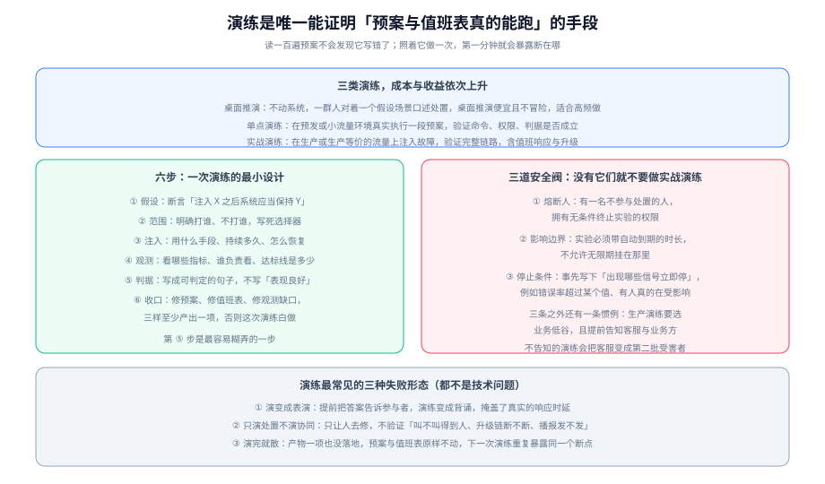

# 演练与预案校验

演练（Drill / GameDay）是**唯一能证明「预案与值班表真的能跑」的手段**。读一百遍预案不会发现它写错了；照着它做一次，第一分钟就会暴露断在哪里。这页讲的是怎么把这件事做得既有效又安全——因为一次失控的演练，会以「演练太危险」为由让整套机制被永久搁置。



## 一句话定位

本页讲**验证**。它不重复 [混沌工程](../../ChaosEngineering/index.md) 里的故障注入技术细节，而是回答「**要验证什么、怎么设计才有效、怎么保证不失控**」——两者的交集是实战演练，但判据归本页。

::: tip 一句话理解
一次演练的成功标准不是「系统扛住了」，而是**演练结束后有三样东西被改动了**：预案、值班表、观测。一样都没动，说明这次演练只是消耗了几个小时。
:::

## 三类演练：成本与收益依次上升

不要一上来就做最贵的那种。三类演练是递进关系，前一类是后一类的前提：

| 类型 | 做什么 | 需要什么环境 | 能验证什么 | 建议频率 |
| --- | --- | --- | --- | --- |
| **桌面推演**（Tabletop） | 一群人对着一个假设场景口述处置，不动系统 | 无 | 定级表是否收敛、角色是否清晰、谁该做什么是否一致 | 每月 |
| **单点演练**（Single-point） | 在预发或小流量环境真实执行一段预案 | 预发环境 / 可隔离的流量 | 命令是否可执行、权限是否足够、期望输出是否成立 | 每季度 |
| **实战演练**（GameDay） | 在生产或生产等价流量上注入故障，走完整链路 | 生产环境 + 安全阀 | 完整链路：含 MTTA、升级、协同、播报 | 每半年，第一次务必更保守 |

**桌面推演的价值常被低估**。它几乎零成本，却能在半小时内暴露出大量不一致——比如「三个人对同一次故障给出了三个级别」这种问题，在生产演练里要花十倍成本才发现。

## 六步：一次演练的最小设计

六步里，**第 ⑤ 与第 ⑥ 步决定了演练有没有价值**：

### ① 假设（Hypothesis）

写成可判定的断言，而不是愿望：

| 反例 | 正例 |
| --- | --- |
| 「关掉一个数据库从库，系统应该正常运行」 | 「关闭 3 个从库中的 1 个，下单接口成功率在 5 分钟内保持在 99.9% 以上」 |
| 「演练一下缓存挂了会怎样」 | 「切断应用与缓存之间的网络 3 分钟，接口 P99 不超过 500ms，且不出现 5xx」 |

**判据**：把假设念给一个不在项目里的人听，他能否复述出「什么条件下、看什么指标、达到什么标准算通过」。

### ② 范围（Blast Radius）

明确「打谁、不打谁」，**写死选择器**，不要靠人临场挑：

```yaml
# 范围在三处同时被约束：命名空间、标签选择器、排除清单（示意，以 Chaos Mesh 为例）
apiVersion: chaos-mesh.org/v1alpha1
kind: NetworkChaos
metadata:
  name: drill-redis-partition
  namespace: chaos-mesh
spec:
  action: partition
  mode: one                    # 只打一个 Pod，不是 all
  selector:
    namespaces: [prod-canary]  # 只打金丝雀命名空间，不打生产
    labelSelectors:
      app: order-service
  direction: both
  duration: '3m'               # 自动到期，不允许无限期
  target:
    selector:
      namespaces: [prod-canary]
      labelSelectors:
        app: redis
```

### ③ 注入（Injection）

写清用什么手段、持续多久、怎么恢复。**持续时间必须是自动到期的**——依赖「记得手动恢复」的演练，迟早会变成一次真实故障。

### ④ 观测（Observation）

指定**看哪些指标、谁负责看、达标线是多少**。这一步不能省略观察者的角色：只写「观察系统表现」，现场就会变成所有人都盯着自己的终端，没有人看整体。

### ⑤ 判据（Criteria）

写成可判定的句子。这一步最容易糊弄，因为「表现良好」听起来像结论，实际上是形容词。可判定的判据长这样：

```text
通过条件（全部满足才算通过）：
  ✓ 下单接口成功率 ≥ 99.9%，持续整个注入期
  ✓ 接口 P99 ≤ 500ms（基线 220ms 的 2.3 倍以内）
  ✓ 注入期间不出现 SEV-1 级别告警
  ✓ 熔断器在 30 秒内打开，且流量切换到备用链路
  ✓ MTTA（演练告警到有人认领）≤ 5 分钟
不通过时的记录项：
  · 未达标的具体指标与时间点
  · 当时值班人实际做了什么
  · 预案里哪一步与实际不符（逐条记录，这是最有价值的产出）
```

### ⑥ 收口（Follow-through）

**至少产出一项**，否则这次演练白做：

| 产物 | 什么情况下必须产出 |
| --- | --- |
| **预案修订** | 演练中出现了「照着预案做不到」或「预案里没有这一步」 |
| **值班表/升级链修订** | MTTA 未达标、或者发现升级链断在某一级 |
| **观测缺口** | 需要靠人肉眼判断而缺少指标、或者指标本身的采集有问题 |

## 三道安全阀

**没有这三道阀就不要做实战演练**。它们的目的是让「失控」这件事在结构上不可能发生：

| 安全阀 | 做法 | 为什么不能省 |
| --- | --- | --- |
| **熔断人** | 指定一名**不参与处置**的人，拥有无条件终止实验的权限 | 处置人员投入后会倾向于「再坚持一下」，而客观判断需要一个旁观者 |
| **影响边界** | 实验必须带**自动到期的时长**；选择器必须限定范围（命名空间、标签、副本数） | 忘记恢复的实验会变成真实故障；这不是理论风险，Chaos Mesh 官方文档就把「忘记设置 duration 导致故障无限期运行」列为主要坑 |
| **停止条件** | 事先写下「出现哪些信号立即停止」 | 写得越具体越好，例如「错误率超过 5%」「任何真实付费用户报障」「核心链路出现资金错误」 |

::: danger 注意
实战演练常见的三条越界做法，每一条都会让下一次演练被否决：

1. **在生产上直接对全部副本注入**（`mode: all`）——范围应当是「最小可观测单元」，通常是一个副本或一个金丝雀分组。
2. **不告知客服与业务方**——演练期间的用户报障会变成真的工单，客服在不知情的情况下会按真实事故处理，白白消耗一次真实的响应能力。
3. **选在业务高峰做**——「顺便压测一下」是两件事的组合，且组合后的风险不是相加而是相乘。
:::

## 演练的判据可以量化：四个要量的数

演练最容易流于形式的地方是「没有数字」。下面四个量都可以在演练中直接测出来：

| 要量什么 | 怎么量 | 达标参考 |
| --- | --- | --- |
| **MTTA（告警到认领）** | 记录演练告警发出的时间与有人确认的时间 | 高等级告警 ≤ 5 分钟（与 [值班制度](../OnCall/index.md) 的承诺一致） |
| **呼叫是否真的到达人** | 观察通知通道：是否走了电话而不只是推送 | 高等级必须确认收到电话，而不是「系统显示已发送」 |
| **升级链是否按预期跳级** | 记录没被确认时是否自动升级，以及升级到谁 | 每一级都在承诺时间内被触发 |
| **预案的可执行率** | 统计预案里的步骤，有多少能原样执行、多少需要临场修改 | 需要临场修改的步骤数**应当逐次下降** |

其中「预案的可执行率」是最有长期价值的指标：它直接量化了**手册与现实之间的距离**。

## 演练用工具：先把版本与支持窗口对上

以 Chaos Mesh 为例，按 2026-10 口径核对的事实：

| 项 | 事实 | 对演练的影响 |
| --- | --- | --- |
| 当前版本与支持窗口 | **2.8.4**（2026-08-18），支持 Kubernetes **1.30~1.35**，每个发布分支支持期 **6 个月** | 集群版本与 Chaos Mesh 版本必须配套；落后多个发布分支的集群不在支持范围内 |
| 安装方式 | `install.sh` **已废弃**，官方推荐 Helm 安装 | 照抄老教程会用上废弃脚本 |
| 注入能力 | Pod、网络（延迟 / 丢包 / 分区 / 带宽）、I/O、DNS、HTTP、时间偏移、压力、内核（eBPF）等 | 「应用层语义错误」这一类**注不进去**，需要应用自己提供故障开关 |
| 实验的组织方式 | 用声明式 CRD 管理（可纳入 GitOps 与 RBAC），支持 Schedule 与 Workflow 编排 | 把实验当资源配置管理，才能做到幂等、可回滚、可审计 |
| 权限与风险 | Chaos Daemon 默认以特权方式运行在所有节点上，扩大了权限面 | 在受限集群中可能被安全策略拦截；上线前需评估合规要求 |

::: warning 说明
**应用层故障（例如「某个业务条件返回错误」）不在故障注入工具的覆盖范围内**，因为工具的能力边界是节点与 Pod 边界。这类场景需要应用自己预留故障开关（Feature Flag / 故障注入端点），并且**这个开关必须有权限控制与自动过期**，否则它会成为新的风险面。
:::

## 三种失败形态（都不是技术问题）

| 形态 | 表现 | 根因 | 修法 |
| --- | --- | --- | --- |
| **演练变成表演** | 提前把答案告诉参与者，演练顺畅得不像真的 | 把演练当成了考核 | 只公布范围与安全阀，不公布具体场景与判据；判据由观察者掌握 |
| **只演处置不演协同** | 有人成功修好了系统，但没有验证「叫不叫得到人、升级链断不断、播报发不发」 | 把演练理解成技术验证 | 把 MTTA、升级跳级、对外播报都列进判据 |
| **演完就散** | 纪要写了一堆，预案与值班表原样不动 | 缺少第 ⑥ 步的产物要求 | 把「至少产出一项改动」作为演练关闭的前置条件 |

## 实战：一次单点演练的完整设计

目标：验证「缓存不可用时的降级链路」是否真的成立。选择单点演练，在预发环境执行。

**第 1 步 假设**

> 切断订单服务与缓存之间的网络 3 分钟，下单接口成功率 ≥ 99.9%，P99 ≤ 500ms，且熔断器在 30 秒内打开、流量切换到数据库直读。

**第 2 步 范围**：仅预发命名空间 `staging`，仅 `app=order-service` 的一个副本与 `app=redis` 之间的流量。生产命名空间不在选择器内。

**第 3 步 注入**：`NetworkChaos`，`action=partition`，`mode=one`，`duration=3m`（自动到期）。执行前记录基线。

**第 4 步 观测**：

| 观察项 | 负责人 | 达标线 |
| --- | --- | --- |
| 下单接口成功率 | 值班人 | ≥ 99.9% |
| 下单接口 P99 | 值班人 | ≤ 500ms（基线 220ms） |
| 熔断器状态 | 技术负责人 | 30 秒内打开 |
| 应用日志中的降级记录 | 技术负责人 | 出现降级标记，且无未捕获异常 |

**第 5 步 判据**（全部满足即通过，任一不满足即记录）：

```text
✓ 成功率 ≥ 99.9%
✓ P99 ≤ 500ms
✓ 熔断 30 秒内打开并切换到直读
✓ 3 分钟后网络恢复，指标在 2 分钟内回到基线
✓ 全程没有人需要手工重启任何实例
```

**第 6 步 收口**（本次实测产出）：

| 发现 | 产物类型 | 具体改动 |
| --- | --- | --- |
| 熔断打开用了 45 秒（超过 30 秒判据） | 预案修订 | 把熔断窗口参数由 60 秒改为 30 秒，并写明依据 |
| 降级期间数据库连接数上涨到 78%（接近上限） | 观测缺口 | 补一条「降级期间数据库连接数」告警 |
| 值班人不知道降级开关在哪（找了 2 分钟） | 预案修订 | 在应急预案首页加一张「常用开关速查表」 |

**这次演练的价值不在于「系统扛住了」，而在于最后那张表**。如果三项发现都没有，就要反过来怀疑：判据是不是写得太松了。

## 验证方式

```shell
# 1) 每个实验是否带自动到期（缺 duration 的注入是最高危的写法）
grep -n "duration" docs/Ops/IncidentResponse/Drill/index.md | head -5

# 2) 是否限定了范围（命名空间 + 标签选择器应当同时出现）
grep -c "namespaces\|labelSelectors" docs/Ops/IncidentResponse/Drill/index.md

# 3) 演练记录里是否有可量化的数字（而不是"表现良好"）
grep -n "MTTA\|秒\|成功率" docs/Ops/IncidentResponse/Drill/index.md | head -6

# 4) 与集群版本的匹配（工具支持窗口 6 个月，需定期核对）
kubectl version --short 2>/dev/null || echo "无集群环境：请核对 Chaos Mesh 2.8.4 支持的 K8s 版本为 1.30~1.35"
```

第 1 条必须能查到 `duration`；如果一份注入配置里没有它，**先修配置再谈演练**。第 4 条的预期是：集群版本落在工具的支持窗口内，否则升级工具或集群。

## 存疑与边界

- 本文中 Chaos Mesh 的版本与支持窗口按 **2026-10** 口径联网核对（2.8.4 / K8s 1.30~1.35 / 每分支支持 6 个月）。**工具版本迭代较快，落地前请以官方发布页为准。**
- 具体故障注入的字段与语法归 [混沌工程](../../ChaosEngineering/index.md)；本页只给「怎么设计一次有意义且安全的验证」。

## 与「多活与单元化」的分工（第 163 天补充）

本页的演练面向**应急流程**：谁指挥、怎么定级、怎么止损、怎么组织演练日。它验证的是「人和流程」；多活的演练还要验证**架构本身**：切过去之后，数据和流量是不是真的都在该在的地方。

| 本页的演练对象 | 多活演练多出来的判据 | 去哪 |
| --- | --- | --- |
| 指挥链与定级（组织维度） | 五级金字塔里 L1 桌面推演正好验证「谁有权按按钮」 | [演练](../../MultiActive/Drill/index.md) 第 1 节 |
| 演练日的组织与脚本 | 每条演练必须写「观测点 / 期望值 / 持续时间」 | [演练](../../MultiActive/Drill/index.md) 第 2 节 |
| 止损与恢复 | 「流量真的切走」的证据是旧单元 QPS = 0 | [演练](../../MultiActive/Drill/index.md) 第 3 节 |
| 故障注入的范围 | 切完之后必须跑三层数据校验（行数 / 哈希 / 不变量） | [冲突裁决](../../MultiActive/Conflict/index.md) 第 5 节 |

::: tip 两类演练可以合并，但结论不能合并
一次「单元 A 失联」的演练，既产出**组织结论**（值班在多长时间内完成判定），也产出**架构结论**（实际 RTO 多少秒、数据差多少行）。写在同一份记录里没问题，但**结论必须分开写**——否则「演练通过」会掩盖「数据校验没做」。
:::

## 参考资料

- Chaos Mesh 官方文档：故障类型、Workflow 编排、安全使用与「务必设置 duration」的官方提示
- GB/T 28827.3-2012《信息技术服务 运行维护 第3部分：应急响应规范》（演练要求部分）
- [混沌工程](../../ChaosEngineering/index.md)（主动故障注入的技术细节）、[备份与容灾 · 容灾演练](../../BackupDR/DisasterRecovery/index.md)（切换类演练）
- [值班制度](../OnCall/index.md)（MTTA 承诺的来源）、[应急指挥与协同](../Command/index.md)（协同环节的验证项）
