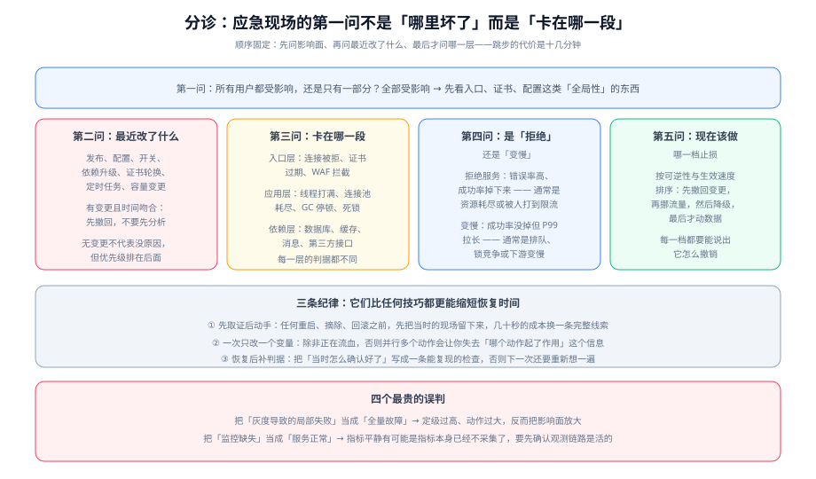

# 常见问题与最佳实践

本页收口整个专题：把高频疑问分类回答、把上线前必须过的自查做成一份可勾选清单，并给出可以直接抄进团队文档的最佳实践与术语表。

::: tip 一句话定位
应急现场的第一问不是「哪里坏了」，而是「**卡在哪一段、最近改了什么**」。顺序固定：先问影响面 → 再问变更 → 最后才问哪一层。跳步的代价通常是十几分钟，而这十几分钟恰好是最值钱的。
:::

## 分诊表：先问影响范围

| 现象 | 先问的第二个问题 | 优先去看 | 先去哪一页 |
| --- | --- | --- | --- |
| 全部用户不可用 | 最近 2 小时有变更吗？ | 变更记录 → 入口层（证书、配置、路由） | [定位与止损](../Diagnosis/index.md) |
| 部分用户不可用 | 是按地域、按版本还是按实例切的？ | 分组指标（地域 / 版本 / 实例） | [定位与止损](../Diagnosis/index.md) |
| 接口能通但明显变慢 | 成功率掉了吗？ | 线程栈、连接池、慢查询 | [定位与止损](../Diagnosis/index.md) |
| 重启后短暂好转又复发 | 根因还在吗？ | 别急着宣布恢复，先看变更与慢查询 | [实战](../Practice/index.md) |
| 告警很吵但用户无感 | 用户视角的指标是什么？ | 业务指标（下单/支付成功率），而非技术指标 | [总览](../Overview/index.md) |
| 深夜被叫醒但不知道干什么 | 这条告警有对应的 Runbook 吗？ | 没有手册的告警就是「不该叫醒人」的告警 | [值班制度](../OnCall/index.md) |
| 不知道该定几级 | 影响面和严重程度分别是？ | 定级矩阵；拿不准往高定 | [故障定级](../Severity/index.md) |
| 没人接单 / 升级没人响应 | 升级链最后一级是谁？ | 排班、联系方式、升级策略绑定 | [值班制度](../OnCall/index.md) |
| 想验证预案是否有效 | 演练过吗？ | 桌面推演 → 单点演练 → 实战演练 | [演练与预案校验](../Drill/index.md) |

## 三条排查纪律

它们比任何技巧都更能缩短恢复时间，因为它们约束的是**人最容易犯的错**：

1. **先取证后动手**：任何重启、摘除、回滚之前，先留下现场（线程栈、连接数、日志片段、指标）。成本几十秒，收益是一条完整线索。
2. **一次只改一个变量**：除非正在流血（数据错误、影响面持续扩大），否则并行多个动作会让你失去「哪个动作起了作用」这个信息——下次还会再犯。
3. **恢复后补判据**：把「当时怎么确认好了」写成一条可复现的检查。否则下一次还要重新想一遍，而想的过程就是 MTTR 的一部分。

## 高频十二问

### Q1：我们已经上了很多监控，为什么还会被用户先发现？

因为**技术指标不等于用户感受**。协议层 200 不代表业务流程成功（下单成功但订单没生成）。真正的 MTTD 短板几乎总是在**业务指标**这一层：缺少业务成功率的采集，或者采集了但没人给它配告警。这也是 [实战](../Practice/index.md) 里事故从 1 分钟变成 18 分钟的全部原因。

### Q2：定级总是有争议，怎么办？

三件事：① 把「核心链路清单」事前写死（只有 3~5 条），争议时查表；② 规定「拿不准往高定」，且**事后下调无惩罚**；③ 用历史事件做一次盲测（见 [故障定级](../Severity/index.md) 的校准方法），把一致率低的那一档判据改写得更具体。

### Q3：小团队也要做值班制度吗？

看有没有外部用户与 7×24 承诺。没有的话，**降低承诺**比假装覆盖更诚实：例如「工作时间 + 夜间仅高危告警」。承诺了却做不到，会让所有告警的可信度一起下降。

### Q4：值班人数到底要几个？

单时区 7×24 的常见下限是 **6 人**（更稳的是 7~8 人）。这不是管理偏好，而是算术：人数越少，人均夜间次数越高，而「同一班次被叫醒超过 2 次」之后响应质量会断崖式下降。

### Q5：为什么说「指挥不修故障」？我们人少做不到。

关键不是「让一个人闲着」，而是**让协调这个职能有人负责**。人少时可以一人多角，但「指挥」必须被显式指认出来，并且在指认的那一刻**这个人暂时不碰机器**。做不到这一点，就会出现「所有人都在改生产、没人知道彼此在改什么」。

### Q6：先止损后定位，那不就是瞎蒙吗？

不是。止损不是随机动作，而是从**四档定义好的手段**里挑（撤回变更 → 挪流量 → 降级 → 动数据），并且优先级依据是「可逆性优先」。所谓「不必先证明因果」，特指**「回滚时间上相关的变更」**这一条——它的成本足够低、可逆性足够高，值得在证据不完全时执行。

### Q7：什么是「假收口」？

看起来恢复了但并没有。两种典型：① 只看单个指标恢复就宣布结束（排队里还积压着几十万条消息）；② 由最疲惫的处置者自己判断结束。正确做法是**三段式判据**：指标回基线 + 观察窗满足 + 临时措施回收或登记。

### Q8：事故要不要对外公告？多久一次？

按 [应急指挥](../Command/index.md) 的节奏表：SEV-1 每 15 分钟、SEV-2 每 30 分钟，**没有进展也要按点播报**。注意区分两类对外沟通——向**监管机构报告**是法定义务（较大以上事件，关键信息基础设施最迟 1 小时、其他最晚 4 小时），向**用户公告**是信息发布，两者受众、渠道、时限都不同。

### Q9：演练会不会把生产搞坏？

会——如果没设安全阀。三道阀是硬要求：**熔断人**（不参与处置、可无条件终止）、**影响边界**（自动到期 + 限定选择器）、**停止条件**（事先写下什么信号立即停）。另外，Chaos Mesh 官方文档就把「忘记设置 duration 导致故障无限期运行」列为主要坑之一。

### Q10：故障注入工具能演练「业务逻辑出错」吗？

不能。这类工具的能力边界是**节点与 Pod 边界**（Pod、网络、I/O、DNS、时间、压力、内核等），无法注入「某个业务条件返回错误」。这类场景需要应用自己预留**受权限控制且自动过期**的故障开关。

### Q11：预案写完就没人看了，怎么破？

三个抓手：① 把「最后更新」放在页面**最上方**；② 在演练中真的照着它执行一次并回填实测结果；③ 把手册与配置一起版本化——服务发布若触及某份手册描述的组件，就必须复核那份手册。

### Q12：值班人自己判断不了该怎么办？

升级。升级的定义是「**把当前局面交给更多能处置的人**」，不是「上报领导」。三个触发条件：时间触发（超时机械升级）、能力触发（缺权限或缺知识）、规模触发（影响面还在扩大）。并且这条规则要配一条保护：**任何人升级都不需要事先批准，也不需要事后解释**。

## 上线自查清单 C1~C12

上线一套应急体系（或对现有体系做一次体检）之前，逐条过关：

- [ ] **C1** 值班表上有姓名、时段、联系方式，且任意一人休假时有人补位
- [ ] **C2** 高等级告警的通知通道包含**电话**，并且真的测试呼叫过一次
- [ ] **C3** 每条高等级告警都有一条对应的 Runbook，且 Runbook 有「期望输出」与「回退点」两段
- [ ] **C4** 定级表用最近 3 次以上历史事件回归校准过，三人结论至少 8/10 一致
- [ ] **C5** 核心链路清单（3~5 条）被明确定义，且有对应的业务成功率指标
- [ ] **C6** 升级链至少 3 级，每一级的触发时限写成数字
- [ ] **C7** 应急角色（指挥 / 记录员 / 技术负责人 / 对外联络）被显式指认，指挥的职责边界写在预案首页
- [ ] **C8** 有明确的「非核心出口清单」，每个出口带开关名与生效延迟
- [ ] **C9** 回滚能力被实测过：回滚是**一条**命令，且回滚耗时已知
- [ ] **C10** 报告义务分支写进了预案（触发条件、联系人、渠道、报告要素、时限）
- [ ] **C11** 过去 6 个月做过至少一次演练，且演练产出了至少一项改动（预案 / 值班表 / 观测）
- [ ] **C12** 至少能算出 MTTD / MTTA / MTTR 三个数的近期值，而不是只算总时长

## 最佳实践十二条

1. **把「事故」「问题」「缺陷」分开管**：事故按分钟、问题按天、缺陷按迭代，混在一起会两头都做不好。
2. **判据挂在用户视角上**：技术指标用于定位，业务指标用于判断有没有出事。
3. **定级只吃两个输入**：影响面与严重程度；时长是升级条件，修复难度决定拉谁进来。
4. **拿不准往高定，事后下调无惩罚**：这条让定级能在 3 分钟内完成。
5. **级别与追责必须脱钩**：一旦挂钩，定级数据会被系统性压低，整套体系随之失效。
6. **升级不需要批准**：把「叫人来」当成一种能力，而不是麻烦别人。
7. **先止损、后定位，止损不要求证明因果**：用户痛苦按分钟计价，根因可以事后慢慢找。
8. **止损手段按可逆性排序**：撤回变更 → 挪流量 → 降级 → 动数据。
9. **指挥不碰键盘**：协调停止的那一刻，所有人都在改生产。
10. **没有进展也要按点播报**：「仍在排查，影响面未扩大，下次更新 16:00」的价值是消除对方 15 分钟内的所有追问。
11. **没有安全阀就不做实战演练**：熔断人、自动到期、停止条件，三个都要有。
12. **每次事故至少产出一项改动**：预案、值班表或观测三者之一。否则这次损失只是损失。

## 术语表

| 术语 | 英文 | 含义 |
| --- | --- | --- |
| 事故 | Incident | 服务当前对用户不可用或结果不正确，需要立刻恢复 |
| 问题 | Problem | 事故的成因与隐患，通常在服务恢复后处理 |
| 定级 | Severity Classification | 在事故开始时确定响应规模的动作 |
| 应急指挥 | Incident Commander（IC） | 掌握全局、做决策、不直接处置的角色 |
| 升级 | Escalation | 把当前局面交给更多能处置的人（不是上报领导） |
| 止损 | Mitigation | 让影响面停止扩大的动作，不要求知道根因 |
| 收口 | Recovery | 服务回到目标水平并保持住，含观察窗与临时措施回收 |
| 运行手册 | Runbook | 面向具体告警的操作清单，含命令、期望输出、回退点 |
| 桌面推演 | Tabletop Exercise | 不动系统、仅口述处置的验证方式 |
| 实战演练 | GameDay | 在生产或生产等价流量上注入故障的完整验证 |
| 熔断人 | Safety Officer / Circuit Breaker | 不参与处置、可无条件终止实验的角色 |
| 影响面 | Blast Radius | 一次故障或一次实验影响的用户与系统范围 |
| 平均确认时长 | MTTA | 告警发出到有人接下之间的时长，衡量值班与告警质量 |
| 平均恢复时长 | MTTR | 接单到影响面消失之间的时长，衡量预案与权限 |

## 参考资料

- GB/T 28827.3-2012《信息技术服务 运行维护 第3部分：应急响应规范》
- GB/T 20986-2023《信息安全技术 网络安全事件分类分级指南》
- 《国家网络安全事件报告管理办法》（2025-11-01 施行）
- Google SRE 系列中关于应急响应、值班负载与事件指挥体系的公开章节
- Chaos Mesh 官方文档（故障类型与安全使用要求）
- [本专题目录页](../index.md)（制度与工具事实速览，2026-10 口径）
