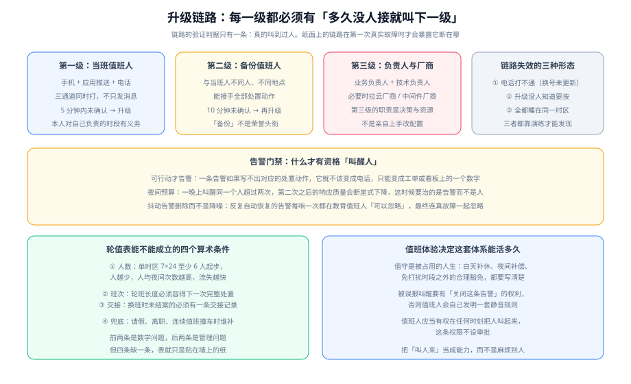

# 值班制度：保证有人能醒

值班制度的唯一目标是**让告警真的落到一个活人身上，并且这个人有能力、有意愿处置**。它听起来是排班问题，实际上是三个问题的叠加：算术问题（几个人够）、工程问题（告警值不值得叫醒人）、组织问题（被叫醒的人有没有被善待）。



## 一句话定位

本页管的是「人在不在、叫不叫得醒、醒了能不能干」。至于**证据在哪儿看**（[日志体系](../../LogSystem/index.md)）、**异常怎么发现**（[监控告警](../../Monitoring/index.md)），归相邻专题。

::: tip 一句话理解
值班制度的好坏只有一个检验方式：**凌晨三点，一次真实故障，是否在承诺时间内有人接下**。所有纸面上的条款都是为这一件事服务的。
:::

## 轮值表：先从算术开始，而不是从意愿开始

排班表最常失败的方式是「按人头平均分」，而忽略了**夜间次数**这个真正让人流失的量。先把算术算清楚：

| 项 | 参考值 | 依据与说明 |
| --- | --- | --- |
| 单时区 7×24 的最小人数 | **6 人**（更稳的是 7~8 人） | 人越少，人均夜间被叫醒次数越高；请假、病假、年假会把剩下的班次压到其他人头上 |
| 轮班周期 | 以「**一次班次能容纳一次完整处置**」为准，通常 1 周（夜间）或 1 天（白天） | 班次太短则交接成本高于值守成本；太长则单次疲劳累积 |
| 同时在线人数 | 至少 1 人主值 + 1 人备份 | 备份不是荣誉头衔，必须能独立接手全部动作 |
| 每夜被叫醒上限 | **同一人 1 个班次内不超过 2 起独立事件** | 超过之后响应质量断崖式下降；第 3 起之前就要把「治告警」当成一项工作排进去 |
| 升级链深度 | 至少 3 级 | 第 1 级当班、第 2 级备份、第 3 级负责人与厂商 |

::: warning 说明
「人数不足」不能用「大家辛苦一下」解决。人数不足时正确的做法是**降低承诺**：把覆盖时段从 7×24 缩到「工作时间 + 夜间仅高危告警」，公开写明这个承诺。承诺了却做不到，会让所有告警的可信度一起下降。
:::

## 班次与交接

交接（Handover）是值班链条上最容易断裂的一环，因为**交接发生时通常没有人监督**。

交接记录至少包含四项，缺一项就可能在两小时后被别人重新发现一次：

1. **未结案的事件**：当前状态、已经做过的动作、下一步该做什么、有没有定时任务在跑。
2. **刚上线/刚变更的东西**：过去 24 小时内的变更清单，这是下一班最需要的「嫌疑人名单」。
3. **被静默或抑制的告警**：谁静默的、为什么、什么时候到期。**静默必须有到期时间**。
4. **临时状态**：手动加的限流、临时扩容、手工补数的任务是否跑完。

```text
# 交接记录模板（可以贴在任何协作工具里，关键是字段固定）
[交接] 2026-10-13 09:00  交班：A  接班：B
未结案：INC-1043 商品搜索超时（已降级非核心接口，等评审上线索引）
        状态=缓解中  下一步=等 DBA 确认索引创建窗口
近 24h 变更：商品服务 v2.31.0（新增相似商品查询）、网关证书轮换（已完成）
静默中：/api/recommend P99 告警 静默至 10-13 18:00（原因：已知的预热期抖动）
临时状态：推荐接口降级已开（开关名 FEAT_RECOMMEND），恢复后需关闭
```

## 响应时延目标：用数字代替「尽快」

「尽快响应」不是目标，因为它无法被检验。把 MTTA 拆到级别上，并且写清各通道：

| 级别 | MTTA 目标 | 通知通道 | 未确认后的动作 |
| --- | --- | --- | --- |
| SEV-1 | **5 分钟内** | 电话 + 短信 + 应用推送三通道同时 | 3 分钟未确认即升级到第 2 级 |
| SEV-2 | **10 分钟内** | 电话 + 应用推送 | 5 分钟未确认即升级 |
| SEV-3 | **30 分钟内** | 应用推送 + 群消息 | 30 分钟未确认升级为第 2 级 |
| SEV-4 | 工作时间 | 群消息 / 工单 | 不升级，进待办 |

三条实现纪律：

- **高等级告警必须走电话**。只有推送与消息的通知，在手机静音、勿扰模式、应用被系统杀死时**完全不会响**。
- **确认（Acknowledge）必须是一个显式动作**，不能靠「在群里回复了」代替。没有确认动作，系统就无法判断该不该升级。
- **升级链的每一级都要能收到同级通知，而不是只通知上一级**。否则第 2 级只知道「有人在处理」，不知道「他还没接」。

::: danger 注意
三处会让升级链静默失效的配置错误，部署后必须逐条验证：

1. **联系方式过期**：手机号换了、离职人员仍在轮值表上、节假日临时调整没有同步到系统。
2. **升级策略没有绑定到服务**：告警进来了，但它没有归属服务，于是没有匹配到任何排班，**告警直接落库而没有人收到**。
3. **「通知已发送」被当成「已送达」**：推送服务返回成功不代表手机收到，高等级告警的正确验证方式是**真的打一次测试电话**。
:::

## 告警门禁：什么才有资格「叫醒人」

告警质量直接决定值班的可持续性。把下面三条作为门禁，任何新告警上线前都要过：

### 门禁一：可行动（Actionable）

> 如果这条告警触发后，值班人**没有任何可执行的动作**，它就不该变成电话。

反例：`磁盘使用率 > 70%`（该做什么？没人知道）。正例：`磁盘使用率 > 85% 且 预计 4 小时内写满`，配一个 Runbook 说明「清理哪个目录、扩容哪个卷」。

这条门禁的副产品是：它会逼着你给每条告警写一份对应的手册，而手册正是 [应急预案](../Runbook/index.md) 的素材。

### 门禁二：不重复（Deduplicated）

同一个根因触发的多条告警必须能被聚合成一个事件。否则一次数据库慢查询会同时点亮「接口超时」「线程池满」「连接池耗尽」「上游错误率上升」四条告警，值班人要在四个窗口之间来回切——**聚合不是美观问题，是认知带宽问题**。

### 门禁三：不抖动（Non-flapping）

反复自动恢复的告警是**净负债**：它每响一次，都在教育值班人「这条可以忽略」。它带来的损失不是这次的噪音，而是**下一次真故障时被一起忽略**。

处置顺序：先查能不能修（阈值是否过紧、是否缺平滑窗口），修不好就**删除这条告警**，改为看板指标或日报数字。

## 夜间预算：把「叫醒人」当成稀缺资源

Google SRE 的公开材料里给过一条经验阈值：**一个班次内出现 2 起以上独立事件，就应该触发纠正行动**。这条阈值值得直接抄进制度，因为它把一件模糊的事变成了可计数的：

| 每班次独立事件数 | 定性 | 该做什么 |
| --- | --- | --- |
| 0~1 | 健康 | 正常值班 |
| 2 | 到警戒线 | 本次不算事故，但要**记录下来**，下一周看趋势 |
| 3~4 | 预警 | 当周必须把「降低告警量」作为一项正式工作排进日程 |
| ≥5 | 失效 | 值班制度事实上已经失效：值班人会开始自行静音，或者干脆不接 |

::: tip 提示
夜间预算有一个反直觉的用法：**它衡量的是告警系统的质量，不是值班人的勤奋程度**。当一个人一晚上被叫醒五次，要改的是系统，不是人。
:::

## 值守体验：决定这套制度能活多久

值班是被占用的人生，而不是「顺便看一眼手机」。制度里必须明确写清四件事，否则它撑不过三个季度：

| 项 | 至少要做到 |
| --- | --- |
| 补偿 | 夜间值守的补休或补偿标准写进制度；当月夜间次数公开可见，避免总是同几个人承担 |
| 免打扰 | 值班时段内的非应急事务豁免响应，不要求值班人同时处理日常需求 |
| 关闭权 | 值班人有权关闭确认误报的告警（并记录理由），不需要审批 |
| 呼叫权 | 值班人有权在任何时刻把任何人叫起来，**这条权限不设审批** |

第四条最重要。如果「叫人来帮忙」需要权衡是不是打扰别人，那么在最需要人手的头 10 分钟里，值班人会选择自己硬扛，而这 10 分钟恰好是最值钱的 10 分钟。

## 实战：从零排出一张能跑的值班表

假设团队 8 人，负责一个面向外部用户的下单服务，目前 7×24 承诺。

**第一版排班**（先解决有无）：

```text
角色划分：
  主值班人：每周 1 人，覆盖周一 09:00 至下周一 09:00
  备份值班人：与主值班人不同人，覆盖同时段
  夜间时段（22:00~09:00）：主值班人只在「SEV-1 / SEV-2」时被电话叫醒
  白天时段：全部级别按 MTTA 表响应

周序（8 人，避免同一人连任）：
  W1 A(主) B(备)   W2 C(主) D(备)   W3 E(主) F(备)   W4 G(主) H(备)
  W5 B(主) C(备)   W6 D(主) E(备)   ...（轮转偏移 1，保证主备不重逢）
```

**第一版必然暴露的三个问题**，以及对应的修法：

| 问题 | 症状 | 修法 |
| --- | --- | --- |
| 备份形同虚设 | 主值班人休假时，备份「不知道今天该自己上」 | 排班系统里把备份也设为受通知对象，交接清单里显式写「下次交接的接班人是备份」 |
| 夜间全量告警 | 一晚上 6 通电话，全是 SEV-3 | 夜间只允许 SEV-1/SEV-2 触发电话，其余进早上的汇总；**被改成汇总的告警必须有对应的看板** |
| 没有人验证过链路 | 第一次真实故障时发现电话打给了离职员工 | 每月一次「测试呼叫」，随机挑选一级，记录接通耗时 |

**能跑起来的判据**（这三条都能实测）：

1. **随机抽一天**，在值守平台触发测试呼叫，第 1 级在 5 分钟内响应 —— 实测响应耗时记录下来。
2. **查过去一个月的夜间次数分布**，没有任何一人超过「每月 8 个夜间事件」这条线（超过就说明告警有待治理）。
3. **任意挑一次交接记录**，按记录里写的内容，能完整复原当时的未结案状态（不需要问交班人）。

## 验证方式

```shell
# 1) 值班表里的人数与轮值周期是否满足算术下限（把期望值换成你团队的实际值）
echo "主值人数 ____ 备份人数 ____ 单时区总人数 ____（下限 6）"

# 2) 通知通道是否真的会用电话：检查高等级告警的通道配置里有没有 voice / phone
grep -rn "phone\|voice\|短信\|电话" docs/Ops/IncidentResponse/OnCall/index.md | head -3

# 3) 升级链是否落在配置里而不是文档里：确认每条高等级告警都绑定了升级策略
grep -rn "escalation\|升级" docs/Ops/IncidentResponse/OnCall/index.md | wc -l
```

第 3 条的输出应当远大于 0。如果一条告警在配置里看不到 `escalation` 相关字段，它大概率**只会在应用里推一条通知**，而深夜那条通知没有人会看到。

## 参考资料

- GB/T 28827.3-2012《信息技术服务 运行维护 第3部分：应急响应规范》（值班与响应要求部分）
- Google SRE 系列中关于值班负载与告警预算的公开章节（夜间预算与轮值人数的经验阈值来源）
- PagerDuty 公开的事件分级 schema（SEV-1~SEV-5 的行业参照）
- [本专题目录页](../index.md)「制度与工具事实速览」中的值守平台生命周期表（2026-10 口径）
