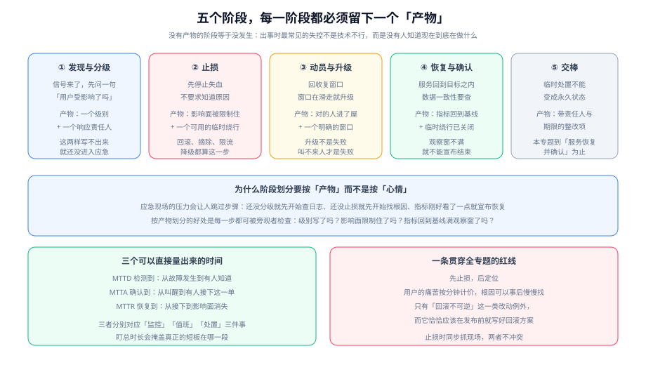

# 总览：故障应急的四条边界

应急体系最容易走偏的地方是**把它当成一份文档**：写得很好看，贴在墙上，出事时没人打开。要避免这一点，得先把四件事的边界划清：**什么算事故、谁负责、什么时候升级、什么时候收口**。这四条边界划不清，后面所有的预案与演练都没有落点。



## 一句话定位

本页回答「这套体系到底在管什么」。它不教具体命令（那是 [定位与止损](../Diagnosis/index.md) 与 [应急预案](../Runbook/index.md) 的事），只确立判断标准——**判断标准不清楚时，执行力越强错得越离谱**。

::: tip 一句话理解
应急体系的目标不是「不出现故障」，而是**让同一次故障的恢复时间可预期**。一个团队能把 MTTR 稳定压在 30 分钟，比一个团队偶尔 5 分钟、经常 5 小时要可靠得多。
:::

## 先把三个词分开：事故、问题、缺陷

这三个词在日常交流里经常互相替代，但在应急流程里它们对应**完全不同的流程与负责人**：

| 词 | 英文 | 定义 | 触发什么流程 | 负责人 |
| --- | --- | --- | --- | --- |
| **事故** | Incident | 服务当前**对用户不可用或结果不正确**，需要立刻恢复 | 应急流程：定级 → 动员 → 止损 → 恢复 | 当班值班人（升级后为应急指挥） |
| **问题** | Problem | 事故的**成因或隐患**，往往在事故恢复后才被看清 | 整改流程：分析 → 方案 → 排期 → 验证 | 技术负责人 / 团队 |
| **缺陷** | Defect | 代码、配置或设计上的具体错误 | 常规研发流程：提 issue → 修复 → 发布 | 代码所有者 |

分开的意义：**事故的度量单位是分钟，问题的度量单位是天，缺陷的度量单位是迭代**。把三者混在一个流程里，会得到两种坏结果——要么因为「还没找到原因」而迟迟不敢恢复服务，要么因为「先恢复了」而再也没人去修真正的问题。

::: warning 说明
「事故」不包含计划内的维护窗口与已知的、已公告的功能不可用。是否有维护窗口、是否已提前公告，是判断「要不要启动应急」的第一个过滤器。
:::

## 边界一：什么算事故

判据只有一条，而且是**用户视角**的：

> **有没有真实用户因为这个变化而无法完成他本来能完成的事？**

这句话刻意避开了「内部指标是否越线」，因为两者经常背离：

- **指标越线但用户无感**：某个内部批量任务的耗时超标、某个非关键接口的错误率上升。这属于「问题」，可以按工单处理，**不应该在半夜叫人起来**。
- **用户有感但指标正常**：指标只采样了协议层成功，业务层的「下单成功但订单没生成」完全看不出来。这类必须靠**业务指标**（下单成功率、支付成功率）或用户反馈才能发现。

因此一个可用的做法是：**把事故判据挂到业务指标上，把技术指标留给定位用**。技术指标回答「哪里慢了」，业务指标回答「用户是不是在受影响」。

::: danger 注意
三个最常被写进预案、又最常失效的判据，请逐条对照检查：

1. **「CPU 超过 80% 就启动应急」**——CPU 高不等于用户受影响，这是容量信号不是事故信号，写成报警即可。
2. **「错误率超过 1%」**——必须写清是**哪个**错误率（HTTP 5xx 率？接口业务失败率？），笼统的「错误率」在事故现场会产生争议，而争议本身就是延误。
3. **「值班人判断影响较大时」**——这是把判据推给人，等于没有判据。正确写法是把「大」翻译成可观测的量：受影响用户占比、受影响的核心链路数量、是否有资金或数据的错误。
:::

## 边界二：谁负责

核心原则是**责任必须落在「当班的人」而不是「最熟悉的人」**：

| 时刻 | 责任人 | 权限 |
| --- | --- | --- |
| 告警触发到有人接下之前 | 升级链路上的值班人 | 有权定级、有权升级、有权执行预案内的动作 |
| 有人接下之后 | 该值班人（或他按流程指认的指挥） | 有权决定止损方案、有权宣布恢复、有权拒绝非应急诉求 |
| 定级达到高等级后 | 应急指挥（独立于处置人员） | 有权调动资源、有权对外沟通、**不应直接动手** |
| 恢复之后 | 技术负责人 | 有权决定整改项与排期 |

这条边界的反面是**「谁在线谁负责」**：出事了在群里问「这个模块谁熟」，等熟悉的人上线，已经过去了二十分钟，而这二十分钟里没人止损。正确做法是**当班人先按预案止损，熟悉的人到了再接手定位**——这两件事可以同时发生。

## 边界三：什么时候升级

升级（Escalation）在中文语境里容易被理解成「上报领导」，于是大家本能地不愿意做。要把它的定义换掉：

> **升级不是「告诉领导」，升级是「把当前局面交给更多能处置的人」。**

三个必须升级的触发条件，建议直接写死：

1. **时间触发**：超过预案里写的「此步骤完成后仍未恢复」，机械升级，不需要任何人同意。
2. **能力触发**：需要的权限或知识当前人没有（例如需要改网络策略、需要动数据库主库），立即升级。
3. **规模触发**：影响面比最初定级时的估计大，或影响仍在扩大。

第三条最容易漏。事故初期的影响面估计几乎总是偏小，因为用户在陆续发现。**「它还在变大」本身就是升级的理由**，不需要等到确认最终规模。

::: tip 提示
给「升级」加一条保护规则：**任何人升级都不需要事先批准，也不需要事后解释**。只有当升级会被评价为「小题大做」时，人们才会犹豫——而犹豫的代价直接加在 MTTR 上。
:::

## 边界四：什么时候收口

收口（Recovery）不是「页面能打开了」，而是**服务回到目标水平并保持住**。三段式判据：

1. **指标回到基线**：不是勉强低于告警阈值，而是回到事故前一个时间窗的正常区间。
2. **观察窗满足**：连续观测一段时间（常见 15~30 分钟，按业务周期定）没有再次越界。
3. **临时措施已回收**：手动加的限流、降级、摘除、临时扩容，要么已撤除，要么已被明确登记为长期配置。

第 3 条最容易被忽略，代价也最大：上周为救火打开的降级开关，如果没有回收，它就会永久地留在配置里，直到某天有人发现「推荐功能已经悄悄关了三个月」。

::: danger 注意
两种常见的「假收口」：

- **看单个指标恢复就宣布结束**：错误率降下来了，但排队队列里还积压着几十万条消息，用户侧会在接下来的两小时里持续感受到延迟。
- **由处置者自己宣布结束**：处置者往往比任何人都更疲惫，也更希望结束。宣布恢复的判断最好由**掌握全局的人**（应急指挥）做，并有明确的观察窗作为凭据。
:::

## 五个阶段与各自的产物

再看一遍开头那张生命周期图，重点在每个阶段**必须留下的产物**——产物是「这个阶段真的发生过」的唯一证据：

| 阶段 | 要回答的问题 | 必须留下的产物 |
| --- | --- | --- |
| ① 发现与分级 | 用户受影响了吗？多大范围？ | 一个级别 + 一个响应责任人 |
| ② 止损 | 怎么先把失血止住？ | 影响面被限制 + 一个可用的临时绕行 |
| ③ 动员与升级 | 需要谁进来？恢复窗口是多久？ | 该到的人到齐 + 一个明确的时间承诺 |
| ④ 恢复与确认 | 真的好了吗？数据对吗？ | 指标回到基线 + 临时措施已回收 |
| ⑤ 交棒 | 怎么防止它再发生？ | 带责任人与期限的整改项 |

## 三个可以直接量出来的时间

不要只盯「这次故障修了多久」，把它拆成三段，才能知道短板在哪：

| 指标 | 含义 | 短板指向 | 常见改进手段 |
| --- | --- | --- | --- |
| **MTTD**<br/>（Mean Time To Detect，平均检测时长） | 故障发生到有人知道 | 监控与观测覆盖 | 补业务指标、降低采样延迟、去掉「只有用户反馈才发现」的盲区 |
| **MTTA**<br/>（Mean Time To Acknowledge，平均确认时长） | 告警发出到有人接下 | 值班与告警质量 | 修升级链路、减少误报、把不可行动的告警从电话降级为工单 |
| **MTTR**<br/>（Mean Time To Restore，平均恢复时长） | 接单到影响面消失 | 预案与权限 | 补预案、给当班人权限、准备可一键执行的止损手段 |

盯总时长（很多人把它统统称为 MTTR）会掩盖真正的短板：**如果故障是用户发现的，那么再快的处置也救不回 MTTD 那一段**。

## 成熟度五档：先定位自己在哪一档

不要在 L0 的团队照搬 L4 的做法，那会得到一堆没人维护的文档。逐档往上爬，每档只做一件事：

| 档位 | 特征 | 这一档唯一要补的东西 |
| --- | --- | --- |
| **L0 随机** | 出事靠用户反馈，谁在线谁上，结束靠运气 | 指定一个当班人，把「谁来」写下来 |
| **L1 有值班** | 有人值班，但值班人不知道自己有什么权限 | 给当班人一条明确的止损权限与一条升级链 |
| **L2 有定级** | 有了分级标准，但只在事后用来描述事故 | 把定级挪到**事故开始时**用，并让它决定动员规模 |
| **L3 有预案** | 高频故障有手册，能照着做 | 把手册拿到演练里跑一遍，回填实测结果 |
| **L4 可验证** | 值班、定级、预案、演练形成闭环，指标可度量 | 用 MTTA/MTTR 的长期趋势去驱动下一轮投入 |

::: tip 提示
判断自己在哪一档的最快方法：**随便挑一个上周发生过的故障，问「当时是谁定的级、定级之后第一件事该做什么」**。答得出来且答案一致，说明至少在 L2 以上。
:::

## 什么时候不需要这一整套体系

不是所有团队都需要完整流程，强行套用会变成形式主义。以下情况可以只做最小集：

- **没有外部用户、可随时停止的内部工具**：定级与指挥体系可以省略，保留「谁改谁负责」即可。
- **单体应用、单人维护、无 7×24 诉求**：值班表无意义，保留预案与止损清单即可。
- **业务有天然的长停机容忍度**（如内部数据平台可以停半天）：把资源投到可恢复性（备份恢复演练）而不是响应速度。

反过来，只要出现以下任一情况，这套体系就不是可选项：**有外部付费用户、有资金或数据的正确性风险、有对外报告义务、有多人共同维护同一套服务**。

## 最小起步三步

如果现在什么都没有，按这三步做，每一步都能独立生效：

1. **写下一张值班表**（哪怕只有三个人、只在工作时间轮）。判据：表上有姓名、时段、联系方式，并且你知道怎么在凌晨两点把表上的第一个人叫醒。
2. **写下一张定级表**（五档足够）。判据：拿最近三次故障往回套，每次都能得到唯一的级别，并且不同的人套出来的级别一致。
3. **写三份预案**（按发生频率排序的前三个）。判据：把预案给一个不熟悉该系统的人，他能在不问你问题的前提下照着执行完。

## 验证方式：三条可以立刻跑的命令

本页的结论都可以被验证，不需要任何额外环境：

```shell
# 1) 值班表是否真的通：把受测人换成本人，确认升级链路能叫到人
#    在值守平台里点一次「测试呼叫」，观察是否真的收到电话（不是只看到通知）
echo "在值守平台触发一次测试呼叫，记录：电话是否响铃 ____ 秒内接通 ____"

# 2) 定级表能否收敛：用最近 3 次历史故障回套，看不同人的结论是否一致
grep -rn "定级\|级别" project/Complete/MonitoringDashboard/Rules/index.md | head -5

# 3) 预案是否写到了可执行：检查它有没有「期望输出」与「回退点」两段
grep -c "期望\|回退\|升级条件" docs/Ops/IncidentResponse/Runbook/index.md
```

第 3 条命令的预期输出是**非零**——一份预案里出现「期望 / 回退 / 升级条件」的次数应当是几十次而不是零次。如果输出是 0，说明预案只写了动作、没写判据。

## 与「变更管理」专题的分工（第 170 天补充）

本页讲**故障来了怎么响应**（定级、指挥、止损、复盘）；[变更管理与发布工程](../../ChangeManagement/EmergencyChange/index.md) 讲**故障中的修复动作按什么规则被允许**——也就是紧急变更的破窗边界与额度。

| 问题 | 本页 | 变更管理专题 |
| --- | --- | --- |
| 现在该谁说话 | IC 与授权人分工 | 紧急变更授权人的**唯一**职责是「批这一次破窗」 |
| 先止血还是先查因 | 止损优先 | 止血动作属于紧急变更，形状变更仍要走审批 |
| 事后怎么交代 | 复盘与改进项 | 24 小时内补单 + 月度紧急变更占比 |

**一条本页特有的坑：故障中「先补单再动手」一定会被绕过。** 反过来「完全不记」也不行——事后没人能说清改了哪几处。可行口径是**口头授权 + 事后补单**：IC 在群里说一句「我批了，改 X」，执行人照做，24 小时内把这次动作补成一条变更单，并在单子里写明**谁口头批的、批的时间**。这条口径要写进预案，否则每次故障都会现场发明一次流程。

## 参考资料

- GB/T 28827.3-2012《信息技术服务 运行维护 第3部分：应急响应规范》
- GB/T 20986-2023《信息安全技术 网络安全事件分类分级指南》（四级分级的国标口径）
- 《国家网络安全事件报告管理办法》（2025-11-01 施行）—— 报告时限与义务主体的法定来源
- Google SRE 关于事件指挥体系（Incident Command System）的公开章节
- [本专题目录页](../index.md) 中的「制度与工具事实速览」表（2026-10 口径）
