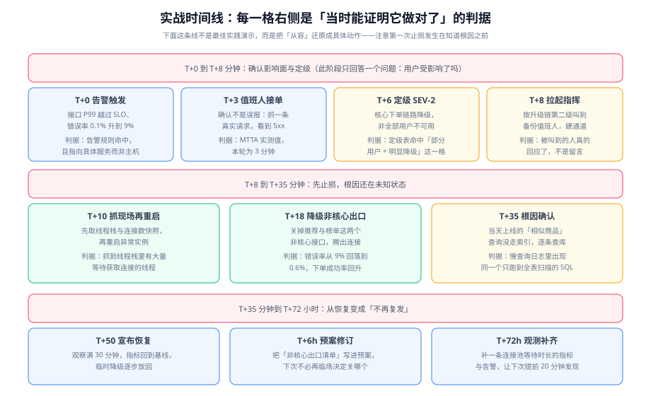

# 实战：一次连接池耗尽事故

本页把前八页的所有条款放到一条真实感足够强的时间线上跑一遍：**一次由「新上线的查询」引发的数据库连接池耗尽**。之所以选这个形态，是因为它同时具备三个特征——**有明确变更点、有清晰的影响面边界、止损手段在四档里跨了三档**，因而是最适合把整套体系串起来的例子。



## 场景与约束

| 项 | 设定 |
| --- | --- |
| 服务 | 电商下单服务 `order-service`（Java，多副本，连接池上限 50） |
| 依赖 | MySQL 主从、Redis、推荐服务（非核心） |
| 用户规模 | 日活几十万，晚间 20:00~22:00 为高峰 |
| 变更历史 | 当天 13:40 上线 `v2.31.0`，新增「相似商品」查询（走 MySQL） |
| 值班安排 | 主值班 1 人 + 备份 1 人，高等级告警走电话 |
| 监控现状 | 有接口成功率与 P99 告警；**没有连接池等待时长的指标** |
| 演练历史 | 一个月前做过一次桌面推演，未做过缓存 / 数据库相关的单点演练 |

::: warning 说明
最后一行「没有连接池等待时长的指标」是这次事故里最关键的一条设定。**事故的根本原因往往不是某个代码缺陷，而是某个缺陷恰好落在观测的盲区里**——它让 MTTD 从理论上的一分钟变成了实际的十八分钟。
:::

## 完整时间线

下面的每一格右侧都是「当时能证明它做对了」的判据。注意**第一次止损发生在知道根因之前 25 分钟**。

### 第一阶段：发现与分级（T+0 ~ T+8 分钟）

| 时刻 | 发生了什么 | 判据 / 依据 |
| --- | --- | --- |
| T+0 | 下单接口 P99 越过 SLO、错误率从 0.1% 升到 9%，告警触发 | 告警规则命中，且指向**具体服务**而不是某台主机 |
| T+3 | 主值班人接单，抓一条真实请求确认不是误报（返回 5xx） | MTTA 实测 = 3 分钟（承诺 5 分钟） |
| T+6 | 定级 **SEV-2**：核心下单链路降级、非全部用户不可用 | 定级矩阵命中「部分用户 / 明显降级」这一格 |
| T+8 | 按升级链第二级叫到备份值班人与技术负责人，开作战室与干系人通道 | 被叫到的人**真的回应了**（不是只看到通知） |

**这一阶段做对的三件事**：① 没有先查日志，先确认影响面；② 定级只花了 3 分钟，没有争论；③ 通道在第 8 分钟就建好了，此后的所有信息都有地方落。

### 第二阶段：止损（T+8 ~ T+35 分钟）

| 时刻 | 发生了什么 | 判据 / 依据 |
| --- | --- | --- |
| T+10 | **先抓现场再重启**：取线程栈与连接数快照，然后重启两个异常实例 | 线程栈中抓到大量 `WAITING` 在获取连接的线程 |
| T+12 | 重启后错误率短暂下降，**5 分钟后再次上升到 11%** | 「重启只是缓解，不是修复」——这是判断根因仍在的第一条证据 |
| T+13 | 指挥要求技术负责人给出「最近 2 小时改了什么」的清单 | 得到 `v2.31.0` 与「新增相似商品查询」两条 |
| T+18 | 执行第三档止损：关闭 `FEAT_RECOMMEND` 与 `FEAT_RANKING` 两个非核心出口 | 错误率从 11% 回落到 0.6%，下单成功率回升到 97% |
| T+20 | 影响面仍在扩大（新用户开始受影响），**指挥决定扩大通知范围并升为 SEV-1** | 「它还在变大」本身就是升级理由，不需要等到确认最终规模 |
| T+25 | 对外第一条播报：影响 + 已做 + 下次更新时间 | 播报时间点有记录，可事后核对节奏是否达标 |
| T+33 | 连接池 `active` 数回落到事故前区间，进入观察 | 连接池指标有基线可比（这是事前记录基线的价值） |

**这里有一个关键决策点值得单独指出**：T+12 的重启让错误率短暂下降。如果此时宣布「已恢复」，就会进入**假收口**——根因仍在，半小时后必然复发。判断「能不能宣布恢复」的依据是**观察窗 + 多条指标的共同结论**，而不是某一条指标的瞬时改善。

### 第三阶段：定位（T+35 ~ T+50 分钟）

| 时刻 | 发生了什么 | 判据 / 依据 |
| --- | --- | --- |
| T+35 | 在慢查询日志中发现同一条 SQL 反复出现，且执行计划为**全表扫描** | 慢查询日志里出现同一 SQL，`type=ALL`、扫描行数与表行数同量级 |
| T+38 | 确认该 SQL 由 `v2.31.0` 新增的相似商品查询引入，且**没有走预期的索引** | 能从调用栈或链路追踪把 SQL 归属到具体新接口 |
| T+42 | 关闭该接口的功能开关（而不是回滚整个版本） | 影响面收窄到「一个功能不可用」，其余功能全部恢复 |
| T+50 | 下单成功率稳定在 99.95%，**观察满 30 分钟**后宣布恢复 | 指标回到基线 + 观察窗满足 + 临时措施已回收或已登记 |

**为什么选择关开关而不是回滚整个版本**：`v2.31.0` 里还包含两个业务急需的修复，整版回滚会带来新的问题。此时**可逆性与影响范围的权衡**成为主要依据——关一个开关的影响面最小。

### 第四阶段：从恢复变成不再复发（T+50 分钟 ~ T+72 小时）

| 时刻 | 发生了什么 | 判据 / 依据 |
| --- | --- | --- |
| T+55 | 排查「为什么已经加了索引还是全表扫描」 | 结论：新 SQL 的查询条件与现有索引的最左前缀不匹配，需要新增复合索引 |
| T+6h | **预案修订**：把「非核心出口清单」写进应急预案首页，下次不必临场决定关哪个 | 预案里新增一页「常用开关速查表」，含开关名、影响、生效延迟 |
| T+24h | 新增复合索引并灰度验证；相似商品查询恢复 | 恢复后 P99 与连接池 `active` 数均回到基线 |
| T+48h | 修订定级表：把「数据错误」相关的判据再明确一次（本次虽无数据错误，但暴露出判据边界模糊） | 定级表新增「有非预期写入 → 至少 SEV-2」一条 |
| T+72h | **观测补齐**：上线「连接池等待时长」与「连接池待获取数」两条指标与告警 | 新告警有对应的 Runbook；用一个合成请求验证告警能触发 |

**如果这四步里只做了一件事**，正确的选择是最后一件（观测补齐）——因为这次事故的 MTTD 从理论上的 1 分钟变成了 18 分钟，全部损耗都在这个盲区里。

## 与周期 5 监控大盘项目七个组件的对应

这次事故恰好可以逐项检验 [实时监控大盘](/project/Complete/MonitoringDashboard/index.md) 里定义的七个组件在真实故障中各自扮演什么角色：

| 组件 | 在这次事故中的角色 | 若缺失会发生什么 |
| --- | --- | --- |
| C1 业务侧指标暴露 | 提供接口成功率与 P99 的原始数据 | 只能靠用户反馈发现问题，MTTD 从分钟级变成小时级 |
| C2 采集任务 | 把指标拉进时序库，本次事故中采集正常 | 需要确认「观测链路是活的」，否则指标平静可能只是没在采集 |
| C3 指标模型与标签 | `service` / `env` 标签让「只看下单服务」成为一条查询 | 没有标签就无法按服务切片，只能看整体 |
| C4 规范门禁 | 保证新增的「连接池等待时长」指标命名与标签符合契约 | 新指标随手命名，后续无法与历史数据对齐 |
| C5 查询与规则 | 接口成功率告警在这次事故中**正常工作**（T+0 触发） | 没有规则就只能人工盯看板 |
| C6 看板数据服务 | 提供一个查询接口，把「当前状态」暴露给值班人 | 值班人需要在多个系统之间切换，**每一次切换都是一次注意力损耗** |
| C7 告警路由与通知 | 保证 SEV-2 的电话真的到达人（MTTA 3 分钟） | 通知只到应用内，深夜无人可见 |

::: tip 提示
这份对照表本身就是一个可用的自查方法：**拿最近一次真实事故，逐个组件问「它当时在做什么」**。任何一个答不上来的组件，要么是没建成，要么是建成了但没人用——两者都需要处理。
:::

## R1~R10 验收判据

以下十条用于验收「这套应急体系在一次真实事故中是否有效」。每条都写成可判定的形式：

| 编号 | 判据 | 验证方式 |
| --- | --- | --- |
| **R1** | 事故被**系统**发现而不是被用户发现 | 时间线里第一条记录来自告警，不来自客服转述 |
| **R2** | MTTA ≤ 级别承诺（SEV-2 为 10 分钟） | 实测告警时间与认领时间之差 |
| **R3** | 定级在发现后 **10 分钟内**完成，且等级与定级表一致 | 定级时间点有记录；事后回套定级表结论相同 |
| **R4** | 首次止损发生在**根因确认之前** | 时间线里「执行止损」的时刻早于「定位根因」的时刻 |
| **R5** | 止损手段落在四档内，且**说明过可逆性** | 记录中能查到动作属于第几档、如何回退 |
| **R6** | 指挥全程未直接修改生产环境 | 生产变更记录里没有指挥的账号 |
| **R7** | 对外播报按级别节奏执行，且**至少有两次** | 播报记录的时间差不大于承诺间隔 |
| **R8** | 宣布恢复前满足观察窗，且临时措施已回收或已登记 | 恢复时刻与最后一条异常指标之间 ≥ 观察窗；开关状态有核对记录 |
| **R9** | 至少产出**一条**预案修订与**一条**观测补齐 | 预案文件有本次对应的改动；新增指标能在看板上查到 |
| **R10** | 事故期间生产变更**可回溯**：每次改动都有记录（谁、何时、为什么） | 变更清单条数与实际动作条数一致 |

**这十条里 R9 最容易被跳过，也最重要**——它决定了这次事故是「一次损失」还是「一次投资」。

## 本地可执行验证

以下命令**不需要容器运行时**，用于验证本文涉及的观测与配置是否自洽（把服务地址替换成自己的）：

```shell
# 1) 接口成功率与 P99 是否能查到（R1 的前提：指标存在）
curl -s 'http://localhost:9090/api/v1/query?query=up{job="order-service"}' | head -c 300; echo

# 2) 连接池指标是否存在（本次事故的观测盲区，T+72h 应补齐）
curl -s 'http://localhost:9090/api/v1/query?query=hikaricp_connections_pending' | head -c 300; echo

# 3) 告警规则是否真的会触发（静态校验，不需要运行实例）
promtool check rules rules/alerting.yaml    # 期望：SUCCESS: N rules found

# 4) 定级表与预案是否可检索（确认文档存在于仓库内而不是口头约定）
ls docs/Ops/IncidentResponse/Severity/index.md docs/Ops/IncidentResponse/Runbook/index.md
```

**判读**：第 2 条如果返回空结果集 `"result":[]`，说明连接池指标**尚未暴露**——这正是本次事故的盲区，应当记为一条待办，而不是当作「没有异常」。

## 本方案明确不做的四件事

1. **不做无上限的根因追查**：在 T+50 宣布恢复之后，剩余的问题（为什么索引没被用上）按**正常研发流程**处理，不再占用应急资源。
2. **不追求「一次说清所有原因」**：本次只定位到「新增查询 + 索引失配」这一层，更上层的「为什么没有在预发环境发现」属于流程改进，另行处理。
3. **不把「关开关」当成长期方案**：开关在 T+42 关闭、T+24h 恢复，中间存在一个功能不可用的窗口，这个窗口必须在恢复后立刻关掉。
4. **不做没有安全阀的演练**：本页给出的演练建议全部限定在预发或单副本范围，不含生产全量注入。

## 参考资料

- [故障定级](../Severity/index.md)（SEV-2 → SEV-1 的升级依据）、[应急指挥与协同](../Command/index.md)（指挥在时间线中的动作边界）
- [定位与止损](../Diagnosis/index.md)（四档止损手段与四个定位陷阱）、[应急预案与运行手册](../Runbook/index.md)（本次修订的预案模板）
- [实时监控大盘](/project/Complete/MonitoringDashboard/index.md)（七个组件的定义与验收判据）
- [演练与预案校验](../Drill/index.md)（本次事故暴露出的观测缺口如何通过演练提前发现）
