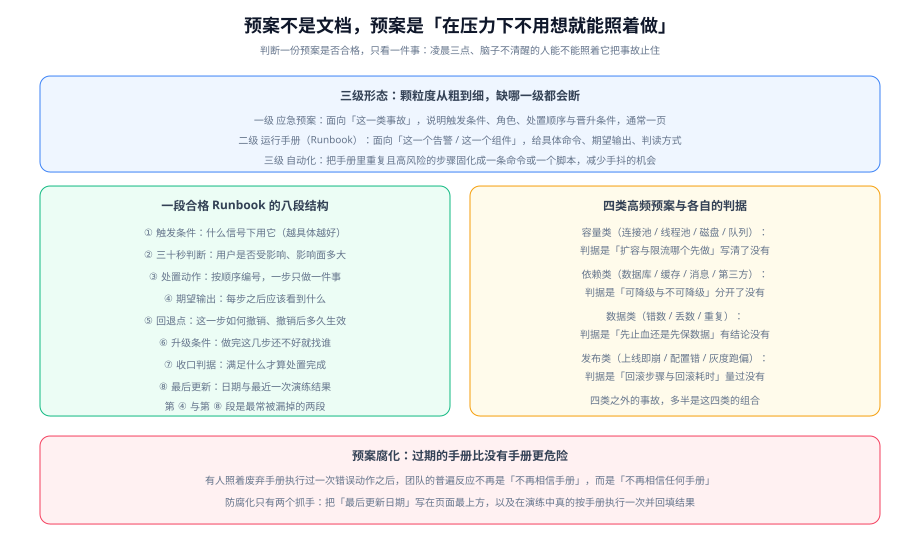

# 应急预案与运行手册

预案（Contingency Plan）与运行手册（Runbook）的区别，很多人一辈子没分清：**预案面向「哪一类事故」，手册面向「哪一个告警」**。预案是一页纸的决策框架，手册是要照着敲的命令清单。只有预案没有手册，等于给了地图没给路；只有手册没有预案，等于给了路但不知道往哪走。



## 一句话定位

本页教「怎么写、怎么维护、怎么判断它还有效」。至于**什么时候用它**由 [故障定级](../Severity/index.md) 决定，**用它的时候怎么动**由 [定位与止损](../Diagnosis/index.md) 展开。

::: tip 一句话理解
判断一份预案是否合格，只有一个标准：**凌晨三点、脑子不清醒的人，能不能照着它把事故止住**。所有形式上的要求（格式、篇幅、归档位置）都服务于这一条。
:::

## 三级形态：颗粒度必须对齐

| 层级 | 名称 | 面向对象 | 篇幅 | 内容 |
| --- | --- | --- | --- | --- |
| 一级 | **应急预案** | 一类事故（如「数据库不可用」「发布后大面积报错」） | 一页 | 触发条件、角色、处置顺序、升级条件、收口判据 |
| 二级 | **运行手册**（Runbook） | 一个告警 / 一个组件 | 一到三页 | 具体命令、期望输出、判读方式、回退点 |
| 三级 | **自动化** | 一个重复且高风险的步骤 | 脚本 / 流水线 | 把手册里最容易手抖的步骤固化成一条命令 |

三级的演进路线是**单向**的：先从预案开始，写手册时发现某些步骤每次都在重复，才把它自动化。**反过来（先写自动化）会失败**，因为你还不清楚正确的处置顺序是什么，自动化只会把错误的顺序固化得更牢。

## 一段合格 Runbook 的八段结构

这八段缺一段，就会在现场产生一个问题。括号里是「缺了这段会发生什么」：

1. **触发条件**：什么信号下用它（缺了：人手一份手册，不知道该翻哪一份）
2. **三十秒判断**：用户是否受影响、影响面多大（缺了：直接开始调参数，方向可能完全错）
3. **处置动作**：按顺序编号，一步只做一件事（缺了：动作顺序靠临场商量）
4. **期望输出**：每一步之后应该看到什么（缺了：做完了不知道对不对）
5. **回退点**：这一步怎么撤销、撤销后多久生效（缺了：一步做错就回不去）
6. **升级条件**：做完这几步还不好就找谁（缺了：值班人自己硬扛到天亮）
7. **收口判据**：满足什么才算处置完成（缺了：靠感觉宣布结束）
8. **最后更新**：日期与最近一次演练结果（缺了：无法判断这份手册是否还适用于当前版本）

::: warning 说明
第 4 段与第 8 段最常被漏掉。漏掉第 4 段的后果是「动作做了，但判据全靠经验」；漏掉第 8 段的后果是**无法判断手册是否过期**，于是所有手册在读者心里的可信度一起下降。
:::

## 四类高频预案与各自的判据

绝大多数线上故障能归到这四类里。每一类的关键判据只有一条，**把这条判据写清就等于把预案写对了一半**：

### 容量类（连接池 / 线程池 / 磁盘 / 队列）

**关键判据：扩容与限流，谁先做？**

先扩容的场合：资源确实被正常业务流量打满，且扩容是安全的（无状态、可水平扩展）。
先限流的场合：请求本身不合理（重试风暴、爬虫、失控的批任务），或者扩容会把压力原样传导到已经饱和的下游。

```text
# 容量类预案的最小骨架（示意：数据库连接池耗尽）
触发：连接池 active 数持续等于 maxPoolSize，且出现获取连接超时
三十秒判断：接口错误率是否上升？上升 → 用户已受影响，按 SEV-2 起步
处置：
  1) 抓现场（重启前必做）：取线程栈与连接池快照        ← 期望：看到大量 WAITING 在获取连接的线程
  2) 关闭非核心出口（把连接让给核心链路）              ← 期望：错误率下降
  3) 若 5 分钟内未缓解，扩容连接池并同步下游容量        ← 期望：active 数回落、超时消失
  4) 定位到底是哪条 SQL / 哪个调用占用连接
回退：关掉的开关于恢复后逐一放回；连接池扩容需评估下游能否承接
升级：完成 1~3 仍不缓解 → 叫数据库负责人
收口：错误率回到基线并观察 30 分钟；连接池 active 数回到事故前区间
```

### 依赖类（数据库 / 缓存 / 消息 / 第三方）

**关键判据：可降级与不可降级，分开了吗？**

把全部依赖按「坏掉时业务还能不能转」分成两栏，**事前分好**。事故现场再去判断「这个能不能降级」，会花掉最宝贵的十分钟。

| 依赖 | 可降级？ | 降级形态 |
| --- | --- | --- |
| 推荐 / 榜单 | 可 | 返回默认内容 |
| 商品搜索 | 可降级为「用分类浏览代替」 | 提示用户换一种方式 |
| 订单写入 / 支付 | 不可 | 只能止损，不能降级 |
| 登录 | 不可（但可降级为「已登录会话继续可用」） | 禁止新登录，放行已有会话 |

### 数据类（错数 / 丢数 / 重复）

**关键判据：先止血还是先保数据？**

数据类事故有一条与其它三类相反的规则：**「快」不是第一优先级，第一优先级是「不要再写坏更多」**。

顺序固定为：**先停止产生新的错误数据 → 再评估已产生的错误数据 → 最后修复**。贸然「重跑一遍」通常会把问题放大，因为重跑会与正在写入的正常流量竞争，还可能造成重复。

### 发布类（上线即崩 / 配置错 / 灰度跑偏）

**关键判据：回滚步骤与回滚耗时，量过吗？**

发布类事故的止血手段几乎永远是**回滚**，因此预案的核心是**回滚能力本身**：

- 回滚命令是**一条**还是**一串**？（一串意味着现场要查文档）
- 回滚耗时**测过**吗？（没测过的回滚等于没有回滚）
- **数据库变更能否回滚**？（加字段可以，删字段通常不可以——这类变更必须在发布前就写好「前向兼容」方案）
- 灰度发布时，**回滚是撤掉新版本还是放量旧版本**？

::: danger 注意
「不可逆变更」是发布类预案里唯一必须特殊对待的东西。破坏性的数据库迁移（删列、改类型、清数据）一旦上线就无法用回滚解决，**因此它必须在发布前就准备好回退方案**，而不是等到出事才想。正确做法是把它拆成「加新列 → 双写 → 切读 → 停写旧列 → 若干版本后再删」，任何一步出问题都能停在原地。
:::

## 让预案「可执行」：三条硬要求

### 要求一：命令必须能直接复制

不要写「进入容器查看连接数」这种自然语言，写具体的命令与文件名：

```shell
# 反例："查看数据库连接数"
# 正例：
kubectl exec -n prod deploy/order-service -- sh -c \
  'cat /proc/net/tcp | wc -l'        # 期望：远低于 maxPoolSize，否则连接泄漏
```

### 要求二：每步都要有判据

判据必须是**可比较的**：一个数字、一个状态、一个字符串。写「看起来正常」等于没有判据。

```shell
# 正例：判据写成可比较的形式
curl -s -o /dev/null -w '%{http_code}\n' https://api.example.com/healthz   # 期望：200
curl -s -o /dev/null -w '%{time_total}\n' https://api.example.com/healthz  # 期望：< 0.3
```

### 要求三：给「不熟悉这个系统的人」看一遍

这是最有效的可执行性检验：把手册交给一个**没有参与过这个系统开发的人**，让他在预发环境照着执行，全程不许提问。他卡住的每一处，都是手册的真实缺陷。

## 自动化：把最容易手抖的步骤固化

自动化的优先级不是「难的先做」，而是**「重复发生且风险高的先做」**。按这个标准，优先自动化的通常是：

| 优先自动化的步骤 | 理由 |
| --- | --- |
| 抓现场（线程栈、堆快照、连接数、最近错误日志） | 每次都要做、步骤多、容易在慌乱中漏做某项 |
| 一键回滚 | 时间敏感、命令长、容易敲错版本号 |
| 关闭非核心出口 | 判断简单、执行快、但涉及多个开关容易漏 |
| 只读 / 降级切换 | 影响面大，手抖代价高 |

**不该自动化的**：需要判断的决策（是否升级、是否切主库）。自动化的边界是「确定性的执行」，不是「判断」。

## 防腐化：过期手册比没有手册更危险

一份过期的手册会造成一种特殊的破坏：**有人照着它执行过一次错误动作之后，团队的普遍反应不是「不再相信这份手册」，而是「不再相信任何手册」**。这个损失的规模远大于一次错误操作。

三个抓手：

1. **把「最后更新」写在页面最上方**，不是页脚。读者第一眼就要看到它的年龄。
2. **演练按手册执行并回填实测结果**（见 [演练与预案校验](../Drill/index.md)）。演练是唯一能让手册保持与现实同步的机制。
3. **手册与配置一起版本化**：服务发布时，检查这次发布是否触及了某份手册描述的组件；触及了就必须复核那份手册。这一条可以做成流水线里的一个检查项。

## 实战：给「数据库连接池耗尽」写一份完整 Runbook

下面是一份可以直接改造成自己版本的完整手册。注意它同时满足八段结构与三条硬要求：

```text
# Runbook：数据库连接池耗尽
最后更新：2026-10-13   最近演练：2026-10-11（单点演练，预发环境，耗时 6 分钟）

## 1. 触发条件
任一满足：① 连接池 active 持续 = maxPoolSize 超过 2 分钟；
          ② 应用日志出现 "Timeout waiting for connection from pool"；
          ③ 数据库侧 active session 数超过实例上限的 80%

## 2. 三十秒判断（先回答这三句）
① 用户受影响了吗？      → 看下单接口成功率；低于 99% 视为已受影响
② 影响面多大？          → 看错误率与受影响接口数；核心链路失败 → 按 SEV-2 起步
③ 最近改了什么？        → 查最近 2 小时的发布与配置变更清单（这是最快的线索）

## 3. 处置动作（按顺序，一步一动作）
1) 抓现场（不重启！）
   kubectl exec -n prod deploy/order-service -- jstack 1 > /tmp/order-jstack-$(date +%s).txt
   期望：文件非空，且后续能在里面搜到大量等待获取连接的线程
2) 查看连接池实时状态（应用暴露的监控端点）
   curl -s http://order-service:8080/actuator/metrics/hikaricp.connections.active
   期望：value 接近 maxPoolSize（如 50）
3) 关闭非核心出口（腾出连接）
   kubectl -n prod patch configmap feature-flags --type merge \
     -p '{"data":{"FEAT_RECOMMEND":"false","FEAT_RANKING":"false"}}'
   期望：1 分钟内错误率下降；若 3 分钟无变化 → 进入第 4 步
4) 定位占用方：在 jstack 文件里找正在执行的 SQL 归属
   grep -A3 "hikaricp" /tmp/order-jstack-*.txt | head -40
   期望：能定位到具体调用栈；若定位不到 → 直接跳到第 6 步升级

## 4. 回退点
- 第 3 步的开关：`FEAT_RECOMMEND` / `FEAT_RANKING` 改回 `true` 即回退，开关生效延迟 < 10 秒
- 若临时扩大了连接池：改回原值即回退，但**必须同时确认下游数据库能承受**，否则会放大问题

## 5. 升级条件
完成 1~4 后 10 分钟仍未缓解 → 升级第 2 级；确认是数据库侧瓶颈 → 直接叫数据库负责人

## 6. 收口判据
① 下单接口成功率连续 30 分钟 ≥ 99.9%
② 连接池 active 数回落到事故前区间（记录下来作为基线）
③ 被关闭的开关已恢复，或已登记为长期配置
```

**这份手册里三个值得注意的设计**：

1. **第 1 步是抓现场，而不是重启**。重启是最快的动作，但它会把证据一起清掉；抓现场只要几十秒。
2. **第 3 步给了「3 分钟无变化就跳下一步」的判据**，而不是「观察一下」。这防止值班人在无效动作上反复尝试。
3. **回退点单独成段**，且写清了生效延迟。第 4 步说「改回原值即回退」还不够，必须说明**这一步是否安全**——扩容连接池看似可逆，实际会放大下游压力。

## 验证方式

```shell
# 1) 手册是否具备八段结构（缺段会被这条命令抓出来）
for k in 触发 判断 处置 期望 回退 升级 收口 更新; do
  printf '%-6s %s\n' "$k" "$(grep -c "$k" docs/Ops/IncidentResponse/Runbook/index.md)"
done

# 2) 手册里的命令是否可复制执行（把示例命令换成你自己的服务地址后逐条跑）
curl -s -o /dev/null -w 'healthz=%{http_code} t=%{time_total}\n' https://api.example.com/healthz

# 3) 手册是否过期：最后更新日期距今不应超过一个发布周期
grep -n "最后更新" docs/Ops/IncidentResponse/Runbook/index.md
```

**判读**：第 1 条里任何一项输出为 0，说明对应段落缺失。第 3 条如果「最后更新」比最近一次服务发布还早，说明这份手册**大概率已经不适用于当前版本**，需要先复核再用。

## 存疑与边界

- 「回滚耗时」这类数字**必须实测**，不能凭经验写。本文给出的耗时均为示例，落地时应以自己的环境实测值替换。
- 自动化脚本的具体写法归各技术专题（如 [CI/CD](../../../Tools/CICD/index.md)），本页只规定**哪些步骤值得被自动化**。

## 参考资料

- GB/T 28827.3-2012《信息技术服务 运行维护 第3部分：应急响应规范》（预案要素部分）
- [混沌工程](../../ChaosEngineering/index.md) 与 [演练与预案校验](../Drill/index.md)（验证手册是否仍然有效的两种手段）
- [CI/CD](../../../Tools/CICD/index.md)（回滚能力的建设归属）、[容器编排进阶](../../ContainerOrchestration/index.md)（滚动更新与健康检查的配置依据）
