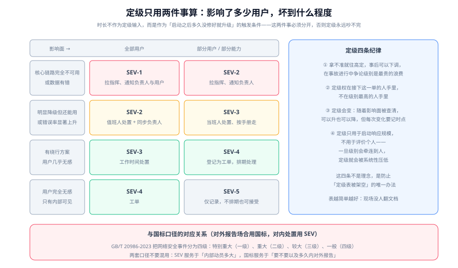

# 故障定级

故障定级（Severity Classification）要解决的问题只有一个：**把人叫醒多少、把响应规模拉到多大，由谁说了算**。它是一张**启动开关**，不是一张成绩单——这个区别决定了它会不会被有效执行。



## 一句话定位

本页给出定级的输入、五档判据、与国内国标口径的对应关系，以及让这张表不被架空的四条纪律。**它是全专题最应该先定下来的一页**，因为值班制度、指挥角色、预案里的升级条件都要引用它。

::: tip 一句话理解
定级是**事故开始时的动员依据**，不是**事故结束后的描述标签**。同样是「4 小时不可用」，开始时就定 SEV-1 和结束时才被追认为 SEV-1，对用户的影响完全不同。
:::

## 定级只吃两个输入：影响面与严重程度

先明确**不**作为输入的两样东西，否则定级永远吵不完：

| 不作为输入 | 为什么 | 它应该是什么 |
| --- | --- | --- |
| **持续时长** | 事故发生的前 5 分钟没人知道它会持续多久；用时长定级等于**先等结果再决定要不要行动** | 它是**升级触发条件**：「SEV-2 处置 30 分钟未恢复 → 升为 SEV-1」 |
| **修复难度 / 涉及系统数量** | 技术上的复杂程度只影响谁来修，不影响用户受影响的程度 | 它决定**拉谁进来**，不决定级别 |

真正决定级别的是两个轴：

- **影响面**：受影响用户占总体用户的比例，以及受影响的是不是**核心链路**（下单、支付、登录）。
- **严重程度**：是「完全不可用」还是「能用但变慢 / 变错」，以及**有没有产生错误数据**。

::: warning 说明
**数据错误应当单独提级**。服务不可用是「用户做不了事」，数据错误是「用户以为自己做完的事其实做错了」——后者的弥补成本远高于前者，且往往不可逆（钱转错了、订单金额算错了）。同一影响面下，**有数据错误的一律取更高档**。
:::

## 五档判据表

下面是可直接抄进团队文档的一版，示例按「面向外部用户的下单服务」写，**落地时请把示例替换成你自己的链路名**：

| 级别 | 影响面 | 严重程度 | 响应规模 | 通知范围 | 典型示例 |
| --- | --- | --- | --- | --- | --- |
| **SEV-1** | 全部或大部分用户 | 核心链路完全不可用，或有资金/数据的错误 | 拉应急指挥 + 全员处置 + 对外沟通 | 电话叫醒负责人与业务方，必要时公告 | 下单接口整体 5xx；支付回调大量丢失导致订单状态错乱 |
| **SEV-2** | 部分用户或部分地区 | 核心链路明显降级（错误率显著上升 / 成功率明显下降） | 值班人处置 + 指挥介入 + 通知负责人 | 电话叫醒主备值班人，业务方群内同步 | 某个可用区的实例全部不健康；搜索接口超时导致浏览转化下降 |
| **SEV-3** | 少量用户，或有绕行方案 | 非核心功能不可用，或核心链路轻微劣化 | 当班人按手册处置 | 应用推送 + 群里同步，不打电话 | 导出报表失败；某个非核心推荐接口超时 |
| **SEV-4** | 几乎无用户感知 | 内部指标异常，有轻微影响 | 工作时间处置 | 工单 / 看板 | 某个批处理任务延迟；个别实例磁盘告警 |
| **SEV-5** | 无用户感知 | 纯技术债或体验瑕疵 | 正常排期 | 工单 | 日志里出现无害的告警；某处代码有性能隐患 |

### 五档与「动作」的对应关系

定级的价值体现在**它自动决定了后续动作**。如果两个级别的动作完全一样，那就不需要两个级别：

```text
SEV-1 → 立刻宣布进入应急 + 指认指挥 + 每 15 分钟对外播报 + 通知业务方
SEV-2 → 指认指挥（可由值班人兼任）+ 每 30 分钟同步 + 通知负责人
SEV-3 → 值班人按手册处置 + 每 2 小时在群里同步进展
SEV-4 → 登记工单，当天内处置
SEV-5 → 登记工单，正常排期
```

## 为什么时长不进定级、但一定要有升级条件

这是初版定级表最常见的两个错误。对比一下：

| 写法 | 问题 | 正确写法 |
| --- | --- | --- |
| 「SEV-1：不可用超过 1 小时」 | 事故第 1 分钟时你不知道它会超过 1 小时，于是**没人行动** | 「SEV-1：核心链路完全不可用」——**不可用本身就是 SEV-1 的依据**，不需要等 |
| 只写级别，不写升级条件 | 一次 SEV-2 拖了 6 小时，始终没人升级，负责人到第二天才知道 | 明确写「**SEV-2 处置 30 分钟未缓解 → 自动升为 SEV-1**」，机械执行 |

升级条件必须**机械**，也就是不需要任何人做判断、不需要开会、不需要批准。它本质上是一个定时器：

```yaml
# 升级条件可以写成配置，让值守平台自己去判断（示意，字段名依平台而定）
escalation_rules:
  - from: SEV-2
    to: SEV-1
    when: "unresolved_for > 30m"
  - from: SEV-1
    to: SEV-1           # 同一级别但扩大通知范围
    when: "unresolved_for > 60m"
    notify_add: ["业务负责人", "技术负责人", "客服负责人"]
  - from: any
    to: "higher"        # 影响面扩大
    when: "impact_scope_increasing"
```

## 与国内国标口径的对应关系

对外报告场合（尤其是涉及网络安全事件时）必须用**国标口径**，不能用内部 SEV 编号。两套口径的用途不同，**混用会造成实际风险**：

| 口径 | 来源 | 分级 | 用途 |
| --- | --- | --- | --- |
| 内部 SEV | 团队自定（行业惯例参照 PagerDuty 的 SEV-1~SEV-5） | SEV-1 ~ SEV-5 | 决定**内部动员规模**：叫醒谁、多久播报一次 |
| 国标分级 | **GB/T 20986-2023**《信息安全技术 网络安全事件分类分级指南》 | 特别重大（一级）、重大（二级）、较大（三级）、一般（四级） | 决定**要不要以及多久内对外报告** |

关于对外报告，以下事实按 2026-10 口径核对，**直接影响预案里必须写的一条分支**：

| 项 | 事实 |
| --- | --- |
| 报告义务的来源 | 《国家网络安全事件报告管理办法》，**2025-11-01 起施行** |
| 需要报告的起点 | **较大以上**网络安全事件 |
| 报告时限 | 涉及关键信息基础设施：**最迟不超过 1 小时**；中央和国家机关各部门及其直属单位：**最迟不超过 2 小时**；其他网络运营者：**最迟不超过 4 小时** |
| 报告节奏 | 初步报告 → 情况不明可先报基础信息、**72 小时内补报** → 处置结束后 **30 日内**形成总结报告 |
| 事件分类 | 国标分 10 个大类（含设备设施故障、违规操作、不可抗力等），**不是只有「被攻击」才需要报告** |

::: danger 注意
三个把「报告」这件事做错的方式：

1. **把报告等同于对外公告**：报告是**向监管机构**的法定义务，公告是向用户的信息发布，两者受众、渠道、时限都不同，不能合并成一个动作。
2. **等查清原因再报告**：办法明确允许「情况不明时先报基础信息、72 小时内补报」——**等待查清就是对时限的违反**。
3. **预案里没有这条分支**：事故发生时才有人去翻法规，那时已经过去两个小时。正确做法是在预案里写死一条「**触发报告义务时的处置分支**」，含联系人、渠道（12387 热线）、报告要素清单。
:::

## 定级四条纪律

这四条不是理念，它们是防止定级表被架空的具体机制：

### 纪律一：拿不准就往高定

在事故进行中争论级别是最贵的浪费。**级别可以事后下调**，而且下调没有任何惩罚；但级别定低了，该到的人没到，损失是真实的。

一条可直接用的默认值：**当两个人对级别有分歧时，取较高的那个，继续处置**。

### 纪律二：定级权在接下这一单的人手里

不在级别最高的人手里，也不在「最熟悉这个系统」的人手里。理由很简单：接下这一单的人**掌握当时最完整的信息**，而且他马上要做动作，级别直接影响他的动作边界。

### 纪律三：定级会变，每次变化要记时点

事故初期的影响面估计几乎总是偏小（用户在陆续发现）。允许升也允许降，但**每次变更都要记录发生时间**——这是事后能算清「定级用了多久才收敛」的唯一依据。

### 纪律四：定级不用于评价个人

这是四条里最重要的一条。如果级别会牵连到考核，那么定级会被**系统性地压低**：值班人会倾向于把 SEV-1 写成 SEV-2，把 SEV-2 写成 SEV-3，直到整套体系名存实亡。

::: danger 注意
一个真实感很强的失败模式：值班人把 SEV-1 报成 SEV-3，因为「报高了要被问话」。结果是没拉到指挥、没通知业务方，处置拖了两小时。**级别与追责一旦挂钩，告警与定级的数据就再也不能用于改进系统了。**
:::

## 定级争议的裁决方式

争议不可避免，但要有一个**成本最低**的裁决机制：

| 争议情形 | 裁决方式 |
| --- | --- |
| 影响面吃不准（多少用户受影响） | 先按「可能更大」的那档启动，同时并行去测真实影响面；测完按证据调整 |
| 是否算「核心链路」有分歧 | 事前就把核心链路清单写进定级表（只有 3~5 条），争议时查表，不讨论 |
| 是否算「数据错误」有分歧 | 判据用「**是否有非预期的写入**」而不是「用户是否抱怨」。有非预期写入 → 至少 SEV-2 |
| 已经升过级，现在影响面缩小了，要不要降 | 允许降，但**必须先满足恢复判据**（指标回基线 + 观察窗），只是「看起来好点了」不构成降级理由 |

## 实战：用历史事件回归校准定级表

定级表写完不算完成，**必须拿真实事件往回套**。这是一次成本极低、但能发现大量问题的校准。

**做法**（三步，一小时可完成）：

1. **取样本**：最近 6 个月的 10 次事件（从工单、群里、值守平台里都能捞到），覆盖不同严重程度。
2. **盲测**：请 3 个人（一人是当班值班人、一人是与该服务无关的工程师、一人是业务方）各自独立定级，互相不交流。
3. **对账**：按三级一致性判定表看结论。

```shell
# 把历史事件整理成一行一条，便于逐条回归
cat > /tmp/severity-calibration.tsv <<'EOF'
id	现象	受影响用户	用户可感知结果	三人定级
E1	下单接口大面积 5xx	全部	无法下单	SEV-1 / SEV-1 / SEV-1
E2	某可用区实例全部不健康	部分	约 30% 请求失败	SEV-2 / SEV-2 / SEV-3
E3	导出报表超时	少量	换一种方式可导出	SEV-3 / SEV-3 / SEV-3
E4	优惠券金额计算偏高 0.5 元	部分	金额错误	SEV-2 / SEV-1 / SEV-1
EOF
# 期望：绝大多数行三人结论一致；不一致的行说明判据有歧义，需要改写判据而不是"要求大家统一认识"
awk -F'\t' 'NR>1{print $1, $NF}' /tmp/severity-calibration.tsv
```

**判读表**：

| 一致性情况 | 结论 | 动作 |
| --- | --- | --- |
| 10 次里 8 次以上三人一致 | 定级表可用 | 直接投入使用，剩下的分歧记为待观察 |
| 一致 5~7 次 | 判据有歧义 | 找出一致率最低的那一档，**改写它的判据**（通常是「核心链路」与「明显降级」两个短语含糊） |
| 一致少于 5 次 | 表不可用 | 判据太抽象。改用「举例子」的方式：每档写 3 个具体现象，而不是写形容词 |

其中 **E4 这类「数据错误」是最容易产生分歧的**，因为它看起来影响面小（只有部分用户、金额差别也小），但严重程度高。上面的例子里三人给出了两种结论，说明判据里必须写明「**有非预期写入 → 至少 SEV-2**」，而不是留给判断。

## 验证方式

```shell
# 1) 定级表是否覆盖了动作：每一档都应该能看到"通知范围"与"播报节奏"
grep -c "SEV-" docs/Ops/IncidentResponse/Severity/index.md

# 2) 升级条件是否机械化：检查有没有出现"小时/分钟"这类定时表述
grep -n "30 分钟\|60 分钟\|小时" docs/Ops/IncidentResponse/Severity/index.md | head -5

# 3) 报告义务分支是否写进预案（把路径换成你团队预案的路径）
grep -rn "1 小时\|2 小时\|4 小时\|报告" docs/Ops/IncidentResponse/Severity/index.md | head -3
```

第 1 条输出应当是**几十次**量级（每个级别会在多个小节被引用）。如果只有一个表里出现过，说明定级表还没和动作绑定。

## 与「客服工单与 SLA 履约工程」的分工（第 209 天补充）

本页的定级表回答「**把自己人叫醒多少**」：P0 拉起全员、P3 写工单明天看。客服工单的 SLA 回答「**对客户承诺多少**」：首响 8 营业小时、解决 3 营业日。两张表经常被混用——把客户工单按事故等级定级，结果所有「VIP 客户的问题」都成了 P1，P1 的达标率随之失去意义。

具体分工：本页管**内部响应规模**（定级维度、启动开关、回归校准）；[客服工单与 SLA 履约工程 · 升级与值班](../../../Backend/SupportTicket/Escalation/index.md)管**对客户的承诺与升级路径**，核心是「阈值、阶梯、值班表、通知去重」四件套。

一个针对本页的坑：**用「改优先级」实现升级**。事故定级里升级就是提级（P3→P2），因为定级只影响内部响应；而客服工单的优先级决定**SLA 目标**（多数产品按优先级圈定目标时长），改优先级等于改合同。客服侧的升级要写独立的 `escalation_level` 与升级事件，优先级只在「客户影响确实变了」时才动。

## 参考资料

- GB/T 20986-2023《信息安全技术 网络安全事件分类分级指南》
- 《国家网络安全事件报告管理办法》（2025-11-01 施行）及其附件《网络安全事件分级指南》
- 工业和信息化领域、人民银行、证券期货业等行业的专门事件报告规定（适用行业需单独对照）
- PagerDuty 公开的事件分级 schema（SEV-1~SEV-5 的行业参照口径）
- [值班制度](../OnCall/index.md)（定级结果直接决定叫醒谁）、[应急指挥与协同](../Command/index.md)（定级决定动员规模）
