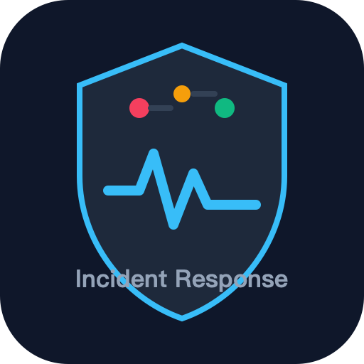
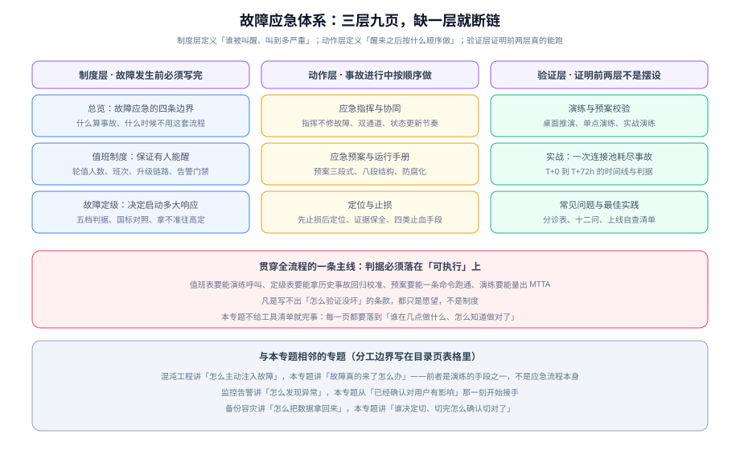

# 故障应急体系

故障应急体系回答的不是「怎么排除故障」，而是**故障发生的那一刻，组织有没有能力稳定地做出正确的动作**：谁被叫醒、按什么标准判断严重程度、谁来指挥、先做哪个动作、什么时候算结束。这些决定的特点是——**全部必须在故障发生之前定完**，因为事故进行中没有人有余力去讨论流程。

本专题讲的是**应对过程本身**：值班与升级、定级、指挥与协同、应急预案、定位与止损、演练验证。它不讲「怎么发现异常」（那是 [监控告警](../Monitoring/index.md) 的职责），也不讲「怎么主动注入故障」（那是 [混沌工程](../ChaosEngineering/index.md) 的职责）。

::: tip 一句话理解
监控解决的是「我知道出事了」，应急体系解决的是「出事之后不至于乱」。前者的产出是一条告警，后者的产出是**一套在压力下仍然能跑通的动作序列**。
:::

## 与相邻专题的分工

「监控」「告警」「容灾」「演练」这几个词经常被混着用，边界必须写死：

| 专题 | 讲什么 | 与本专题的关系 |
| --- | --- | --- |
| 本专题 | **应对过程**：值班与升级、定级、指挥协同、预案、定位与止损、演练 | —— |
| [监控告警](../Monitoring/index.md) | 指标类型、抓取模型、告警规则设计的**方法论** | 那边回答「**怎么知道出事了**」，本专题从「**已经确认对用户有影响**」那一刻接手 |
| [监控告警 · 告警设计](../Monitoring/Alerting/index.md) | 告警阈值、分组、抑制、静默的**具体写法** | 那边管「告警规则怎么写」，本专题管「**哪一条告警才有资格变成电话**」——价值密度不同，判据也不同 |
| [日志体系](../LogSystem/index.md) | 日志的采集、存储、检索与规范化 | 那边保证「**现场留下了痕迹**」，本专题规定「**谁在什么时刻去看、看到什么算证据**」 |
| [混沌工程](../ChaosEngineering/index.md) | 主动注入故障的方法论、实验设计、工具链 | 那边是**主动制造故障**，本专题是**被动承接故障**；实战演练是两者的交集，但判据归本专题 |
| [备份与容灾](../BackupDR/index.md) | 备份策略、RTO/RPO、容灾档位与演练流程 | 那边回答「**数据怎么拿回来、要几小时**」，本专题回答「**谁有权决定切换、切完怎么确认切对了**」 |
| [云上架构 · 可用性拓扑](../CloudArchitecture/Availability/index.md) | 失败域、可用区取舍、跨地域复制 | 架构决定了**故障的影响面有多大**，本专题决定**影响发生时怎么收窄它** |
| [容器编排进阶](../ContainerOrchestration/index.md) | K8s 的滚动更新、健康检查、自愈机制 | 自愈是**系统自己止损**，本专题处理的是**自愈失效之后的人工介入** |
| [Kubernetes](../Kubernetes/index.md) | 集群组件的运维与排障 | 那边给「集群内怎么查」，本专题给「查不出来的时候按什么顺序止损」 |
| [安全加固](../SecurityHardening/index.md) | 主机与集群的加固基线、合规项 | 安全事件走独立流程（含对外报告义务），本专题只处理**可用性与正确性**这一类事故 |
| [网络基础](../Network/index.md) | 协议分层、DNS、抓包排查 | 网络故障的**定位手段**归那边，本专题只规定**它在应急流程中排第几步** |
| [微服务 · 熔断与限流](../../Backend/Microservices/CircuitBreaker/index.md) | 熔断、限流、超时的**实现与参数** | 熔断是**自动止损**，本专题是**人工止损**；两者必须能互相接管，不能互相依赖 |
| [完整项目交付 · 架构设计](../../Others/ProjectDelivery/Architecture/index.md) | 可逆与不可逆决策的分界 | 本专题的「止损手段按可逆性排序」正是这条分界在**故障现场**的用法 |
| [CI/CD](../../Tools/CICD/index.md) | 流水线、发布策略、回滚机制 | 发布类事故的止血主力是**回滚**，回滚能力归那边建设，本专题规定**什么时候必须回滚** |

## 专题地图

| 页面 | 内容 | 适合谁读 |
| --- | --- | --- |
| [总览：故障应急的四条边界](./Overview/index.md) | 什么算事故、五个阶段与产物、成熟度五档、什么时候**不需要**这套体系 | 所有人，先读 |
| [值班制度：保证有人能醒](./OnCall/index.md) | 轮值表算术、响应时延、三级升级链路、告警门禁、值守体验 | 排班的人与当班的人，**重点读** |
| [故障定级](./Severity/index.md) | 影响面 × 严重程度的定级矩阵、五档判据、与国标口径的对应、四条纪律 | 所有人，**重点读** |
| [应急指挥与协同](./Command/index.md) | 五种角色、指挥不修故障、双通道信息流、状态更新模板与节奏 | 指挥与被叫到的人 |
| [应急预案与运行手册](./Runbook/index.md) | 预案三级形态、Runbook 八段结构、四类高频预案、防腐化机制 | 写预案的人，**重点读** |
| [定位与止损](./Diagnosis/index.md) | 先止损后定位、四档止损手段、证据保全、四个定位陷阱 | 上手处置的人，**重点读** |
| [演练与预案校验](./Drill/index.md) | 三类演练、六步设计、三道安全阀、三种失败形态 | 组织演练的人 |
| [实战：一次连接池耗尽事故](./Practice/index.md) | T+0 到 T+72h 的完整时间线，含 R1~R10 验收判据 | 想看完整过程的人 |
| [常见问题与最佳实践](./FAQ/index.md) | 分诊表、三条纪律、十二问、上线自查清单、术语表 | 所有人 |

## 制度与工具事实速览

按 **2026-10** 口径联网核对。下表只固化「会影响制度设计」的事实，**任何报价请以厂商官方页面为准**：

| 项 | 当前事实（2026-10） | 对制度的影响 |
| --- | --- | --- |
| 国内运维应急标准 | **GB/T 28827.3-2012**《信息技术服务 运行维护 第3部分：应急响应规范》现行（2013-02-01 实施，2022-01-10 复审结论为「继续有效」）；**该标准正在修订**，修订建议征集已于 2025-06-15 截止 | 写预案时可直接引用它的框架；但要注意它可能在近年改版，落地前复核版本 |
| 国内运维通用要求 | GB/T 28827.1-**2022**（2023-05-01 实施，2012 版已作废）、GB/T 28827.2-2012（交付规范） | 引用标准号时必须带年份，2012 版的第一部分已经作废 |
| 网络安全事件分级 | **GB/T 20986-2023**《信息安全技术 网络安全事件分类分级指南》替代 2007 版；四级为特别重大（一）/ 重大（二）/ 较大（三）/ 一般（四） | 内部 SEV 分级与国标分级**不要混用**：前者服务内部动员，后者服务对外报告 |
| 对外报告义务 | 《国家网络安全事件报告管理办法》**2025-11-01 起施行**（12387 热线）；较大以上事件报告时限：关键信息基础设施 **≤1 小时**、中央和国家机关 ≤2 小时、其他网络运营者 **≤4 小时**；初步报告 + 72 小时内补报 + 处置结束后 **30 日内**出总结报告 | 「报告」是**法定动作**，不是公关动作；预案里必须有一条只做这件事的分支 |
| 值守平台（闭源） | PagerDuty（行业惯例参照物，其 **SEV-1~SEV-5** 公开分级广泛被抄）、incident.io、Rootly、FireHydrant（**按值班人而非全员席位计费**） | 选型时先看**计费口径**：席位制 vs 值班人制的差额在「全员 200 人、只有 25 人轮值」时非常大 |
| 值守平台（开源） | **Keep**（MIT，`ee/` 目录除外，2026-09-09 发布 v0.54.3，持续提交），定位是告警聚合与 AIOps，排班能力偏薄 | 自建的最大风险不是功能，而是**「谁来维护它」**——负责告警的系统自己先挂了就很尴尬 |
| 已终止/生命周期结束 | **Opsgenie** 自 **2025-06-04 起停止销售**，**2027-04-05 终止支持**，届时未迁移的数据会**被删除**；注意官方迁移工具启动后**120 天**自动关闭原实例，这个更短的时钟由你自己启动 | 依赖它的团队要按 **120 天**而不是 2027 年排计划；这是「供应商单方面终止」的现成案例 |
| 已归档 | **Grafana OnCall OSS** 于 **2026-03-24 归档**（2025-03 起维护模式），仓库迁至冷存储且只读 | 曾经「自建就选它」的默认答案已经关闭，迁移时不要照抄旧链接 |
| 故障注入（演练用） | Chaos Mesh **2.8.4**（2026-08-18），支持 K8s 1.30~1.35，每个发布分支支持期 6 个月；`install.sh` 已废弃，改用 Helm 安装 | 演练工具与集群版本**必须配套**，跨多个发布分支的集群不在支持范围内 |

## 版本组织说明

本专题**不建立版本目录**（不存在 `IncidentResponse2/` 这类结构），理由有三条：

1. **应急体系的演进以「条款增补」而不是「破坏性换代」出现**。值班人数、定级维度、止损顺序这些内容十年不变；变的是工具与合规要求。
2. **真正会发生破坏性变化的是两类外部输入**：① 国家标准与法规（如《国家网络安全事件报告管理办法》2025-11-01 施行，直接改变了报告时限与义务主体）；② 值守平台的生命周期（Opsgenie 终止支持、Grafana OnCall 归档）。这两类变化本专题用 `::: info` 在页内**标注生效时点**处理，旧口径**保留不删除**。
3. **仓库内已有版本目录的范例**可以参考：[Spring5/Spring6](/docs/Backend/Java/Frame/Spring/Spring6/index.md)、Spring Boot 的 `v2/v3/v4` 子树——那里的做法是「旧版本目录保留原内容并标注维护状态，新内容面向最新稳定版」。本专题尚未出现需要按此处理的主题，将来若某个平台真的发生不兼容换代（例如告警路由协议整体替换），再按同样的方式另建目录。

## 学习路径

建议按「先定规则、再学动作、最后验证」的顺序读：

1. 先读 [总览](./Overview/index.md)，把「什么算事故」与五个阶段的产物搞清楚——这一步没做，后面的条款都没有落点。
2. 再读 [故障定级](./Severity/index.md) 与 [值班制度](./OnCall/index.md)，这两页是**制度层**，决定了「多大的事会惊动多少人」。
3. 然后读 [应急指挥与协同](./Command/index.md)、[应急预案与运行手册](./Runbook/index.md)、[定位与止损](./Diagnosis/index.md)，这三页是**动作层**，是事故进行中真正要用的东西。
4. 最后读 [演练与预案校验](./Drill/index.md) 与 [实战](./Practice/index.md)，用它们回头检验前三步写的东西是不是真的能跑。
5. [常见问题与最佳实践](./FAQ/index.md) 放在手边，排障时当分诊表用。

## 参考资料

- GB/T 28827.3-2012《信息技术服务 运行维护 第3部分：应急响应规范》（国家标准全文公开系统可在线阅读）
- GB/T 28827.1-2022《信息技术服务 运行维护 第1部分：通用要求》
- GB/T 20986-2023《信息安全技术 网络安全事件分类分级指南》
- 《国家网络安全事件报告管理办法》（2025-11-01 施行）及所附《网络安全事件分级指南》
- Google SRE 系列中关于应急响应与值班的章节（事件指挥体系的公开来源）
- Chaos Mesh 官方文档（故障注入类型、Workflow 与安全使用）
- [故障应急体系 · 常见问题与最佳实践](./FAQ/index.md)（本专题的术语表与自查清单）

## 与高并发系统设计的分工（第 141 天补充）

本专题的前提是**事故已经发生**：怎么定级、怎么指挥、按哪份预案处置、事后怎么把教训变成规则。它是一套**事件过程**的方法论。

[高并发系统设计 · 总览](../../Backend/HighConcurrency/Overview/index.md) 处理的是**事故之前**的那一步：让「出事的形态」是有限且可枚举的——过载时先拒谁、排队积压到多少就快速失败、降级到哪一级、什么条件下自动恢复。它不给处置流程，而是给**边界条件**，让本专题里的预案可以写成「如果水位线 > 80% 则执行 A」，而不是「如果系统很慢就先上去看看」。

| | 本专题（应急） | 高并发系统设计（防过载） |
| --- | --- | --- |
| 时间位置 | 事故中与事故后 | 事故前（把过载拦在事故之外） |
| 产出 | 定级标准、指挥体系、预案、复盘规则 | 四条边界、分层配额、降级分级、恢复条件 |
| 两者交汇处 | 预案里的「触发条件」 | 就是那边定义的容量类指标（水位线、队列深度） |

::: danger 一条最实用的分工判断
**如果一份预案的触发条件写不出数值，说明防过载这一层还没做。** 「系统变慢时启动降级」不是触发条件；「`queue_depth > 5000` 持续 30 s」才是。前者会让值班人**在最忙的时候做判断题**，而正确的做法是让这类判断在事故前就做完——这正是过载设计要交付的东西。
:::
