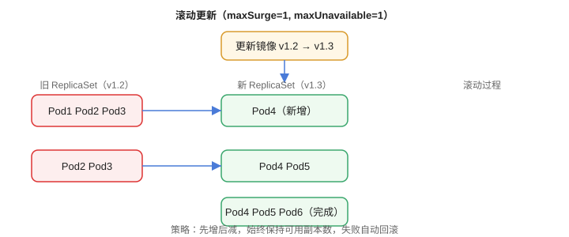

# Deployment 与工作负载

Deployment 是**无状态应用**的标准工作负载对象：它管理 ReplicaSet，负责副本数、滚动更新、回滚和自愈。这一篇还对比 StatefulSet、DaemonSet、Job 等场景。

## Deployment 的作用

```text
Deployment
└── ReplicaSet（版本快照）
    └── Pod × N（模板一致）
```

1. 保证指定数量的副本始终运行。
2. 更新镜像时执行滚动更新。
3. 更新失败自动回滚。

## 示例

```yaml [deployment.yaml]
apiVersion: apps/v1
kind: Deployment
metadata:
  name: web
spec:
  replicas: 3
  selector:
    matchLabels:
      app: web
  strategy:
    type: RollingUpdate
    rollingUpdate:
      maxUnavailable: 1
      maxSurge: 1
  template:
    metadata:
      labels:
        app: web
    spec:
      containers:
        - name: web
          image: myapp:1.2
          ports:
            - containerPort: 8080
```



## 滚动更新策略

| 参数 | 含义 | 建议 |
| --- | --- | --- |
| `maxUnavailable` | 更新期间允许不可用的最大副本数 | 默认 25%，可配 1 |
| `maxSurge` | 更新期间允许超出期望副本的最大数 | 默认 25%，可配 1 |

```shell
# 更新镜像
kubectl set image deployment/web web=myapp:1.3

# 查看滚动状态
kubectl rollout status deployment/web

# 回滚
kubectl rollout undo deployment/web

# 查看历史版本
kubectl rollout history deployment/web
```

## 扩缩容

```shell
# 手动
kubectl scale deployment/web --replicas=5

# 自动（需要 Metrics Server）
kubectl autoscale deployment/web --min=2 --max=10 --cpu-percent=70
```

## 其他工作负载

| 对象 | 场景 | 特点 |
| --- | --- | --- |
| StatefulSet | 数据库、有状态服务 | 稳定网络标识、有序部署、配合 PVC |
| DaemonSet | 每个节点跑一个（日志、监控） | 节点增删自动跟随 |
| Job | 一次性任务 | 执行完退出 |
| CronJob | 定时任务 | 按 Cron 表达式触发 Job |

## 易错点

::: danger 常见错误
1. `selector` 与模板 labels 不一致：Deployment 报错或无法匹配 Pod。
2. 更新后 Pod 一直 CrashLoop：readiness 探针失败导致滚动更新卡住，先看 describe。
3. 无状态应用用 StatefulSet：过度设计，默认用 Deployment。
4. 数据库用 Deployment：数据会丢，用 StatefulSet + PVC。
5. 滚动更新太快/太慢：`maxUnavailable` 与 `maxSurge` 未按业务调整。
6. 回滚前不看历史：`rollout undo` 回退到上一个版本，确认版本顺序。
:::

## 验证方式

1. `kubectl apply -f deployment.yaml && kubectl get deployment`。
2. `kubectl rollout status deployment/web` 看到 `successfully rolled out`。
3. `kubectl get rs` 观察新旧 ReplicaSet 并存，滚动完成后旧的缩为 0。

## 相关专题

- [弹性伸缩](../../ContainerOrchestration/Autoscaling/index.md)：用 HPA/VPA/KEDA 自动增减副本，配套 Deployment 的滚动发布
- [容器编排进阶](../../ContainerOrchestration/index.md)：Helm 与 GitOps 让 Deployment 交付与回滚可声明、可审计

## 与「交付期部署脚本」的分工（第 149 天补充）

**本页回答什么**：`Deployment` 这个对象本身——它声明什么、滚动更新怎么控、怎样算更新成功、扩缩容与工作负载怎么选。
**本页不回答什么**：一个**没有编排系统**的项目（单机 + Compose + 反向代理）该怎么把「上线」写成可复跑的动作。后者归项目侧的 [部署脚本](/project/Complete/TeamBoard/DeployScripts/index.md) 与 [配置与密钥](/project/Complete/TeamBoard/ConfigSecrets/index.md)。

**两者共有的一个坑，本页先点出来**。本页第八节「易错点」讲的是**声明与实际的偏差**（改了 `image` 标签却没触发滚动、`maxUnavailable` 设成 100% 导致全量中断）。单机脚本侧的同一条坑会**换形态出现**：脚本里的动作看起来都执行了、退出码也是 0，但**真正生效的那一份不是你以为的那一份**。第 149 天在两个项目上碰到了它的三个变体：

* **配置被解析期吃掉**：Compose 里 `echo "== apply $f"` 的单个 `$` 在解析期就被替换掉，容器日志打印的文件名**恒为空**，而迁移**全部成功**、退出码仍 0；唯一信号是 stderr 一行 warning。修法是写 `$$f`。
* **复制目录带进旧配置**：`copy -R` 把旧 `prometheus.yml` 一起带过来，抓取目标仍指向宿主旧端口 → 容器全起来、目标却是旧的。
* **换名不构成隔离**：`docker compose -p othername` 只分开容器名、网络与卷，**宿主端口是全局资源**，撞上就是 `port is already allocated`。

**共同形状**：声明层（YAML / 清单 / 脚本）与生效层（容器里真正执行的那一行、真正被读进去的那份配置）之间**隔着一次插值、一次复制、一次命名替换**，而这三处**都不会让命令失败**。所以「部署成功」必须由**读回来的值**证明，不能由退出码证明。


## 与「容量与成本治理」专题的分工（第 156 天补充）

| 问题 | 本页 | [容量与成本治理](../../CapacityCost/index.md) |
| --- | --- | --- |
| 副本数、`requests` / `limits`、探针怎么写 | **本页回答** | 只引用 |
| `requests` 写多少才不算浪费 | 给机制 | **那边回答**：`P95 usage × 1.25`、虚高倍数的判据 |
| 集群账单怎么摊到命名空间 | 不回答 | **那边回答**：`max(request, usage)` 分摊公式 |
| 右调之后账单为什么没降 | 不回答 | **那边回答**：右调收益按节点口径算，不按配置差算 |

**一句话结论**：`requests` 既是调度承诺，也是成本分摊的计量单位——**改它等于同时改容量与账单两本账**。

**这一页特有的坑**：把 `requests` 从 2 核降到 400m 之后，副本密度上升了，但如果**节点池没有随之缩容**，账单一分不降。判断右调是否真的省钱，要去看节点数，而不是看 Deployment 的 YAML。

## 与「分布式锁与选主」专题的分工（第 159 天补充）

本页讲**部署形态**：Deployment / StatefulSet 的选择、滚动更新参数、探针、资源与调度。它关心「副本怎么被安全地换掉」。

[分布式锁与选主](/docs/Backend/DistributedLock/index.md) 讲**副本之间怎么协调**：谁有资格写、失去资格时怎么退位。两者的接口是 `coordination.k8s.io/v1` 的 `Lease` 对象，以及 `terminationGracePeriodSeconds` 这个容易被忽略的参数。

| 边界问题 | 归本页 | 归专题 |
| --- | --- | --- |
| `maxSurge` / `maxUnavailable` / 探针参数 | ✅ | — |
| 三个副本里只允许一个跑后台任务 | — | ✅ [选主](/docs/Backend/DistributedLock/LeaderElection/index.md) |
| `terminationGracePeriodSeconds` 与 preStop | ✅ | — |
| 优雅退出时「先停写、再撤销租约」的顺序 | — | ✅ [租约](/docs/Backend/DistributedLock/Lease/index.md) |

::: danger 默认 30 秒的 grace 与 15 秒的租约不匹配
`terminationGracePeriodSeconds` 默认 30 s，K8s 选主的 `LeaseDuration` 常用 15 s。看起来很宽裕，但真实链路是「preStop → 停止接新请求 → 等在途请求 → 撤销租约」，在途请求如果有长轮询或 WebSocket，30 秒根本不够，进程会被 SIGKILL——**租约来不及撤销**，新 leader 要等满 `LeaseDuration` 才能接管。读数是「发布一次，后台任务的接管延迟多出一个租约周期」，而日志里看不出任何异常。要么把 preStop 做成「先摘流量再等 10 秒」，要么把 grace 调到 ≥ 租约 + 在途上限。
:::

## 参考资料

- Deployment 文档：https://kubernetes.io/zh-cn/docs/concepts/workloads/controllers/deployment/
- 滚动更新：https://kubernetes.io/zh-cn/docs/concepts/workloads/controllers/deployment/#updating-a-deployment
- StatefulSet：https://kubernetes.io/zh-cn/docs/concepts/workloads/controllers/statefulset/
