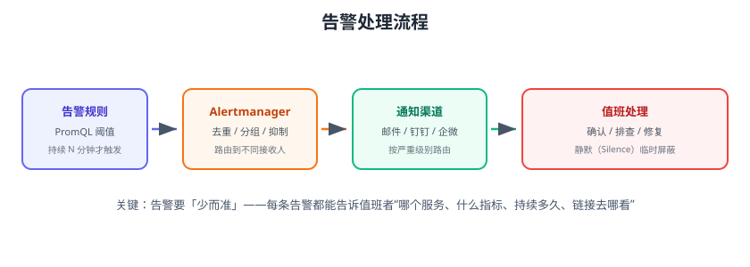

# 告警规则与 Alertmanager

告警是监控的“最后一公里”：指标异常时，系统要**准确、及时、不轰炸**地通知到责任人。Prometheus 负责根据规则评估是否触发，Alertmanager 负责把触发的告警去重、分组、路由并发送到通知渠道。本页给出完整的告警配置实践。



## 告警链路

```text
Prometheus 告警规则（PromQL 阈值 + for 持续时间）
  → 触发 → 推送到 Alertmanager
  → 分组 / 抑制 / 静默
  → 按路由规则 → 通知渠道（邮件、钉钉、企微、Webhook）
  → 值班人处理 → 恢复通知
```

::: danger 「配置好了」≠「会响」：链路上有四个断点
这条链路看起来是一条直线，实际上任何一段断了，结果都是**同一个现象——没有通知**。而「没有通知」既可能是「一切正常」，也可能是「告警从来没生效过」，两者从值班侧看完全一样。

四个断点，按链路顺序排查（每一段都能单独证伪）：

| # | 断点 | 怎么证伪 | 典型原因 |
| --- | --- | --- | --- |
| ① | Prometheus 采集不到 | 打开 `/targets` 看是否 `UP`；在 `/graph` 里手动跑一次指标表达式 | 抓取配置错、服务未暴露端点、网络策略拦截 |
| ② | 规则表达式永远不满足 | 把阈值临时调到必然触发，看 `/alerts` 里有没有 `firing` | PromQL 写错（例如用错聚合维度）、`for` 时间过长、单位不一致 |
| ③ | Alertmanager 收到但路由丢弃 | 看 `/api/v2/alerts` 有没有该告警；再看 `/#/status` 的路由树 | `matchers` 写错、被 `inhibit_rules` 抑制、被静默 |
| ④ | 通知渲染或发送失败 | 看 Alertmanager 日志里的模板渲染错误；看接收器返回码 | 模板字段缺失、Webhook 地址失效、渠道侧限流 |

**唯一可靠的验证方式，是让它真的响一次。** 标准手法是把阈值临时调低到必然触发（例如把错误率阈值改成 `0.0001`），制造一次失败请求，确认渠道在秒级收到通知，然后把阈值改回去并**再次确认不再误报**——最后这一步同样重要，否则你会得到一个「阈值被留在测试值上」的隐藏故障。

这与「告警必须触达人而非只发群」是同一条判据的两个方向：前者验证**能响**，后者验证**响了有人管**。
:::

## 告警规则语法

```yaml [alert-rules.yml]
groups:
  - name: host-alerts
    rules:
      - alert: HostHighCpu
        expr: 100 - avg(rate(node_cpu_seconds_total{mode="idle"}[5m])) * 100 > 85
        for: 5m
        labels:
          severity: warning
        annotations:
          summary: "主机 CPU 使用率过高"
          description: "{{ $labels.instance }} CPU 使用率超过 85%，当前 {{ $value | humanize }}%"
          runbook_url: "https://wiki.example.com/ops/host-cpu"
```

| 字段 | 说明 |
| --- | --- |
| `alert` | 告警名 |
| `expr` | PromQL 触发条件 |
| `for` | 持续多长时间才触发（防止抖动误报） |
| `labels` | 附加标签（severity 等），用于路由 |
| `annotations` | 告警内容：summary、description、runbook_url |

Prometheus 配置加载规则：

```yaml [prometheus.yml]
rule_files:
  - "alert-rules.yml"
```

## 常用告警规则模板

```yaml
groups:
  - name: host-alerts
    rules:
      - alert: HostHighCpu
        expr: 100 - avg(rate(node_cpu_seconds_total{mode="idle"}[5m])) * 100 > 85
        for: 10m
        labels: {severity: warning}

      - alert: HostMemoryPressure
        expr: (1 - node_memory_MemAvailable_bytes / node_memory_MemTotal_bytes) * 100 > 90
        for: 5m
        labels: {severity: critical}

      - alert: HostDiskWillFill
        expr: predict_linear(node_filesystem_avail_bytes{mountpoint="/"}[6h], 4 * 3600) < 0
        for: 30m
        labels: {severity: critical}

  - name: app-alerts
    rules:
      - alert: HighErrorRate
        expr: |
          sum(rate(http_requests_total{status=~"5.."}[5m])) by (job) /
          sum(rate(http_requests_total[5m])) by (job) > 0.05
        for: 5m
        labels: {severity: critical}

      - alert: InstanceDown
        expr: up == 0
        for: 2m
        labels: {severity: critical}

      - alert: HighLatencyP95
        expr: |
          histogram_quantile(0.95,
            sum by (le, job) (rate(http_request_duration_seconds_bucket[5m]))) > 2
        for: 10m
        labels: {severity: warning}
```

::: tip predict_linear 技巧
用 `predict_linear` 按历史趋势预测磁盘/内存耗尽时间，比“当前 > 90%”更早发现风险。
:::

## Alertmanager 配置

### 安装

```yaml [docker-compose.yml]
services:
  alertmanager:
    image: prom/alertmanager:v0.33.1
    container_name: alertmanager
    ports:
      - "9093:9093"
    volumes:
      - ./alertmanager.yml:/etc/alertmanager/alertmanager.yml
```

### 路由与接收器

```yaml [alertmanager.yml]
global:
  resolve_timeout: 5m
  smtp_smarthost: smtp.example.com:587
  smtp_from: alert@example.com
  smtp_auth_username: alert@example.com
  smtp_auth_password: xxx

route:
  group_by: ["alertname", "instance"]   # 按告警名+实例分组
  group_wait: 30s                       # 组内第一条等待
  group_interval: 5m                    # 同组告警重复发送间隔
  repeat_interval: 4h                   # 未恢复重复通知间隔
  receiver: default
  routes:
    - matchers:
        - severity="critical"
      receiver: pager
      continue: true
    - matchers:
        - job="order-service"
      receiver: order-team

receivers:
  - name: default
    email_configs:
      - to: ops@example.com
  - name: pager
    webhook_configs:
      - url: http://dingtalk-hook/alert
  - name: order-team
    webhook_configs:
      - url: http://wecom-hook/alert
```

### Prometheus 对接

```yaml [prometheus.yml]
alerting:
  alertmanagers:
    - static_configs:
        - targets: ["alertmanager:9093"]
```

## 分组、抑制、静默

| 能力 | 作用 | 场景 |
| --- | --- | --- |
| 分组 | 同一批告警合并成一条通知 | 一个实例挂了触发 20 条规则，只发 1 条 |
| 抑制 | 高等级告警屏蔽低等级 | 主机挂了，就不用再报“服务不可达” |
| 静默 | 人工临时屏蔽 | 已知维护窗口内不报警 |

抑制示例：`severity=critical` 时抑制同 instance 的 warning：

```yaml
inhibit_rules:
  - source_matchers: [severity="critical"]
    target_matchers: [severity="warning"]
    equal: ["instance"]
```

静默（UI 或 API）：

```shell
curl -X POST http://localhost:9093/api/v2/silences -d '{
  "matchers": [{"name":"instance","value":"10.0.0.11:9100"}],
  "startsAt":"2026-08-29T10:00:00+08:00",
  "endsAt":"2026-08-29T12:00:00+08:00",
  "createdBy":"ops",
  "comment":"机房维护"
}'
```

## 告警分级建议

| 级别 | 定义 | 响应时限 | 通知方式 |
| --- | --- | --- | --- |
| P0 | 核心业务不可用 | 立即（15 分钟内） | 电话/短信 + IM |
| P1 | 功能异常但可降级 | 30 分钟 | IM + 邮件 |
| P2 | 有风险未故障 | 1 个工作日 | IM |
| P3 | 信息性 | 计划处理 | 不通知或汇总 |

## 易错点与最佳实践

::: danger 常见错误
1. **`for` 不设置**：瞬时抖动就报警，告警风暴。
2. **`repeat_interval` 太短**：每 5 分钟轰炸一次，值班人员直接屏蔽通知。
3. **分组键太少**：`group_by` 只有 alertname，不同实例的告警合到一起，定位困难。
4. **告警无操作说明**：通知里没有 runbook 链接，值班人不知道怎么办。
5. **维护期不做静默**：发布/维护窗口刷屏告警，真告警被淹没。
6. **告警没有复盘**：长期静默的规则不清理，噪音越来越多。
:::

::: tip 最佳实践
1. 告警必须可操作：说明、影响、操作链接、责任人。
2. 用 `for` 过滤抖动，用 `predict_linear` 提前预警。
3. 告警分组按 `alertname + instance + job`，抑制主从关系。
4. 维护窗口自动静默（按时间/标签）。
5. 每周 Review：新增、调整、废弃告警规则，控制噪音。
6. 告警值班表（on-call rotation）与通知绑定，确保有人响应。
:::

## 读写分离场景的一条专用告警：复制延迟要能触发降级

读写分离之后，从库延迟不再只是「监控上的一个数字」，而是**业务会读旧数据**的直接原因。所以这条告警要有配套动作，不能只通知：

| 级别 | 条件 | 动作 |
| --- | --- | --- |
| 告警 | `Seconds_Behind_Source > 5` 持续 30 s | 只通知，观察是否自愈（多半是大事务或 DDL） |
| 降级 | `Seconds_Behind_Source > 30` 持续 60 s | **把读流量摘除该从库**（权重置 0 / 改路由规则） |
| 紧急 | `Replica_SQL_Running = No` 或全部从库不可用 | 摘除 + 值班介入；必要时全部读回主库 |

::: danger 两件必须一起做的事
1. **降级动作要有人做、有审计**：能改路由配置的人等于能改生产数据流向，配置变更走与代码相同的评审与记录流程；
2. **「全部读回主库」必须提前演练**：它是唯一的退出路径，演练内容是「把应用数据源指回主库、业务读写正常」，不需要改代码。

中间件侧的延迟阈值、摘除方式与验证命令见 [数据库中间件 · 读写分离工程化](../../../DB/Middleware/ReadWriteSplit/index.md)。
:::

## 验证方式

1. 配置一条 CPU 告警（阈值设低如 1%），等 `for` 时间后确认 Alertmanager 收到告警并发出通知。
2. 触发两条同组告警，确认只收到一条合并通知。
3. 添加静默规则，确认静默期间不再通知。
4. 恢复指标后确认告警自动恢复并发送恢复通知。

## 与「观测驱动开发」专题的分工（第 158 天补充）

本页讲**告警规则怎么写**（表达式、`for`、标签、路由、通知渠道）；第 158 天交付的 [告警设计](/docs/Tools/ObservabilityDriven/AlertDesign/index.md) 讲**该不该叫人起来**。前者是语法与配置，后者是取舍与配额——两者的产出形态完全不同：本页产出的是能通过 `promtool check` 的 YAML，那边产出的是「这个服务最多 7 条叫人告警」的清单。

| 边界问题 | 归本页 | 归该专题 |
| --- | --- | --- |
| `for` 该写 1m 还是 5m | 语法与求值行为、`pending` 到 `firing` 的转换 | 判据是「单点抖动不得叫人」，具体值由业务高峰形状决定 |
| 告警风暴怎么止住 | `inhibit_rules` 与 `group_by` 的写法 | 顺序纪律：先抑制、再聚合、最后删除 |
| 该配几条告警 | 不涉及 | 配额（每服务 ≤ 7 条，P0/P1 ≤ 2 条）与「新增必须删旧」 |
| 阈值定多少 | 表达式里怎么写比较 | 取历史 P95 而非愿望值；低峰/高峰下绝对值阈值必然失效 |

本页特有的一个坑：**`for` 不是「延迟通知」，是「要求持续满足」**。写成 `for: 0m` 或省略时，任何一次瞬时尖峰都会触发；而写成 `for: 30m` 又会让真正的持续性故障晚半小时才叫人。中间这个量级由「业务能容忍多久」决定，不由「抖动多大」决定——这也是为什么它不该在 YAML 里靠试出来。

## 与「部署前置」章节集的分工（第 169 天补充）

本页讲告警规则的**语法、分组、抑制与路由**；[部署后冒烟](/project/Complete/TeamBoard/SmokeGate/index.md) 与 [上线前置闸门](/project/Complete/TeamBoard/PreLaunchGate/index.md) 讲的是「发布那一刻，指标链路本身是不是通的」。分工：

| 问题 | 归本页 | 归「部署前置」章节集 |
| --- | --- | --- |
| `for` / `keep_firing_for` / 分组抑制怎么写 | ✅ 规则语法 | —— |
| 发布后怎么证明指标真的在采（`card_move_ms_count ≥ 1`） | —— | ✅ `SMK` 的 `S9` |
| 告警风暴怎么收敛 | ✅ | —— |
| 「指标缺失」为什么不回滚本次发布，而是阻断下一次 | —— | ✅ `SMK` 第五节 |

::: warning 本页特有的一条坑：指标断流时，规则不会自己变红
`rate(http_requests_total[5m]) > 0.05` 这类规则在**指标完全消失**时算不出值，Prometheus 不产生样本，于是「没有告警」——而服务可能已经 100% 不可用。必须配一条 `absent(card_move_ms_count) == 1`（或 `up == 0`）的「断流告警」，并在发布验收里显式检查 `/actuator/prometheus` 能返回非零计数。这也是 `S9` 失败被定为「不回滚、阻断下次发布」的原因：它不影响用户，但会让**下一次**故障无法定位。
:::

## 参考资料

- Alertmanager 文档：https://prometheus.io/docs/alerting/latest/alertmanager/
- 告警规则最佳实践：https://prometheus.io/docs/practices/alerting/
- 告警路由配置：https://prometheus.io/docs/alerting/latest/configuration/
- Grafana Alerting：https://grafana.com/docs/grafana/latest/alerting/
- 日志类告警（数量突增、关键字命中、缺失告警与降噪）：[日志告警与联动](../../LogSystem/Alerting/index.md)
- 时序侧告警取数与抑制策略：[时序数据库 · 常见问题与最佳实践](../../../DB/TimeSeries/FAQ/index.md)
- 安全事件的审计与运行时检测告警：[安全加固 · 审计与检测](../../SecurityHardening/AuditDetection/index.md)
- 告警链路的端到端实测（规则 → 路由 → 通知）：[混沌工程 · 演练中的可观测](../../ChaosEngineering/Observability/index.md)

## 与「变更管理」专题的分工（第 170 天补充）

本页讲**告警规则怎么写**（阈值、分组、抑制、静默）；[变更管理与发布工程](../../ChangeManagement/ChangeWindow/index.md) 讲**窗口期内该怎么抑制、以及抑制的出口在哪**。

| 问题 | 本页 | 变更管理专题 |
| --- | --- | --- |
| 怎么压掉噪声 | 分组、抑制、静默 | 静默必须绑变更单（谁批的、到几点） |
| 窗口期内告警怎么办 | 由静默规则决定 | 静默范围只覆盖「预期会变的指标」，不覆盖错误率与可用性 |
| 出了事怎么发现 | 升级策略 | 静默期保留出口告警 |

**一条本页特有的坑：窗口期「全部静默」等于把变更引起的故障一起静默了。** 最典型的翻车是：变更窗口 2 小时，静默也是 2 小时，结果第 10 分钟就挂了，直到窗口结束才有人知道。正确做法是静默**只针对预期的抖动指标**（如发布期间的 5xx 短时上升），并保留一条**出口告警**：错误率超过硬阈值时无视静默、直接呼人。静默的边界要写进变更单，不能只写进 Alertmanager。

## 与性能与容量工程的分工

本页只管**规则怎么写、怎么不吵**——`for` 设多长、怎么分组抑制、路由到谁；而**阈值该取什么值，来源在 [性能与容量工程 · SLO](../../PerformanceEngineering/SLO/index.md) 的错误预算与燃烧率**，不在本页。

| 本页讲什么 | 对方讲什么 | 遇到什么问题时该去哪边 |
| --- | --- | --- |
| PromQL 表达式、`for`、分组 / 抑制 / 静默、分级与路由 | 错误预算与燃烧率决定了阈值该定成多少 | 「这条规则为什么天天响」→ 本页 |
| 保证告警「能响、有人管、不轰炸」 | 保证告警阈值「与业务承诺一致、不拍脑袋」 | 「这个 5% 是拍脑袋还是算出来的」→ [SLO](../../PerformanceEngineering/SLO/index.md) |

一句话：**规则是工程问题（本页），阈值是业务与容量问题（那边）。** 阈值拿不稳时，先去 [SLO 与错误预算](../../PerformanceEngineering/SLO/index.md) 把口径定下来，再回到本页把它写成一条规则。
