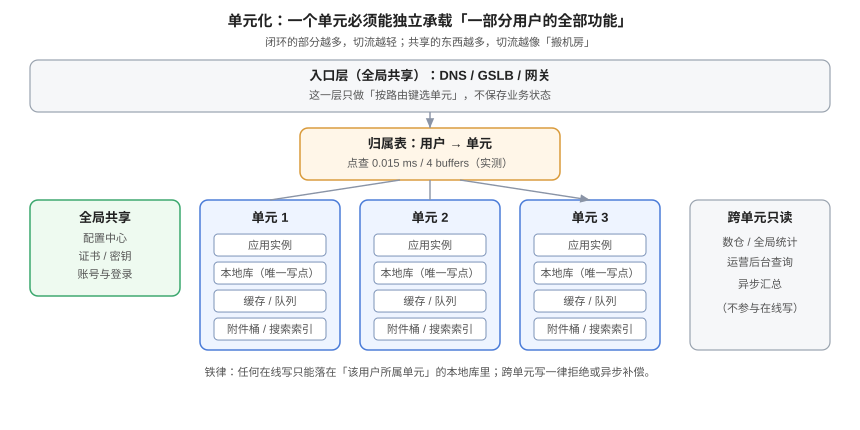

# 单元化模型：把用户切成能独立承载的组

**单元（Cell）是一套「能独立承载一部分用户全部在线功能」的完整栈。** 注意这里的三个词：独立、一部分用户、全部功能。少任何一个，它就不是单元，而只是「一套部署」。本页给出单元边界的四种切法、闭环清单的逐项判定、单元数的算法、以及一次单元迁移的五步流程。



## 一、单元的定义与三个必要条件

| 条件 | 含义 | 不满足时会发生什么 |
| --- | --- | --- |
| **独立** | 不依赖其他单元就能处理该单元用户的请求 | 别的单元挂了，本单元跟着不可用 |
| **一部分用户** | 用户被明确划分，且划分是稳定的 | 同一用户被两个单元服务 → 双写 |
| **全部功能** | 该用户的读、写、上传、搜索、通知都在本单元完成 | 切流后「能用但不好用」，用户认为坏了 |

::: tip 一个自检问题
**「把单元 A 的网络完全切断，单元 B 的用户受影响吗？」** 如果答案是「受影响」，说明存在跨单元依赖，A 不是一个单元。这个问题比任何架构评审都有效，因为它可以在演练里真的做一遍。
:::

## 二、单元边界怎么切：四种维度

| 维度 | 路由键 | 优点 | 代价 | 适用 |
| --- | --- | --- | --- | --- |
| **按用户 ID 哈希** | `hash(user_id) % N` | 分布均匀、实现最简 | 扩容时 `N` 变化导致大规模迁移 | 用户之间无交互的产品 |
| **按租户** | `tenant_id` | 同一租户的数据天然在一处，跨租户查询本就是运营侧需求 | 大租户会造成单元倾斜 | B 端 SaaS、协作工具 |
| **按地理** | 用户所在地区 | 就近接入、合规（数据不出境） | 地区间流量差异大，容量难均 | 全球化产品、有数据驻留要求 |
| **按业务线** | 业务标识 | 故障隔离到业务线 | 同一用户可能跨业务线 → 跨单元写 | 多业务线的集团系统 |

### 2.1 为什么「按租户」在协作类产品里几乎总是对的

协作看板这类产品的每一条 SQL 都带 `tenant_id`——看板、卡片、评论、通知、附件全部按租户隔离。用 `tenant_id` 做路由键有三个直接好处：

1. **不需要跨单元 JOIN**：一次看板渲染的所有数据都在本单元；
2. **迁移粒度自然**：迁一个租户 = 迁一组有界的数据；
3. **影响面可算**：单元挂了，受影响的租户数可以直接查归属表得到。

代价是**倾斜**：一个大租户的数据量可能等于一万个小租户。这一点必须在容量规划里显式处理（见[成本](../Cost/index.md)的非对称单元）。

::: danger 按用户哈希 + 按租户混用，是双写的直接来源
如果登录走「按用户哈希」、业务走「按租户」，那么一个用户登录后在单元 1，他的租户数据在单元 2——每一次请求都要跨单元。**路由键必须全局唯一且所有入口一致**，这条写在[路由](../Routing/index.md)的判据里。
:::

## 三、闭环清单：什么必须在一个单元里

这是单元化最容易做漏的部分。清单按「切流后用户会不会立刻发现」排序：

| 组件 | 必须闭环？ | 不闭环的后果 | 折中方案 |
| --- | --- | --- | --- |
| **关系库（写）** | **必须** | 跨单元写 = 双写 = 冲突 | 无折中 |
| **缓存** | **必须** | 缓存 key 不带单元 → 串号 | key 必须含单元或租户前缀 |
| **消息队列 / 事件流** | **必须** | 消费者在别的单元，事件延迟或丢失 | 每单元独立 topic 前缀 |
| **搜索索引** | **必须** | 切流后搜索为空 | 每单元独立索引 |
| **附件 / 对象存储** | **必须** | 上传成功、下载 404 | 每单元独立桶 + key 带单元前缀 |
| **定时任务** | **必须** | 两个单元同时跑同一批任务 → 重复执行 | 每单元只处理本单元数据 |
| **登录 / 会话** | 可共享 | 共享时切流后用户要重新登录 | 共享会话服务，但要能容忍「单元标识过期」 |
| **配置中心** | 可共享 | 共享更安全（配置一致性） | 共享，但要有「按单元差异化」的覆盖能力 |
| **证书 / 密钥** | 可共享 | 共享减少轮换工作量 | 共享，但每个单元要有独立的出网凭据 |
| **全局统计 / 报表** | **不闭环** | 跨单元聚合必然存在 | 走异步汇总或数仓，不参与在线写 |

::: warning 「不闭环」的那一行必须写清楚降级
全局统计不闭环是合理的，但**必须明确「统计延迟多久算正常」**。否则切流后运营看到「今日订单掉了 40%」，会误判为业务故障。建议在统计页面上直接标注「数据延迟约 N 分钟」。
:::

## 四、归属表：唯一的不变式

单元化只有一个全局不变式：

> **对任意用户/租户，归属表在任一时刻只有一个权威答案，且所有在线写都必须使用它。**

归属表的最小形态：

```sql
-- 归属表：必须能被高频点查，且变更必须留痕
CREATE TABLE tenant_route (
  tenant_id   bigint PRIMARY KEY,
  cell        text   NOT NULL,                -- 'cell-a' / 'cell-b'
  epoch       bigint NOT NULL DEFAULT 1,      -- 每次迁移 +1，用于拒绝旧 epoch 的写
  moved_at    timestamptz,
  CONSTRAINT tenant_route_cell_chk CHECK (cell IN ('cell-a','cell-b','cell-c'))
);

-- 变更留痕：谁在什么时候把哪个租户迁到了哪里
CREATE TABLE tenant_route_log (
  id          bigint GENERATED ALWAYS AS IDENTITY PRIMARY KEY,
  tenant_id   bigint NOT NULL,
  from_cell   text,
  to_cell     text NOT NULL,
  epoch       bigint NOT NULL,
  operator    text NOT NULL,
  created_at  timestamptz NOT NULL DEFAULT now()
);
```

### 4.1 `epoch` 是做什么的

它是**迁移期间拒绝旧写**的闸门。迁移时 `epoch` 加一，业务写入带 `expected_epoch`，条件更新失败即拒绝：

```sql
UPDATE cards SET title = $1, version = version + 1
 WHERE id = $2
   AND tenant_id = $3
   AND version = $4
   AND (SELECT epoch FROM tenant_route WHERE tenant_id = $3) = $5;  -- 迁移期校验
```

没有 `epoch` 的结果是：迁移窗口内，旧单元仍在接受写，那批写会永久丢失（新单元没有它们）。**这是「迁移看起来成功、数据少了几条」的典型来源。**

### 4.2 归属表点查要有多快

它会被每一个请求打到，所以必须是索引点查。本机实测（PostgreSQL 18.6，50 万行）：

| 场景 | 访问方式 | 执行时间 | Buffers |
| --- | --- | --- | --- |
| 有主键索引 | `Index Scan using cell_route_pkey` | **0.015 ~ 0.026 ms** | 4 ~ 7 |
| 无索引 | `Parallel Seq Scan` | **15.739 ms** | 2,703 |

```sql
CREATE TABLE cell_route (user_id bigint PRIMARY KEY, cell text NOT NULL);
INSERT INTO cell_route SELECT g, 'cell-' || (g % 4) FROM generate_series(1, 500000) g;
ANALYZE cell_route;
EXPLAIN (ANALYZE, BUFFERS, COSTS OFF) SELECT cell FROM cell_route WHERE user_id = 314159;
-- Index Scan using cell_route_pkey (actual time=0.015..0.016 rows=1.00 loops=1)
--   Buffers: shared hit=7
-- Execution Time: 0.026 ms
```

差三个数量级。**这道查不走的唯一理由是「忘了建索引」，而它会让每个请求多花 15 ms。**

## 五、单元数怎么定

单元数不是「有几个机房」决定的，而是两个约束的交集：

```text
单元数 N ≥ ceil(峰值负载 / 单单元安全容量)     ← 容量约束
单元数 N ≥ 2                                  ← 可用性约束（N-1 能兜住）
单元数 N ≤ 团队能同时运维的独立栈数量          ← 组织约束
```

### 5.1 算例（推演）

| 输入 | 取值 | 来源 |
| --- | --- | --- |
| 峰值写 QPS | 4,000 | 压测结论（有前提） |
| 单单元安全容量 | 2,500 QPS（按 60% 水位） | 压测 × 0.6 |
| 需要 N-1 冗余 | 是 | 任一单元可摘除 |

```text
N ≥ ceil(4000 / 2500) = 2
N-1 冗余校验：N=2 时摘掉一个只剩 2500，兜不住 4000 → 不满足
N=3 时摘掉一个剩 5000 ≥ 4000 → 满足
```

结论：**3 个单元**。注意这里 2 个单元「看起来够用」但经不起摘除——这是最常见的容量误算：把「平均值够」当成「冗余够」。

::: tip 单元数宁少勿多
每多一个单元，就多一份全栈、多一条同步链路、多一组要演练的路径。3 个单元的运维复杂度不是 3，而是接近 3 ×（同步链路数）。**能用 2 个不对称单元解决的，不要上 4 个对称单元。**
:::

## 六、单元迁移（Rebalance）：五步

迁移是单元化里唯一「会动数据」的操作，也是最容易出事的一步。

| 步 | 动作 | 判据（不满足不许进下一步） |
| --- | --- | --- |
| 1. 冻结 | 目标租户进入「只读窗口」或「双写窗口」 | 该租户的写请求返回明确的「迁移中」而不是成功 |
| 2. 拷贝 | 全量快照 + 增量追平 | 源与目标的行数、内容哈希一致（见[冲突裁决](../Conflict/index.md)的对账三层） |
| 3. 校验 | 跑不变量校验（不只是两侧比对） | 业务不变量成立，例如「订单数 = 支付流水数」 |
| 4. 切路由 | 改归属表 + `epoch + 1` | 新写全部落到新单元；旧 epoch 的写被拒绝 |
| 5. 清理 | 旧单元的数据保留 N 天后删除 | 保留期内可回切；过期后删除并留审计 |

### 6.1 迁移窗口的三个坑

1. **只读窗口太长**：大租户的全量拷贝可能是小时级，用户被冻结一小时等于故障。正确做法是**先全量、再增量、只冻结最后几秒**（停机时间 ≈ 增量追平时间）。
2. **忘记清缓存**：路由缓存（网关 30 s）、业务缓存（租户级 key）都要失效，否则迁移完成后仍有请求打到旧单元。
3. **没有 `epoch` 闸门**：见第 4.1 节，旧写会静默丢失。

## 七、反例：三个「看起来像单元、其实不是」的设计

| 反例 | 表现 | 为什么不成立 |
| --- | --- | --- |
| **按表分库**（用户表在 A、订单表在 B） | 每个服务一套库，都叫「单元」 | 一个业务请求要跨两个库 → 跨单元写 |
| **读写分离当单元** | 主库 + 多个只读副本，副本也叫「单元」 | 副本不能写 → 切过去写不了 |
| **按服务拆分的伪单元** | 每个微服务一套部署，但共享一个库 | 库是单点 → 库挂了全挂 |

判据很简单：**能不能拔掉一个单元的网线，让另一部分用户完全不受影响地继续用**。不能，就不是单元。

## 八、验证方式

```shell
# ① 闭环检查：单元内是否存在指向其他单元的地址
grep -rn "cell-a\|cell-b" --include="*.yml" --include="*.yaml" --include="*.properties" . | grep -v "本单元\|current" | head
# 期望：配置里只有「本单元」的相对引用；出现硬编码的「另一个单元」地址即为不闭环

# ② 归属表存在且唯一
psql "$DSN" -c "\d tenant_route"
# 期望：主键为 tenant_id；有 cell 与 epoch 两列

# ③ 归属表点查走索引（把 <id> 换成一个真实租户）
psql "$DSN" -c "EXPLAIN (ANALYZE, BUFFERS, COSTS OFF) SELECT cell FROM tenant_route WHERE tenant_id = <id>;"
# 期望：Index Scan，Execution Time < 0.1 ms，Buffers < 10

# ④ 单元数冗余校验（把数字换成自己的）
python3 -c "import math; peak=4000; cap=2500; n=2
while True:
    if (n-1)*cap >= peak: print('N =', n); break
    n += 1"
# 期望：N = 3（示例输入）；输出 2 说明把平均值当成了冗余
```

## 九、判据族 `MAC`

| 判据 | 内容 | 怎么验证 |
| --- | --- | --- |
| `MAC-A` | 单元必须满足「独立 / 一部分用户 / 全部功能」三条，缺一不可 | 逐条对照第 1 节表格，三条各有书面结论 |
| `MAC-B` | 路由键必须全局唯一，且与单元切分维度一致 | `grep` 登录与业务两条链路的取键逻辑，指向同一字段 |
| `MAC-C` | 闭环清单必须逐项列出并标注「闭环 / 共享 / 不闭环」 | 文档存在清单表，10 个组件全覆盖 |
| `MAC-D` | 归属表必须有 `epoch`，业务写入必须校验它 | `\d tenant_route` 有 `epoch` 列；`grep -n "epoch"` 在写入 SQL 中命中 |
| `MAC-E` | 归属表点查必须走索引，执行时间 < 0.1 ms | `EXPLAIN (ANALYZE, BUFFERS)` 输出 Index Scan 且时间达标 |
| `MAC-F` | 单元数必须同时满足容量约束与「N-1 兜住峰值」 | 用第 5 节的脚本算出 N，并记录峰值与单单元容量来源 |
| `MAC-G` | 迁移必须走「冻结 → 拷贝 → 校验 → 切路由 → 清理」五步且每步有判据 | 迁移手册五步齐全，第 3 步有不变量校验命令 |
| `MAC-H` | 不得存在「按表分库 / 只读副本 / 共享库」被称作单元的情况 | 架构图与命名对照第 7 节三个反例，无一命中 |

## 十、与相邻专题的分工

| 你想知道 | 去哪 |
| --- | --- |
| 请求怎么按归属表找到单元、四层路由 | [路由](../Routing/index.md) |
| 单元之间的数据怎么同步 | [数据同步](../DataSync/index.md) |
| 单元数带来的成本 | [成本](../Cost/index.md) |
| 一个真实系统的双单元落地 | [实战](../Practice/index.md) |

## 参考资料

- Google SRE Workbook：[*Non-Abstract Large System Design*](https://sre.google/workbook/nalsd/)，「按用户切分」与容量单元化的推导
- PostgreSQL 18 文档：[Constraints](https://www.postgresql.org/docs/current/ddl-constraints.html)（`CHECK` 与复合唯一键）
- PostgreSQL 18 文档：[Using EXPLAIN](https://www.postgresql.org/docs/current/using-explain.html)（本页 Buffers 读数的判读依据）
