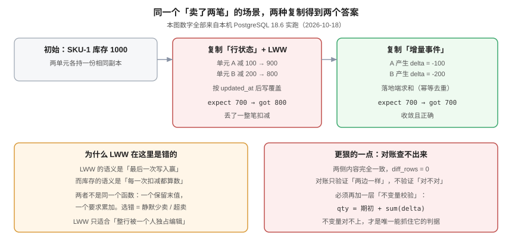

# 冲突裁决：收敛不等于正确

**多活里最难的不是「让两边一样」，而是「让两边都对」。** 本页用一次真实的库存扣减实验说明：后写覆盖（LWW）能让两侧完全一致、对账差异为 0，却少记了一整笔扣减。然后给出冲突的三种来源、四种裁决策略的选择表，以及对账为什么必须配一层「不变量校验」。



## 一、实验：一次「都成功」的丢单

场景：`SKU-1` 初始库存 1000，两个单元各持一份副本。单元 A 卖出 100，单元 B 在同一秒卖出 200。按行复制 + 后写覆盖同步。

```sql
CREATE TABLE stock_a (sku text PRIMARY KEY, qty int, updated_at timestamptz);
CREATE TABLE stock_b (LIKE stock_a INCLUDING ALL);
INSERT INTO stock_a VALUES ('SKU-1', 1000, '2026-10-18 10:00:00+08');
INSERT INTO stock_b VALUES ('SKU-1', 1000, '2026-10-18 10:00:00+08');

UPDATE stock_a SET qty = qty - 100, updated_at = '2026-10-18 10:00:01+08'   WHERE sku='SKU-1';
UPDATE stock_b SET qty = qty - 200, updated_at = '2026-10-18 10:00:01.4+08' WHERE sku='SKU-1';

-- 双向同步：按时间戳后写覆盖
INSERT INTO stock_a AS t SELECT * FROM stock_b WHERE sku='SKU-1'
  ON CONFLICT (sku) DO UPDATE SET qty = EXCLUDED.qty, updated_at = EXCLUDED.updated_at
  WHERE EXCLUDED.updated_at > t.updated_at;
INSERT INTO stock_b AS t SELECT * FROM stock_a WHERE sku='SKU-1'
  ON CONFLICT (sku) DO UPDATE SET qty = EXCLUDED.qty, updated_at = EXCLUDED.updated_at
  WHERE EXCLUDED.updated_at > t.updated_at;

SELECT 'expect 700' AS what, 700 AS qty
UNION ALL SELECT 'cell_a', qty FROM stock_a WHERE sku='SKU-1'
UNION ALL SELECT 'cell_b', qty FROM stock_b WHERE sku='SKU-1';
```

实测输出（PostgreSQL 18.6）：

```text
    what    | qty
------------+-----
 expect 700 | 700
 cell_a     | 800
 cell_b     | 800
```

两笔扣减只留下了一笔。真实库存 800，但账上应该扣 300。**而两端完全一致，所以「两侧对账」查不出来**：

```sql
SELECT count(*) AS diff_rows FROM (
  SELECT * FROM stock_a EXCEPT SELECT * FROM stock_b
  UNION ALL SELECT * FROM stock_b EXCEPT SELECT * FROM stock_a) d;
```

```text
 diff_rows
-----------
         0
```

::: danger 这是本专题最重要的一条结论
**对账只能发现「不一致」，发现不了「一致地错」。** 收敛（convergence）与正确（correctness）是两个独立的性质，很多多活方案只保证了第一个。
:::

## 二、同一场景换成「增量事件」

把「同步行状态」换成「同步变化量」，落地端做加法：

```sql
CREATE TABLE evt_a (id bigint GENERATED ALWAYS AS IDENTITY PRIMARY KEY, sku text, delta int);
CREATE TABLE evt_b (LIKE evt_a INCLUDING ALL);
INSERT INTO evt_a (sku, delta) VALUES ('SKU-1', -100);
INSERT INTO evt_b (sku, delta) VALUES ('SKU-1', -200);

SELECT 1000 + sum(delta)::int AS merged_qty FROM (
  SELECT delta FROM evt_a UNION ALL SELECT delta FROM evt_b) s;
```

```text
 merged_qty
------------
        700
```

正确。区别不在「同步工具」，而在**同步的是什么**：

| 同步内容 | 语义 | 可合并 | 结果 |
| --- | --- | --- | --- |
| 行状态（`qty = 900`） | 「现在是多少」 | 否 | 后写覆盖，丢更新 |
| 变化量（`delta = -100`） | 「变了多少」 | 是 | 求和，正确 |
| 全量快照（`qty`, `version`） | 「在某版本时是多少」 | 否（需版本比较） | 保留版本大者，仍可能丢 |

::: tip 一条可操作的设计准则
**「能不能把这次写表达成可交换、可重复的增量？」** 能，就用事件流；不能（比如「把标题改成 X」），就必须保证这一行只有一个写者。
:::

## 三、冲突的三个来源

| 来源 | 场景 | 是否可避免 |
| --- | --- | --- |
| **并发写同一行** | 两个人同时改同一张卡片的标题 | 可用「单写者」避免（按租户切） |
| **跨单元唯一键** | 两单元各自分配了 `id=1` 的订单 | 可避免（全局发号 / 单元前缀） |
| **迁移期双写** | 迁移窗口内新旧单元都能写 | 可避免（`epoch` 闸门 + 短窗口） |

**三个来源里有三个可避免**——这说明大多数「冲突」其实是设计缺陷，不是物理必然。

::: danger 不要用「冲突本来就难免」为双写辩护
只有当「同一个业务实体必须被两个单元同时写」时，冲突才是必然的。这种情况在协作类、交易类系统里都很罕见：**协作看板按租户切、交易按账户切，都能做到单写者。** 先证明「必须双写」，再引入裁决机制。
:::

## 四、四种裁决策略

| 策略 | 做法 | 适用 | 代价 |
| --- | --- | --- | --- |
| **A. 拒绝跨单元写** | 非归属单元的写一律 `409`/`421`，让客户端重试到正确单元 | **默认推荐** | 需要客户端能处理重定向 |
| **B. 单写者** | 每个实体只有一个单元可写，其他只读 | 绝大多数在线业务 | 需要归属模型 |
| **C. CRDT / 可合并类型** | 计数器、集合、LWW-Register 等 | 计数、点赞、标签集合 | 只能用在这些类型上 |
| **D. 业务补偿** | 两侧都写，事后按业务规则修正（如超卖退款） | 无法避免冲突时 | 需要补偿流程与客服介入 |

### 4.1 为什么「拒绝」是默认答案

因为它把「数据可能错」变成了「请求明确失败」。用户会重试，系统会重定向，**错误可见、可修**。而 LWW 把错误藏进了数据里，等到对账或用户投诉才发现。

```http
POST /api/boards/42/cards
X-Tenant: 1001

HTTP/1.1 421 Misdirected Request
X-Cell-Correct: cell-b
Location: https://cell-b.api.example.com/api/boards/42/cards
```

`421` 比 `409` 更准确：它表达的是「你问对人了，但找错了门」。客户端拿到 `Location` 重试一次即可，不需要用户感知。

## 五、对账：三层，缺一不可

| 层 | 比什么 | 能发现 | 发现不了 |
| --- | --- | --- | --- |
| **L1 行数** | `count(*)` | 漏同步、整块丢失 | 值被改错 |
| **L2 内容哈希** | 按主键范围分段算 `md5` 聚合 | 字段级差异 | 「两侧一致地错」 |
| **L3 业务不变量** | 例如 `qty = 期初 + sum(delta)` | **一致地错** | 不变量本身写错 |

```sql
-- L2：分段内容哈希（按 id 区间切，避免全表扫描锁）
SELECT count(*) AS rows,
       md5(string_agg(sku || ':' || qty || ':' || updated_at::text, ',' ORDER BY sku)) AS digest
  FROM stock_a WHERE sku BETWEEN 'A' AND 'M';

-- L3：业务不变量（这才是能抓住「一致地错」的那一层）
SELECT s.sku, s.qty AS current_qty,
       (1000 + COALESCE(sum(e.delta), 0)) AS expected_qty
  FROM qty_sum s LEFT JOIN evt_all e USING (sku)
 GROUP BY s.sku, s.qty
HAVING s.qty <> 1000 + COALESCE(sum(e.delta), 0);
-- 期望：0 行。有行即「账实不符」，无论两侧是否一致
```

::: warning L2 的哈希要注意两件事
1. **必须排序**：`string_agg` 的顺序不稳定，不排序的哈希每天都不一样（假告警）。
2. **必须分段**：全表 `md5` 在大表上要几十秒，对账任务会撞上业务高峰。按主键区间切段，每段一行结果。
:::

## 六、修复：以事件为准，还是以某一侧为准

| 场景 | 修复依据 | 做法 |
| --- | --- | --- |
| 事件流可重放 | **以事件重放为准** | 从事件流的某个位点重算，覆盖结果表 |
| 行复制、无事件 | 以「归属单元」为准 | 用归属单元的行覆盖其他单元 |
| 两侧都有真实写入（真冲突） | 业务规则 | 生成人工工单，不自动合并 |

::: danger 自动「以某一侧为准」是最危险的操作
如果两侧都有真实写入（比如两个用户分别改了同一张卡片），任何自动覆盖都会丢掉一个人的编辑。**这种情况必须产生一条冲突记录并通知人**，而不是让时间戳决定谁的编辑消失。
:::

## 七、验证方式

```shell
# ① 复现 LWW 丢更新（在隔离的库上跑，不要在生产跑）
psql "$DSN" -f /tmp/lww-demo.sql
# 期望：cell_a / cell_b 都是 800，而按事件求和是 700 → 证明问题存在

# ② 对账差异（L2）
psql "$DSN_A" -c "SELECT md5(string_agg(sku||':'||qty, ',' ORDER BY sku)) FROM stock_a;"
psql "$DSN_B" -c "SELECT md5(string_agg(sku||':'||qty, ',' ORDER BY sku)) FROM stock_b;"
# 期望：两个哈希相同。不同则存在未同步差异

# ③ 不变量校验（L3）——唯一能抓「一致地错」的判据
psql "$DSN" -c "SELECT count(*) FROM qty_sum s LEFT JOIN evt_all e USING (sku)
  GROUP BY s.sku, s.qty HAVING s.qty <> 1000 + COALESCE(sum(e.delta),0);"
# 期望：0 行

# ④ 跨单元写是否被拒绝
curl -s -o /dev/null -w '%{http_code}\n' -X POST "https://cell-b.example.com/api/boards/42/cards" -H "X-Tenant: 1001"
# 期望：421（或 409），而不是 200
```

## 八、判据族 `MAX`

| 判据 | 内容 | 怎么验证 |
| --- | --- | --- |
| `MAX-A` | 每个可写实体必须有唯一写者；双写必须写出理由 | 逐个实体列出归属单元；出现两个写者的必须有书面理由 |
| `MAX-B` | 非归属单元的写必须被显式拒绝（`409`/`421`），不得静默接受 | `curl` 打到非归属单元，状态码不是 2xx |
| `MAX-C` | 可合并的状态必须用增量表达（计数器用 delta，集合用 add/remove） | 计数器类字段的同步载荷里是 delta 而不是绝对值 |
| `MAX-D` | 对账必须三层齐全（行数 / 内容哈希 / 业务不变量） | 对账脚本里有三个查询，缺 L3 即不合格 |
| `MAX-E` | 内容哈希必须排序且分段 | 对账 SQL 里 `string_agg` 带 `ORDER BY`，且有主键区间条件 |
| `MAX-F` | 真冲突必须生成冲突记录并通知人，不得自动覆盖 | 冲突表有数据；覆盖式修复的代码路径不存在 |
| `MAX-G` | 修复必须以事件重放或归属单元为准，且可重复执行 | 同一修复脚本执行两次结果一致（幂等） |
| `MAX-H` | 「收敛」与「正确」必须在文档里分开表述 | `grep -n "收敛"` 与 `grep -n "不正确\|错"` 在同一节出现，说明有区分 |

## 九、与相邻专题的分工

| 你想知道 | 去哪 |
| --- | --- |
| 同步方式怎么选、回环怎么抑制 | [数据同步](../DataSync/index.md) |
| 幂等键、重放、补偿状态机 | [幂等与状态机工程](../../../Backend/IdempotencyStateMachine/index.md) |
| 账务对账的完整口径 | [账务系统：对账](../../../Backend/Ledger/Reconciliation/index.md) |
| 并发写的行级控制（乐观锁） | [分区分表与冷热分离](../../../DB/PartitionArchival/index.md) |

## 参考资料

- PostgreSQL 18 文档：[CREATE TABLE ... ON CONFLICT](https://www.postgresql.org/docs/current/sql-insert.html)
- M. Shapiro et al., *Conflict-free Replicated Data Types*, SSS 2011（CRDT 的原始分类）
- P. Bailis & A. Ghodsi, *Eventual Consistency Today*, ACM Queue 2013（「收敛 ≠ 正确」的经典论述）
