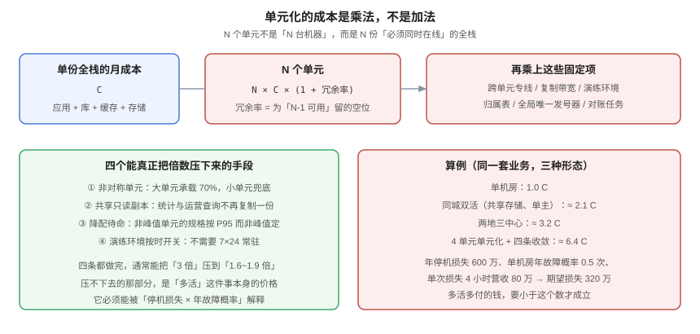

# 成本：单元化是乘法

**单元化的成本不是「多买几台机器」，而是「N 份全栈同时在线」。** 一个单元挂了业务还在，靠的是其他单元本来就有容量——这份容量在平时是闲置的，这就是多活的价格。本页给出成本结构的分解、同一业务在四种形态下的倍数算例、四条能把倍数压下来的手段，以及一条「值不值」的判断公式。



## 一、成本结构的五个部分

| 部分 | 内容 | 随单元数怎么变 |
| --- | --- | --- |
| **常驻全栈** | 应用、库、缓存、消息、搜索、对象存储 | × N |
| **冗余容量** | 为「N-1 能兜住峰值」预留的空位 | ×（1 + 冗余率） |
| **跨单元链路** | 专线 / 对等连接 / 复制带宽 | ×（N-1）条 |
| **演练与工具** | 演练环境、对账任务、归属表、发号器 | 固定 + 少量随 N |
| **组织成本** | 值班、变更评审、故障定位难度 | 超线性（最难量化） |

```text
总成本 ≈ N × C × (1 + 冗余率) + (N-1) × L + F
其中 C = 单份全栈月成本，L = 单条跨单元链路月成本，F = 固定项
```

::: warning 最后一项「组织成本」经常被忽略
单元化之后，一次线上问题的排查路径从「一处」变成「先判断是哪个单元，再看该单元内部」。**这部分成本不在账单上，但它决定了你能不能长期维护这套架构**。见[体系概述](../Overview/index.md)第 5 节第 3 条。
:::

## 二、四种形态的倍数算例（推演）

同一套业务、同样的峰值负载，四种形态的月成本倍数：

| 形态 | 单元/站点数 | 冗余率 | 链路 | 倍数（相对单机房） |
| --- | --- | --- | --- | --- |
| 单机房 | 1 | 0.3 | 0 | **1.0 C** |
| 同城双活（共享存储、单主） | 2 | 0.2 | 1 条同城 | **≈ 2.1 C** |
| 两地三中心 | 3 | 0.2 | 2 条（1 同城 1 异地） | **≈ 3.2 C** |
| 4 单元单元化 | 4 | 0.33 | 3 条 | **≈ 6.4 C** |

::: danger 这些数字是推演，不是报价
`C`、`L`、冗余率都随业务差异极大。**用法是代入自己的数**：把你自己的单份全栈月成本填进公式，再乘倍数。不要直接把「6.4 倍」当成结论去汇报。
:::

### 2.1 为什么单元化的倍数高于「站点数」

因为单元是**全栈**的：每个单元都要有自己的库、缓存、搜索索引、对象存储桶。而两地三中心里的「异地灾备」可以只保留数据库与最小应用集，不需要全量搜索索引与缓存。

这也是为什么不要轻易把单元数从 3 提到 6：**成本近似线性，复杂度近似平方**。

## 三、四条收敛手段

### 3.1 非对称单元

不必所有单元同规格。常见的 70/30 或 80/20 分布：

```text
单元 A（大）：承载 70% 租户，规格 S
单元 B（小）：承载 30% 租户，规格 0.5S
```

代价是「A 挂了 B 接不住」——这时必须接受**降级**而不是**接管**。判断标准：**这部分用户的 RTO 要求是否允许降级**。

### 3.2 共享只读副本

统计、报表、运营后台的查询不需要每个单元一份副本，可以共享一个跨单元的只读副本（或数仓）：

| 查询类型 | 放哪 | 为什么 |
| --- | --- | --- |
| 在线业务读 | 单元内 | 必须闭环，延迟敏感 |
| 运营后台列表 | 单元内（带租户条件） | 仍需租户隔离 |
| 全局统计 / 报表 | 跨单元只读副本或数仓 | 不需要闭环，异步可接受 |

这一条通常能省掉 15%~25% 的存储与计算。

### 3.3 降配待命

非峰值单元的规格按 **P95 而非峰值** 定，高峰时靠弹性扩容补上：

```text
常驻规格 = P95 负载所需
弹性扩容 = 峰值 - P95，按需拉起（预热时间必须 < 切流第一段）
```

::: danger 弹性扩容的前提是「预热比 TTL 快」
如果扩容需要 5 分钟，而 DNS TTL 只有 60 秒，那么切流后新单元会在扩容完成前就被打满。**降配待命只适用于「扩容能在切流窗口内完成」的场景**，否则常驻规格必须按峰值定。
:::

### 3.4 演练环境按时开关

演练环境不需要 7×24 常驻。按「每月 2 次 × 每次 4 小时」开关，成本可以降到常驻的 1/90。

| 环境 | 常驻 | 按需 | 节省 |
| --- | --- | --- | --- |
| 生产（N 单元） | 必须 | — | — |
| 预发 | 必须（1 份） | — | — |
| 演练 | 不必 | 每月 8 小时 | ≈ 98% |

四条都做完，通常能把「3 倍」压到「1.6~1.9 倍」。**压不下去的那部分，就是多活本身的价格。**

## 四、单位成本：用哪个口径说话

| 口径 | 公式 | 用来说服谁 |
| --- | --- | --- |
| **每万次请求成本** | 月总成本 /（月请求数 / 10000） | 技术团队横向对比 |
| **每租户成本** | 月总成本 / 活跃租户数 | 商业化定价 |
| **每单元成本** | 月总成本 / 单元数 | 容量规划 |
| **可用性单位成本** | 增量成本 /（可用性提升的 9 的个数） | **决策层** |

最后一个最有说服力：从 99.9% 到 99.99%，年停机时间从 8.76 小时降到 52.6 分钟。**为了这 8 小时，多付的钱值不值？** 用业务侧的「每小时停机损失」乘一下就知道。

## 五、值不值：一条判断公式

```text
多活的年增量成本  <  年停机损失期望值 × 多活能消除的比例
```

算例（推演）：

| 输入 | 取值 |
| --- | --- |
| 单机房年故障概率 | 0.5 次/年 |
| 单次故障平均影响时长 | 4 小时 |
| 每小时营收损失 | 20 万元 |
| 年停机损失期望 | 0.5 × 4 × 20 = **40 万元** |
| 多活年增量成本（4 单元） | **约 180 万元** |

结论：**在这个量级上，多活算不过账**。要么把单次影响时长压到 1 小时以内（提升单机房的可靠性更便宜），要么业务量增长到营收损失 > 450 万/年之后再上。

::: tip 这个公式真正的用途不是「算出一个数」
而是**逼你把「停机损失」写成一个可讨论的数字**。多数团队从来没有量化过它，于是「要不要做多活」变成了纯立场之争。
:::

### 5.1 三种「算不过账但仍然要做」的正当理由

1. **合规 / 合同要求**：金融、医疗、政企的 SLA 条款里写死了 RTO。
2. **不可替代的信任损失**：一次数据丢失导致的客户流失，无法用营收损失衡量。
3. **增长预期**：明年的业务量会让公式翻转，现在建比明年建便宜。

除这三条之外，「同行都做了」不是理由。

## 六、验证方式

```shell
# ① 算出自己的 N 与冗余率（把数字换成自己的）
python3 -c "
peak=4000; cap=2500; red=0.33
n=2
while (n-1)*cap < peak: n+=1
print('N =', n, '冗余率 =', red, '倍数 ≈', round(n*(1+red),2))"
# 期望：得到 N 与成本倍数；与账单实际倍数对比，差 20% 以上说明有未归集的固定成本

# ② 检查是否真的共享了只读副本（避免每单元一份统计副本）
grep -rn "readonly\|replica\|warehouse" --include="*.yml" --include="*.yaml" . | head
# 期望：统计类数据源指向同一个只读副本，而不是每单元一个

# ③ 检查演练环境是否常驻（成本浪费的常见来源）
kubectl get ns | grep -i "drill\|chaos"
# 期望：不存在长期运行的演练命名空间；存在则记录其月成本

# ④ 单位成本口径是否有人用
grep -rn "每万次请求\|每租户成本\|单位成本" --include="*.md" docs/ | head
# 期望：至少一个口径被写进汇报材料，而不是只有「总账单」
```

## 七、判据族 `MAE`

| 判据 | 内容 | 怎么验证 |
| --- | --- | --- |
| `MAE-A` | 成本必须按「N × C ×（1+冗余）+ 链路 + 固定」分解，不得只报总账 | 成本文档有五个部分的分解表 |
| `MAE-B` | 每个数字必须标注「实测 / 推演」，推演必须带公式 | 文档里每处倍数都有公式或账单出处 |
| `MAE-C` | 必须有「值不值」的判断公式与代入值 | 文档里有公式与四个输入的实际取值 |
| `MAE-D` | 统计与报表类查询不得每单元一份副本 | 数据源配置指向共享只读副本 |
| `MAE-E` | 演练环境不得 7×24 常驻（除有书面理由） | `kubectl get ns` 无长期演练命名空间 |
| `MAE-F` | 降配待命的前提是「扩容 < 切流第一段」，且被验证过 | 有扩容耗时的实测记录，且小于 2×TTL |
| `MAE-G` | 必须有一个「单位成本」口径进入汇报 | 汇报材料里有每万次请求或每租户成本 |
| `MAE-H` | 非对称单元的降级结论必须写明「谁在什么时候不接管」 | 文档里有明确的降级矩阵与触发条件 |

## 八、与相邻专题的分工

| 你想知道 | 去哪 |
| --- | --- |
| 容量台账、水位线、单位成本方法论 | [容量规划与成本治理](../../CapacityCost/index.md) |
| 云上账单归集与预算告警 | [容量规划与成本治理](../../CapacityCost/index.md) |
| 单元数怎么由容量算出 | [单元化模型](../CellModel/index.md) 第 5 节 |
| 多活该做到哪一档 | [体系概述](../Overview/index.md) 第 5 节 |

## 参考资料

- Google SRE Book：[*Embracing Risk*](https://sre.google/sre-book/embracing-risk/)（可用性与成本的定量权衡）
- AWS Well-Architected：Cost Optimization Pillar
- 本站：[容量规划与成本治理](../../CapacityCost/index.md)（单位成本与分摊的完整方法）
