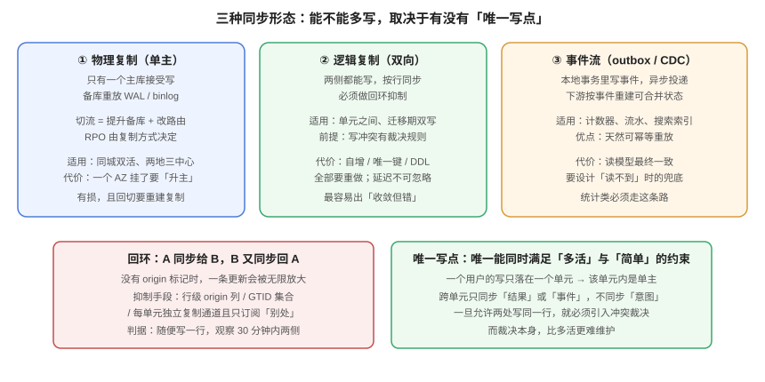

# 跨单元数据同步：单向、双向与事件流

**同步方式决定了「能不能多处写」，而不是反过来。** 单主复制下写只有一个落点，切换是「升主」；双向复制下写有多处落点，你就必须处理冲突；事件流则把「状态」换成「变化」，让下游可以幂等重建。本页给出三种方式的取舍、回环抑制的四种手段、跨单元自增键的两个实测坑，以及同步延迟的三个监控口径。



## 一、三种方式：先看「写落点」

| 方式 | 写落点 | 同步单位 | 冲突可能 | 典型实现 |
| --- | --- | --- | --- | --- |
| **物理复制** | 一处（主） | WAL / binlog 块 | 无（单主） | PG streaming replication、MySQL 主从 |
| **逻辑复制（单向）** | 一处（主） | 行变更 | 无（从侧不写） | PG logical replication、Debezium |
| **逻辑复制（双向）** | 多处 | 行变更 | **有** | 双向 logical replication、自研同步 |
| **事件流** | 多处（各写各的） | 业务事件 | 合并语义决定 | outbox + Kafka、CDC + 消费端 |

::: tip 选择顺序
**能用单主就别用双向，能用事件流就别用行复制。** 行复制是把「数据库内部表示」当成契约；事件流是把「业务变化」当成契约——后者跨版本、跨库、跨语言都更稳。
:::

## 二、回环：双向复制的第一个必答题

A 同步给 B、B 又同步回 A，一条更新会无限放大。抑制手段有四种，各自的代价不同：

| 手段 | 做法 | 优点 | 代价 |
| --- | --- | --- | --- |
| **行级 origin 列** | 每行带 `origin_cell`，同步时跳过「本单元产生」的行 | 简单直观 | 加一列；同一行被多处改时列会被覆盖 |
| **GTID / LSN 集合** | 记住已应用的事务 ID，重复的不再应用 | 精确 | 要求两端都支持，跨异构库难 |
| **通道隔离** | 每个单元只订阅「其他单元」的发布，且发布端不带回传 | 简单 | 需要发布订阅拓扑正确 |
| **单写者仲裁** | 每个租户只有一处能写，另一处只读 | 最彻底 | 失去「双向」的意义 |

### 2.1 行级 origin 的坑

```sql
-- 看起来没问题：同步时跳过本单元产生的行
UPDATE cards SET title = $1, origin_cell = 'cell-b'
 WHERE id = $2 AND origin_cell <> 'cell-b';
```

问题在于：如果 A 改了这行（`origin_cell='cell-a'`），同步到 B 时把 `origin_cell` 改成 `'cell-b'`；B 又改这行，`origin_cell` 变成 `'cell-b'`，此时 A 的后续同步**会跳过它**——因为「origin 是本单元」。**一行的 origin 只能记「最后写入者」，不能记「谁可以再改」。**

正确做法是把回环抑制放在**传输层**（通道隔离 / GTID），而不是数据层。

::: danger 回环爆炸的观测特征
同步速率持续上升、单行 `updated_at` 每秒变多次、两侧 `xmin` 不断变大。发现这三个特征，先停同步通道，再查 origin 逻辑——**不要试图靠限流压住它**，限流只会让它变慢而不是停止。
:::

## 三、跨单元的自增键：两个必踩的坑

### 3.1 两侧 `bigserial` 各自从 1 开始 → 必然撞号

本机实测（PostgreSQL 18.6）：

```sql
CREATE SCHEMA cell_a; CREATE SCHEMA cell_b;
CREATE TABLE cell_a.orders (id bigserial PRIMARY KEY, note text);
CREATE TABLE cell_b.orders (id bigserial PRIMARY KEY, note text);
INSERT INTO cell_a.orders (note) VALUES ('a-1'), ('a-2');
INSERT INTO cell_b.orders (note) VALUES ('b-1'), ('b-2');

SELECT count(*) AS total_rows, count(DISTINCT id) AS distinct_ids
  FROM (SELECT id FROM cell_a.orders UNION ALL SELECT id FROM cell_b.orders) t;
```

```text
 total_rows | distinct_ids
------------+--------------
          4 |            2
```

四行数据只有两个不同的 ID。更糟的是：**两边的 `PRIMARY KEY` 都没报错**——因为在各自的库里它们是唯一的。等到汇总或迁移时才发现撞号，那时已经有外键指向错误的行了。

### 3.2 `CACHE` 造成的跳跃：切流后会「跳号」一大段

```sql
CREATE SEQUENCE demo_seq CACHE 100;
```

三个不同会话各取一次：

```text
101
201
301
```

第一段 1~100 被第一个会话整段预留在内存里，**进程崩了、单元切了，这段号就永久丢失**。跳号本身不致命（自增键不该被当成「连续编号」），但有两类系统会被它打穿：

- 把 ID 当「单据号」展示给用户（用户看到 101 之后跳到 201）；
- 用 ID 差值做统计（「今天新增 = max - min」会算错）。

### 3.3 三种可用的全局唯一方案

| 方案 | 形态 | 优点 | 代价 |
| --- | --- | --- | --- |
| **UUIDv7** | 时间前缀 + 随机 | 无需协调，天然有序 | 16 字节，索引更大 |
| **号段（segment）** | 中央发号器按段下发 | 有序、紧凑 | 发号器是单点，要预取 |
| **单元前缀 + 本地序列** | `(cell_id << 48) + local_seq` | 有序、可反查单元 | 需要规划位数 |

::: tip 推荐
**对外暴露的 ID 用 UUIDv7，内部主键用「单元前缀 + 本地序列」。** 前者不泄露信息量，后者让索引保持局部性，两者各司其职。
:::

## 四、幂等键：`(单元, 本地序列)`，不是一个序列

事件流落地时最常见的错误是「用事件 ID 去重」，而事件 ID 恰恰是最容易撞的（见 3.1）。

```sql
-- 错误：单列去重，两单元的事件 ID 会撞
CREATE TABLE applied_event (event_id bigint PRIMARY KEY);

-- 正确：复合去重，单元参与主键
CREATE TABLE applied_event (
  src_cell  text   NOT NULL,
  local_seq bigint NOT NULL,
  applied_at timestamptz NOT NULL DEFAULT now(),
  PRIMARY KEY (src_cell, local_seq)
);
```

实测时的现象很直观：两个单元各自产生的第一条事件，`local_seq` 都是 `1`。单列主键会让第二条被当成重复丢弃——**丢的是一条真实的业务变化，而且没有任何报错**。

## 五、DDL 同步：先结构，后代码

跨单元的表结构变更比单库难，因为**不存在「同时生效」**。唯一安全的顺序是 expand-contract：

| 阶段 | 动作 | 兼容性 |
| --- | --- | --- |
| 1. Expand | 加新列（可空）/ 加新表 | 旧代码不认识新列，不受影响 |
| 2. 双写 | 新代码同时写新旧两处 | 新旧代码都能读 |
| 3. 回填 | 后台任务把历史数据补到新列 | 幂等、可重入 |
| 4. 切换读 | 读新列，观察 | 出问题可切回读旧列 |
| 5. Contract | 删旧列 | **不可逆**，必须等所有单元都切完读 |

::: danger 改名与删列在多活里是「两次发布」
单库环境里 `ALTER TABLE ... RENAME COLUMN` 是一个原子操作；多活环境里它在两个单元之间必然有一段时间不一致。**改名必须拆成「加新列 + 双写 + 切读 + 删旧列」四次发布**，直接改名会导致旧单元的应用在新库上报表不存在。
:::

## 六、同步延迟：三个口径，缺一个就会误判

| 口径 | 怎么算 | 优点 | 缺点 |
| --- | --- | --- | --- |
| **时间戳差** | `now() - 最新同步行的时间` | 直观 | 依赖两端时钟，时钟漂移会骗人 |
| **位点差** | `主库 LSN - 备库 replay LSN` | 精确 | 要能读到两端的位点 |
| **心跳表** | 主库每秒写一行，备库读最新一行的时间 | 与业务无关、最稳 | 需要一张额外表 |

```sql
-- 心跳表：主库写入，备库只读
CREATE TABLE sync_heartbeat (
  id bigint GENERATED ALWAYS AS IDENTITY PRIMARY KEY,
  cell text NOT NULL,
  beat_at timestamptz NOT NULL DEFAULT clock_timestamp()
);

-- 在备库上算延迟（秒）
SELECT extract(epoch FROM (now() - max(beat_at))) AS lag_seconds
  FROM sync_heartbeat WHERE cell = 'cell-a';
```

::: warning 只监控「时间戳差」会在时钟漂移时静默失效
两端 NTP 差 30 秒，延迟指标就会显示负值或恒定 0。**心跳表 + 位点差两个口径同时看**，任何一个异常都告警。
:::

## 七、断点续传：同步中断后从哪继续

| 方式 | 续传依据 | 风险 |
| --- | --- | --- |
| 按时间戳 | `WHERE updated_at > last_ts` | **同一毫秒的多行会漏**；时钟回拨会重复 |
| 按自增 ID | `WHERE id > last_id` | 只对「单写点」成立；双向时两侧 ID 空间不同 |
| 按位点 / offset | LSN / binlog position / Kafka offset | 正确，但要持久化且不可跨库混用 |

::: danger 「按时间戳续传」是最常见的漏数来源
`updated_at > last_ts` 在批量更新同一时刻的多行时，会把 `last_ts` 之后的行漏掉——因为它们的时间戳**等于** `last_ts`。写成 `>=` 又会重复。唯一稳的写法是 `(updated_at, id) > (last_ts, last_id)` 的行值比较。
:::

## 八、验证方式

```shell
# ① 跨单元唯一性：两库各自生成了多少个重复 ID
psql "$DSN_A" -c "SELECT count(*) FROM orders;" ; psql "$DSN_B" -c "SELECT count(*) FROM orders;"
psql "$DSN_A" -c "SELECT count(*) AS dup FROM orders a JOIN dblink('dbname=b','SELECT id FROM orders') AS b(id bigint) USING (id);"
# 期望：dup = 0。非 0 说明两侧序列独立，必须改全局发号或单元前缀

# ② 序列跳跃量（切流前后各取一次）
psql "$DSN" -c "SELECT last_value FROM orders_id_seq;"
# 期望：两次读数之差 ≈ 实际插入行数；远大于行数说明 CACHE 预留在切换中丢失

# ③ 同步延迟（心跳表口径）
psql "$DSN_B" -c "SELECT extract(epoch FROM (now() - max(beat_at))) AS lag_seconds FROM sync_heartbeat;"
# 期望：< 3 s 为健康；持续增长说明同步通道阻塞

# ④ 幂等键是否含单元
psql "$DSN" -c "\d applied_event"
# 期望：主键为 (src_cell, local_seq) 复合键；只有单列 event_id 即为不合格
```

## 九、判据族 `MAS`

| 判据 | 内容 | 怎么验证 |
| --- | --- | --- |
| `MAS-A` | 同步方式必须书面写明是四种中的哪一种，并说清「写落点」 | 文档中有「写落点」结论句；与架构图一致 |
| `MAS-B` | 双向复制必须有传输层回环抑制，不得只靠行级 origin 列 | 检查复制通道配置，每通道只订阅「他处」变更 |
| `MAS-C` | 跨单元主键不得使用两库独立的 `bigserial` | 任取两侧各一行，比对 ID 集合无交集；或用第 8 节 ① 的脚本 |
| `MAS-D` | 幂等去重键必须包含来源单元 | `\d applied_event` 显示复合主键含 `src_cell` |
| `MAS-E` | 同步延迟必须有心跳表口径，不得只有时间戳差 | 库中存在心跳表且有数据；监控面板有对应指标 |
| `MAS-F` | 断点续传必须用位点或行值比较，不得用裸时间戳 | `grep -n "updated_at >"` 在同步代码中无命中 |
| `MAS-G` | DDL 变更必须走 expand-contract，改名不得一步完成 | 发布记录里改名类变更都是「加列 → 双写 → 切读 → 删列」四步 |
| `MAS-H` | 同步中断后必须能自动追平，且有「追平完成」的可观测信号 | 断开通道 1 分钟再恢复，观察延迟回落到基线并留下追平日志 |

## 十、与相邻专题的分工

| 你想知道 | 去哪 |
| --- | --- |
| 撞上了怎么裁（LWW / CRDT / 拒绝） | [冲突裁决](../Conflict/index.md) |
| CDC 的 binlog 解析、快照模式、schema 演进 | [数据同步与 CDC](../../../DB/CDC/index.md) |
| 幂等键与重放的通用做法 | [幂等与状态机工程](../../../Backend/IdempotencyStateMachine/index.md) |
| 单元之间为什么必须单向 | [单元化模型](../CellModel/index.md) |

## 参考资料

- PostgreSQL 18 文档：[Logical Replication](https://www.postgresql.org/docs/current/logical-replication.html)
- PostgreSQL 18 文档：[Sequence Functions](https://www.postgresql.org/docs/current/functions-sequence.html)（`CACHE` 的语义）
- PostgreSQL 18 文档：[ALTER TABLE](https://www.postgresql.org/docs/current/sql-altertable.html)（expand-contract 的操作基础）
