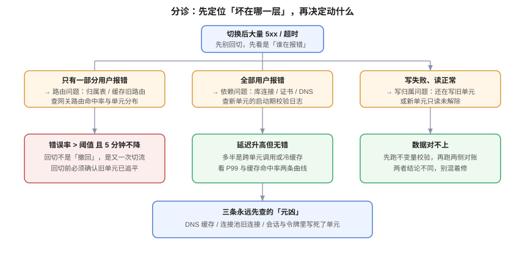

# 常见问题与最佳实践

本页收三类东西：**十类现象的分诊表**（先定位坏在哪一层，再决定动什么）、**十二个高频问题**（都是本专题里最容易走偏的判断题）、**十四项上线清单**（可以逐条勾）。最后附术语表与判据族 `MAF`。



## 一、分诊表：十类现象

| 现象 | 最可能的一层 | 先看什么 | 别急着做什么 |
| --- | --- | --- | --- |
| 切流后只有一部分用户报错 | **路由** | 网关路由命中率、归属表缓存 TTL | 别回切，先看是哪些租户 |
| 切流后全部用户报错 | **依赖** | 新单元的启动日志、证书、DNS | 别改代码，先看配置 |
| 写失败、读正常 | **写归属** | 新单元是否仍只读、`epoch` 是否不一致 | 别重启数据库 |
| 切流后「数据少了最近 20 分钟」 | **回切** | 是否在数据未追平时就切回 | 别从备份恢复，先查反向通道 |
| 文件上传成功、下载 404 | **附件未闭环** | object key 是否带单元段、桶是否为本单元 | 别改权限，先看 key 前缀 |
| 搜索返回空 | **索引未闭环** | 搜索索引是否每单元一份 | 别重建全量索引 |
| 通知收不到 | **事件未闭环** | 主题前缀是否含单元、消费者在哪 | 别提工单给消息队列团队 |
| 两个单元的同一行反复被改 | **回环** | 同步通道是否互相订阅 | 别限流，先停通道 |
| 对账差异 0 但业务数字不对 | **语义错误** | 不变量校验（不是对账） | 别相信「两侧一致」 |
| 切流后延迟整体升高 | **冷缓存 / 跨单元** | 缓存命中率、`cross_cell_calls` | 别扩容，先看跨单元调用数 |

::: tip 分诊的第一原则
**先分辨「影响面」再分辨「原因」**：只有一部分用户出错 → 路由或数据归属；全部用户出错 → 依赖或配置。这个二分能把排查范围缩小一半，且不需要看任何日志。
:::

## 二、十二问

### Q1：我们有两个机房，算多活吗？

要看**写落在哪**。如果两个机房的应用都往同一个库写（跨机房转发），那是「读多活」；如果两个机房各有自己的库且都能写，那是「双写」，必须有冲突裁决。只有「每个用户/租户的写只落一处、且两处都能承载各自用户」才算多活。见[体系概述](../Overview/index.md)第 4 节。

### Q2：多活能不能替代备份？

**不能，永远不能。** 多活会把 `DELETE`、`UPDATE`、误操作忠实同步到所有单元。备份解决的是「数据被写坏了怎么回去」，多活解决的是「机器不可用了怎么继续」。两件事的失效模式完全不重叠。

### Q3：RTO 承诺 1 分钟现实吗？

只有当三段之和 ≤ 60 秒时才现实：DNS TTL ≤ 15 s（还要客户端配合）、长连接能立即重连、客户端重试 < 5 s。**实测最常见的组合是 2×TTL + 30 s 排空 + 20 s 重试**，也就是 2~3 分钟。见[流量切换](../TrafficSwitch/index.md)第 1 节。

### Q4：为什么不能把 `cell` 放进令牌？

因为令牌的有效期通常远长于一次切流。令牌里写死 `cell`，等于把切流时间绑到「令牌过期」这个由用户行为决定的值上（可能是 7 天）。**令牌只放身份，单元每次查归属表**——点查只要 0.015 ms。

### Q5：归属表挂了怎么办？

**fail closed（拒绝），不要 fail open（默认落到某个单元）。** fail open 会让全部流量涌向一个只准备了 1/N 容量的单元，把「路由故障」升级成「全站故障」。降级方案是缓存「最近一次成功的归属快照」用于读，写仍然拒绝。

### Q6：两个单元的自增 ID 撞了怎么办？

三种方案：UUIDv7（无序风险小、无需协调）、中央号段（有序、有单点）、单元前缀 + 本地序列（有序、可反查）。**绝不能依赖两库各自的 `bigserial`**——实测四行数据只有两个不同 ID，而两侧主键都不报错。见[数据同步](../DataSync/index.md)第 3 节。

### Q7：双向复制一定要做吗？

**大多数情况不需要。** 只有当「同一行必须被两个单元同时写」时才需要。协作类按租户切、交易类按账户切，都能做到单写者。先证明「必须双写」，再引入冲突裁决——裁决比多活本身难维护。

### Q8：对账差异为 0，是不是就对了？

**不是。** 实测：LWW 同步后两侧完全一致（`diff_rows = 0`），但库存少了 100。对账只能发现「不一致」，发现不了「一致地错」。必须再加一层**业务不变量校验**（如 `qty = 期初 + sum(delta)`）。见[冲突裁决](../Conflict/index.md)第 1 节。

### Q9：切流后能立刻切回来吗？

**不能。** 切走后新单元的写入只在它本地，旧单元没有。回切前必须建立反向通道并追平，否则用户会看到「最近 N 分钟的数据消失」。回切比切走难三倍，原因就在这里。

### Q10：单元数是不是越多越好？

不是。成本近似线性，复杂度近似平方。**能用 2 个不对称单元解决的，不要上 4 个对称单元。** 单元数的下限由「峰值 / 单单元容量」与「N-1 能兜住」两条共同决定，见[单元化模型](../CellModel/index.md)第 5 节。

### Q11：为什么演练要通过「旧单元 QPS = 0」来判定？

因为网关的「已切」是**配置状态**，不是**流量事实**。缓存、长连接、DNS 都可能让流量继续打到旧单元。唯一可靠的证据是旧单元入口 QPS 降到 0（不是「接近 0」）。见[演练](../Drill/index.md)第 3 节。

### Q12：这套东西小团队做得起吗？

做得起的是 **L3 级别的单元化 + 温备**，做不起的是「4 单元全活 + 双向复制 + 自动切流」。判断标准不是团队大小，而是：**有没有人能读懂路由与同步指标**。没有这个人的时候，多活是一颗定时炸弹。

## 三、上线清单（14 项）

```text
□ 1. 多活形态已书面写明（同城双活 / 两地三中心 / 单元化），并说明写落点
□ 2. 路由键已确定，且在登录、API、WebSocket、消费者、定时任务五处一致可得
□ 3. 令牌与会话中不含单元标识
□ 4. 归属表已建，含 epoch 列，点查走索引（< 0.1 ms）
□ 5. 闭环清单十项已逐项标注（闭环 / 共享 / 不闭环），附件与搜索在「闭环」内
□ 6. 非归属单元的写返回 421（或 409），带正确单元提示
□ 7. 跨单元主键不依赖两库独立序列（UUIDv7 / 号段 / 单元前缀三者之一）
□ 8. 幂等去重键包含来源单元
□ 9. 同步有心跳表口径，延迟 < 3 s 且纳入监控
□ 10. 双向复制（若有）有传输层回环抑制，不靠行级 origin 列
□ 11. RTO 由三段相加得出，每段有实测出处，第一段按 2×TTL 估
□ 12. 切流脚本包含长连接主动断开
□ 13. 演练至少做到 L3，记录含观测点 / 期望值 / 持续时间三要素
□ 14. 三层数据校验（行数 / 哈希 / 不变量）已接入演练流程
```

::: danger 清单里最容易跳过的是第 5 项和第 13 项
第 5 项（闭环清单）跳过 → 切流后「能用但不好用」；第 13 项（演练）跳过 → 不知道能不能切。**这两项的共同点是「不做也不会立刻出事」，所以最容易被无限期推迟。**
:::

## 四、十二条最佳实践

1. **先答「写在哪」，再谈机房数量。** 顺序反了会得出「做了多活但不敢切」。
2. **默认拒绝跨单元写（421/409），不要静默接受。** 让错误可见，是成本最低的正确性保障。
3. **同步「变化」而不是「状态」。** 计数器用 delta，集合用 add/remove；能合并的才谈多写。
4. **幂等键永远带来源单元。** 两单元的本地序列必然从 1 开始。
5. **对账之外必须有业务不变量校验。** 前者查不一致，后者查「一致地错」。
6. **归属表是唯一的权威副本，绝不参与复制。** 复制它等于把旧路由带到新单元。
7. **迁移用 `epoch` 闸门，不用「等一会儿就没人写了」这种假设。**
8. **RTO 按最坏值承诺，按实测值汇报。** 2×TTL 是最低估计。
9. **切流与回切是对称动作，但回切多一步「追平」。** 手册里必须写死这一步。
10. **演练只认「旧单元 QPS = 0」与「不变量 0 违例」两个证据。**
11. **单元数宁少勿多，规格宁不对称勿对称。**
12. **把「停机损失」写成一个数字。** 没有这个数字，「要不要做多活」永远是立场之争。

## 五、术语表

| 术语 | 含义 | 最容易混淆的点 |
| --- | --- | --- |
| **单元（Cell）** | 能独立承载一部分用户全部功能的完整栈 | 与「一套部署」「一个微服务」不同：单元必须是全栈 |
| **归属表（Routing Table）** | 用户/租户 → 单元的权威映射 | 与「配置中心里的路由规则」不同：它是有状态的数据 |
| **epoch** | 归属记录的版本号，每次迁移 +1 | 与「乐观锁 version」不同：它用于拒绝迁移期的旧写 |
| **回环（Loop）** | A→B→A 的同步放大 | 与「重复投递」不同：回环会无限增长 |
| **LWW** | Last-Write-Wins，后写覆盖 | 它保证收敛，不保证正确 |
| **收敛（Convergence）** | 两侧最终一致 | 与「正确」是两个独立性质 |
| **不变量（Invariant）** | 永远成立的业务等式，如 `库存 = 期初 + 增量` | 与「对账」不同：对账查差异，不变量查语义 |
| **RTO 三段** | 解析生效 + 连接排空 + 客户端重试 | 不是「按下按钮到 DNS 生效」 |
| **fail closed** | 依赖故障时拒绝服务 | 与 fail open（默认放行）相对，后者是多活里最危险的选择 |
| **单向复制** | 只从一个单元流向另一个 | 与「主从」不同：主从不涉及「哪个单元服务哪些用户」 |

## 六、验证方式

```shell
# ① 分诊表能否被机器用起来：错误码分布（有 421/503 说明分诊可判）
curl -s "http://gateway/admin/metrics" | grep -E "421|503" | head
# 期望：能看到按状态码的计数；全为 0 说明路由与降级都没被触发过

# ② 上线清单第 3 项：令牌不含单元
TOKEN=$(curl -s -X POST https://auth.example.com/token -d '{"u":"a","p":"b"}' | jq -r .access_token)
echo "$TOKEN" | cut -d. -f2 | base64 -d 2>/dev/null | grep -c cell
# 期望：0

# ③ 上线清单第 9 项：心跳延迟
psql "$DSN" -c "SELECT extract(epoch FROM (now() - max(beat_at))) FROM sync_heartbeat;"
# 期望：< 3

# ④ 上线清单第 14 项：不变量校验可执行
psql "$DSN" -c "SELECT count(*) FROM qty_sum s LEFT JOIN evt_all e USING (sku)
  GROUP BY s.sku, s.qty HAVING s.qty <> 1000 + COALESCE(sum(e.delta),0);"
# 期望：0 行
```

## 七、判据族 `MAF`

| 判据 | 内容 | 怎么验证 |
| --- | --- | --- |
| `MAF-A` | 分诊表必须覆盖「路由 / 依赖 / 写归属 / 回切 / 闭环 / 语义」六类，不得只有「重启试试」 | 分诊表十行齐全，每行有「先看什么」 |
| `MAF-B` | 十四项上线清单必须逐项可勾，不接受「已评估」 | 清单每项都有可执行动作或命令 |
| `MAF-C` | 十二问的答案必须与本专题其他页一致，不得互相矛盾 | 交叉核对 Q3 与切换页、Q8 与冲突页的数值一致 |
| `MAF-D` | 「对账」与「不变量校验」必须在文中明确区分 | 两词出现在不同小节且各有定义 |
| `MAF-E` | fail closed 必须在清单与判据中都出现 | `grep -c "fail closed"` ≥ 2 |
| `MAF-F` | 术语表中每个词必须有「最容易混淆的点」一列且非空 | 该列无空白单元格 |
| `MAF-G` | 最佳实践不得包含「加强监控」「提高意识」这类不可执行项 | 逐条检查，每条都能对应一个动作 |
| `MAF-H` | 本页引用的外部数值必须与其他页同源 | 引用处给出页码或命令，数字一致 |

## 八、与相邻专题的分工

| 你想知道 | 去哪 |
| --- | --- |
| 该不该做多活、做成哪一档 | [体系概述](../Overview/index.md) |
| 单元怎么切 | [单元化模型](../CellModel/index.md) |
| 切流三段与回切 | [流量切换](../TrafficSwitch/index.md) |
| 演练怎么做才算通过 | [演练](../Drill/index.md) |
| 容灾四档位与备份 | [备份与容灾](../../BackupDR/index.md) |

## 参考资料

- PostgreSQL 18 文档：[Logical Replication](https://www.postgresql.org/docs/current/logical-replication.html)
- RFC 9110 §15.5.20：`421 Misdirected Request`
- Google SRE Workbook：[*Non-Abstract Large System Design*](https://sre.google/workbook/nalsd/)
