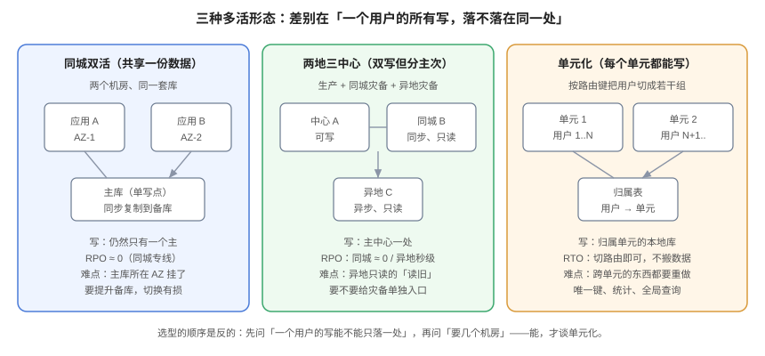

# 体系概述：多活、容灾与单元化的边界

**多活不是容灾的高级版本，而是另一种东西。** 容灾的目标是「出事了能恢复」，多活的目标是「出事时不用恢复」——业务在另一个地方继续跑，用户感知不到「一次切换」。本页给出三种多活形态的取舍、四个必须先答的问题、三种最常见的假多活，以及一条「什么时候不该做多活」的判断线。



## 一、先把三个词分清

| 词 | 目标 | 失败时的动作 | 代价 |
| --- | --- | --- | --- |
| **高可用（HA）** | 单机/单实例挂了不中断 | 主备切换、实例重建 | 副本 + 探活 |
| **容灾（DR）** | 机房/地域没了能恢复 | 切到备用环境、可能搬数据 | 备用环境 + 演练 |
| **多活（Multi-Active）** | 多个场地**同时**承载业务，故障时流量挪走即可 | 改路由，不搬数据 | 全栈 × N + 数据同步 + 冲突治理 |

三者的关系可以一句话说清：**高可用解决「坏了」，容灾解决「没了」，多活解决「坏了但不许停」。**

::: tip 一个残酷的判断
如果你的 RTO 是 30 分钟、RPO 是 1 分钟，那么**「温备 + 一年两次演练」几乎一定比多活更便宜也更可靠**。多活的门槛不是钱，是「你能不能接受写冲突这件事进入你的日常」。
:::

## 二、三种形态：差别只在一个问题

三种形态的真正区别不是「几个机房」，而是同一个问题：

> **一个用户的两次写，会不会落在两个不同的数据库上？**

| 形态 | 数据布局 | 同一用户的写落点 | 切流时要做什么 | 典型 RTO |
| --- | --- | --- | --- | --- |
| **同城双活** | 共享一套库（单主 + 同城同步备） | 永远一处（主库） | 提升备库 + 改路由 | 分钟级 |
| **两地三中心** | 生产主 + 同城同步 + 异地异步 | 永远一处（生产主） | 提升 + 明确「异地只读」边界 | 分钟 ~ 十分钟 |
| **单元化** | 每个单元一套独立库 | 永远一处（**该用户所属单元**） | 只改归属表与路由 | 秒 ~ 分钟级 |

读表的关键在第三列：**只要「写落点唯一」，前两种形态的切换都还是一次「主备切换」，而单元化把切换降级成「改一条路由」**——这是单元化唯一无可替代的价值。

### 2.1 为什么单元化能把切流变轻

因为单元内是**闭环**的：应用、库、缓存、队列、附件桶、搜索索引都在同一个单元里。一个单元失联，损失的是「这个单元上的用户」，而不是「全站」。此时你有两个选择：

1. **让他们降级**（只读、提示稍后重试）——影响面 = 该单元用户数 / 总用户数；
2. **把他们迁到别的单元**——需要该单元的数据已经同步到别处，且归属表能改。

选择 2 就是「多活」，选择 1 就是「多活 + 明确的影响面」。两者都比「全站 500」好一个数量级。

::: danger 单元化最容易漏的一件事
单元内闭环的清单里，**附件桶与搜索索引最常被漏掉**。结果是：库切过去了，用户上传的图片 404、搜索返回空——业务「能用」，但用户认为「坏了」。闭环清单必须逐个列出来并逐项验收，见[单元化模型](../CellModel/index.md)第一节。
:::

## 三、四个必须先答的问题

做多活之前，这四个问题必须有书面答案。任何一个答不出来，说明你还没到能动手的阶段。

| # | 问题 | 答不出来的后果 | 去哪答 |
| --- | --- | --- | --- |
| 1 | **写在哪**：一个用户的写只能落在一个单元吗？ | 落点不唯一 → 必须做冲突裁决，难度翻倍 | [单元化模型](../CellModel/index.md) |
| 2 | **怎么找到它**：路由键是什么、它在所有入口都拿得到吗？ | 部分入口拿不到 → 同一用户被两个单元服务 | [路由](../Routing/index.md) |
| 3 | **数据怎么过去**：单向还是双向、回环怎么抑制？ | 双向无抑制 → 更新被无限放大 | [数据同步](../DataSync/index.md) |
| 4 | **切多快**：RTO 里三段各占多少？ | 承诺 1 分钟、实际 3 分钟 | [流量切换](../TrafficSwitch/index.md) |

### 3.1 四问的依赖顺序

这四问是**串行**的，不能并行讨论：

```text
写在哪（模型）
   └─→ 怎么找到它（路由）        ← 路由键由「写在哪」决定
          └─→ 数据怎么过去（同步） ← 同步方向由「写在哪」决定
                 └─→ 切多快（切换） ← 三段时长由前三者决定
```

::: warning 讨论多活时最常见的跑偏
一上来就讨论「用 DNS 还是用网关切流」。这属于第 4 问，而它 90% 的不确定性来自前 3 问。**先定模型，再定路由，最后才谈切流工具**——顺序反了，会得出「我们做了多活但不敢切」的结论。
:::

## 四、三种「假多活」

这三种情况在架构图上看起来都是多活，实际能力差别巨大。识别方法写在最后一列。

### 4.1 只有读多活（写单点）

两个机房都在跑应用，但只有一个库接受写，另一个机房的应用把写请求**跨机房转发**回主库。

- 看起来：两个机房都在服务。
- 实际上：主库所在机房挂了，写全部失败；而且跨机房写延迟直接叠加到用户请求上。
- 识别：**在主库机房切断网络，看写请求的失败率**。如果不是 0，说明写有多处落点；如果是 100%，说明这是读多活。

### 4.2 数据双写但无冲突裁决

两个单元都能写，双向同步，但没有 origin 标记、没有冲突规则。

- 看起来：两边都能写，很「活」。
- 实际上：一条更新会在两侧来回放大；同一行被两侧同时改，最后谁赢取决于时钟。
- 识别：**在一个单元写一行，观察 30 分钟内另一侧是否出现「同一行被反复更新」**；再在两侧同一秒各改一次，看结果是否可预测。

### 4.3 DNS 切了但会话没切

流量切到新机房，但用户的会话、令牌、缓存里的单元信息还指向旧机房。

- 看起来：DNS 生效了，新机房有流量。
- 实际上：一部分用户被反复踢回登录页，或者请求打到新机房却被路由回旧单元。
- 识别：**在令牌里 `grep` 单元字段**；有的话，切流就受制于「旧令牌的过期时间」，而不是 DNS 的 TTL。

::: danger 第 4.3 条是最贵的坑
令牌里写死单元（`cell: "A"`）看起来很方便——网关不用查归属表。但它把「切流时间」从一个可控的配置项，变成了「令牌有效期」这个由用户行为决定的值。**正确做法：令牌只放身份（`sub` / `sid` / `jti`），单元每次由归属表查。** 归属表点查 0.015 ms，买不来那点性能损失。
:::

## 五、什么时候不该做多活

这条判断线比任何架构图都重要。以下五条命中任意两条，就应该先做温备：

1. **写落点无法唯一**：同一个账户会被多个业务线在同一时刻写，且没有天然的归属键。
2. **跨单元读是常态**：核心页面需要同时读多个单元的数据（全局排行榜、全局搜索、跨租户统计）。这类需求会把单元化的收益吃掉。
3. **团队没有 7×24 的值班能力**：多活的故障模式更隐蔽（不是「挂了」而是「一部分人不对」），需要有人能读懂路由与同步指标。
4. **年停机损失小于多活的增量成本**：见[成本](../Cost/index.md)的算例。
5. **没有演练能力**：多活不上演练等于没做——因为你不知道它到底能不能切。

::: tip 反向判断
如果以上五条你都**不**满足，那么单元化几乎是必然选择：它让「故障影响面」从一个全局量变成一个可计算的局部量。这才是多活的真正收益——**不是「不会挂」，而是「挂了只影响 1/N」**。
:::

## 六、与备份容灾的分工（一句话版）

| 场景 | 用什么 | 为什么 |
| --- | --- | --- |
| 误删了一张表 | 备份 + PITR | 多活会把 `DELETE` 同步到所有单元 |
| 一个可用区断电 | 多活（同城） | 备份恢复要小时级 |
| 一个地域整体不可用 | 多活（单元化）+ 异地只读 | 容灾档位决定要不要做 |
| 数据库文件损坏 | 备份 + 校验 | 复制会把损坏一起复制过去 |
| 一次错误发版 | 灰度 + 回滚 | 与多活无关，见[发布工程](../../../Tools/CICD/DeployRollback/index.md) |

## 七、验证方式

以下四条用来验证「你对自家系统的多活形态判断是否正确」，都是只读操作：

```shell
# ① 确认「写是不是真的只有一个落点」：在应用配置里找写库连接
grep -rn "jdbc:postgresql\|spring.datasource.url" --include="*.yml" --include="*.yaml" --include="*.properties" . | head -20
# 期望：写库只有一个 host；出现两个及以上，说明存在双写，必须能指出冲突裁决在哪

# ② 确认「令牌里有没有写死单元」
grep -rn "cell\|zone\|region" --include="*.java" --include="*.ts" src/main 2>/dev/null | grep -i "claim\|payload\|token" | head
# 期望：无输出。有输出则切流时间受令牌有效期约束

# ③ 确认「归属表存在且被查询」
grep -rn "tenant_route\|user_route\|cell_route" --include="*.sql" --include="*.java" . | head
# 期望：能定位到建表语句与查询点；查不到说明路由靠「约定」而不是靠数据

# ④ 量一次真实 TTL（切流第一段的量级）
dig +noall +answer www.example.com | awk '{print $2}'
# 期望：拿到秒数；把它代入切流窗口公式，见「流量切换」页
```

## 八、判据族 `MAO`

| 判据 | 内容 | 怎么验证 |
| --- | --- | --- |
| `MAO-A` | 多活形态必须书面写明是三选一中的哪一个，并说明「同一用户的写落点」 | 在架构文档里 `grep -n "写落点"`，能找到一句明确结论；找不到即不合格 |
| `MAO-B` | 四问必须都有书面答案，且顺序为「写在哪 → 怎么找 → 怎么过去 → 切多快」 | 文档目录里四问的小节顺序与依赖图一致；顺序颠倒即不合格 |
| `MAO-C` | 令牌与 Cookie 中不得出现单元/机房标识 | `grep -rn "cell" --include="*.java" src/main` 在令牌构造处无命中 |
| `MAO-D` | 写库连接必须唯一；若存在第二写点，必须能指出冲突裁决的实现位置 | `grep` 数据源配置，写库 host 只有一个；或能打开冲突裁决代码 |
| `MAO-E` | 不得把「读多活」表述为「多活」——文档里必须出现「写仍为单点」的说明 | `grep -n "写仍为单点\|写单点"` 在架构页命中 |
| `MAO-F` | 影响面必须可计算：任一单元故障时，受影响用户比例有明确数字 | 文档里有「受影响租户数 / 总租户数」的算式或实测值 |
| `MAO-G` | 「不该做多活」的五条判断必须逐条自查并留痕 | 文档里有五条各自「命中/未命中」的结论，不是一句「已评估」 |
| `MAO-H` | 多活不得替代备份：备份策略必须独立存在且可演练 | 备份专题的演练记录仍在有效期内（如 90 天），与本专题文档互不替代 |

## 九、与相邻专题的分工

| 你想知道 | 去哪 |
| --- | --- |
| 容灾四档位、RTO/RPO 怎么定 | [容灾架构](../../BackupDR/DisasterRecovery/index.md) |
| 一个用户的写怎么切到单元 | [单元化模型](../CellModel/index.md) |
| 一次切流要多久 | [流量切换](../TrafficSwitch/index.md) |
| 多活要多花多少钱 | [成本](../Cost/index.md) |

## 与「技术决策与评审」的分工（第 178 天补充）

本页回答「多活拓扑怎么选、数据怎么同步、流量怎么切」（拓扑对比、`RPO`/`RTO`、切换演练）；[技术决策与评审](../../../Others/TechDecision/index.md) 回答「这次拓扑选择该怎么被评审、什么时候必须重开」。

| 这件事 | 归哪边 | 边界在哪 |
| --- | --- | --- |
| 四种多活拓扑 | **选哪种** | 拓扑是**最难回退**的一类决策，必须 A 档 |
| 数据同步与冲突解决 | **一致性从哪来** | 同步方式决定了「能不能反悔」 |
| 流量切换与演练 | **切得动吗** | 演练的「假通过」形态与决策的「假共识」同源 |
| 成本模型 | **值不值** | 成本判据要含变更成本，不只是机器钱 |

本页特有的一个坑：**多活拓扑是本库所有决策类型里「可逆性最低」的一类**：定下来之后改它等于重建一次基础设施。所以它应当同时满足三条——A 档评审、明确的 `review_due`、以及一条可观测的重开条件（例如「跨区延迟超过 X ms 持续一个月」）。三条缺一条，这个决定就会在三年内变成没人敢碰的历史包袱。
## 参考资料

- Google SRE Workbook：[*Non-Abstract Large System Design*](https://sre.google/workbook/nalsd/)，单元化与「故障影响面」的原始论述
- AWS Builders' Library：[*Static stability using Availability Zones*](https://aws.amazon.com/builders-library/static-stability-using-availability-zones/)
- PostgreSQL 18 文档：[High Availability, Load Balancing, and Replication](https://www.postgresql.org/docs/current/high-availability.html)
