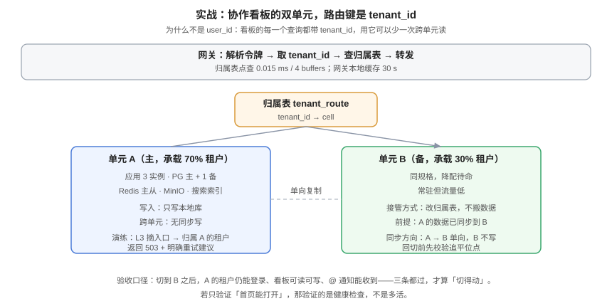

# 实战：给协作看板做双单元 + 切流

前九页讲的是判断与选型，这一页把它们落到一个具体系统上：一个多租户协作看板，从「单机房单库」改造成「双单元 + 可切流」。路由键是 `tenant_id`，两个单元，单元 A 承载 70% 租户，单元 B 承载 30%，B 同时是 A 的接管方。



## 一、现状与目标

| 项 | 改造前 | 改造后 |
| --- | --- | --- |
| 部署 | 单机房，3 实例 | 两个单元，A 3 实例 / B 2 实例 |
| 数据库 | 1 主 1 备 | A: 主+备；B: 主+备；A → B 单向逻辑复制 |
| 缓存 | 单 Redis | 每单元独立 Redis，key 带 `t.{tenant}` 前缀 |
| 附件 | 单桶 | 每单元独立桶，object key 带单元段 |
| 路由 | 无 | 网关按 `tenant_id` 查归属表 |
| RTO | 约 2 小时（恢复备份） | 目标 ≤ 3 分钟（切流） |

::: warning 为什么是「A → B 单向」而不是双向
因为**写只在归属单元**。A 的租户写 A，B 的租户写 B，两者之间只需要一条「A → B」的复制用于接管场景（B 接管 A 的租户时，需要 A 的数据）。B 不向 A 复制，因为 B 的数据在接管时会被 A 读取——但那属于「再切回来」的场景，届时反向建立通道即可。

**单向复制是单元化默认的数据流方向；双向只在「同一行必须两处写」时才有必要，而那种情况应该先被消除。**
:::

## 二、归属表与四张表

```sql
-- ① 归属表：路由的权威答案
CREATE TABLE tenant_route (
  tenant_id  bigint PRIMARY KEY,
  cell       text   NOT NULL,
  epoch      bigint NOT NULL DEFAULT 1,
  moved_at   timestamptz,
  CHECK (cell IN ('cell-a','cell-b'))
);

-- ② 迁移留痕
CREATE TABLE tenant_route_log (
  id         bigint GENERATED ALWAYS AS IDENTITY PRIMARY KEY,
  tenant_id  bigint NOT NULL,
  from_cell  text,
  to_cell    text NOT NULL,
  epoch      bigint NOT NULL,
  operator   text NOT NULL,
  created_at timestamptz NOT NULL DEFAULT now()
);

-- ③ 同步心跳：延迟监控的唯一可靠口径
CREATE TABLE sync_heartbeat (
  id      bigint GENERATED ALWAYS AS IDENTITY PRIMARY KEY,
  cell    text NOT NULL,
  beat_at timestamptz NOT NULL DEFAULT clock_timestamp()
);

-- ④ 幂等应用记录：单元参与主键（两单元的本地序列会撞）
CREATE TABLE applied_event (
  src_cell   text   NOT NULL,
  local_seq  bigint NOT NULL,
  applied_at timestamptz NOT NULL DEFAULT now(),
  PRIMARY KEY (src_cell, local_seq)
);
```

## 三、网关侧：路由的三步

```text
① 解令牌 → 得到 sub / sid / jti（不含单元）
② 用 sid 查会话 → 得到 tenant_id
③ 查归属表（本地缓存 30 s）→ 得到 cell → 转发
```

::: danger 第 ② 步不能省
如果令牌里直接放 `tenant_id`，那么「同一用户切换租户」时需要重新签发令牌，而签发是认证服务的动作——这会把一个业务操作变成一次认证流程。**令牌只放身份，租户从会话或成员关系查**，这与[认证与租户成员关系](../../../../project/Complete/TeamBoard/AuthTenantMember/index.md)的口径一致。
:::

### 3.1 非归属单元的写必须被拒绝

```http
POST /api/boards/42/cards HTTP/1.1
Host: cell-b.api.example.com
Authorization: Bearer <token>
X-Tenant: 1001

HTTP/1.1 421 Misdirected Request
X-Cell-Correct: cell-a
Location: https://cell-a.api.example.com/api/boards/42/cards
Retry-After: 0
```

为什么是 `421` 而不是 `403`：`403` 表示「你没权限」，`421` 表示「你有权限，但找错了门」。客户端拿到 `Location` 直接重试，用户无感。

## 四、数据侧：单向复制与冲突闸门

### 4.1 复制通道

```sql
-- 在 A 上发布（只发布业务表，不发布归属表与心跳）
CREATE PUBLICATION cell_a_pub FOR TABLE cards, comments, boards, attachments;

-- 在 B 上订阅（B 的库不向 A 回传，因此天然无回环）
CREATE SUBSCRIPTION cell_a_sub
  CONNECTION 'host=cell-a-db port=5432 dbname=teamboard user=repl'
  PUBLICATION cell_a_pub;
```

::: warning 归属表绝不能参与复制
如果 `tenant_route` 被复制，B 会收到「租户 1001 归属 cell-a」的更新，**在 B 接管后这条旧记录会把流量又指回 A**。归属表是全局单点的数据，只能有一个权威副本，其他单元通过 API 读取或缓存。
:::

### 4.2 迁移闸门

```sql
-- 迁移时 epoch + 1
UPDATE tenant_route SET cell = 'cell-b', epoch = epoch + 1, moved_at = now()
 WHERE tenant_id = 1001 AND epoch = $expected;

-- 业务写入校验 epoch（失败即 421，让客户端重新取路由）
UPDATE cards SET title = $1, version = version + 1
 WHERE id = $2 AND tenant_id = $3 AND version = $4
   AND (SELECT epoch FROM tenant_route WHERE tenant_id = $3) = $5;
```

## 五、验收序列 S1~S10

这十条按依赖顺序排列，**前一条不过，后一条不用跑**。

| # | 验收项 | 命令 / 动作 | 期望 |
| --- | --- | --- | --- |
| **S1** | 归属表就位且走索引 | `EXPLAIN (ANALYZE, BUFFERS) SELECT cell FROM tenant_route WHERE tenant_id=1001` | Index Scan，< 0.1 ms，Buffers < 10 |
| **S2** | 令牌不含单元 | 解一次真实令牌，打印 payload | 只有 `sub`/`sid`/`jti`/`exp`，无 `cell` |
| **S3** | 路由命中率 100% | 打 200 次请求后看 `gateway_route_hit_ratio` | 1.000（允许 99.99% 以上） |
| **S4** | 跨单元写被拒 | 用 tenant 1001 的令牌打 B 的域名 | `421` + `X-Cell-Correct: cell-a` |
| **S5** | 单元内闭环 | 在 A 上传附件、建看板、搜索、收通知 | 四项全部成功，且附件 URL 指向 A 的桶 |
| **S6** | 单向复制正常 | 在 A 写一行，等 3 s 后查 B | B 上能查到该行；`sync_heartbeat` 延迟 < 3 s |
| **S7** | 归属表不参与复制 | 改一条 `tenant_route`，等 60 s 查 B | B 上的归属表**没有**变化 |
| **S8** | 单元 A 摘除时降级明确 | 注入 NetworkPolicy 拒绝 A 的入站 | 归属 A 的请求返回 `503` + `Retry-After`，不返回假数据 |
| **S9** | 切流到 B 后可读写 | 改归属表 `cell='cell-b'`，`epoch+1` | A 的租户在 B 上能登录、读看板、拖卡片、收通知 |
| **S10** | 切流后数据正确 | 跑三层校验（行数 / 哈希 / 不变量） | 差异 = 期望值；不变量违例 0 行 |

### 5.1 S8 的关键：区分「明确失败」与「静默错误」

```shell
kubectl logs -n cell-a deploy/app --since=10m | grep -c "cell_unavailable"
# 期望：> 0（有明确的失败日志）

curl -s -o /dev/null -w '%{http_code} %{header_json}\n' https://cell-a.api.example.com/api/boards/42
# 期望：503，且响应头含 Retry-After
```

::: danger 最怕的不是 503，是 200
如果 A 被隔离后，请求被某个「兜底逻辑」转到了 B，而 B 上没有这些租户的数据，那么 API 会返回 **200 + 空列表**。用户体验是「我的看板全没了」——这比 503 糟糕得多。**兜底逻辑必须 fail closed。**
:::

### 5.2 S9 之后的回切

切到 B 之后，A 恢复。此时：

1. A 的数据**落后于 B**（B 接管期间的写只在 B）；
2. 若要切回，必须建立 **B → A** 的反向通道并追平；
3. 追平前不得把归属改回 A。

```sql
-- 追平校验（在 A 上查：B 的心跳是否已停止、位点是否追平）
SELECT cell, max(beat_at), extract(epoch FROM (now() - max(beat_at))) AS lag
  FROM sync_heartbeat GROUP BY cell;
-- 期望：cell-b 的 lag 趋近 0 且持续 5 分钟
```

## 六、成本与收益（推演）

| 项 | 改造前 | 改造后 | 增量 |
| --- | --- | --- | --- |
| 应用实例 | 3 | 5 | +2 |
| 数据库 | 1 主 1 备 | 2 主 2 备 | +2 |
| 缓存 | 1 | 2 | +1 |
| 对象存储 | 1 桶 | 2 桶 | 复制一份（去重后 +40%） |
| 月成本 | 1.0 C | ≈ 1.75 C | **+75%** |
| RTO | 约 2 小时 | ≤ 3 分钟 | **-97.5%** |

::: tip 这个比值说明什么
「+75% 成本换 97.5% 的 RTO 改善」看起来很划算，但**要先确认你原来的 2 小时 RTO 是不是真的会造成损失**。如果年停机损失只有几十万，这笔钱仍然不划算——见[成本](../Cost/index.md)第 5 节。
:::

## 七、验证方式

```shell
# ① 一次完整的路由验证（S1~S4）
psql "$DSN" -c "EXPLAIN (ANALYZE, BUFFERS, COSTS OFF) SELECT cell FROM tenant_route WHERE tenant_id=1001;"
TOKEN=$(curl -s -X POST https://auth.example.com/token -d '{"u":"a","p":"b"}' | jq -r .access_token)
echo "$TOKEN" | cut -d. -f2 | base64 -d 2>/dev/null | jq .
curl -s -o /dev/null -w '%{http_code}\n' -X POST https://cell-b.api.example.com/api/boards/42/cards -H "Authorization: Bearer $TOKEN"
# 期望：Index Scan / payload 无 cell / 421

# ② 闭环验证（S5）
curl -s -X POST https://cell-a.api.example.com/api/attachments/presign -H "Authorization: Bearer $TOKEN" -d '{"size":1024}' | jq -r .url
# 期望：URL 的 host 指向 cell-a 的桶；指向 cell-b 或公共桶即不闭环

# ③ 复制与心跳（S6、S7）
psql "$DSN_B" -c "SELECT extract(epoch FROM (now() - max(beat_at))) FROM sync_heartbeat;"
psql "$DSN_B" -c "SELECT cell FROM tenant_route WHERE tenant_id=1001;"
# 期望：lag < 3；B 上的归属结果与 A 修改前一致（证明归属表未被复制）

# ④ 三层数据校验（S10）
psql "$DSN" -c "SELECT count(*) FROM qty_sum s LEFT JOIN evt_all e USING (sku)
  GROUP BY s.sku, s.qty HAVING s.qty <> 1000 + COALESCE(sum(e.delta),0);"
# 期望：0 行
```

## 八、判据族 `MAP`

| 判据 | 内容 | 怎么验证 |
| --- | --- | --- |
| `MAP-A` | 路由键必须与单元切分维度一致（本项目为 `tenant_id`） | 登录、API、WebSocket、消费者四处取键字段相同 |
| `MAP-B` | 归属表不得参与复制，只保留一个权威副本 | 在 B 上改 A 的归属记录后，A 侧 60 s 内无变化 |
| `MAP-C` | 非归属单元的写必须返回 `421` 且带 `X-Cell-Correct` | 用 A 的令牌打 B，检查状态码与响应头 |
| `MAP-D` | 单元内闭环四项（附件 / 搜索 / 通知 / 缓存）必须逐项验收 | S5 的四项各有一次成功记录 |
| `MAP-E` | 隔离单元时必须 fail closed（`503`），不得返回空数据 | S8 注入后检查响应码不是 200 |
| `MAP-F` | 切流必须走 `epoch + 1`，旧 epoch 写入被拒 | 切流后立即用旧 epoch 写一次，期望被拒 |
| `MAP-G` | 回切前必须建立反向通道并追平，位点有读数 | 回切记录里有 `sync_heartbeat` 的 lag 读数 |
| `MAP-H` | 成本倍数必须与账单实际对比，差异 < 20% | 用第 6 节表格对比账单，超差需解释 |

## 九、与相邻专题的分工

| 你想知道 | 去哪 |
| --- | --- |
| 单元化模型的通用做法 | [单元化模型](../CellModel/index.md) |
| 切流三段与灰度 | [流量切换](../TrafficSwitch/index.md) |
| 冲突与对账三层 | [冲突裁决](../Conflict/index.md) |
| 本项目的多租户 DDL 与 RLS | [在线协作任务看板：多租户隔离](../../../../project/Complete/TeamBoard/MultiTenancy/index.md) |
| 本项目的认证与令牌设计 | [认证与租户成员关系](../../../../project/Complete/TeamBoard/AuthTenantMember/index.md) |

## 参考资料

- PostgreSQL 18 文档：[Logical Replication](https://www.postgresql.org/docs/current/logical-replication.html)
- PostgreSQL 18 文档：[CREATE SUBSCRIPTION](https://www.postgresql.org/docs/current/sql-createsubscription.html)
- RFC 9110 §15.5.20：`421 Misdirected Request` 的定义
