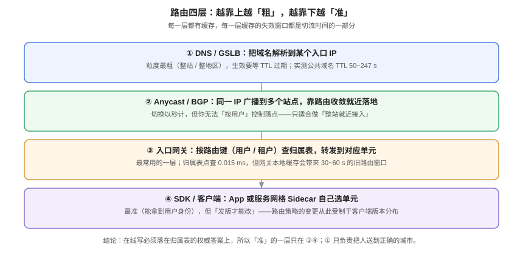

# 路由：请求怎么找到自己的单元

**路由是多活里唯一「每一次请求都要过」的环节，所以它的错误会被放大到全站。** 本页给出四层路由各自的能力边界、路由键的选择与一致性要求、归属表缓存的「旧路由窗口」有多大、以及归属单元不可用时三种兜底策略的取舍。



## 一、四层路由：各自能做什么

| 层 | 决策依据 | 粒度 | 生效时间 | 能按「用户」路由吗 |
| --- | --- | --- | --- | --- |
| **① DNS / GSLB** | 域名 → IP | 整站 / 整地区 | 等 TTL 过期 | 不能 |
| **② Anycast / BGP** | 同一 IP 广播到多站点 | 整站 | 秒级（路由收敛） | 不能 |
| **③ 入口网关** | 令牌 → 租户 → 归属表 | 租户 / 用户 | 立即（受缓存影响） | **能** |
| **④ SDK / Sidecar** | 客户端已知身份 | 租户 / 用户 | 发版才生效 | **能**，但受版本分布约束 |

### 1.1 关键结论：只有 ③④ 能承载「写」

第 ①② 层只能把人送到「正确的城市」，送不到「正确的单元」。原因是它们看不到用户身份——DNS 解析时还没有令牌。

::: danger 用 DNS 做单元路由的致命问题
如果「单元 A 的域名是 a.example.com、单元 B 是 b.example.com」，那么**用户访问哪个域名就决定了数据落在哪**。用户的收藏夹、分享链接、甚至上一次的登录跳转都会把他带到旧单元。这不是多活，这是「手动选库」。
:::

正确分工是：**①把用户送到最近的城市入口，③在入口内按归属表把他送到单元。** 两层各司其职，不越权。

## 二、路由键：选错就全错

路由键必须同时满足三条：

1. **唯一**：一个业务实体只有一个键（`tenant_id` 而不是「租户名」）；
2. **无处不在**：登录、API、WebSocket、定时任务、消息消费五个入口都能拿到它；
3. **稳定**：不随用户行为变化（不要用「当前所在城市」这种会变的值）。

| 路由键候选 | 唯一 | 五个入口都能拿到 | 稳定 | 结论 |
| --- | --- | --- | --- | --- |
| `tenant_id` | 是 | 是（登录后进令牌上下文，不进令牌本身） | 是 | **推荐** |
| `user_id` | 是 | 是 | 是 | 可用，但跨用户协作场景会跨单元 |
| 设备 ID | 否（一人多设备） | 部分 | 否 | 不可用 |
| 会话 ID | 否（一会话多请求） | 是 | 否 | 不可用 |
| 用户 IP 归属地 | 否 | 是 | 否 | 不可用 |

### 2.1 为什么 `tenant_id` 在协作类产品里优于 `user_id`

因为**协作的本质是「多个用户操作同一份数据」**。如果按 `user_id` 切，A 用户和 B 用户在同一块看板上拖动卡片时，两人的写会分别落在两个单元——这是必然的双写。

按 `tenant_id` 切，同一租户的所有用户共享一个单元，协作天然是「本地写」。

::: tip 一个判断口诀
**「谁的数据会被同一个事务改，就按谁切。」** 事务边界决定了单元边界。
:::

## 三、归属表缓存：旧路由窗口有多大

网关不可能每个请求都查库（虽然它只要 0.015 ms），通常会本地缓存 30~60 秒。这带来一个必须写进文档的量：**旧路由窗口**。

```text
旧路由窗口 = 网关本地缓存 TTL
迁移窗口要求 = 旧路由窗口 + 增量追平时间
```

| 缓存 TTL | 迁移后仍有请求打到旧单元的时长 | 迁移时必须保留旧单元可写的时间 |
| --- | --- | --- |
| 30 s | ≤ 30 s | ≥ 30 s |
| 60 s | ≤ 60 s | ≥ 60 s |
| 300 s | ≤ 5 min | ≥ 5 min（不推荐） |

::: danger 迁移后立刻删旧库 = 数据静默丢失
如果网关缓存 60 s，而你在切完归属表 5 秒后就删了旧库，那么这 55 秒内打到旧单元的写会失败——**或者更糟：如果旧库还在但已不被同步，那些写会「成功」然后消失**。正确做法是配合[单元化模型](../CellModel/index.md)第 6 节的 `epoch` 闸门，让旧写被明确拒绝而不是静默丢失。
:::

### 3.1 缓存的三个正确写法

1. **带 `epoch` 缓存**：缓存值里带上归属表的 `epoch`，业务写入时带回服务端比对，不一致即拒绝（最稳）。
2. **主动失效**：迁移时通过配置中心广播失效，不需要等 TTL（快，但要求网关支持）。
3. **短 TTL + 兜底查库**：缓存未命中时查库，TTL 取 10~30 s（最简单）。

## 四、实测：DNS TTL 到底是多少

切流第一段的时长由 TTL 决定，所以它是必须**量**而不是**猜**的值。2026-10-18 在本机用 `dig` 实测若干公共域名：

| 域名 | 观察到的 TTL（秒） | 说明 |
| --- | --- | --- |
| `api.github.com` | 50 | 单条 A 记录，TTL 较短 |
| `www.baidu.com` | 149 / 91 | 首次解析与后续查询不同（逐级递减） |
| `www.qq.com` | 247 / 57 / 56 / 56 | CNAME 链上每一跳 TTL 不同 |
| `www.github.com` | 159 / 30 | CNAME 目标 TTL 更短 |

```shell
dig +noall +answer www.qq.com | awk '{print $1, $2, $4}'
# www.qq.com.            205 IN CNAME ins-r23tsuuf.ias.tencent-cloud.net.
# ins-r23tsuuf...net.     37 IN CNAME tra-kbagmtra.ias.tencent-cloud.net.
# tra-kbagmtra...net.     72 IN A     111.30.178.240
```

两个必须记住的事实：

1. **TTL 是逐级递减的**：你看到的 205 / 37 / 72 是「剩余 TTL」，不是配置值。
2. **CNAME 链的每一跳都要等**：链越长，切流第一段越不可控。

::: warning 你不能控制「客户端缓存」
即使你把 TTL 设成 30 s，运营商 DNS、企业 DNS、浏览器、甚至某些 SDK 都有自己的缓存策略。**工程上按 2 × TTL 估算，并按最坏值承诺 RTO。**
:::

## 五、归属单元不可用时的三种兜底

这是路由设计里最需要做取舍的地方。

| 策略 | 做法 | 影响面 | 代价 | 适用 |
| --- | --- | --- | --- | --- |
| **A. 降级不接管** | 归属单元挂了 → 该单元用户返回 503 + 明确提示 | 该单元用户 | 无额外数据同步 | 单元之间无数据副本时**唯一正确**的选择 |
| **B. 同单元内换实例** | 单元内有多个实例，挂一个不影响 | 无 | 副本成本 | 必须有，属于基本盘 |
| **C. 跨单元接管** | 把归属改到另一个单元 | 无（对用户） | 该单元数据必须已在目标单元有副本，且迁移五步要走完 | 有同步副本时可选 |

::: danger 最危险的一种「兜底」
**「查归属表失败就默认落到单元 A」**——这是灾难放大器。归属表故障时，全部流量涌向 A，A 本来就只准备承载 1/N。正确做法是**失败即拒绝**（fail closed），并在网关层缓存一份「最近一次成功读取的归属快照」，用它做降级读。
:::

## 六、路由的可观测：三个必须有的指标

| 指标 | 定义 | 为什么必须有 | 异常阈值（示例） |
| --- | --- | --- | --- |
| **路由命中率** | 请求落到「归属表指定单元」的比例 | 低于 100% 说明有旧路由或旁路 | < 99.9% 告警 |
| **跨单元调用数** | 一个请求内跨单元访问的次数 | 单元化失效的最早信号 | > 0 即排查 |
| **归属表查询 P99** | 网关侧归属表查询延迟 | 路由层是全局单点 | > 5 ms 告警 |

```text
# 路由命中率（PromQL 形式，字段名按自己的埋点替换）
sum(rate(gateway_route_hit_total[5m])) by (cell)
  /
sum(rate(gateway_route_total[5m])) by (cell)
```

::: tip 一条便宜的兜底
在网关注入一个响应头 `X-Cell-Resolved: cell-a`，让每个请求都能在日志里看到「它被路由到了哪」。排查「为什么这个用户数据不对」时，这一行日志能省掉半小时。
:::

## 七、验证方式

```shell
# ① 路由键在五个入口都能拿到（换成自己的字段名）
grep -rn "tenantId\|tenant_id" --include="*.java" --include="*.ts" src/main | grep -E "login|websocket|consumer|scheduler|controller" | head
# 期望：五个入口各至少一处命中；缺哪个，那个入口就是「路由盲区」

# ② 归属表缓存 TTL 与迁移窗口的关系（读配置）
grep -rn "route.*cache\|cache.*route" --include="*.yml" --include="*.yaml" --include="*.properties" . | head
# 期望：TTL 有明确数值，且迁移手册中的「旧单元保留期」≥ 该 TTL

# ③ 令牌里不含单元标识
grep -rn "\.claim(\|claims\[\|payload\[" --include="*.java" --include="*.ts" src/main | grep -i "cell\|zone" | head
# 期望：无输出

# ④ 实测一次 TTL，代入切流公式
dig +noall +answer <your-domain> | awk '{print $2}' | sort -n | head -1
# 期望：得到一个秒数；若为 300，则第一段最坏约 600 s
```

## 八、判据族 `MAR`

| 判据 | 内容 | 怎么验证 |
| --- | --- | --- |
| `MAR-A` | 路由键必须在登录、API、WebSocket、消息消费、定时任务五个入口一致可得 | 五个入口各一条 `grep`，全部命中同一字段 |
| `MAR-B` | 单元路由只能由 ③④ 层决定，DNS 不得承载按用户路由 | 架构图里 DNS 只指向入口 LB；域名里不含单元名 |
| `MAR-C` | 归属表缓存 TTL 必须小于迁移时旧单元保留期 | 读取缓存配置的 TTL，与迁移手册数值比对 |
| `MAR-D` | 归属表查询失败必须 fail closed，不得默认落到某个单元 | `grep -n "default\|orElse"` 在路由代码里无「默认单元」 |
| `MAR-E` | 每个请求必须可观测到「被路由到哪个单元」 | 响应头或日志里有 `X-Cell-Resolved` 一类字段 |
| `MAR-F` | 监控必须有路由命中率，且低于 99.9% 告警 | 监控面板上存在该指标与对应告警规则 |
| `MAR-G` | 跨单元调用数必须被计量，且在线路径为 0 | 指标 `cross_cell_calls_total` 存在，在线路径读数为 0 |
| `MAR-H` | RTO 承诺必须基于实测 TTL 与 2×TTL 最坏值 | 文档里 TTL 有 `dig` 读数作为出处，且公式用 2×TTL |

## 九、与相邻专题的分工

| 你想知道 | 去哪 |
| --- | --- |
| 单元怎么切、闭环清单 | [单元化模型](../CellModel/index.md) |
| 切流的完整三段与灰度 | [流量切换](../TrafficSwitch/index.md) |
| DNS 与 CDN 的就近接入原理 | [CDN 原理](../../EdgeCDN/CDNPrinciple/index.md) |
| 网关侧的权重、灰度、限流 | [网关流量管理](../../../Backend/GatewayDeep/TrafficManagement/index.md) |

## 参考资料

- RFC 1034 §4.3.5：TTL 与缓存语义
- RFC 4786：Anycast 的运维实践（BGP 收敛与流量回撤）
- PostgreSQL 18 文档：[Using EXPLAIN](https://www.postgresql.org/docs/current/using-explain.html)（归属表点查读数）
