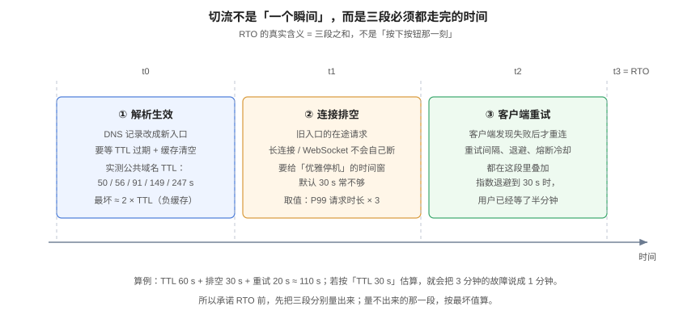

# 流量切换：三段时间与回切

**切流不是一个瞬间，而是三段必须依次走完的时间。** 承诺 RTO 时如果把「按下按钮」当成切换完成，实际值通常是承诺值的 2~3 倍。本页把切流拆成解析生效、连接排空、客户端重试三段，给出可算的公式、四种切流手段的对照、灰度切流的五步，以及回切为什么比切走更难。



## 一、三段时间：RTO 的真实构成

```text
RTO = TTL 生效时间 + 连接排空时间 + 客户端重试时间
```

| 段 | 由什么决定 | 怎么量 | 典型值 |
| --- | --- | --- | --- |
| **① 解析生效** | DNS TTL、CNAME 链长度、客户端缓存 | `dig` 看 TTL；改一条测试记录并计时 | 30 s ~ 5 min |
| **② 连接排空** | 在途请求时长、长连接数、优雅停机配置 | 看 P99 请求时长与连接数 | 10 s ~ 60 s |
| **③ 客户端重试** | 重试间隔、退避策略、熔断冷却 | 抓包或看客户端日志 | 1 s ~ 30 s |

### 1.1 算例（推演）

假设：TTL 60 s、P99 请求 800 ms（排空取 3×P99 ≈ 2.4 s，但长连接要单独算 30 s）、客户端指数退避首次 1 s、最大 30 s。

```text
① = 2 × 60 = 120 s      ← 按最坏值：TTL 过期 + 负缓存
② = 30 s                ← 长连接（WebSocket）主动断开 + draining
③ = 20 s                ← 客户端重新解析 + 重连
RTO ≈ 170 s ≈ 2.8 min
```

::: danger 不要用「TTL 60 s → 1 分钟切完」做承诺
三个理由：TTL 是**剩余**时间不是配置值（CNAME 链上每跳不同）；客户端有自己的缓存；重试有退避。**按 2×TTL + 排空 + 重试算，并把每一项写成实测值**，否则 SLA 一定被击穿。
:::

## 二、四种切流手段

| 手段 | 粒度 | 生效时间 | 可回滚性 | 适用 |
| --- | --- | --- | --- | --- |
| **DNS 记录切换** | 整站 | 受 TTL 约束（分钟级） | 慢（要再等一轮 TTL） | 站点级灾难、机房整体下线 |
| **GSLB / Anycast** | 整站 / 地区 | 秒级 ~ 分钟级 | 中（路由收敛） | 就近接入 + 地区级切换 |
| **入口网关权重** | 按流量比例 | **立即** | **立即** | 灰度、单单元维护、A/B |
| **SDK / 服务网格** | 按请求 | 立即（受版本分布） | 立即 | 精细化路由 |

### 2.1 组合用法（推荐）

```text
① DNS/GSLB    ：只负责「把用户送到有容量的城市」
② 入口网关权重 ：负责「城市内哪个单元承载多少流量」
③ 应用内开关   ：负责「哪些功能在这个单元开启」
```

三层各管一段，任何一层出问题都不需要动其他层。**把「按租户路由」放进 DNS 是这类设计里最常见的错误**，见[路由](../Routing/index.md)第 1.1 节。

## 三、灰度切流：五步，每步有判据

| 步 | 动作 | 判据（不满足即回退） |
| --- | --- | --- |
| 1. 预热 | 目标单元扩容到能承载目标流量 | 目标单元 CPU < 40%、连接池水位 < 50% |
| 2. 1% 灰度 | 网关权重 1%，观察 10 分钟 | 错误率与基线差 < 0.1 个百分点；P99 延迟差 < 10% |
| 3. 10% | 观察 15 分钟 | 同上，且**业务指标**（下单、保存）无异常 |
| 4. 50% | 观察 30 分钟 | 同上，且目标单元无队列积压 |
| 5. 100% | 全量，保持旧单元只读 24 小时 | 24 小时内无需要回切的信号 |

::: tip 灰度必须看「业务指标」，不能只看技术指标
HTTP 200 率 99.99% 也可能是灾难：写请求全部返回 200 但落到了错误的地方。**灰度期至少加一条业务断言**，例如「保存后的卡片能被另一个会话读到」。
:::

### 3.1 灰度的判定信号：三条，缺一不可

1. **技术信号**：错误率、P99、队列深度、连接池水位；
2. **业务信号**：核心动作成功率（保存 / 下单 / 支付）、数据一致性抽检；
3. **人工信号**：值班同学能回答「现在是几 %、观察了多久、下一步是什么」。

## 四、回切：比切走难三倍

回切的难点不在「把流量切回去」，而在**「旧单元的数据是否已经追平」**。

| 情况 | 能不能直接回切 | 正确做法 |
| --- | --- | --- |
| 切走后旧单元**完全只读**、新单元持续写入 | **不能** | 先把新单元的增量反向同步回旧单元，追平后再切 |
| 切走后旧单元仍接受写（双写） | 不能 | 必须有冲突裁决，否则回切必然丢数据 |
| 新旧单元共享同一份库 | 能 | 只切流量，数据无需追平 |

::: danger 最常见的回切事故
切到新单元后发现问题，立刻把 DNS 切回旧单元——**但新单元这 20 分钟里的写入全在它本地，旧单元没有**。用户看到「最近 20 分钟的数据消失了」。
**回切的第一件事永远是「确认数据单向流」，第二件事是「确认追平位点」。**
:::

### 4.1 回切检查清单

```text
□ 新单元写入已停止（或已进入只读）
□ 反向同步通道已建立且延迟 < 阈值
□ 位点已追平（延迟 = 0 且持续 5 分钟）
□ 旧单元已预热到能承载全量
□ 缓存已清（避免读到旧快照）
□ 回切后 30 分钟内每小时跑一次不变量校验
```

## 五、会话、粘性与「令牌里不要放单元」

| 设计 | 切流影响 | 结论 |
| --- | --- | --- |
| 无状态 + 令牌只放身份 | 切流只受 TTL 约束 | **推荐** |
| 令牌里带 `cell` | 切流受**令牌有效期**约束（可能 7 天） | 禁止 |
| 服务端 Session 存在单元本地 | 切流后用户被踢下线 | 改成共享会话或 JWT |
| 长连接（WebSocket）粘在旧单元 | 切流后不重连 | 必须主动下发「重连」指令 |

::: warning 长连接是切流里最容易被忽略的一段
HTTP 请求几秒就结束，WebSocket 可以挂几小时。切流时如果不主动断开，那批用户会一直连着旧单元，直到网络抖动才重连。**正确做法：切流脚本里包含「向所有连接推送 `4409 reconnect` 并关闭」这一步**，见[实时协作](../../../Backend/RealtimeCollaboration/index.md)的连接管理。
:::

## 六、冻结期与业务日历

切流不是纯技术动作，它必须避开业务高峰：

| 时段 | 允许切流吗 | 理由 |
| --- | --- | --- |
| 大促 / 秒杀 | 否 | 流量峰值 + 任何抖动都被放大 |
| 财务结账日 | 否 | 数据一致性要求最高 |
| 版本发布窗口 | 否 | 两个变量同时变，无法归因 |
| 工作日 10:00~12:00 | 谨慎 | 流量上升期，观察窗口不好定 |
| 凌晨 2:00~5:00 | 是 | 流量低，回退成本低 |

::: tip 冻结期要写进「谁能解除」
冻结期如果只是「原则上不切」，等于没有。必须写清：**谁有权批准例外、批准记录在哪**。否则每次大促前都会有一次「临时小切流」。
:::

## 七、验证方式

```shell
# ① 量第一段：TTL 的真实值（多解析几次，看剩余 TTL 递减）
for i in 1 2 3; do dig +noall +answer <your-domain> | awk '{print $2}'; sleep 2; done
# 期望：数值递减。配置值 ≈ 第一次读数；用 2×配置值估最坏时间

# ② 量第二段：优雅停机的实际耗时
kubectl delete pod <pod> --grace-period=30 --wait=true 2>/dev/null || true
# 观察：从删除到端口不再接受连接的时间；应 ≥ P99 请求时长 × 3

# ③ 灰度期间检查路由分布（网关侧）
curl -s "http://gateway/admin/route-stats" | jq '.cells'
# 期望：目标单元占比与设定权重一致（误差 < 1%）

# ④ 回切前的追平校验
psql "$DSN_NEW" -c "SELECT extract(epoch FROM (now() - max(beat_at))) AS lag FROM sync_heartbeat;"
# 期望：lag < 3 且连续 5 分钟稳定
```

## 八、判据族 `MAT`

| 判据 | 内容 | 怎么验证 |
| --- | --- | --- |
| `MAT-A` | RTO 必须由三段相加得出，且每段有实测出处 | 文档里有三段各自的读数与公式，缺一段即不合格 |
| `MAT-B` | 第一段必须按 2×TTL 估算，不得用配置值直接当时间 | 公式里出现 `2 ×`，且 TTL 有 `dig` 读数 |
| `MAT-C` | 切流脚本必须包含长连接主动断开 | 脚本里有推送重连指令或关闭连接的命令 |
| `MAT-D` | 灰度必须有五步且每步有「技术 + 业务」两类判据 | 灰度手册五步齐全，每步两类判据都在 |
| `MAT-E` | 回切前必须确认「单向数据流 + 位点追平」 | 回切清单前两项为此，且演练记录里有位点读数 |
| `MAT-F` | 令牌与会话中不得含单元标识 | `grep` 令牌构造处无 `cell`；Session 存储不在单元本地 |
| `MAT-G` | 必须有冻结期规则与例外批准路径 | 发布手册里有冻结期表与「谁批准例外」 |
| `MAT-H` | 切流与回切都必须能在演练中完整跑一遍并留下记录 | 演练记录里有切走与回切两条时间线 |

## 九、与相邻专题的分工

| 你想知道 | 去哪 |
| --- | --- |
| 路由键与归属表缓存 | [路由](../Routing/index.md) |
| 切流后的数据校验 | [冲突裁决](../Conflict/index.md) |
| 演练怎么组织、怎么算通过 | [演练](../Drill/index.md) |
| 发布灰度与回滚的应用侧实现 | [发布与回滚](../../../Tools/CICD/DeployRollback/index.md) |
| 长连接管理与重连 | [实时协作](../../../Backend/RealtimeCollaboration/index.md) |

## 与「数据库大版本升级」专题的分工

| 问题 | 看哪里 |
| --- | --- |
| 机房级切流、三段时间、回切 | 本页 |
| 数据库换版本时的切换顺序与回滚点 | [切换窗口与回滚](../../DatabaseUpgrade/Cutover/index.md) |
| 单元内数据库升级要不要单独排期 | [数据库大版本升级与切换](../../DatabaseUpgrade/index.md) |

**这一页特有的坑：切库必须排在切流之后、且不能与切流同窗口。** 单元化切流的顺序是「先摘写、再切读、最后回切」，数据库升级的顺序是「先停写、再切库、再放开写」——两件事都要动「写」，放在同一个窗口里，一旦出问题无法判断是路由问题还是数据库问题。**数据库升级应该在单个单元内独立完成并观察一个周期，再纳入切流演练。**

## 参考资料

- RFC 1034 §4.3.5：TTL 与缓存
- Kubernetes 文档：[Pod 生命周期与优雅终止](https://kubernetes.io/docs/concepts/workloads/pods/pod-lifecycle/#pod-termination)
- Google SRE Book：[*Embracing Risk*](https://sre.google/sre-book/embracing-risk/)（RTO 与风险预算的关系）
