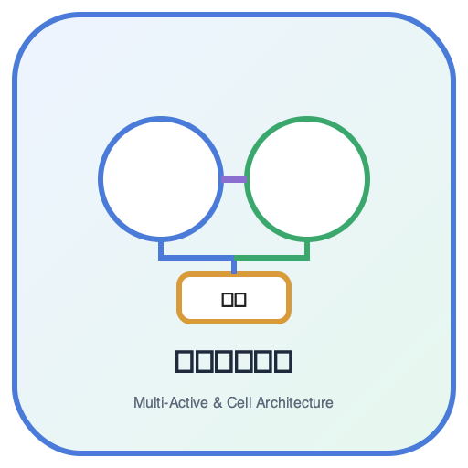
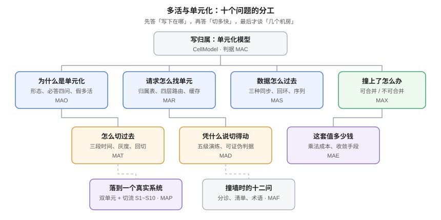

# 多活与单元化

多活回答的是一个很具体的问题：**一个机房整体不可用了，业务能不能不搬数据、不等恢复，接着做生意**。「多活」这个词被用得很松——两个机房都部署了叫多活，数据库有主备也叫多活，DNS 指到两个 IP 也叫多活。本专题把这件事拆成十个必须分别回答的问题，从「一个用户的写应该落在哪」开始，一直到「切过去之后账对不对」。

面向需要为「业务不停、数据不丢」直接负责的后端、SRE 与架构同学。读完之后你应当能判断：**你的系统该不该做多活、做成哪一档、切流要多久、切完之后凭什么说它是对的**。

::: tip 一句话理解
**多活不是「多部署一套」，而是「让每一次写都只有一个合法的落点」。** 落点唯一，切流就只是改路由；落点不唯一，你就得先解决冲突——而冲突比多活本身难得多。
:::

## 本专题的十页

| 页面 | 回答的问题 | 判据族 |
| --- | --- | --- |
| [体系概述：多活、容灾与单元化的边界](Overview/index.md) | 三种形态怎么选，什么时候**不该**做多活 | `MAO-A` ~ `MAO-H` |
| [单元化模型：把用户切成能独立承载的组](CellModel/index.md) | 单元边界怎么切、哪些必须闭环、哪些可以共享 | `MAC-A` ~ `MAC-H` |
| [路由：请求怎么找到自己的单元](Routing/index.md) | 四层路由各自能做什么、归属表与缓存窗口 | `MAR-A` ~ `MAR-H` |
| [跨单元数据同步：单向、双向与事件流](DataSync/index.md) | 数据怎么过去、回环怎么抑制、序列怎么办 | `MAS-A` ~ `MAS-H` |
| [冲突裁决：收敛不等于正确](Conflict/index.md) | 撞上了怎么裁、对账为什么查不出「一致地错」 | `MAX-A` ~ `MAX-H` |
| [流量切换：三段时间与回切](TrafficSwitch/index.md) | RTO 到底是几秒、灰度怎么切、回切为什么要追平 | `MAT-A` ~ `MAT-H` |
| [演练：五级金字塔与可证伪判据](Drill/index.md) | 凭什么说「切得动」、假通过长什么样 | `MAD-A` ~ `MAD-H` |
| [成本：单元化是乘法](Cost/index.md) | 多活要多花几倍、四条收敛手段、值不值 | `MAE-A` ~ `MAE-H` |
| [实战：给协作看板做双单元 + 切流](Practice/index.md) | 一个真实系统怎么从单机房走到双单元 | `MAP-A` ~ `MAP-H` |
| [常见问题与最佳实践](FAQ/index.md) | 十类现象的分诊、十二问、上线清单 | `MAF-A` ~ `MAF-H` |

## 本专题与相邻专题的分工

「容灾」「多活」「多集群」三个词在库里被反复提及，边界必须写死，否则读者会在四个专题之间反复横跳：

| 你想要的 | 去哪里 |
| --- | --- |
| **容灾档位怎么选**（冷备/温备/热备/多活）、RTO/RPO 定义、备份与恢复 | [备份与容灾](../BackupDR/index.md) 及其[容灾架构](../BackupDR/DisasterRecovery/index.md) |
| **失败域与可用区拓扑**（进程 / 机器 / AZ / 地域）、2 AZ 还是 3 AZ | [可用性拓扑](../CloudArchitecture/Availability/index.md) |
| **Kubernetes 层的多集群**：联邦、MCS、Argo CD 多集群下发 | [多集群：联邦、MCS 与容灾](../ContainerOrchestration/MultiCluster/index.md) |
| **DNS 与 CDN 的就近接入**、GSLB 的解析行为 | [CDN 原理](../EdgeCDN/CDNPrinciple/index.md)、[负载均衡](../CloudArchitecture/LoadBalancing/index.md) |
| **切流的应用侧闸门**（网关权重、灰度、回滚） | [网关流量管理](../../Backend/GatewayDeep/TrafficManagement/index.md) |
| **跨库/跨源的数据搬运与一致性**（binlog、CDC、对账） | [数据同步与 CDC](../../DB/CDC/index.md) |
| **写冲突的幂等与补偿**（重放、状态机、对账） | [幂等与状态机工程](../../Backend/IdempotencyStateMachine/index.md) |
| **单元化的容量与单位成本算账** | [容量规划与成本治理](../CapacityCost/index.md) |
| **演练的组织与故障注入工具** | [混沌工程](../ChaosEngineering/index.md)、[故障应急](../IncidentResponse/Drill/index.md) |

::: warning 一句话划界
备份与容灾解决「**数据与场地**」，本专题解决「**写的落点与流量的落点**」。前者是保险，后者是建筑设计——保险买错了只是贵，建筑设计错了会塌。
:::

## 判据纪律

本专题十页各有一族判据，共 **80 条**（10 族 × 8 条），前缀逐页唯一，全库不与他处撞号：

| 页面 | 判据族 | 数量 | 判据回答的三个问题 |
| --- | --- | --- | --- |
| 体系概述 | `MAO` | 8 | 约定是什么 / 定错的后果 / 怎么验证没被破坏 |
| 单元化模型 | `MAC` | 8 | 同上 |
| 路由 | `MAR` | 8 | 同上 |
| 数据同步 | `MAS` | 8 | 同上 |
| 冲突裁决 | `MAX` | 8 | 同上 |
| 流量切换 | `MAT` | 8 | 同上 |
| 演练 | `MAD` | 8 | 同上 |
| 成本 | `MAE` | 8 | 同上 |
| 实战 | `MAP` | 8 | 同上 |
| 常见问题 | `MAF` | 8 | 同上 |

每条判据的「怎么验证」都必须是一条**能跑的命令或一次能观察到的现象**，不接受「检查配置是否正确」这类形容词。

## 本专题的实测口径

文中出现的所有数字分两类，**严格区分**：

1. **本机实跑**：2026-10-18 在本机 PostgreSQL **18.6**（Debian `18.6-1.pgdg13+2`，容器内 `select version()` 输出）上执行，`EXPLAIN (ANALYZE, BUFFERS)` 与 `nextval` 读数附执行语句。这类数字可以复现，命令都在页面里。
2. **推演**：成本倍数、切流窗口这类算例，明确标注「推演」并给出计算公式，读者代入自己的数即可。

::: danger 不要把两类数字混着读
本仓历史上出现过把推演写成实测的情况。区分方法很简单：**实测一定带命令与输出，推演一定带公式与假设**。看到没有命令的数字，就当它是推演。
:::

## 学习路径

1. 先读[体系概述](Overview/index.md)，用「四问决策树」判断你该做到哪一档——**很多人会发现温备就够**。
2. 决定做单元化后读[单元化模型](CellModel/index.md)与[路由](Routing/index.md)，这两页决定后面所有页的难度。
3. 数据侧读[数据同步](DataSync/index.md)与[冲突裁决](Conflict/index.md)，这两页是「多活会不会算错账」的分水岭。
4. 最后读[流量切换](TrafficSwitch/index.md)、[演练](Drill/index.md)、[成本](Cost/index.md)，把「切得动、证明得了、付得起」三件事闭环。
5. 动手前把[实战](Practice/index.md)的 `S1~S10` 抄成自己的验收序列，遇到现象查[常见问题](FAQ/index.md)的分诊表。

## 参考资料

- PostgreSQL 18 官方文档：[Logical Replication](https://www.postgresql.org/docs/current/logical-replication.html)、[Sequence Functions](https://www.postgresql.org/docs/current/functions-sequence.html)
- RFC 1034 / RFC 1035：域名系统与资源记录（TTL 的语义来源）
- AWS Well-Architected：Reliability Pillar（失败域与单元化的通用论述）
- Google SRE Workbook：[*Managing Load*](https://sre.google/workbook/managing-load/) 与 [*Non-Abstract Large System Design*](https://sre.google/workbook/nalsd/)（单元化与容量切分的原始论述）
- 本站相邻专题：[备份与容灾](../BackupDR/index.md)、[可用性拓扑](../CloudArchitecture/Availability/index.md)、[多集群](../ContainerOrchestration/MultiCluster/index.md)
