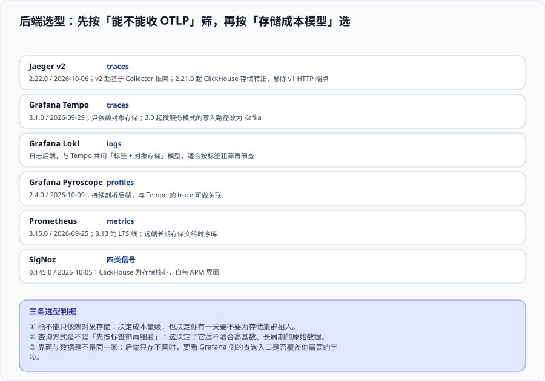

# 后端与存储选型

选后端这件事有两个常见的错误顺序：先按界面好不好看选，再发现数据要重新采集一遍；或者先按「功能多」选，月底收到账单才发现成本模型完全不同。正确的顺序是**先按「能不能收 OTLP」筛掉一批**（决定你会不会被绑定），**再按「存储成本模型」选**（决定三年后你还养不养得起）。

::: tip 一句话理解
OTLP 决定你能不能**换**，存储模型决定你**换不换得起**。前者是一次性的接入成本，后者是每个月都在发生的运行成本。
:::

## 一、第一层筛：能不能收 OTLP

| 判据 | 说明 |
| --- | --- |
| 原生支持 OTLP 接收 | 应用侧 SendI/O 只需要写一个端点；换后端时**不改应用代码** |
| 或支持通用中转格式 | 例如 Jaeger / Zipkin 协议、Prometheus remote write；需要 Collector 侧多一层转换 |
| 或只支持私有 agent | **绑定风险最高**：换后端等于重新埋点一次，这是本专题要避免的主要成本 |

**验收方式**：用 `telemetrygen` 造一条链路，只改 Collector 的 exporter 端点，不改任何应用配置——如果后端立刻收到，说明第一层通过了。

## 二、第二层筛：三种存储成本模型

| 模型 | 代表 | 成本特征 | 代价 |
| --- | --- | --- | --- |
| **对象存储 + 块索引** | Grafana Tempo | 成本最低，长期保留可行（对象存储单价的数量级优势） | 查询粒度粗；复杂过滤要扫更多数据 |
| **列式数据库** | SigNoz（ClickHouse）、Jaeger（ClickHouse 存储） | 中；聚合与多维过滤强 | 需要运维一个数据库集群 |
| **全文索引 / 搜索引擎** | Jaeger（Elasticsearch / OpenSearch 存储） | 高；索引本身占用可观 | 查询体验好，但成本随索引维度上升 |

::: warning 说明：Jaeger 的存储选择在 v2 发生了变化
Jaeger **v2 起基于 OpenTelemetry Collector 框架**构建，存储后端可选项包括 Elasticsearch、OpenSearch、Cassandra、Badger 与 **ClickHouse**。**2.21.0（2026-09-14）把 ClickHouse 存储提升为稳定**，同一版本**移除了遗留的 v1 HTTP 端点**——如果你的脚本还在调 v1 查询接口，升级时会直接失败（这类失败是好事：至少不是静默返回空结果）。
:::

## 三、候选矩阵（核对时间 2026-10）

| 后端 | 原生信号 | 当前版本 | 一句话定位 |
| --- | --- | --- | --- |
| **Jaeger v2** | traces | **2.22.0**（2026-10-06） | CNCF 毕业项目；v2 基于 Collector 框架，存储可换（含 ClickHouse） |
| **Grafana Tempo** | traces | **3.1.0**（2026-09-29） | 只依赖对象存储的链路后端；3.0 起微服务模式写入路径改为 Kafka |
| **Grafana Loki** | logs | 3.x 线 | 与 Tempo 共用「标签 + 对象存储」模型，适合按标签粗筛再细查 |
| **Grafana Pyroscope** | profiles | **2.4.0**（2026-10-09） | 持续剖析后端，可与 Tempo 的 trace 做关联 |
| **Prometheus** | metrics | **3.15.0**（2026-09-25） | 指标侧既有事实标准；**3.13 为 LTS 线**（支持至 2027-07-31），约 6 周一个 minor |
| **SigNoz** | 四类信号 | **0.145.0**（2026-10-05） | OTLP 原生、ClickHouse 存储、自带 APM 界面；周更节奏 |

**组合上的两条实务经验**：

1. **指标与链路分开存几乎是默认选择**：Prometheus 的本地存储适合短周期、高写入，链路后端适合长周期、大体积。把链路塞进 Prometheus 或把指标塞进链路后端，都会很快遇到形态不匹配的问题。
2. **日志不要为了「统一」而搬进链路后端**：日志的量通常比链路大一到两个数量级，混合存储会把链路后端的成本结构整体带偏。

## 四、查询入口与「采样概率外推」

选后端时要确认的三件事，都与**查询**有关而不是与写入有关：

| 要确认的 | 为什么 | 怎么确认 |
| --- | --- | --- |
| 能不能按**服务名 + 属性**筛 | 高基数环境下，只有先按标签缩小范围才能查得动 | 在后端尝试按 `service.name` 与一个业务属性组合检索 |
| 查询语言是否支持**聚合**（如按时间分桶计数） | 否则「这段时间错误链路有多少」只能靠导出后自己算 | 查一次「错误链路按 5 分钟分桶」 |
| 是否支持**按采样概率外推** | 采样后的计数要还原成总量，需要后端知道每条链路的有效概率 | 在后端的指标聚合能力或查询语言里找采样概率相关支持 |

::: danger 注意：「后端能聚合」不等于「聚合结果可对外」
即使后端支持按采样概率外推，也**不建议把链路侧的聚合数字当作业务速率**：采样规则一改，同一份查询的结论就会变，而没有人会记得去改看板说明。

**纪律**：速率类与错误率类数字统一取自**采样之前**算好的指标；链路侧只用于**归因与调查**。
:::

## 五、保留与生命周期

保留期是**成本公式里唯一按天线性增长的一项**，也是最容易被默认值接管的一项：

| 信号 | 常见默认 | 建议起点 | 理由 |
| --- | --- | --- | --- |
| 指标 | 15 天（本地）/ 长期无限 | 原始 15 天 + 降采样后 13 个月 | 排查「上周的事」与「去年的容量趋势」是两种不同精度需求 |
| 链路 | 3~7 天 | 7~14 天 | 链路的价值集中在「最近出问题的时间窗」 |
| 日志 | 7~30 天 | 14 天热 + 归档 | 日志量最大，热窗口越短越省 |
| 剖析样本 | 常无默认 | 聚合后长期保留、原始样本短期 | 单次样本价值低，趋势价值高 |

**做法**：把每一项的保留期写成配置里的显式数值（而不是使用默认值），并在页面上写清「谁决定了这个值、依据是什么」。这与 [观测成本治理](../Cost/index.md) 是同一条纪律的两面。

## 六、判据定义表

| 判据 | 内容 | 怎么验证 |
| --- | --- | --- |
| `OBD-A` | 后端必须原生支持 OTLP 接收，或经通用中转格式接入 | 只改 Collector 导出端点、不改应用配置即可收到数据 |
| `OBD-B` | 选型必须写明所选后端的存储成本模型及其长期含义 | 选型文档中写清对象存储 / 列式 / 全文索引三类归属 |
| `OBD-C` | 每个信号的保留期必须是显式配置值，不得使用默认 | 在配置中检索保留期字段，四项信号都有明确取值 |
| `OBD-D` | 速率与错误率类数字必须取自采样前指标，不用链路侧外推 | 抽查看板面板的数据源，指向指标而非链路聚合 |
| `OBD-E` | 升级前端点与查询接口的变更必须核对（如 Jaeger 移除 v1 端点） | 升级记录中列出被移除 / 改名的接口，并确认脚本已改 |
| `OBD-F` | 后端组合必须避免「把日志搬进链路后端」这类形态错配 | 检查各信号的落点，日志与链路不共用同一存储实例 |

## 七、与相邻专题的分工

- [监控告警](../../../Ops/Monitoring/index.md) 讲 Prometheus / Grafana 体系本身；本页只回答「链路与剖析这两个新信号放哪里」。
- [时序数据库](../../../DB/TimeSeries/index.md) 讲指标的长期存储与降采样；本页不重复指标侧的存储设计。
- [日志体系](../../../Ops/LogSystem/index.md) 讲日志采集与存储；本页只给出「日志不搬进链路后端」这条边界。
- [观测成本治理](../Cost/index.md) 把本页的保留期与存储模型换算成钱。

## 参考资料

- [Jaeger：部署与存储](https://www.jaegertracing.io/docs/latest/deployment/)
- [Grafana Tempo：架构与对象存储](https://grafana.com/docs/tempo/latest/operations/architecture/)
- [Grafana Pyroscope 文档](https://grafana.com/docs/pyroscope/latest/)
- [SigNoz 文档](https://signoz.io/docs/)
- [Prometheus：存储与保留](https://prometheus.io/docs/prometheus/latest/storage/)与 [endoflife.date：Prometheus](https://endoflife.date/prometheus)
