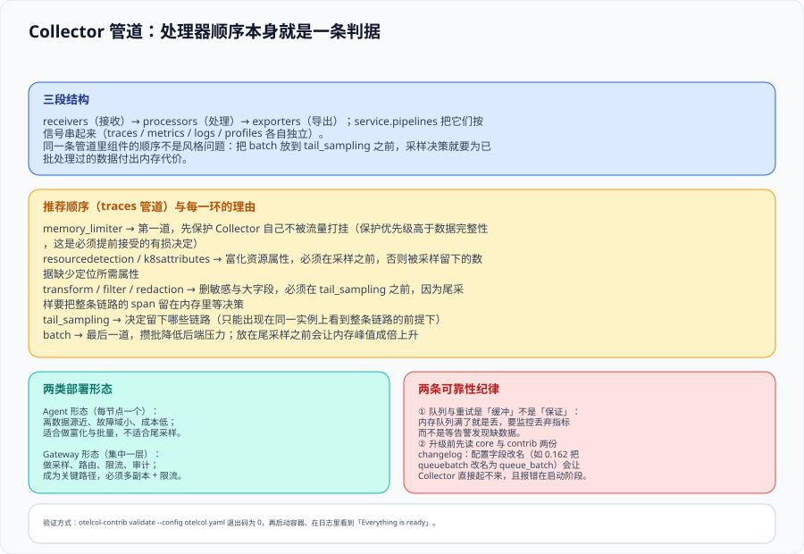

# Collector：管道工程化



Collector 是 OpenTelemetry 里唯一自托管的核心组件。它的价值不在「多一个进程」，而在于**把重试、批量、加密、脱敏、采样这些横切关注点，从每个应用里搬到一个地方统一实现**：「一个应用要发数据」和「一个组织要治理数据」是两件不同的事，后者只做一次。

::: tip 一句话理解
没有 Collector 时，每个服务各自重试、各自批量、各自决定要不要过滤敏感字段——**策略数量等于服务数量乘以语言数量**。有了 Collector，策略变成一份 YAML。
:::

## 一、三段结构与最小可运行配置

管道由三部分组成，`service.pipelines` 把它们按信号串起来（`traces` / `metrics` / `logs` / `profiles` 各自独立）：

| 段 | 作用 | 常见组件 |
| --- | --- | --- |
| **receivers** | 接收数据 | `otlp`（gRPC / HTTP）、`prometheus`、`filelog` |
| **processors** | 处理数据 | `memory_limiter`、`resourcedetection`、`k8sattributes`、`transform`、`filter`、`redaction`、`tail_sampling`、`batch` |
| **exporters** | 导出数据 | `otlp` / `otlphttp`、`debug`、`prometheusremotewrite`、`loadbalancing` |

```yaml
# otelcol.yaml —— 最小可运行骨架（traces + metrics 两条管道）
receivers:
  otlp:
    protocols:
      grpc: { endpoint: 0.0.0.0:4317 }
      http: { endpoint: 0.0.0.0:4318 }

processors:
  memory_limiter:          # 第一道：先保护自己
    check_interval: 1s
    limit_percentage: 75
    spike_limit_percentage: 20
  batch: {}                # 最后一道：攒批

exporters:
  otlp/tempo:
    endpoint: tempo:4317
    tls: { insecure: true }
  debug:
    verbosity: basic       # 只在验证阶段使用，生产务必移除

service:
  pipelines:
    traces:
      receivers: [otlp]
      processors: [memory_limiter, batch]
      exporters: [otlp/tempo]
    metrics:
      receivers: [otlp]
      processors: [memory_limiter, batch]
      exporters: [prometheusremotewrite]
```

::: tip 验证方式
`otelcol-contrib validate --config otelcol.yaml` 无输出且退出码为 `0`，说明**文件能解析且组件存在于该发行版**；再启动容器，日志里出现 `Everything is ready. Begin running and processing data.`。

注意「无输出」与「有数据」是两件事：validate 通过只证明配置自洽，不证明数据能进来。
:::

## 二、处理器顺序：顺序本身就是结论

同一条管道里组件的顺序**不是风格问题**。下面这个顺序里，每一环的位置都有理由：

```text
memory_limiter → resourcedetection / k8sattributes → transform / filter / redaction
               → tail_sampling → batch → exporter
```

| 位置 | 组件 | 为什么必须在那个位置 |
| --- | --- | --- |
| 1 | `memory_limiter` | 第一个执行，才能保护 Collector 自己不被流量打挂。它**主动丢数据**——这是必须提前接受的有损决定 |
| 2 | `resourcedetection` / `k8sattributes` | 富化必须在采样之前，否则被留下的少数链路缺少定位所需的属性，而属性一旦被采掉就再也补不回来 |
| 3 | `transform` / `filter` / `redaction` | 删敏感字段与大字段**必须在尾采样之前**：尾采样要把整条链路的 span 留在内存里等决策，先瘦身才能让同样的内存装更多链路 |
| 4 | `tail_sampling` | 决定留下哪些链路。它是有状态的，这决定了它的部署约束（见第四节） |
| 5 | `batch` | 放在最后。放在尾采样之前会让内存峰值成倍上升（攒批的数据也在内存里等） |

::: danger 注意：两个把顺序写错就会出事的组合
1. **`batch` 放在 `tail_sampling` 之前**：批处理会把不同链路的 span 混在同一批里等待发送，而尾采样按 trace_id 聚合整条链路。结果是内存里同时存在「已在批次里等发送」和「在采样器里等决策」两份数据，内存占用大幅上升，且 `decision_wait` 与 `batch.timeout` 两个超时会互相干扰。
2. **`k8sattributes` 放在 `tail_sampling` 之后**：尾采样丢弃了大部分链路之后才补 K8s 元数据，看起来省了处理量；但如果采样策略里有任何一条基于 K8s 标签（例如按命名空间区分采样率），这条策略会因为属性还没补齐而**永远匹配不上**——而且不报错。
:::

## 三、两类部署形态

| 形态 | 位置 | 适合做什么 | 不适合做什么 |
| --- | --- | --- | --- |
| **Agent（每节点 / 每 Pod）** | 离数据源最近 | 富化（K8s 元数据）、脱敏、初筛、批量发送；故障域小、成本低 | **尾采样**——它只能看到本地节点上的 span |
| **Gateway（集中一层）** | 集群内独立服务 | 尾采样、路由到多个后端、限流、审计、跨团队策略统一 | 承担关键路径的可用性风险：它挂了，全部数据断流，必须多副本 + 限流 |

**为什么要分两层**：尾采样要求「同一条链路的所有 span 到达同一个实例」。落到多副本的 Gateway 上时，必须在前一层按 `trace_id` 做负载均衡（`loadbalancing` exporter，路由键取 trace ID），否则一条链路会被拆到多台实例上、各自以为看到了不完整链路，**慢请求与错误链路反而会被丢掉**。

```yaml
# 前一层：按 trace_id 分流的无状态 Collector（Gateway 之前的必经一档）
exporters:
  loadbalancing:
    routing_key: traceID
    protocol:
      otlp:
        tls: { insecure: true }
    resolver:
      static:
        hostnames:
          - tail-sampler-1:4317
          - tail-sampler-2:4317
```

::: warning 说明：尾采样实例数要与流量一起算
尾采样的内存占用 ≈ 在飞链路数 × 每条链路的 span 数 × 单个 span 的内存大小。默认 `decision_wait` 是 30 秒、默认 `num_traces` 是 5 万；一旦在飞链路数超过 `num_traces`，**最老的链路会在做出决策前被逐出**——而被逐出的恰好最可能是慢链路。所以：

1. `decision_wait` 应设为**略高于链路耗时的 P99**（往往是 10 秒而不是 30 秒），可以成倍降低在飞状态；
2. `num_traces` 至少要设为**预期在飞数的两倍**；
3. 必须监控**逐出计数与迟到 span 计数**——出现这两个数，就说明有决策是建立在不完整链路上的。
:::

## 四、可靠性：队列与重试是缓冲，不是保证

| 机制 | 它保证什么 | 它不保证什么 |
| --- | --- | --- |
| `memory_limiter` | 保护 Collector 自己不被 OOM 杀掉 | 不保证数据完整——它**主动丢弃** |
| 发送队列（queue） | 后端短暂不可用时缓冲一段时间 | 队列满了就丢，且默认行为可能不是最保守的那个 |
| 重试（retry） | 可重试错误会在退避后重发 | 不解决后端持续不可用；也无助于语义错误（如 4xx 格式被拒） |
| 持久化队列 | 进程重启后不丢已入队数据 | 增加延迟与磁盘 IO，需要单独规划容量 |

**监控哪些指标**：自监控指标里必须能看到**接收计数、导出计数、队列长度、丢弃计数**。其中丢弃计数是「你正在瞎」的直接证据——它比任何业务告警都更需要有人看。

## 五、升级纪律

Collector 是**双周发布、无 LTS** 的组件，升级纪律比大多数组件都重要：

1. **同时读两份 changelog**：核心仓库（框架、配置、通用组件）与 contrib（额外的 receivers / processors / exporters）。同一个版本的变化分散在两份记录里。
2. **配置字段会改名**：例如 **0.162.0（2026-09-28）把 `queuebatch` 更名为 `queue_batch`**。这类改动会让 Collector **在启动阶段直接失败**——好在失败得很明显，比静默丢数据好得多。
3. **升级前先 validate**：把新版本的二进制与配置文件放在一起跑一次 `validate`，比在生产上重启更快更便宜。
4. **固定镜像 tag**：生产用 `latest` 等于每次重启都在做一次未评审的升级。

## 六、判据定义表

| 判据 | 内容 | 怎么验证 |
| --- | --- | --- |
| `OBC-A` | 配置文件必须能通过 `validate`，且组件存在于所用发行版 | 运行 validate 命令，退出码为 0 |
| `OBC-B` | `memory_limiter` 必须是管道里第一个 processor | 读取配置文件中 processors 列表顺序，逐项核对 |
| `OBC-C` | 富化类 processor 必须在采样之前，批处理必须在采样之后 | 同上，并检查是否出现「基于未补齐属性」的采样策略 |
| `OBC-D` | 尾采样只能部署在能看到整条链路的实例上；多副本时必须按 trace_id 分流 | 检查是否存在 loadbalancing exporter 且 `routing_key` 为 traceID |
| `OBC-E` | 必须监控接收 / 导出 / 队列长度 / 丢弃四项自监控指标 | 在后端查询这四个指标，四项都有数据 |
| `OBC-F` | 生产环境不得启用详细日志与 debug 导出器 | 在配置中检索 `debug` 与 `verbosity: detailed`，命中即不合格 |
| `OBC-G` | 升级前必须核对核心与 contrib 两份 changelog，并固定镜像 tag | 升级记录中同时存在两份 changelog 的核对结论与明确的镜像版本号 |

## 七、与相邻专题的分工

- [OpenTelemetry 接入](../OpenTelemetry/index.md) 讲应用侧怎么发数据；本页讲数据**发出之后**的管道。
- [采样决策](../Sampling/index.md) 专门讲尾采样策略的写法与失真问题；本页只讲它在管道中的**位置约束**。
- [监控告警](../../../Ops/Monitoring/index.md) 讲 Prometheus 侧的采集与告警；本页的 `prometheusremotewrite` 只是「把指标转出去」的一条出口。
- [Kubernetes](../../../Ops/Kubernetes/index.md) 讲集群本身；本页的 `k8sattributes` 只关心「怎么把 Pod 元数据补到观测数据上」。

## 参考资料

- [Collector 官方文档：Configuration](https://opentelemetry.io/docs/collector/configuration/)
- [Collector 发行版与 changelog](https://github.com/open-telemetry/opentelemetry-collector-releases/releases)
- [Tail Sampling Processor（组件文档与稳定性说明）](https://github.com/open-telemetry/opentelemetry-collector-contrib/tree/main/processor/tailsamplingprocessor)
- [Load Balancing Exporter](https://github.com/open-telemetry/opentelemetry-collector-contrib/tree/main/exporter/loadbalancingexporter)
- [Memory Limiter Processor](https://github.com/open-telemetry/opentelemetry-collector/blob/main/processor/memorylimiterprocessor/README.md)
