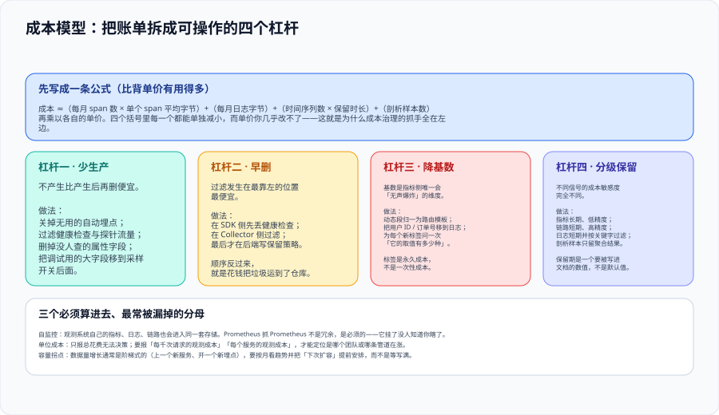

# 观测成本治理



观测数据是**按量计费**的，而且量会以阶梯的方式增长：上一个新服务、开一组新的自动埋点、把某个标签从枚举换成 ID，都是一次跳变。这一页把账单拆成一条可计算的公式，再把公式里能动的四个杠杆分别说清——**目标不是少采集，而是「留下的每一条都有人用」**。

::: tip 一句话理解
成本 ≈ **数据量 × 单价**。单价你几乎改不了，所以全部抓手都在数据量上：**少产生、早删掉、降基数、分级保留**。四件事里最先该做的是「早删掉」——它最便宜且立即生效。
:::

## 一、成本公式

```text
成本 ≈（每月 span 数 × 单个 span 平均字节）               ← 链路
     +（每月日志字节）                                    ← 日志
     +（时间序列数 × 保留时长）                            ← 指标
     +（剖析样本数）                                       ← 剖析
   再乘以各自单价
```

这条公式的用处不是算出一个精确数字，而是**判断该动哪一项**：

| 症状 | 公式里的哪一项在涨 | 优先动作 |
| --- | --- | --- |
| 账单每月稳定增长、与流量同步 | span 数 / 日志字节 | 采样率与过滤 |
| 账单在某一天跳变并保持 | 时间序列数 | 查新标签（基数） |
| 账单与流量无关但持续上涨 | 保留时长 / 剖析样本 | 复核保留期 |

## 二、四个杠杆

| 杠杆 | 做法 | 生效速度 | 副作用 |
| --- | --- | --- | --- |
| **少生产** | 关掉无用的自动埋点；过滤健康检查与探针；删掉没人查的字段 | 中（要改部署） | 需要确认「确实没人查」 |
| **早删** | 在最靠左的位置过滤：SDK 侧 → Collector 侧 → 后端保留策略 | **快** | 删掉的东西以后查不到，需要留档决策 |
| **降基数** | 动态段归一为路由模板；把 ID 类值移到日志；给每个新标签算取值数 | 慢（要改代码或规则） | 改口径会影响既有看板，需要同步改 |
| **分级保留** | 不同信号用不同保留期；原始样本短期、聚合结果长期 | 快（改配置） | 需要有人定期确认「短期数据真的不再需要」 |

::: danger 注意：「早删」被跳过时会发生什么
最常见的错误顺序是：**先在后端配保留策略，再考虑采集侧过滤**。这等于**花钱把垃圾运到仓库，再雇人定期倒掉**——运输、入库、索引、存储的成本全部已经发生。

正确顺序是：

1. **SDK 侧**：确认没有采集探针与健康检查（它们通常占总量的可观比例，且没有分析价值）；
2. **Collector 侧**：用 `filter` / `transform` 删掉不需要的 span 与属性（顺序必须在采样之前，见 [Collector](../Collector/index.md)）；
3. **后端侧**：最后才配保留期，用于兜住前两层的漏网。
:::

## 三、基数：指标侧的无声炸弹

**基数（Cardinality）= 标签取值的乘积**。它是唯一一个会在**不增加流量**的情况下让成本翻倍的维度：

| 标签组合 | 取值数 | 时间序列数 |
| --- | --- | --- |
| `service`(20) × `route`(15) | 300 | 300 |
| 追加 `method`(4) | — | 1,200 |
| 追加 `status`(10) | — | 12,000 |
| 追加 `user_id`(10,000) | — | **120,000,000** |

最后一行不是笔误：**一个无界标签会让时间序列数从万级直接跳到亿级**。它不会报错，只会在几个月内把内存和存储同时吃掉。

::: danger 注意：三条基数纪律
1. **每次新增标签，先回答「它的取值有多少种」**——答不出来的标签不许加。
2. **高基数维度只能进日志或链路属性，不进指标标签**：需要按用户维度分析时，用日志查询而不是指标下钻。
3. **标签是永久成本**，不是一次性成本：删掉标签之前，它一直按时间序列数计费。
:::

## 四、三个必须算进去的分母

只报「这个月花了多少」无法支撑任何决策。至少要补三个分母：

| 分母 | 回答的问题 | 缺了它会怎样 |
| --- | --- | --- |
| **每千次请求的观测成本** | 单位业务量的观测开销是否在变差 | 流量涨了 30%、账单涨了 30% 会被误判为「正常」 |
| **每个服务的观测成本** | 是哪个团队 / 哪条管道在涨 | 只能看到总量，只能一刀切降低所有采样率 |
| **自监控成本** | 观测系统自己占了多少 | 观测系统的指标、日志、链路也在同一套存储里，且**必须**被采集（它挂了没人知道你瞎了） |

## 五、一次可复制的成本估算

下面是一份**示意算术**（不是实测值），展示如何把公式用起来。假设：单条链路 25 个 span、单个 span 平均 260 字节、月请求量 5,000 万。

| 场景 | 有效采样率 | 每月 span 数 | 传输/存储的相对量 |
| --- | --- | --- | --- |
| 不采样 | 100% | 12.5 亿 | 1.00 |
| 头采样 5% | 5% | 6,250 万 | 0.05 |
| 尾采样：错误全留 + 慢请求全留 + 基线 1% | 约 2.5%（随错误率浮动） | 约 3,100 万 | 0.025 |
| 尾采样 + 过滤健康检查（约占总流量 8%） | 约 2.3% | 约 2,850 万 | 0.023 |

::: warning 说明：为什么「基线 1%」不等于总采样率 1%
尾采样的各条策略是**或**的关系：错误链路被 100% 留下，于是它在最终样本里的占比远高于它在全部流量里的占比。上表中的「约 2.5%」是**错误率 0.5% + 慢请求 1% + 其余 1%** 混合后的结果。

**这带来一个必须写进看板的结论**：尾采样后的链路数据集，**错误率是被放大的**，不能直接用来报错误率。
:::

**可以立刻执行的三条检查命令**：

```shell
# 1）确认保留期写在配置里（不是默认值）
grep -rn 'retention' ./deploy/ | grep -v '#'   # 应有明确数值，如 retention: 168h

# 2）确认没有无界标签进入指标（抽查业务指标定义）
grep -rn 'user_id\|order_id\|request_id' ./src/**/metrics* 2>/dev/null   # 应为空

# 3）确认 Collector 的过滤生效（自监控指标中的接收与导出计数应有量级差）
curl -s localhost:8888/metrics | grep -E 'otelcol_receiver_accepted_spans|otelcol_exporter_sent_spans'
```

## 六、判据定义表

| 判据 | 内容 | 怎么验证 |
| --- | --- | --- |
| `OBK-A` | 每个信号必须显式配置保留期，不得依赖默认值 | 在配置中检索四项信号的保留期字段，均有明确取值 |
| `OBK-B` | 过滤必须从最靠左的位置开始（SDK → Collector → 后端） | 检查是否存在采集侧过滤，而非仅靠后端保留策略 |
| `OBK-C` | 新增指标标签前必须评估取值数量，无界标签禁止进入指标 | 抽查指标定义文件中的标签列表，无 ID 类标签 |
| `OBK-D` | 必须给出单位成本（每千次请求 / 每个服务）而非仅总量 | 成本看板中存在至少两个单位成本面板 |
| `OBK-E` | 观测系统自身的指标必须被采集与告警（自监控） | 在后端能查到 Collector / 存储组件的自监控指标与规则 |
| `OBK-F` | 采样后的数量类数字必须标注口径，不得直接作为业务总量 | 抽查 3 个面板的分母口径说明 |

## 七、与相邻专题的分工

- [云原生 · 成本治理（FinOps）](../../../Ops/CloudNative/FinOps/index.md) 讲**云账单**的采集、归因与单位成本；本页讲**观测数据**这一项特殊支出的成本结构。两者共用「标签归因 + 单位成本」的方法，但口径不同：那边管基础设施账单，这边管遥测数据量。
- [监控告警](../../../Ops/Monitoring/index.md) 讲指标与告警的写法；本页只补充「标签基数」这一条成本纪律。
- [采样决策](../Sampling/index.md) 是本页「少产生」杠杆在链路侧的主要实现手段。
- [后端与存储选型](../Backends/index.md) 决定单价与存储模型；本页决定量。


## 与「容量与成本治理」专题的分工（第 156 天补充）

| 问题 | 本页 | [容量与成本治理](../../CapacityCost/index.md) |
| --- | --- | --- |
| 采样率、保留期、指标基数怎么定 | **本页回答** | 只引用方法 |
| 观测成本该算进谁的成本 | 不回答 | **那边回答**：共享成本按用量摊，且要能被业务看见 |
| 观测成本与业务成本如何一起降 | 不回答 | **那边回答**：单位成本与季度循环 |

**一句话结论**：观测成本是「自产自销」的成本——它既是被观测系统的一部分，也是治理系统的一部分，所以必须**两头都算**。

**这一页特有的坑**：把采样率调低看起来只影响观测侧，实际会**同时改变两侧的数字**——被观测系统的开销下降，但「每千请求成本」的分子没变、分母也没变，于是这条曲线纹丝不动，让人误以为「采样没用」。正确做法是把观测侧的节省单独成行，不要指望它体现在单位成本上。

## 参考资料

- [OpenTelemetry：Collector 自监控指标](https://opentelemetry.io/docs/collector/internal-telemetry/)
- [Grafana：管理指标基数](https://grafana.com/docs/grafana-cloud/best-practices/manage-metrics-cardinality/)
- [OpenTelemetry：Metrics Data Model（基数与聚合）](https://opentelemetry.io/docs/specs/otel/metrics/data-model/)
- [Prometheus：保留与存储配置](https://prometheus.io/docs/prometheus/latest/storage/#operational-aspects)
- [CNCF：FinOps 与云原生成本（方法论来源）](https://www.finops.org/)
