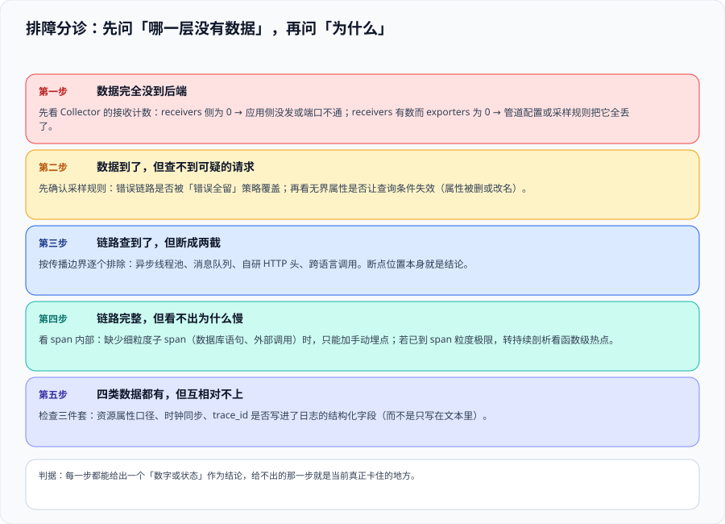

# 常见问题与最佳实践

这一页按**症状**组织，而不是按概念。排障时最怕的不是没有工具，而是不知道「现在该看哪一个」。下面先给一张分诊表（每一步都要能给出一个数字或状态作为结论），再给十二个高频问答、一份上线自查清单与一份术语表。

::: tip 一句话理解
排障的顺序永远是：**先确认数据在哪一层消失了，再问为什么**。直接猜「大概是采样把数据丢了」是最常见的时间黑洞。
:::

## 一、分诊：五步定位

| 步骤 | 症状 | 先看什么 | 结论形态 |
| --- | --- | --- | --- |
| 1 | 后端完全没数据 | Collector 的**接收计数** | 接收为 0 → 应用没发或端口不通；接收有数、导出为 0 → 管道或采样把数据全丢了 |
| 2 | 有数据，但查不到可疑请求 | **采样规则**是否覆盖这条链路；属性是否被删或改名 | 规则命中与否的具体条件 |
| 3 | 链路查到了，但断成两截 | **传播边界**：线程池、消息队列、自研 HTTP 头、跨语言调用 | 断点位置本身就是结论 |
| 4 | 链路完整，但看不出为什么慢 | span 粒度是否够（有没有数据库语句、外部调用子 span）；不够则转持续剖析 | 「缺口在哪一级」而不是「再猜一轮」 |
| 5 | 四类数据都有，但互相对不上 | **关联三件套**：资源属性口径、时钟偏移、trace_id 是否在结构化字段里 | 哪一件套缺失 |

## 二、高频十二问

**Q1：装了 Collector 但后端没有数据，从哪查起？**
按顺序看三处：① Collector 自监控的**接收**计数（为 0 说明数据没到）；② 导出计数与**丢弃**计数（接收有、导出无 → 管道或采样问题）；③ 后端自身的接收日志。**永远先看自监控，不要先看后端界面**——后者只能告诉你「没有」，前者能告诉你「在哪一步没有」。

**Q2：链路数据很多，但查询很慢，是采样做得不够吗？**
通常不是。高基数环境下查询慢的主因是**没有先按标签缩小范围**：`service.name`、`route`、`status` 这类低基数标签要先筛，再按 trace_id 精查。采样率降低会减少数据量，但不改变「查询方式不对」这件事。

**Q3：为什么错误率看起来比真实值高很多？**
尾采样把错误链路 100% 留下、其余按比例采，错误率必然被放大。**速率与错误率类数字要取采样前算好的指标**，链路只用于归因。参见 [采样决策](../Sampling/index.md) 的失真三例。

**Q4：`decision_wait` 用默认 30 秒可以吗？**
只有在链路耗时 P99 明显小于 30 秒时可以。链路还没结束就被判定时，`latency` 策略永远匹配不上——**慢请求策略会一直空转且不报错**。经验做法是取略高于 P99 的值（常见是 10 秒）。

**Q5：一条链路在后端被拆成了两段，是什么原因？**
按可能性排序：① 尾采样用了多副本但没有按 trace_id 分流；② 异步边界（线程池、消息队列、定时任务）没有传递上下文；③ 跨信任域被有意剥离（这时应在文档中写明）；④ 跨语言调用时用了自研的透传头。

**Q6：应该先做头采样还是尾采样？**
先尾采样、再头采样（头采样作为总量封顶的保险丝）。**反过来一旦在入口丢掉了错误链路，后面任何规则都补不回来。**

**Q7：手动埋点的 span 名可以带订单号吗？**
不可以。span 名是**操作名**，应当稳定且有限（如 `POST /orders`）；带订单号会让后端里的操作列表无限增长，等价于在链路侧制造基数爆炸。订单号应放进日志或受控属性。

**Q8：语义约定升级会怎么影响我的看板？**
属性名、取值、**单位**都可能变。以 Java agent 3.0 为例，数据库连接池的时长指标会从毫秒改为秒——**阈值不改就会出现「看起来一切正常」的假象**。迁移做法是双发比对（`/dup`），并且比对必须包含值与单位，见 [OpenTelemetry 接入](../OpenTelemetry/index.md)。

**Q9：持续剖析可以直接上生产吗？**
OTLP 侧的 profiles 仍为 Development、官方标记 public Alpha。可以先用厂商 / 社区形态落地（也能长期常开），但**不要把它放进关键告警链路**，并把字段设计向 OTLP profiles 模型对齐，等转正再换管道。

**Q10：火焰图上最宽的块就是该优化的地方吗？**
不是。宽度是**采样占比**，热函数可能本来就该热（核心计算路径）。要判断是否值得优化，需回到链路与业务口径：它是否出现在被投诉的那条链路上、它占的端到端时间比例是多少。

**Q11：观测系统的成本为什么总是超预期？**
三个常见原因：① 保留期用了默认值（通常偏长）；② 无界标签进入指标（基数爆炸）；③ 过滤做在了后端而不是最靠左的位置（花钱运垃圾）。见 [观测成本治理](../Cost/index.md)。

**Q12：小团队没有专职 SRE，怎么起步？**
按 [概述](../Overview/index.md) 的三步走：先自动埋点 + 一个 Collector + 一个后端；再补三件套与采样规则；最后才考虑第四类信号与成本看板。**每一步都要有可当场执行的验收，而不是「感觉接上了」。**

## 三、上线自查清单（12 项）

- [ ] 四类（或已接入的几类）数据的 `service.name` 等资源属性口径完全一致
- [ ] 日志中的 `trace_id` 写在**结构化字段**里，且能用它反查到链路
- [ ] 采样决策点已明确（头 / 尾），两级组合后的有效采样率有记录
- [ ] 尾采样的 `decision_wait` 依据实测 P99 设定，`num_traces` 不小于在飞数的两倍
- [ ] 错误链路与超阈值慢链路按**数量**核对过（造 N 条查到 N 条）
- [ ] 多副本尾采样前有按 trace_id 的分流，并监控逐出与迟到 span
- [ ] Collector 的接收 / 导出 / 队列 / 丢弃四项自监控指标已被采集与告警
- [ ] 生产配置中没有 `debug` 导出器与详细日志
- [ ] 四项信号的保留期都是显式配置值
- [ ] 观测系统自身的指标被采集（Prometheus 抓 Prometheus 不是冗余）
- [ ] 成本侧至少有两个单位成本面板（每千次请求 / 每个服务）
- [ ] 每个采集项都能回答「留下它是为了回答哪个问题」

## 四、最佳实践（10 条）

1. **先自动埋点、再手写业务 span**，顺序反了会产出大量重复且口径不一的 span。
2. **服务名由部署配置统一注入**，禁止代码硬编码；大小写与分隔符必须统一。
3. **属性名一律沿用语义约定**；自创名只有当前后端懂，换后端即失效。
4. **无界值（ID、原始 URL、时间戳）不进属性、更不进指标标签**。
5. **过滤从最靠左的位置开始**：SDK → Collector → 后端保留策略。
6. **处理器顺序按「保护自己 → 富化 → 瘦身 → 采样 → 攒批」**，顺序即结论。
7. **采样率与保留期写进配置**，不用默认值；速率类数字取采样前的指标。
8. **剖析结论必须与链路或指标交叉验证**，火焰图只提供线索。
9. **升级前核对两份 changelog**（核心与 contrib），并固定镜像 tag。
10. **每条采集项都要有负责人与用途**，答不出用途的标记为待清理。

## 五、术语表

| 术语 | 含义 |
| --- | --- |
| **Signal（信号）** | 观测数据的类别：metrics / logs / traces / profiles |
| **OTLP** | OpenTelemetry Protocol，统一传输协议，默认端口 `4317`（gRPC）/ `4318`（HTTP） |
| **Resource（资源）** | 描述数据来源的属性集合（`service.name` 等），关联的前提 |
| **SemConv（语义约定）** | 属性命名与取值约定，带稳定性等级 |
| **Propagation（传播）** | 跨进程传递 trace / span 标识与采样标记 |
| **Exemplar** | 指标样本上附带的代表性 trace_id，用于从分位数跳到实例 |
| **Head / Tail Sampling** | 在入口 / 在链路结束后做采样决策 |
| **Profiling（剖析）** | 定时采样调用栈，用于定位函数级资源消耗 |
| **Cardinality（基数）** | 标签取值的组合数，指标成本的直接决定因素 |
| **WAL / 持久化队列** | 进程重启后仍不丢数据的追加日志机制 |

## 六、判据定义表

| 判据 | 内容 | 怎么验证 |
| --- | --- | --- |
| `OBQ-A` | 排障必须先定位「数据在哪一层消失」，再解释原因 | 每次排障记录里都有 Collector 自监控的读数 |
| `OBQ-B` | 采样生效类断言必须按数量核对，不能只看「有没有数据」 | 造 N 条、查 N 条，记录在验收清单中 |
| `OBQ-C` | 速率与错误率类数字必须注明口径，且取自采样前指标 | 抽查面板的数据源与说明文本 |
| `OBQ-D` | 剖析结论必须与链路或指标交叉验证 | 优化项记录里同时存在剖析与链路证据 |
| `OBQ-E` | 生产配置不得包含调试导出器与详细日志 | 配置检索 `debug` / `verbosity: detailed` 无命中 |
| `OBQ-F` | 上线自查清单 12 项必须逐条勾选并留痕 | 交付前自查记录完整，缺项注明原因与解除条件 |

## 七、与相邻专题的分工

- 监控侧的规则写法与告警触达归 [监控告警](../../../Ops/Monitoring/index.md)；本页只处理「观测数据本身」的问题。
- 故障发生后的值班、定级与应急指挥归 [故障应急体系](../../../Ops/IncidentResponse/index.md)；本页止步于「找到了根因」。
- 单进程的剖析命令与 JVM 参数归 [HighPerformanceJava · 剖析工具链](../../../Backend/HighPerformanceJava/Profiling/index.md)。
- 模型与检索侧的观测归 [AI 应用观测与评估](../../../AI/LLMObservability/index.md)。

## 参考资料

- [OpenTelemetry：Troubleshooting 与 FAQ](https://opentelemetry.io/docs/collector/troubleshooting/)
- [OpenTelemetry：Collector Internal Telemetry](https://opentelemetry.io/docs/collector/internal-telemetry/)
- [Tail Sampling Processor 文档（含内存与逐出说明）](https://github.com/open-telemetry/opentelemetry-collector-contrib/tree/main/processor/tailsamplingprocessor)
- [OpenTelemetry 规范：OTLP 各信号稳定性](https://github.com/open-telemetry/opentelemetry-specification/blob/main/specification/protocol/otlp.md)
- [Grafana：TraceQL 查询与采样概率外推](https://grafana.com/docs/tempo/latest/traceql/)
