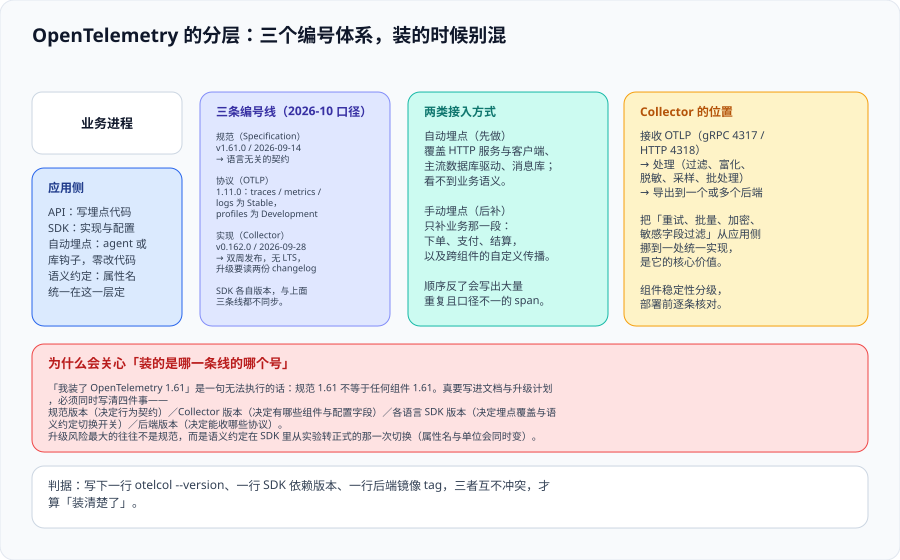
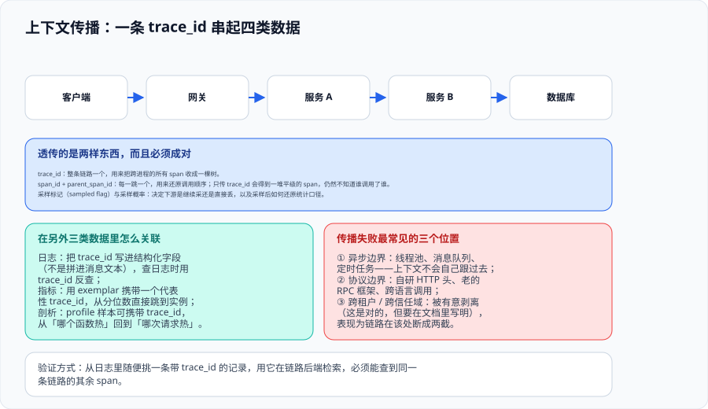

# OpenTelemetry：统一标准与接入



OpenTelemetry（常缩写为 OTel）要解决的只有一个问题：**让「怎么埋点」与「数据存到哪里」彻底解耦**。它由三部分组成——一份语言无关的**规范**、一组各语言的 **API / SDK**、以及一个可自托管的**管道（Collector）**。接入时最容易出错的不是配置，而是把这三个部分的版本号混为一谈。

::: tip 一句话理解
「我装了 OpenTelemetry 1.61」是一句**无法执行**的话。规范 1.61 不等于任何组件 1.61。写进文档与升级计划时必须同时写清四件事：**规范版本、Collector 版本、各语言 SDK 版本、后端版本**。
:::

## 一、三条编号线

| 编号线 | 当前版本（核对时间 2026-10） | 它决定什么 | 升级风险 |
| --- | --- | --- | --- |
| **Specification** | **1.61.0**（2026-09-14） | 语言无关的行为契约：数据模型、传播、SDK 配置、OTLP 兼容性章节 | 低——实现按各自节奏采纳，不强制同步升级 |
| **OTLP** | **1.11.0** | 报文的形状与传输：端口 `4317`（gRPC）/ `4318`（HTTP） | 低——**traces / metrics / logs 为 Stable，profiles 为 Development** |
| **Collector** | **0.162.0**（2026-09-28） | 有哪些组件与配置字段 | **中高**——双周发布、无 LTS；配置字段会改名 |
| **各语言 SDK** | 各自独立（Java agent 2.32.0 / 2026-10-06） | 埋点覆盖范围与语义约定切换开关 | **高**——语义约定从实验转正式时，属性名与单位会同时变 |
| **后端** | 各自独立（Tempo 3.1.0 / Jaeger 2.22.0） | 能收哪些协议、能查哪些字段 | 中——查询接口与存储 schema 变化 |

::: warning 说明：升级风险最大的不是规范，而是语义约定切换
规范版本升级通常只是「多了几个可选字段」。真正会一次性改动你的看板与告警的，是**语义约定（Semantic Conventions）在某个 SDK 里从实验转为正式**的那一次：属性名、取值、甚至单位都会变。

以 2026-10 的 Java agent 为例：**2.32.0 已被官方当作 3.0 的候选版**，3.0 会把数据库与代码语义约定变成稳定默认，并切换消息系统的约定。文中给出的迁移做法是**双发比对**（把旧属性与新属性同时发出，先用基线采一份遥测再开开关）：

```shell
# 第一步：总开关关掉，按域追加 /dup，新旧属性双发
export OTEL_INSTRUMENTATION_COMMON_V3_PREVIEW=false
export OTEL_SEMCONV_STABILITY_OPT_IN=database/dup,code/dup
export OTEL_SEMCONV_STABILITY_PREVIEW=messaging/dup

# 第二步：比对完看板与告警后再打开总开关
export OTEL_INSTRUMENTATION_COMMON_V3_PREVIEW=true
```

**双发有明确的边界**：它不会保住每一项旧指标，也不会同时给出两个 span 名与 kind。例如数据库连接池指标**即使开了 `database/dup` 也会换成新名与新单位**，span 仍然只有一个名字。所以比对的对象必须包含**值、类型、单位**，不能只比属性名。
:::

## 二、应用侧：API、SDK 与两类接入

| 层 | 作用 | 谁来写 |
| --- | --- | --- |
| **API** | 定义埋点接口（创建 span、记录属性、导出的抽象） | 写业务代码的人 / 库作者 |
| **SDK** | API 的具体实现 + 配置（采样、导出、资源、批处理） | 由运维 / 平台侧配置，通常通过环境变量或配置文件 |
| **自动埋点（Instrumentation）** | agent 或库钩子，零改代码覆盖框架层 | 平台侧统一启用 |
| **语义约定（SemConv）** | 属性名、取值、单位的统一命名表 | 由社区维护，接入方遵守 |

**两类接入方式的正确顺序是「先自动、后手动」**：

1. **自动埋点先做**。它可靠地覆盖 HTTP 服务端与客户端、主流数据库驱动、常见消息库。这一层能回答「哪个接口慢、慢了多久、调了哪些下游」。
2. **手动埋点只补业务那一段**。下单、支付、结算这类业务语义不在框架层，需要手写 span，并给出业务属性（订单号、渠道等）。
3. **顺序反了会产出大量重复且口径不一的 span**：先手写了一套「HTTP 请求 span」，再打开自动埋点，同一跳会出现两个名字不同的 span。

::: danger 注意：手动埋点的三条纪律
1. **属性名沿用语义约定，不要自创。** 自创名的属性只有当前后端「懂」，换后端时全部失效；社区约定（如 HTTP、数据库、消息）的属性在多数后端里能自动解析成标准列。
2. **不要把无界值放进属性。** 用户 ID、订单号、原始 URL、时间戳放进 span 属性，等于在链路侧制造基数爆炸；需要的定位信息应写进**日志**，并在 span 上留一个可关联的标识。
3. **不要用 span 名称当业务分类字段。** span 名是**操作名**（应当稳定、有限），业务分类应该是属性。把订单号拼进 span 名会让后端里的操作列表无限增长。
:::

## 三、资源属性：四类数据能对上的前提

**资源（Resource）**描述「这条数据来自哪里」，它是最容易被忽视、后果最严重的一层：

| 属性 | 作用 | 一致性要求 |
| --- | --- | --- |
| `service.name` | 服务的唯一标识 | **四类数据必须完全一致**，包括大小写与分隔符 |
| `service.namespace` | 服务所属业务域 / 团队 | 用于在多团队环境下分组与鉴权 |
| `service.version` | 部署版本 | 排查「是这次发版引起的吗」的关键维度 |
| `deployment.environment` | 环境（prod / staging / dev） | 防止测试数据污染生产看板与告警 |

::: danger 注意：服务名的三种写法会让关联静默失效
`order-service`、`order_service`、`OrderService` 在四张界面上是三个服务。这类不一致不会报错，只会让「怎么这条链路没有对应日志」变成一个长期的悬案。

**做法**：服务名由**部署配置统一注入**（环境变量或编排文件的元数据），不允许由代码里硬编码；并在接入验收时用同一个名字到四类后端各查一次。
:::

## 四、上下文传播与关联



**传播（Propagation）**是让跨进程链路成立的机制。它传递的不只是一个 ID，而是三样东西：

| 传递项 | 作用 | 只传它会怎样 |
| --- | --- | --- |
| `trace_id` | 把整条链路的所有 span 收成一棵树 | 只能知道「属于同一次请求」 |
| `span_id` + `parent_span_id` | 还原调用顺序与嵌套 | 缺了它，得到一堆平级 span，仍然不知道谁调了谁 |
| 采样标记与采样概率 | 让下游与上游的采样决定一致，并让统计可加权 | 各层各采各的，最终没人说得清「到底采了多少」 |

**日志侧的注入方式**，是把标识写进**结构化字段**而不是消息文本：

```json
{
  "timestamp": "2026-10-16T03:12:44.512Z",
  "level": "ERROR",
  "service.name": "order-service",
  "trace_id": "4bf92f3577b34da6a3ce929d0e0e4736",
  "span_id": "00f067aa0ba902b7",
  "message": "payment callback timed out after 3000ms"
}
```

::: tip 为什么强调「结构化字段而不是文本」
拼进消息文本的 `trace_id` 只能**用人眼看**：查询时要写模糊匹配，日志量大时既慢又贵。写进结构化字段后，它才有可能被索引、被后端自动识别成「可跳转到链路」的链接。
:::

**指标侧的关联**用 **exemplar**：在直方图的一个桶上附带一个代表性 `trace_id`，于是「P99 抬头的那个时刻」可以直接跳到一条真实链路。这是把「分位数」变成「可归因的一次请求」的唯一标准做法。

## 五、接入验收的三条命令

接入是否真的成立，用三条命令判定，而不是靠界面里「有数据」：

```shell
# 1）确认装的 Collector 版本与配置能解析（退出码 0 才算过）
otelcol-contrib validate --config ./otelcol.yaml

# 2）确认应用侧真的在发数据（不用业务流量，制造一条可控链路）
telemetrygen traces --otlp-endpoint 127.0.0.1:4317 --otlp-insecure \
  --traces 1 --service checkout-ok --status-code Ok --span-duration 100ms

# 3）确认后端能按统一的服务名查到它（Tempo 的服务名取值接口）
curl -s 'http://localhost:3200/api/search/tag/service.name/values'
```

三条都过，才叫「装上并且接对了」；只过第一条，只是「容器起来了」。

## 六、判据定义表

| 判据 | 内容 | 怎么验证 |
| --- | --- | --- |
| `OBT-A` | 文档与升级计划必须同时写清规范 / Collector / SDK / 后端四个版本 | 抽查接入文档，四个版本号齐全且彼此不冲突 |
| `OBT-B` | 服务名等资源属性由部署配置统一注入，禁止代码硬编码 | 在仓库中搜索硬编码服务名；四类后端按同一名字各查一次 |
| `OBT-C` | 先启用自动埋点，再补业务手动埋点；不重复定义框架层 span | 抽查链路，同一跳不出现两个语义重复的 span |
| `OBT-D` | 手动埋点的属性名必须来自语义约定；无界值不进属性 | 抽查 span 属性表，动态值（ID / URL / 时间戳）命中即为不合格 |
| `OBT-E` | 传播必须带 span 关系与采样标记，不只手传 trace_id | 抓一次跨进程调用，下行请求头里含 traceparent 的全部字段 |
| `OBT-F` | 日志中的 trace_id 写在结构化字段里，不拼在消息文本中 | 抽一条日志，`trace_id` 是独立字段且可被查询工具检索 |
| `OBT-G` | 语义约定切换必须先双发比对再切默认，且比对含值与单位 | 迁移记录中同时存在基线遥测与切换后对比（以 Java agent 3.0 为例） |

## 七、与相邻专题的分工

- [微服务 · 链路追踪](../../../Backend/Microservices/Tracing/index.md) 讲**追踪在微服务架构里的业务用法**（谁调用了谁、怎么读一条链）；本页讲**标准与接入方式**（装什么、怎么配、怎么验）。
- [监控告警](../../../Ops/Monitoring/index.md) 讲**指标本身的采集与告警规则**；本页只负责「把指标这条信号接进统一管道」。
- [Collector](../Collector/index.md) 是本页的下游：应用侧发出去之后，数据在管道里怎么处理。
- [AI 应用观测与评估](../../../AI/LLMObservability/index.md) 也走 OTLP，但它关心的是模型与检索的语义字段；本页讲的是通用接入层。

## 参考资料

- [OpenTelemetry 规范仓库](https://github.com/open-telemetry/opentelemetry-specification)：版本与行为契约
- [OTLP 协议规范](https://github.com/open-telemetry/opentelemetry-specification/blob/main/specification/protocol/otlp.md)：各信号稳定性状态（profiles 仍为 Development）
- [OpenTelemetry 语义约定](https://opentelemetry.io/docs/specs/semconv/)：属性命名、稳定性等级与迁移指南
- [OpenTelemetry Java agent 3.0 预览公告](https://opentelemetry.io/blog/2026/java-agent-3.0-preview/)：双发比对（`/dup`）的官方做法
- [OpenTelemetry：Context and Propagation](https://opentelemetry.io/docs/concepts/context-propagation/)
- [OpenTelemetry：Metrics Exemplars](https://opentelemetry.io/docs/specs/otel/metrics/data-model/#exemplars)
