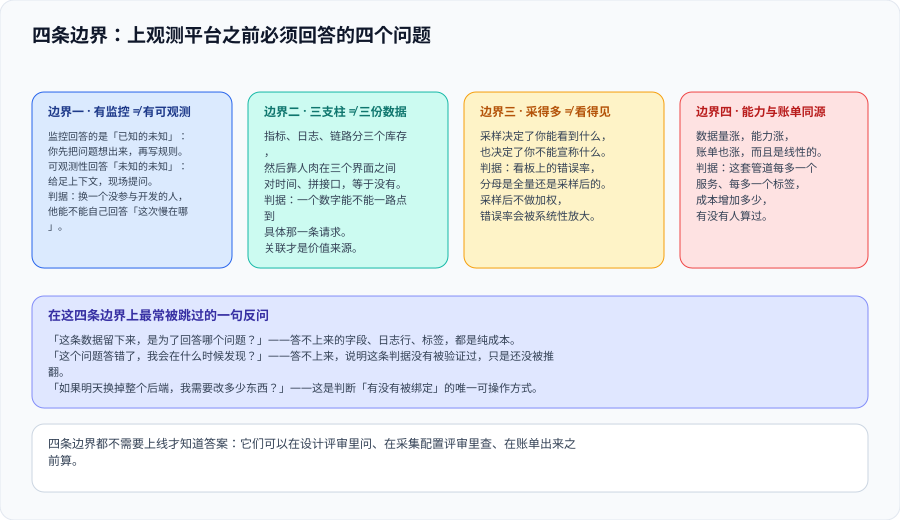
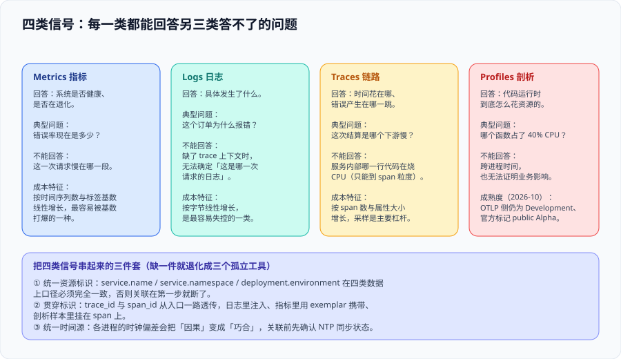

# 概述：从监控到可观测性的四条边界



「可观测性」这个词被用得太松了，以至于它经常只是「更多的监控」的同义词。这一页把它收敛成**四个可判断的问题**：你要解决的是「不知道出事了」还是「不知道哪里出事」；你的三类数据是**存在三个库里**还是**真的能互相对上**；你的采样规则决定了你**能宣称什么、不能宣称什么**；以及你打算为这套能力**付多少钱**。

::: tip 一句话理解
监控是**面向已知问题**的：你先把问题想出来，再写一条规则去盯它。可观测性是**面向未知问题**的：你把足够的上下文留下来，然后针对现场提问。**前者的上限是你的想象力，后者的上限是你的上下文完整性。**
:::

## 一、四条边界

| 边界 | 常见误解 | 可判断的判据 |
| --- | --- | --- |
| **有监控 ≠ 有可观测性** | 「我们有 Prometheus 和 Grafana，所以是可观测的」 | 换一个没参与开发的人，他能不能自己回答「这次慢在哪」 |
| **三大支柱 ≠ 三份数据** | 「指标、日志、链路我们都接了」 | 看板上的一个异常数字，能不能一路点到具体那一条请求 |
| **采得多 ≠ 看得见** | 「全量采集，什么都留」 | 看板上的错误率，分母是全量还是采样后的 |
| **能力与账单同源** | 「先接上，成本以后再说」 | 每多一个服务、每多一个标签，成本增加多少，有没有人算过 |

四条边界都不需要上线才知道答案——它们可以在**设计评审里问**、在**采集配置评审里查**、在**账单出来之前算**。

### 边界一：从「已知的未知」到「未知的未知」

这两个词不是修辞，它们对应两种完全不同的工程投入：

| | 监控（Monitoring） | 可观测性（Observability） |
| --- | --- | --- |
| 起点的知识状态 | 已知的未知：我知道该盯什么 | 未知的未知：我不知道会怎么坏 |
| 典型产物 | 阈值、规则、看板、告警 | 高基数的事件数据 + 任意维度的查询能力 |
| 失效方式 | **漏报**：没写规则的那件事发生了 | **答不上来**：数据留下来但上下文不够 |
| 成本形态 | 随时间线性、可预测 | 随采集维度爆炸，需要治理 |

所以「我们已经有监控了，还要可观测性吗」这个问题本身是错的：**它们解决的是两个不同的问题，监控的完善不会自动带来可观测性**。

### 边界二：三根支柱立在同一张桌子上才成立

指标、日志、链路是三种**数据结构**，不是三个**系统**。把它们分别送进三个互不相识的存储，然后靠人肉在三个界面之间对时间、拼接口——这时你有的仍然是三个工具，不是可观测性。

让三根支柱真正成立的是一张桌子，它由三样东西组成（下一节展开）：**统一的资源标识、贯穿的 trace_id、统一的时间源**。

### 边界三：采样决定了你能宣称什么

采样是成本治理的主要手段，同时它**会改变你看到的人群**：

- 采样规则一变，看板上的错误率就会变——**而这可能只是因为规则变了**，不是因为系统变好了或变坏了；
- 没有概率加权的采样数据，**不能用来算速率**（见 [采样决策](../Sampling/index.md) 里的失真三例）；
- 因此本专题把「这条数字的分母是什么」当作一条独立的判据：**凡是报给别人的数字，分母必须写清楚**。

### 边界四：能力与账单是同一条曲线

观测数据的成本是**数据量乘以单价**的线性函数，而单价几乎改不了。这意味着成本治理的全部抓手都在「少产生、早删掉、降基数、分级保留」四件事上（见 [观测成本治理](../Cost/index.md)）。

::: warning 说明：「先接上，成本以后再说」为什么总是失败
因为观测数据的增长是**阶梯式**的：上一个新服务、开一个新的自动埋点、把某个标签从枚举改成 ID，都是一次跳变。默认配置几乎总是「全量 + 长期保留」，于是第一次跳变就把预算打穿。**在接入之前先把保留期与采样率写进配置，是唯一不靠事后补救的做法。**
:::

## 二、四类信号各答什么



| 信号 | 回答的问题 | 不能回答的 | 成本敏感维度 |
| --- | --- | --- | --- |
| **Metrics** | 系统是否健康、是否在退化 | 这一次请求慢在哪一段 | **时间序列数**（标签基数的乘积） |
| **Logs** | 具体发生了什么 | 缺 trace 上下文时，这是哪一次请求 | **字节数**（最易失控） |
| **Traces** | 时间花在哪、错误在哪一跳 | 服务内部哪一行代码在烧 CPU | span 数 × 属性大小 |
| **Profiles** | 代码运行时怎么花资源 | 跨进程时间、业务影响 | 采样频率 × 进程数 |

**四类的关系不是替代，而是接力**：指标发现问题（「错误率涨了」）→ 链路定位到段（「是结算服务的下游慢」）→ 剖析定位到行（「这个正则在大循环里编译」）。少任意一环，链条就在那里断掉。

::: danger 注意：三个高频的「看起来做了」陷阱
1. **只接指标，然后把「没有链路」当成设计选择。** 指标能告诉你「哪个服务错误率高」，但无法告诉你「是它的哪个下游」。当服务数超过三个，人工排除法的成本会迅速超过接入链路的成本。
2. **接了链路，但 span 只到 HTTP 边界。** 自动埋点覆盖的是框架层，业务语义（下单、扣减库存、调用支付）不在其中。于是你能看到「这个接口 3 秒」，看不到「3 秒里有 2.4 秒在等第三方支付」。
3. **接了日志，但没有 trace_id。** 日志量最大、最贵，却因为无法与某一次请求绑定，在排障时只能靠时间戳猜。
:::

## 三、关联三件套

把四类数据串成一条证据链，只需要三样东西——但它们必须**同时**成立，缺一件就退化成四个孤立工具：

| 组件 | 具体做法 | 缺了它会怎样 |
| --- | --- | --- |
| **统一资源标识** | `service.name` / `service.namespace` / `deployment.environment` 在四类数据上口径完全一致 | 同一个服务在四张界面里有四个名字，关联在第一步就断了 |
| **贯穿标识** | `trace_id` 与 `span_id` 从入口一路透传；日志写进结构化字段、指标用 exemplar 携带、剖析样本挂载 | 只能按时间窗口猜，多租户环境下几乎无法确认「这是同一次请求」 |
| **统一时间源** | 各进程 NTP 同步；容器与宿主机时区一致 | 因果会退化成巧合：下游的日志时间戳早于上游，你会得出错误结论 |

**验证方式（可执行）**：从日志里随便挑一条带 `trace_id` 的记录，用它在链路后端检索，必须能查到同一条链路的其余 span；再从指标图上的一个异常点，通过 exemplar 跳到那条具体链路。两步都能做到，这三件套才算真的接上了。

## 四、什么时候不该做可观测性深入

这不是客套话——本库的纪律是**每一项技术决策都要写清「什么时候不该用」**：

| 场景 | 该做什么 | 为什么 |
| --- | --- | --- |
| 单服务 + 单数据库，问题集中在容量 | 结构化日志（带请求 ID）+ RED 指标 | 链路的价值来自**跨进程**；只有一个进程时，日志比链路便宜一个量级 |
| 团队还没有人能读懂火焰图 | 先做链路与指标 | 剖析工具会持续产生成本，而没有被消费的数据是纯支出 |
| 组织没有值班与故障流程 | 先做 [故障应急体系](../../../Ops/IncidentResponse/index.md) | 数据齐了但没人被叫醒，等于没接 |
| 业务量很小、故障靠用户反馈就能发现 | 先用最低成本的结构化日志 | 「可观测性」是投资，先要有一个值得保护的服务 |

::: tip 判据
**问「最近一次故障，我们花了多久才定位到根因」**。如果答案是「十分钟以内，靠日志就够了」，那当前阶段不需要更重的东西；如果答案是「半天，最后靠猜」，那缺的正是本专题讲的这一层。
:::

## 五、最小起步路径

不要一次上四类信号。按下面三步走，每一步都能独立产生价值：

```text
第一步（1 天）：应用侧接 SDK 的自动埋点 → OTLP → 一个 Collector → 一个链路后端
              验收：能按 service.name 查到一条真实请求的链路
第二步（2~3 天）：补三件套 + 采样规则
              验收：日志能用 trace_id 反查链路；错误链路 100% 留下，基线按比例采
第三步（按需）：第四类信号、成本看板、接入 CI 门禁
              验收：单条链路的存储成本与保留期写进配置，不再依赖默认值
```

每一步的验收都是**可以当场执行的**，不是「感觉接上了」。可执行版本见 [实战](../Practice/index.md)。

## 六、判据定义表

| 判据 | 内容 | 怎么验证 |
| --- | --- | --- |
| `OBV-A` | 观测能力的判断口径是「换个人能不能自己答」，不是「装了几个组件」 | 让没参与开发的人按文档定位一次已知故障，记录耗时 |
| `OBV-B` | 三类数据必须能互相关联；只接其中一类不算可观测 | 从异常指标点抽查一条链路、从链路抽一条日志，两步都要能跳通 |
| `OBV-C` | 资源属性在四类数据上口径完全一致 | 用同一 `service.name` 在四类后端各查一次，命中同一批实例 |
| `OBV-D` | 所有对外报出的数字必须写明分母（全量还是采样后） | 抽查 3 个看板面板，检查标题或说明是否写明口径 |
| `OBV-E` | 采样率、保留期必须显式写在配置里，不允许依赖默认值 | 在配置文件中 `grep` 采样与保留字段，无命中即判为不合格 |
| `OBV-F` | 时间源统一：各主机与容器时钟偏差在可接受范围内 | 用 NTP 客户端查看偏移量；链路时间线不出现「下游早于上游」 |
| `OBV-G` | 不上任何没人消费的信号：「留下它是为了回答哪个问题」必须能答 | 对每个采集项记录负责人与用途，答不出的标记为待清理 |
| `OBV-H` | 起步按三步推进，每步都有可当场执行的验收 | 每一步的验收命令写进项目文档并实际跑过一次 |

## 七、与相邻专题的分工

- **本页讲「要不要做、做到哪一层」的判断（方法论边界）**；[OpenTelemetry 接入](../OpenTelemetry/index.md) 讲「装什么、装哪条线的哪个号」；[Collector](../Collector/index.md) 讲管道；[采样](../Sampling/index.md) 讲看到什么。
- 指标的**采集与告警写法**归 [监控告警](../../../Ops/Monitoring/index.md)（RED / USE、告警三道闸门），本页不重复。
- 日志采集器与存储归 [日志体系](../../../Ops/LogSystem/index.md)；本页只要求「日志里要有 trace_id」。
- 「一次请求有多快、还能扛多少」归 [性能与容量工程](../../../Ops/PerformanceEngineering/index.md)；本页不回答容量问题。

## 与「观测驱动开发」专题的分工（第 158 天补充）

第 158 天交付的 [观测驱动开发](/docs/Tools/ObservabilityDriven/index.md)（9 章 / 72 条判据）管的是**决策侧**，本页管的是**实现侧**。两者的分工可以用一句话说清：**本页回答「信号怎么采、存、查」，该专题回答「该采什么、采来怎么用」。**

| 边界问题 | 归本页 | 归该专题 |
| --- | --- | --- |
| 三支柱（指标 / 日志 / 追踪）各自由谁承载、SDK 怎么接 | 后端拓扑、Collector 部署、导出器配置 | 不涉及——只问「这个问题该由哪类信号回答」 |
| 「可用性」这个数怎么算 | 不涉及 | 分母与排除项的四种口径、口径为什么必须写成代码常量 |
| 采样参数怎么定 | 头部/尾部算法、概率与速率限制的实现 | 只给一条业务侧原则：先保错、再保慢、最后按比例采成功 |
| 成本为什么突然翻倍 | 存储后端与保留期配置 | 高基数标签的乘法算例与「标签取值 < 100」的阈值 |

本页特有的一个坑：**三支柱都装齐了，不等于能回答业务问题**。自动采集拿到的永远只有框架层信号（HTTP 状态码、SQL 耗时），它不知道「拖动一张卡片」包含几次请求、哪一次在关键路径上——这层语义只能靠业务埋点补，而业务埋点归该专题的 [埋点规范](/docs/Tools/ObservabilityDriven/Instrumentation/index.md)。

## 参考资料

- [OpenTelemetry：Observability Primer](https://opentelemetry.io/docs/concepts/observability-primer/)：信号与关联的官方定义
- [OpenTelemetry：Signals](https://opentelemetry.io/docs/concepts/signals/)：四类信号的边界与稳定性状态
- [OpenTelemetry：Semantic Conventions](https://opentelemetry.io/docs/specs/semconv/)：资源与属性命名约定
- [Google SRE Book：Monitoring Distributed Systems](https://sre.google/sre-book/monitoring-distributed-systems/)：「已知的未知 / 未知的未知」的出处
- [Grafana：What is observability](https://grafana.com/docs/grafana/latest/observability/)：另一种视角的能力分层
