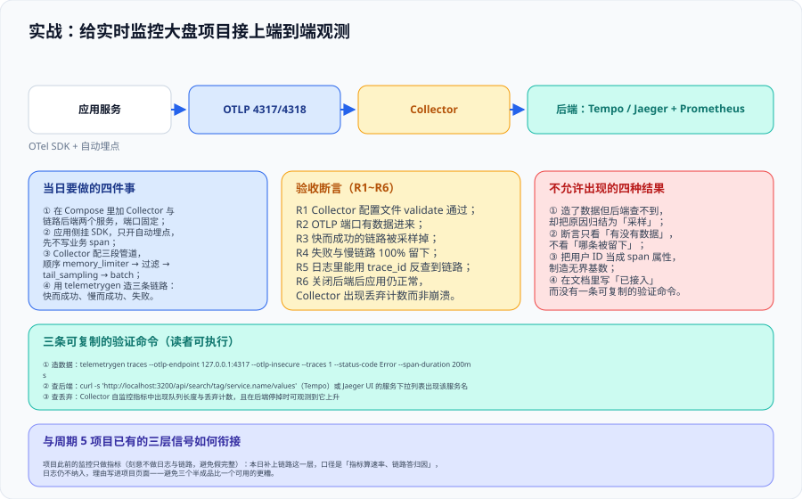

# 实战：给实时监控大盘接入端到端观测



这一页把前面五个页面的结论落成一次**可以照着执行、且能当场验收**的接入。目标不是「装一套最全的观测栈」，而是**给已有的指标体系补上归因能力**：监控告警专题已经让这套系统能回答「有没有出事」，本页让它能回答「那次慢，慢在哪一段」。

::: tip 一句话理解
这一页的验收标准只有一句话：**造三条链路（快而成功、慢而成功、失败），一条被采样掉、两条被留下，并且日志能用 trace_id 反查回链路。** 做不到就是没接上，数据「看起来有」不算。
:::

## 一、背景：只做链路，不做日志

项目此前的监控刻意**只做指标**（避免造出三个半成品），本页补上**链路**这一层，**日志仍不纳入**。理由写在这里，避免下一个人以为漏了：

| 信号 | 当前状态 | 为什么这样安排 |
| --- | --- | --- |
| 指标 | 已有（Prometheus + 三张大盘 + 告警规则） | 已经是可用状态 |
| **链路** | **本页新增** | 补上「一次请求为什么慢」的归因能力 |
| 日志 | 不做 | 应用尚未接入结构化日志；先接链路，等日志改造完成后用 trace_id 反查 |

**先划分工边界**：本页讲**怎么把链路接进这个项目并验证**；[采样决策](../Sampling/index.md) 讲策略为什么这么写；[Collector](../Collector/index.md) 讲管道顺序的由来。

## 二、四步接入

```text
① 起 Collector 与链路后端两个服务（端口固定，不占用既有大盘端口）
② 应用侧挂 SDK，只开自动埋点（先不写业务 span）
③ Collector 配三段管道，顺序：memory_limiter → filter → tail_sampling → batch
④ 用 telemetrygen 造三条链路，按 R1~R6 逐条验收
```

### 步骤 ① / ③：Compose 与 Collector 配置

```yaml
# compose.observability.yaml —— 与既有 monitoring 栈并列，端口不冲突
services:
  otel-collector:
    image: otel/opentelemetry-collector-contrib:0.162.0   # 固定 tag，不用 latest
    command: ["--config=/etc/otelcol-contrib/config.yaml"]
    volumes:
      - ./otelcol.yaml:/etc/otelcol-contrib/config.yaml:ro
    ports:
      - "127.0.0.1:4317:4317"    # OTLP/gRPC：只绑定本机，不暴露公网
      - "127.0.0.1:4318:4318"    # OTLP/HTTP
      - "127.0.0.1:8888:8888"    # 自监控指标，供 Prometheus 抓取
    depends_on: [tempo]

  tempo:
    image: grafana/tempo:3.1.0
    command: ["-config.file=/etc/tempo.yaml"]
    volumes:
      - ./tempo.yaml:/etc/tempo.yaml:ro
      - tempo-data:/var/tempo
    ports:
      - "127.0.0.1:3200:3200"    # 查询接口

volumes:
  tempo-data:
```

```yaml
# otelcol.yaml —— 顺序本身就是结论，逐行的理由见 Collector 页
receivers:
  otlp:
    protocols:
      grpc: { endpoint: 0.0.0.0:4317 }
      http: { endpoint: 0.0.0.0:4318 }

processors:
  memory_limiter:
    check_interval: 1s
    limit_percentage: 75
    spike_limit_percentage: 20
  filter/drop-noise:            # 早删：健康检查与探针链路没有分析价值
    error_mode: ignore
    traces:
      span:
        - 'attributes["http.route"] == "/health"'
        - 'attributes["http.route"] == "/ready"'
  tail_sampling:
    decision_wait: 10s          # 依据链路耗时 P99 设定，不沿用默认 30s
    num_traces: 100000
    expected_new_traces_per_sec: 1000
    policies:
      - name: keep-errors
        type: status_code
        status_code: { status_codes: [ERROR] }
      - name: keep-slow
        type: latency
        latency: { threshold_ms: 1500 }
      - name: baseline-sample
        type: probabilistic
        probabilistic: { sampling_percentage: 10 }
  batch: {}

exporters:
  otlp/tempo:
    endpoint: tempo:4317
    tls: { insecure: true }     # 同机 Compose 网络内，不做 TLS；跨网必须开

extensions:
  health_check: {}

service:
  extensions: [health_check]
  telemetry:
    metrics:
      readers:
        - pull:
            exporter:
              prometheus: { host: 0.0.0.0, port: 8888 }
  pipelines:
    traces:
      receivers: [otlp]
      processors: [memory_limiter, filter/drop-noise, tail_sampling, batch]
      exporters: [otlp/tempo]
```

::: danger 注意：三处必须与既有栈对齐的地方
1. **端口不能冲突**：既有 Prometheus 用 `9090`、Grafana 用 `3000`，本栈用 `4317` / `4318` / `3200` / `8888`。冲突的表现是「服务起来了但数据不对」，排查成本很高。
2. **只绑定 `127.0.0.1`**：OTLP 接收端口不设鉴权，暴露到公网等于给所有人一个写入通道。
3. **`debug` 导出器只能出现在验证阶段**：它会把你造的数据打进日志，生产留着既费磁盘又可能泄露内容。
:::

### 步骤 ④：造三条数据

```shell
# 快而成功：应当被基线 10% 概率采样掉（大概率查不到）
telemetrygen traces --otlp-endpoint 127.0.0.1:4317 --otlp-insecure \
  --traces 1 --service checkout-ok --status-code Ok --span-duration 100ms

# 慢而成功：应当 100% 留下
telemetrygen traces --otlp-endpoint 127.0.0.1:4317 --otlp-insecure \
  --traces 1 --service checkout-slow --status-code Ok --span-duration 2000ms

# 失败：应当 100% 留下
telemetrygen traces --otlp-endpoint 127.0.0.1:4317 --otlp-insecure \
  --traces 1 --service checkout-error --status-code Error --span-duration 200ms
```

**注意**：`telemetrygen` 需要单独安装或用容器运行；若环境不允许安装，用任何能设置 span 状态与时长的 OTLP 客户端都可以，判据不变。

## 三、验收断言 R1~R6

| 判据 | 断言 | 怎么验证 | 期望结果 |
| --- | --- | --- | --- |
| `OBR-A` | Collector 配置可解析且组件存在 | `otelcol-contrib validate --config otelcol.yaml` | 无输出、退出码 `0` |
| `OBR-B` | OTLP 端口有数据进入 | 造数据后查自监控：接收 span 计数大于 0 | 计数增长 |
| `OBR-C` | 快而成功的链路被采样（不必留下） | 在 Tempo 查询该服务名，重复造 20 条 | 约留下 1~3 条，不是 20 条 |
| `OBR-D` | 失败与慢链路 100% 留下 | 各造 5 条，查后端 | 各 5 条全在 |
| `OBR-E` | 自监控指标可被 Prometheus 抓到 | `curl -s localhost:8888/metrics` 并检索 `otelcol_` | 有接收 / 导出 / 队列 / 丢弃计数 |
| `OBR-F` | 后端不可用时不拖垮应用，且丢弃可观测 | 停掉 tempo 后造数据，查 Collector 自监控 | 应用正常；队列与丢弃计数上升 |

::: warning 说明：R4 是这一页的核心
「错误全留」是尾采样存在的首要理由，也是唯一一条**不能用「有没有数据」来验证**的断言——必须**按数量核**。只看到「后端里有 checkout-error 的链路」不足以证明策略生效：如果错误链路本来就被全量收着，你也看得到它。**判据是「造了 5 条，就有 5 条」。**
:::

## 四、当日记录：做了什么、怎么验证、下一步

| 项 | 内容 |
| --- | --- |
| **做了什么** | 新增 Compose 与 Collector 配置；定义四步接入顺序；把采样策略的阈值与窗口从默认值改为依据实测值；确定「只做链路、不做日志」的边界并写明理由 |
| **怎么验证** | 照 R1~R6 逐条执行，六条全部给出实测输出；R4 必须按数量核对（造 5 条查 5 条） |
| **下一步** | ① 把 Collector 自监控指标接进既有 Prometheus 并配两条告警（丢弃计数、队列长度）；② 应用侧补 3 个业务 span（下单、扣库存、支付回调）；③ 结构化日志改造完成后接入 trace_id 反查 |

## 五、判据定义表（与上文断言同号）

| 判据 | 内容 | 怎么验证 |
| --- | --- | --- |
| `OBR-A` | 接入的第一步是「配置能过校验」，不是「容器起来了」 | validate 退出码为 0 |
| `OBR-B` | 必须在 Collector 自监控上看接收计数，而不是看后端有没有数据 | 自监控接收计数 > 0 |
| `OBR-C` | 采样生效的判据是「该留下的没留」，需要按比例核对 | 连续造 20 条基线链路，留下数量显著小于 20 |
| `OBR-D` | 错误与超阈值慢链路必须按数量核对，不接受「能看到」 | 各造 5 条，后端各查到 5 条 |
| `OBR-E` | 四类自监控指标（接收 / 导出 / 队列 / 丢弃）必须可被抓取 | 抓取端点上存在四个指标 |
| `OBR-F` | 后端故障时应用不受影响，且丢弃可被观测 | 停后端后造数据，应用正常且丢弃计数上升 |

## 六、与相邻专题的分工

- [监控告警](../../../Ops/Monitoring/index.md) 讲本项目**既有三层信号里的指标层**（RED / USE、告警三道闸门）；本页只补链路层，不重讲指标。
- [性能与容量工程](../../../Ops/PerformanceEngineering/index.md) 讲本项目的容量基线与压测；链路接入后，压测结论的归因会更精确，但压力模型不变。
- [微服务 · 链路追踪](../../../Backend/Microservices/Tracing/index.md) 讲追踪在微服务架构里的读法（本例是单服务，读法更简单）。
- 项目侧的进度、表结构与验收清单见 `project/Complete/MonitoringDashboard` 对应章节，本页只给接入方法。

## 参考资料

- [telemetrygen（造可控链路的官方工具）](https://github.com/open-telemetry/opentelemetry-collector-contrib/tree/main/cmd/telemetrygen)
- [OpenTelemetry Demo：示例 Compose 与配置](https://opentelemetry.io/docs/demo/)
- [Grafana Tempo：单机模式与查询 API](https://grafana.com/docs/tempo/latest/)
- [Collector：Filter Processor（OTTL 写法）](https://github.com/open-telemetry/opentelemetry-collector-contrib/tree/main/processor/filterprocessor)
- [Collector：Internal Telemetry（自监控指标）](https://opentelemetry.io/docs/collector/internal-telemetry/)
