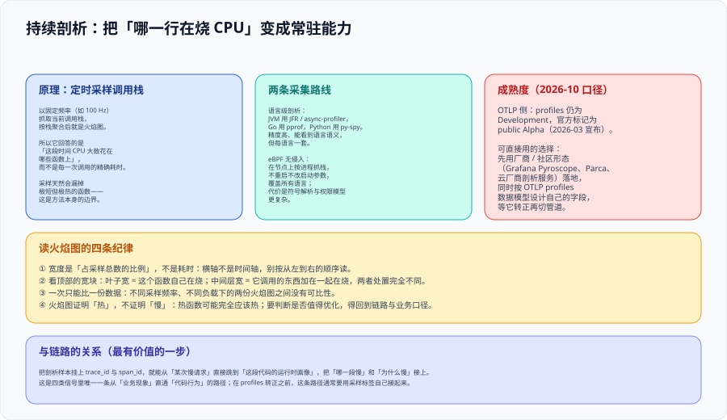

# 持续剖析：第四类信号与火焰图



前三类信号能回答「哪个服务慢、哪一次请求慢」，但回答不了**「这段代码为什么慢」**。持续剖析（Continuous Profiling）补的正是这一环：以固定频率采样运行中的调用栈，长期留在生产环境，把「哪个函数在烧资源」变成一个**可以随时查询的常驻能力**，而不是故障时才临时打开的工具。

::: tip 一句话理解
链路告诉你**哪一段慢**，剖析告诉你**那一行为什么慢**。链路定位到 span，剖析定位到函数——中间那一步是 `trace_id` 挂在剖析样本上。
:::

## 一、四类信号的接力关系

| 信号 | 回答 | 典型问题 |
| --- | --- | --- |
| Metrics | 系统是否健康 | 延迟是否超出止损线 |
| Logs | 具体发生了什么 | 这次请求的报错是什么 |
| Traces | 时间花在哪、错误在哪一跳 | 哪个下游拖慢了整条链路 |
| **Profiles** | 代码运行时怎么花资源 | **哪个函数占了 40% 的 CPU** |

**这里有一条容易忽略的推论**：剖析证明「热」，不证明「慢」。一个函数可能本来就该热（它就是核心计算路径）。所以要判断「值不值得优化」，必须回到链路与业务口径——**剖析提供线索，不提供结论**。

## 二、原理：定时采样调用栈

```text
每 100 Hz（可配）抓一次「当前正在执行的调用栈」→ 按栈聚合 → 得到火焰图
```

由此推出三条必须记住的性质：

1. **它是概率性的**：样本数不够时，差异可能是噪声。要比较两个版本，必须有足够的样本量，并只在同一份数据口径下比较。
2. **它看不到极短但极热的函数**：采样频率决定了时间分辨率下限，低于采样间隔的调用可能被完全漏掉。
3. **它的成本与频率、进程数成正比**：所以「全时开启」是有前提的——需要先算过成本（见 [观测成本治理](../Cost/index.md)）。

## 三、两条采集路线

| 路线 | 代表工具 | 优点 | 代价 |
| --- | --- | --- | --- |
| **语言级剖析** | JVM：JFR / async-profiler；Go：pprof；Python：py-spy | 精度高，能看到语言语义（锁、分配、GC） | 每个语言一套，接入方式与启动参数各不相同 |
| **eBPF 无侵入** | 节点级栈采样（内核态取样，用户态解析符号） | 不重启、不改启动参数；覆盖机器上所有语言 | 符号解析复杂；权限模型与内核版本有要求 |
| **平台化托管** | 云厂商的持续剖析服务 | 免运维、与云资源天然关联 | 语言覆盖有限，采样间隔等参数不可控 |

::: warning 说明：语言级与 eBPF 的选择不是「哪个更好」
- **要查 GC、锁竞争、内存分配**（JVM 侧的常见问题）→ 语言级剖析是必需的，eBPF 拿不到这些语义。
- **要在几十个服务上一次性铺开、且不想改任何启动参数** → eBPF 路线的边际成本最低。
- **常见组合**：eBPF 做**全集群常开**的粗粒度画像，语言级剖析在**被点名的那几个服务**上开细粒度。
:::

## 四、读火焰图的四条纪律

| 纪律 | 含义 | 常见误读 |
| --- | --- | --- |
| **宽度是比例，不是时间** | 横轴是采样占比，不是时间轴 | 按从左到右的顺序读，把火焰图当成时间线 |
| **看顶部宽块** | 叶子很宽 = 这个函数自己在烧；中间层宽 = 它调用的东西加在一起在烧 | 优化中间层的那个「壳函数」 |
| **一次只比一份数据** | 采样频率、负载、进程集合必须相同 | 拿压测期的图和故障期的图对比 |
| **热 ≠ 慢 ≠ 该改** | 热是事实，是否优化是决策 | 看到最宽的块就动手优化 |

::: tip 一个可执行的读图顺序
① 先看**总样本数**是否足够（不足则结论不成立）→ ② 从上往下找**第一个宽度占比超过预期**的分支 → ③ 下钻到叶子，确认是「自己烧」还是「借别人的热」→ ④ 回到链路，确认这个函数是否出现在被投诉的那条链路上 → ⑤ 再决定要不要优化。
:::

## 五、与链路的关联

把剖析样本挂上 `trace_id` 与 `span_id`，才能把「哪一段慢」与「为什么慢」接上——这是四类信号里**唯一一条从业务现象直通代码行为的路径**：

```text
看板：结算接口 P99 抬头
  → 链路：慢在 order-service 的一个内部方法（span 名称给出操作）
  → 剖析：该时间段内，这个 span 对应的栈样本集中在正则编译
  → 结论与动作：把正则提到循环外并缓存
```

::: danger 注意：这条路径目前需要自己接
**OTLP 侧的 profiles 仍为 Development，官方标记为 public Alpha（2026-03 宣布）**，因此：

1. **不要把它放进关键生产链路**（官方原话是与生产关键负载保持距离），先用厂商 / 社区形态落地；
2. **字段设计要提前对齐 OTLP profiles 的数据模型**（基于 pprof 的无损转换、索引式字符串表、样本可携带 trace / span 上下文），等它转正再换管道，避免迁移时重做数据标注；
3. **必须记录当前用的是哪条管道**（厂商私有协议还是 OTLP profiles），否则「为什么这条 profile 关联不到链路」会在半年后成为一个悬案。
:::

## 六、判据定义表

| 判据 | 内容 | 怎么验证 |
| --- | --- | --- |
| `OBP-A` | 剖析结论必须与链路或指标交叉验证，不得单独证明「慢」 | 每条优化决策记录里同时存在链路或指标证据 |
| `OBP-B` | 比较两份剖析数据时，采样频率、负载与进程集合必须一致 | 抽查对比记录中的采集参数是否完全相同 |
| `OBP-C` | 剖析采集频率与进程覆盖范围必须显式配置，且算过成本 | 配置中频率与范围可查；成本估算记录存在 |
| `OBP-D` | 使用 OTLP profiles 时必须记录其稳定性等级与所依赖的版本 | 接入文档中写明 profiles 仍为 Development / Alpha 的核对日期 |
| `OBP-E` | 剖析样本若与链路关联，必须携带 trace / span 上下文 | 从一条链路跳到对应样本，或从样本查到对应链路 |
| `OBP-F` | 火焰图结论必须能落到「函数 + 行」级，不接受「大概是这里」 | 每条优化项都写明函数名与具体位置 |

## 七、与相邻专题的分工

- [HighPerformanceJava · 剖析工具链](../../../Backend/HighPerformanceJava/Profiling/index.md) 讲**单进程、单次调查**的工具用法（JFR、async-profiler、火焰图实操）；本页讲**常驻式的持续剖析平台**与它的边界。
- [性能与容量工程](../../../Ops/PerformanceEngineering/index.md) 讲「一次请求有多快、还能扛多少」；本页讲「慢在哪里、为什么慢」。
- [可观测性 · 后端与存储](../Backends/index.md) 讲剖析后端的选型位置；本页讲信号本身的原理与成熟度。
- 语言侧的采样语法与命令不在本页展开，见对应语言专题。

## 参考资料

- [OpenTelemetry：Profiles 概念页（含稳定性状态）](https://opentelemetry.io/docs/concepts/signals/profiles/)
- [OpenTelemetry Blog：Profiles 进入 public Alpha](https://opentelemetry.io/blog/2026/profiles-alpha/)
- [OTLP Specification：profiles 为 Development](https://github.com/open-telemetry/opentelemetry-specification/blob/main/specification/protocol/otlp.md)
- [Grafana Pyroscope 文档](https://grafana.com/docs/pyroscope/latest/)
- [Parça（开源持续剖析）](https://www.parca.dev/)
- [async-profiler](https://github.com/async-profiler/async-profiler)与 [pprof](https://github.com/google/pprof)
