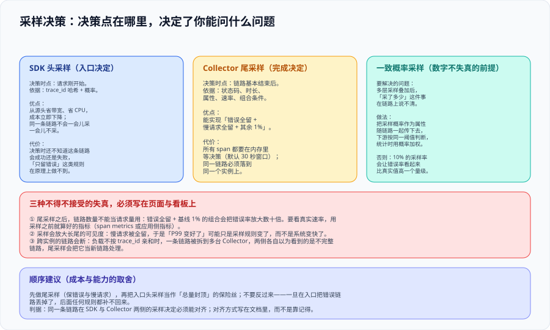

# 采样决策：看到什么，与不能宣称什么



采样是链路侧成本的主要杠杆，也是**唯一一个会改变你能宣称什么的技术决定**。同一个错误率，采样前与采样后可能是两个相差一个量级的数字，而两者都不会报错——这正是本页要解决的问题：**先把「决策在哪一点做」讲清楚，再把「数字怎么不失真」讲清楚。**

::: tip 一句话理解
头采样省的是**带宽与 CPU**，代价是**决策时还不知道这条链路会成功还是失败**；尾采样能实现「错误全留」，代价是**所有 span 都要在内存里等决策**。二者不是二选一，而是**顺序有讲究**：先尾采样，再把头采样当总量封顶的保险丝。
:::

## 一、为什么必须采样

| 维度 | 不采样的后果 | 采样能改善的 |
| --- | --- | --- |
| 应用侧 CPU / 内存 | 每条请求都序列化 span 并发送 | 头采样可立竿见影 |
| 网络与 Collector 负载 | 每跳都要传一次完整属性集 | 头采样 |
| 后端存储与查询 | 存储成本按 span 数线性增长 | 头采样 + 尾采样 |
| **归因能力** | 全量时最强 | 任何采样都是**取舍**：留下什么，就失去了对其他的可见性 |

**采样的本质是「放弃一部分样本，换取成本」**，所以判断采样做得好不好的标准不是「采得少」，而是「**放弃的样本里，有没有本来会用到的那部分**」。

## 二、两个决策点

| | SDK 头采样 | Collector 尾采样 |
| --- | --- | --- |
| 决策时点 | 请求刚开始 | 链路基本结束后 |
| 决策依据 | trace_id 哈希 + 概率（可能叠加父级的采样标记） | 状态码、时长、属性、速率、组合条件 |
| 能看到什么 | 只有入口处的信息（HTTP 方法、路由） | 整条链路的全部 span |
| 成本效果 | 从源头降低带宽与 CPU，最彻底 | 只降低「到后端之后」的存储与查询成本 |
| 内存代价 | 无 | 在飞链路全部驻留内存（`decision_wait` 窗口内） |
| 部署约束 | 无 | 同一链路必须落到**同一个实例** |
| 原理上的极限 | **做不到「只留错误」**——决策时还不知道结果 | 做不到「便宜地过滤未采样链路」——所有 span 都得先送进来 |

::: danger 注意：头采样会「污染」尾采样的可见性
如果 SDK 头采样先丢了 90% 的链路，Collector 侧的错误全留策略最多只能留住**活下来那 10%** 里的错误。于是：

1. **入口的头采样率必须留得足够宽**，让尾采样的策略有意义；
2. **两级的组合效果必须写下来**（例如「入口 50%，尾采样对其余按 5%」），否则半年后没人算得清有效采样率；
3. 一旦在入口丢掉了错误链路，**后面任何规则都补不回来**——这是「先尾后头」这条顺序的根本原因。
:::

## 三、一致概率采样：让数字不失真的前提

多层采样叠加后，「到底采了多少」会在链路上说不清。解决方式是让**采样概率成为链路的一部分**：

| 机制 | 做法 | 解决什么 |
| --- | --- | --- |
| 传递采样标记 | 上游决定采样时，把标记与概率一起传下去，下游按同一阈值判断 | 避免一条链路里一半 span 被留、一半被丢 |
| 一致性哈希 | 用 trace_id 的哈希做概率判断，保证同一 trace_id 在各处得到同一结论 | 分片与多实例环境下结论一致 |
| 概率加权 | 统计时按 `1 / 概率` 加权（或记录有效概率），而不是直接数条数 | 让采样后的**速率类**问题仍然可算 |

::: warning 说明：`hash_seed` 与「一致性」的边界
尾采样处理器早期默认使用固定的哈希种子方案，其「一致」**只在使用相同种子的 Collector 之间成立**；跨团队、跨版本的两层采样器如果用不同种子，概率判断会对不上。

**做法**：在本组件的配置里显式声明一致性语义与种子，并把它作为接入文档的一部分；同时注意「按比例」模式会与上游采样率**相乘**——上游 50% 再叠 50%，剩下的不是 50% 而是 25%。
:::

## 四、尾采样策略的写法

策略之间是**或**的关系：任意一条策略投「保留」，这条链路就留下；如果想表达「除了某类都留」，需要用丢弃类策略显式表达。

```yaml
# processors 片段：错误全留 + 慢请求全留 + 按关键度分档 + 基线抽样
processors:
  tail_sampling:
    decision_wait: 10s            # 取略高于链路耗时 P99，而不是默认的 30s
    num_traces: 100000            # 至少是预期在飞链路数的两倍
    expected_new_traces_per_sec: 1000
    policies:
      - name: keep-errors         # ① 只要出错就留下：这是尾采样存在的首要理由
        type: status_code
        status_code: { status_codes: [ERROR] }
      - name: keep-slow            # ② 慢请求全留：注意阈值来自 SLO，不是拍脑袋
        type: latency
        latency: { threshold_ms: 1500 }
      - name: critical-always      # ③ 关键业务链路：金额、下单相关的服务 100% 留
        type: string_attribute
        string_attribute: { key: service.criticality, values: [critical] }
      - name: baseline-sample      # ④ 基线抽样：保证「正常流量长什么样」仍然可见
        type: probabilistic
        probabilistic: { sampling_percentage: 5 }
```

::: danger 注意：三个会让策略静默失效的写法
1. **`decision_wait` 用了默认值 30 秒但链路 P99 是 40 秒**：链路还没结束就被判定，`latency` 策略永远不会命中——**你的慢请求策略一直是空转的**。
2. **`num_traces` 小于在飞链路数**：最老的链路在决策前被逐出，而它往往正是最慢的那条。表现为「错误能留住、慢请求留不住」这种很反直觉的现象。
3. **策略里用了还没补齐的属性**：例如基于 K8s 标签做分档，而 `k8sattributes` 被放在了尾采样之后——策略永远匹配不上，且不报错。参见 [Collector · 处理器顺序](../Collector/index.md)。
:::

## 五、采样后的三个失真

这三条必须**写进看板说明或页面**，否则一定会有人拿采样后的数字当全量用：

| 失真 | 表现 | 正确做法 |
| --- | --- | --- |
| **错误率被放大** | 错误 100% 留、其余 5%，未加权时错误率会被放大十几倍 | 速率类问题用**采样之前**算好的指标（应用侧指标或 span metrics 连接器） |
| **长尾被高估** | 慢请求全留，于是「P99 变好了」可能只是规则变了 | 分位数与 SLO 口径统一取自指标，不用采样后的链路反推 |
| **链路被截断** | 多副本未按 trace_id 分流时，一条链路被拆成多段 | 检查是否存在 `loadbalancing` exporter 与逐出/迟到 span 指标 |

::: tip 判据
**每个展示采样数据的看板面板，都必须能回答「这个数字的采样率是多少、有没有加权」**。答不出来，就把它标记为「仅供调查使用，不可用于对外结论」。
:::

## 六、判据定义表

| 判据 | 内容 | 怎么验证 |
| --- | --- | --- |
| `OBS-A` | 采样决策点必须显式声明（头 / 尾），并写明两级组合后的有效采样率 | 在接入文档中检索采样配置，能找到两级的概率与乘积结论 |
| `OBS-B` | 尾采样的 `decision_wait` 必须依据链路耗时 P99 设定，不得沿用默认值 | 对比配置值与实测 P99，配置值略大才算过 |
| `OBS-C` | `num_traces` 必须不小于预期在飞链路数的两倍 | 用实测 QPS × P99 估算在飞数，与配置值比较 |
| `OBS-D` | 错误链路与超阈值慢链路必须被 100% 保留 | 制造一条错误链路与一条慢链路，两者都能在后端查到 |
| `OBS-E` | 采样概率必须随链路传播，统计类问题使用采样前指标或加权 | 抽查链路属性含有效概率；看板的分母口径写明来自指标 |
| `OBS-F` | 多副本尾采样前必须按 trace_id 分流，且监控逐出与迟到 span | 检查 loadbalancing 配置；在后端查询逐出 / 迟到计数 |
| `OBS-G` | 采样后的数字若用于对外结论，必须写明采样率与是否加权 | 抽查 3 个面板的说明文本，三处都要写明口径 |

## 七、与相邻专题的分工

- [Collector](../Collector/index.md) 讲管道的结构与处理器顺序；本页专门讲**采样策略本身**以及它对数字口径的影响。
- [监控告警](../../../Ops/Monitoring/index.md) 讲指标与告警的写法；本页只要求「速率类结论不要从采样链路反推」。
- [性能与容量工程](../../../Ops/PerformanceEngineering/index.md) 讲压测与容量；压测时的采样应与生产一致，否则压测结论无法迁移。
- [观测成本治理](../Cost/index.md) 讲成本公式；采样是公式里「数据量」那一项的主要杠杆。

## 参考资料

- [Tail Sampling Processor（策略类型与配置项）](https://github.com/open-telemetry/opentelemetry-collector-contrib/tree/main/processor/tailsamplingprocessor)
- [OpenTelemetry 演示：按服务关键度做尾采样](https://opentelemetry.io/docs/demo/sample-configurations/tail-sampling-service-criticality/)
- [Probabilistic Sampling Processor（头采样与哈希种子）](https://github.com/open-telemetry/opentelemetry-collector-contrib/tree/main/processor/probabilisticsamplerprocessor)
- [Span Metrics Connector（在采样之前把速率算出来）](https://github.com/open-telemetry/opentelemetry-collector-contrib/tree/main/connector/spanmetricsconnector)
- [OpenTelemetry 规范：Sampling](https://opentelemetry.io/docs/specs/otel/trace/tracestate-handling/)
