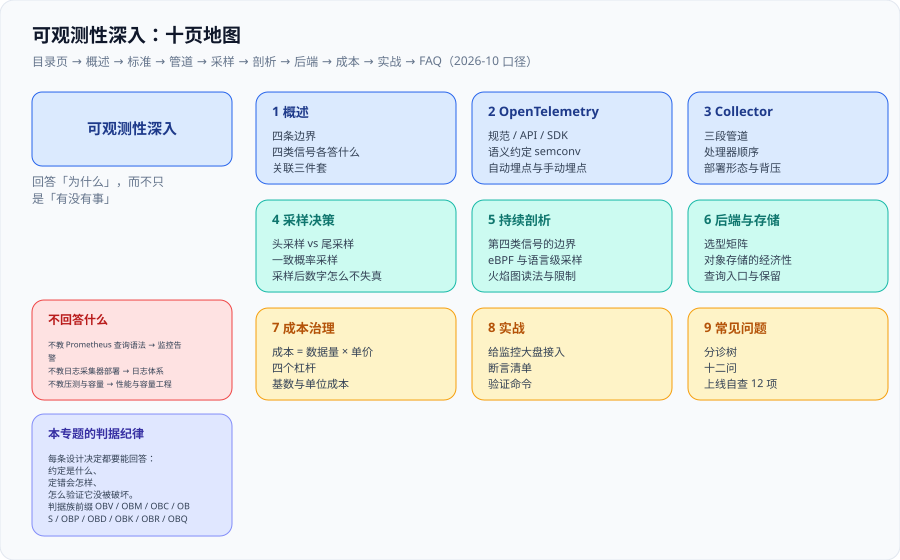

# 可观测性深入

<p style="text-align:center;"></p>



这一页讲的是**当「有没有出事」已经能回答之后，怎么回答「为什么」**。监控告警专题把仪表盘和报警器搭好了：指标怎么采、看板怎么画、告警怎么送到人手里。但一个真实故障的最后一公里往往是——「昨天 14:02 那批下单为什么慢了 3 秒？」「这个函数的 CPU 是谁烧的？」「我看板上的错误率到底是不是真的？」这些问题需要的不是更多指标，而是**一套能把四类观测数据串成一条证据链的工程**。

本专题的主线是 **OpenTelemetry（统一标准）→ Collector（统一管道）→ 采样（决定看到什么）→ 持续剖析（第四类信号）→ 后端与成本**，落地到一条可验证的接入路径。

::: tip 一句话理解
**监控告诉你「现在不正常」，可观测性让你能直接问「哪个请求、哪一行代码、为什么」。** 前者的上限是你事先想到的问题，后者的上限是你手上的上下文有多全。
:::

- [概述：从监控到可观测性的四条边界](Overview/index.md)
- [OpenTelemetry：统一标准与接入](OpenTelemetry/index.md)
- [Collector：管道工程化](Collector/index.md)
- [采样决策：看到什么，与不能宣称什么](Sampling/index.md)
- [持续剖析：第四类信号与火焰图](Profiles/index.md)
- [后端与存储选型](Backends/index.md)
- [观测成本治理](Cost/index.md)
- [实战：给实时监控大盘接入端到端观测](Practice/index.md)
- [常见问题与最佳实践](FAQ/index.md)

## 本专题的判据纪律

本专题每一页都配一张「判据定义表」：每条设计决定都要能回答三件事——**约定是什么、定错会怎样、怎么验证它没被破坏**。判据族前缀与数量如下，便于逐页对照。

| 页面 | 判据族 | 数量 |
| --- | --- | --- |
| 概述：四条边界 | `OBV-A` | 8 |
| OpenTelemetry 接入 | `OBT-A` | 7 |
| Collector 管道 | `OBC-A` | 7 |
| 采样决策 | `OBS-A` | 7 |
| 持续剖析 | `OBP-A` | 6 |
| 后端与存储 | `OBD-A` | 6 |
| 观测成本治理 | `OBK-A` | 6 |
| 实战接入 | `OBR-A` | 6 |
| 常见问题 | `OBQ-A` | 6 |

## 2026-10 版本状态速览

三条编号线互不同步，这是最容易在沟通里出错的地方：规范 1.61 不等于任何组件 1.61。

| 组件 | 版本（核对时间 2026-10） | 状态与要点 |
| --- | --- | --- |
| OpenTelemetry Specification | **1.61.0**（2026-09-14） | 语言无关的行为契约；本版为增量澄清，无 OTLP 报文变更 |
| OTLP（协议） | **1.11.0** | traces / metrics / logs 为 **Stable**；**profiles 为 Development** |
| OpenTelemetry Collector | **0.162.0**（2026-09-28） | 双周发布、**无 LTS**；本版把 `queuebatch` 更名为 `queue_batch`（配置必须同步改） |
| Collector Helm Chart | 0.17x 线 | appVersion 跟随 0.15x~0.16x，与 Collector 版本不是同一个号 |
| OTel Java agent | **2.32.0**（2026-10-06） | 被官方当作 **3.0 的候选版**；语义约定切换会同时改属性名与单位 |
| Jaeger | **2.22.0**（2026-10-06） | v2 基于 Collector 框架；2.21.0 起 ClickHouse 存储转正、移除 v1 HTTP 端点 |
| Grafana Tempo | **3.1.0**（2026-09-29） | 只依赖对象存储；3.0 起微服务模式写入路径改为 Kafka |
| Grafana Pyroscope | **2.4.0**（2026-10-09） | 持续剖析后端，可与 Tempo 的 trace 关联 |
| Prometheus | **3.15.0**（2026-09-25） | 3.13 为 LTS 线（支持至 2027-07-31），约 6 周一个 minor |
| SigNoz | **0.145.0**（2026-10-05） | 四类信号一体，ClickHouse 为存储核心，周更 |

::: warning 说明：为什么这张表要写「核对时间」
本页所有版本事实按 2026-10 的官方发布页核对。**Collector 每两周一个版本、SDK 各有自己的节奏**，任何一行都会在几个月内过期——所以每一页的版本结论后面都带日期，而不是写「当前最新」。这条纪律是本库的硬要求：没有日期的「最新版本」等于没有信息。
:::

## 相关专题与分工

本专题与库内五个相邻专题存在明确边界，**互不替代**：

| 相邻专题 | 它讲什么 | 本专题讲什么 |
| --- | --- | --- |
| [监控告警](../Monitoring/index.md) | 指标体系本身：Prometheus 抓取、Grafana 看板、告警规则与触达 | 指标的**上游**：四类信号怎么产生、怎么关联、怎么采样与治理成本 |
| [日志体系](../LogSystem/index.md) | 日志采集器部署、存储与查询（ELK / Loki） | 日志的**上下文**：怎么把 trace_id 注入结构化字段并反查链路 |
| [性能与容量工程](../PerformanceEngineering/index.md) | 一次请求有多快、这套系统还能扛多少（SLO、压测、容量） | 「慢了之后怎么定位到具体代码」——链路分段与函数级剖析 |
| [微服务 · 链路追踪](../../Backend/Microservices/Tracing/index.md) | 微服务架构里链路追踪的**业务用法**（谁调用了谁） | 追踪的**工程实现**：SDK、传播、采样、后端与成本 |
| [AI 应用观测与评估](../../AI/LLMObservability/index.md) | 模型输出质量、token 与评估成本 | 通用基础设施侧的四类信号；两者可共用 OTLP 管道但语义层不同 |

一句话判据：**要设计一条采集或告警规则，回监控告警；要回答「这条数据为什么没留下、那条链路为什么断了」，来本专题。**

## 建议阅读顺序

```text
Overview（四条边界，先想清楚要不要做）
  → OpenTelemetry（装什么、装哪条线的哪个号）
  → Collector（管道顺序本身就出结论）
  → Sampling（决定你能宣称什么）
  → Profiles（第四类信号的边界与火焰图读法）
  → Backends（选型：先看能不能收 OTLP，再看存储成本模型）
  → Cost（在账单出来之前算一次）
  → Practice（照着接入一遍，跑通 R1~R6）
  → FAQ（排障分诊树）
```

## 与「实时协作与冲突解决」专题的分工（第 151 天补充）

本页给的是工具与方法（Trace、指标、日志、Profiles），[实时协作与冲突解决](../../Backend/RealtimeCollaboration/index.md) 给的是「在协作链路上该看哪几个数」。工具是通用的，指标是场景的：

| 信号 | 本页提供 | 协作场景要看的具体读数 |
| --- | --- | --- |
| 指标 | 采集、聚合、标签设计 | `doc_bytes`、`updates_per_doc`、`ws_connections`、`ack_latency` |
| Trace | 跨服务链路 | 「握手 → 鉴权 → 落库 → 广播」四段的耗时占比 |
| 日志 | 结构化与采样 | 每次变换/合并的 `seq`、`clientSeq`、内容哈希 |
| Profiles | 性能剖析 | 大文档的合并耗时（常见于墓碑未 GC） |

一句话结论：**协作系统的可观测性要能回答「两端为什么不一致」，而不只是「服务有没有 500」。** 所以必须额外采集「内容哈希」与「状态向量」这两类业务读数——它们不在任何标准三件套里。

::: warning 容易混用的一处
「错误率 0」在协作场景里几乎不说明问题：合并错误是「合法但不对」，全程 200。要么加内容哈希对账，要么加「重放幂等」的定时校验，否则这类缺陷永远不进监控。
:::

## 参考资料

- [OpenTelemetry 官方网站](https://opentelemetry.io/)：规范、SDK、Collector、语义约定的唯一权威入口
- [OpenTelemetry Collector Releases](https://github.com/open-telemetry/opentelemetry-collector-releases/releases)：版本与 changelog（双周节奏）
- [OTLP Specification](https://github.com/open-telemetry/opentelemetry-specification/blob/main/specification/protocol/otlp.md)：各信号的稳定性状态
- [OpenTelemetry 语义约定](https://opentelemetry.io/docs/specs/semconv/)：属性命名与稳定性等级
- [Grafana Tempo 文档](https://grafana.com/docs/tempo/latest/)与 [Grafana Pyroscope 文档](https://grafana.com/docs/pyroscope/latest/)
- [Jaeger 文档](https://www.jaegertracing.io/docs/)：v2 架构与存储选型
- [Prometheus 文档](https://prometheus.io/docs/)：指标侧的既有口径（本专题不重复）
- [SigNoz 文档](https://signoz.io/docs/)
