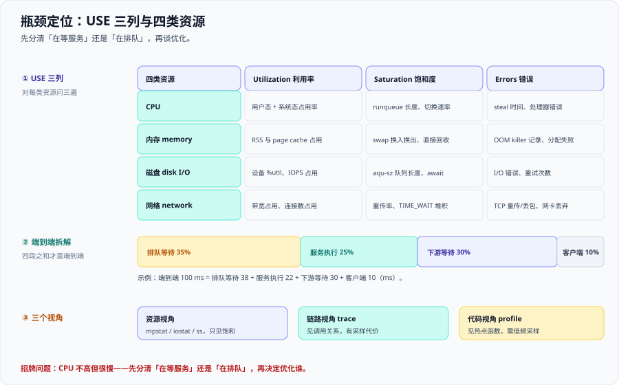

# 瓶颈定位



定位瓶颈的第一步**不是优化，而是先分清「在等服务」还是「在排队」**。这两件事的处置方向完全相反：在排队说明资源不够，加点余量或降到达率就有效；在等服务说明你在等别人，加自己的资源一点用都没有。

这一页给一套**不改代码也能做**的定位流程：USE 三列、四类资源、端到端四段拆解，以及招牌小节「CPU 不高但很慢」的七种原因。压测怎么量、容量怎么算分别见 [压测方法论与工具](../LoadTesting/index.md) 与 [容量规划与弹性](../Capacity/index.md)。

::: tip 一句话理解
「平均延迟 100 ms」不是一个可归因的结论，因为它把**排队等待、服务执行、下游等待、客户端**混成了一坨。**四段之和才是端到端**，先拆开，才知道该动谁。
:::

## 一、USE 方法

**USE（Utilization / Saturation / Errors，利用率 / 饱和度 / 错误）**是对**每一类资源**问同样三个问题：

| 列 | 问的问题 | 判据形态 |
| --- | --- | --- |
| **Utilization 利用率** | 这段时间里，资源有多少比例是忙的 | 百分比，如 CPU 利用率 74% |
| **Saturation 饱和度** | 排队排到什么程度了 | 队列长度、等待时间、被拒绝的比例 |
| **Errors 错误** | 有没有出错 | 计数与速率，如重传、OOM、I/O 错误 |

**利用率是「有没有在忙」，饱和度是「忙不忙得过来」**：一个资源可以在利用率只有 30% 时就已经饱和——磁盘上并发队列排到 8，或线程池 20 个线程全在等下游。**只看利用率会漏掉整个饱和维度。**

### 四类资源 × 三列的信号表

| 资源 | USE 列 | 关键信号 | 看它的命令 |
| --- | --- | --- | --- |
| CPU | Utilization | 用户态 + 系统态占用率 | `mpstat -P ALL 1` |
| CPU | Saturation | runqueue 长度、上下文切换速率 | `vmstat 1`、`pidstat -w 1` |
| CPU | Errors | steal 时间、处理器错误 | `mpstat`、`dmesg` |
| 内存 | Utilization | RSS 与 page cache 占用 | `free -m`、`ps -o rss` |
| 内存 | Saturation | swap 换入换出、直接回收 reclaim | `vmstat 1` 的 `si`/`so` |
| 内存 | Errors | OOM killer 记录、分配失败 | `dmesg -T`、`/var/log/messages` |
| 磁盘 | Utilization | 设备 `%util`、IOPS 占用 | `iostat -xz 1` |
| 磁盘 | Saturation | `aqu-sz` 队列长度、`await` 抬头 | `iostat -xz 1` |
| 磁盘 | Errors | I/O 错误、重试次数 | `dmesg -T`、`smartctl -a` |
| 网络 | Utilization | 带宽占用、连接数占用 | `sar -n DEV 1`、`ss -s` |
| 网络 | Saturation | 重传率、`TIME_WAIT` 堆积、队列溢出 | `netstat -s`、`ss -s` |
| 网络 | Errors | TCP 重传/丢包、网卡丢弃 | `netstat -s`、`ip -s link` |

## 二、等待 vs 服务时间

把一个请求的端到端耗时**拆成四段**，是整页里最省事、也最有用的一步：

| 段 | 含义 | 增大时说明什么 |
| --- | --- | --- |
| **排队等待** | 在网关/线程池/连接池里等一个执行位 | 你在排队：资源不够或被上游灌太多 |
| **服务执行** | 自己的代码在 CPU 上真正跑的时间 | 你在服务：热点在本机，可优化 |
| **下游等待** | 等 RPC / DB / 缓存的返回 | 你在等服务：加自己的资源无效 |
| **客户端** | DNS、握手、请求/响应传输 | 问题不在这台服务器上 |

四段举例：一次「端到端 100 ms」可能是 **排队等待 38 ms + 服务执行 22 ms + 下游等待 30 ms + 客户端 10 ms**。**只有 22 ms 是你自己的**——如果不去拆，你很可能去优化那 22 ms，而真正的大头是 38 ms 的排队。

::: danger 三条拆解纪律
1. **分段必须同一次请求内测量。** 把不同时间窗的「平均排队」和「平均服务」拼在一起，得到的和不是端到端——正确做法是在同一条链路（trace）上取同一请求的四个 span。
2. **服务端耗时不含排队。** `http_request_duration_seconds` 从请求进到你的进程开始计时，**网关排队与连接建立的时间不在里面**。对外口径要写清是服务端还是端到端，见 [SLO 与性能需求](../SLO/index.md)。
3. **四段之和是端到端，不是其中最大的一段。** 排查时容易盯着最大段，但优化掉它之后，端到端未必下降——因为瓶颈会**转移到第二大的那段**。
:::

## 三、三个视角

同一个「慢」，三个视角看到的东西完全不同，必须配合用。

| 视角 | 能看到什么 | 看不到什么 | 代价 |
| --- | --- | --- | --- |
| **资源视角**（mpstat / iostat / ss） | 哪一层在忙、有没有饱和 | 调用关系；不知道慢的请求和哪个资源相关 | 几乎为零，可常年开着 |
| **链路视角**（trace） | 一次请求在客户端→网关→服务→依赖的分段耗时 | 应用内部函数级热点；未采样的请求看不到 | 采样与存储成本，通常 1% 采样 |
| **代码视角**（profile / 火焰图） | 本机 CPU、锁、分配的热点函数 | 跨进程时间，如网络等待、下游耗时 | 需低开销采样，不能全时开启 |

**三者的使用顺序**：先资源视角看哪类资源贴顶（最便宜），再链路视角把慢请求分段摊开（定位「哪一段」），最后才用代码视角看热点函数（定位「哪一行」）。顺序倒过来，你会花大力气优化一个只占 5% 的函数。

## 四、CPU 层

CPU 的五个去处，决定了「忙」到底忙在哪里：

| 指标 | 含义 | 异常信号 |
| --- | --- | --- |
| **用户态（us）** | 应用代码执行 | 高说明有热点计算，可 profile |
| **系统态（sy）** | 内核代你做的工作（系统调用、内存映射） | 持续高说明系统调用过于频繁 |
| **软中断（si）** | 网络/定时器中断处理 | 高说明网络包量大或单网卡打满 |
| **上下文切换（cs）** | 线程被调度换出换入 | 高说明锁竞争或线程过多 |
| **steal（st）** | 虚拟化环境下被宿主机「偷走」的时间 | 非 0 说明邻居在抢你的 CPU |

```shell
mpstat -P ALL 1 5      # 每个核的 us/sy/si/st，看是否有单核打满
vmstat 1 5             # r 列是 runqueue，cs 列是上下文切换
top -H -p <pid>        # 把进程拆成线程，看哪个线程在烧 CPU
```

::: warning CPU 不高 ≠ 有余量
「CPU 才 30%，肯定没到瓶颈」是一个高频误判。CPU 只反映**执行**，不反映**等待**。线程池 200 个线程全在下游那等，CPU 可以是 10%。**CPU 低而延迟高，恰恰是把问题指向「在等服务」的第一条线索。**
:::

## 五、内存层

内存要看四个东西，优先级从高到低：

| 指标 | 看什么 | 命令 |
| --- | --- | --- |
| **RSS** | 常驻内存是否单调上涨（泄漏） | `ps -o rss=`、`free -m` |
| **page cache** | 文件缓存命中是否够，是否反复读盘 | `free -m` 的 buff/cache |
| **swap** | 有没有开始换出（`si`/`so` 非 0） | `vmstat 1` |
| **OOM killer** | 有没有进程被内核杀掉 | `dmesg -T` |

::: danger 「内存看着够但开始 swap」是最容易被忽略的拐点
1. **拐点不在内存耗尽的那一刻，而在第一次 `si`/`so` 非 0 的时候。** 一旦开始换页，后续每次访问都可能踩到缺页，延迟从微秒级跳到毫秒级，而且**不会恢复**——被换出的页要等真的需要时才读回来。
2. **`free -m` 里 available 接近 0 但 cache 很大，是正常的。** Linux 会把空闲内存当 page cache 用；真正要担心的是 available 持续很低**并且** swap 有进出。
3. **容器里更要小心。** 容器看到的是宿主机的 `/proc/meminfo`，限流由 cgroup 决定。正确做法是看 `memory.current` 与 `memory.max`（cgroup v2），别用 `free` 判断容器余量。
:::

## 六、磁盘 IO 层

磁盘层有三个必须分开的概念：**IOPS（每秒操作数）**、**吞吐（B/s）**、**延迟（await ms）**。三者不能只优化一个。

| 概念 | 含义 | 说明 |
| --- | --- | --- |
| IOPS | 每秒能完成多少次 I/O 操作 | 小随机写在机械盘上受寻道限制 |
| 吞吐 | 每秒能搬多少字节 | 顺序大 I/O 看这个 |
| 延迟 | 一次 I/O 的平均耗时（`await`） | 队列一深，延迟立刻升高 |

::: danger 关于 iowait 与 %util 的两个反直觉事实
1. **`iowait` 高不是「磁盘忙」，而是「CPU 在等磁盘」。** 它是 CPU 空闲时间里**有未完成 I/O** 的那部分。所以 `iowait` 高只说明有进程在等 I/O，**不等于磁盘已经到了极限**——磁盘可能很闲，只是这一次 I/O 排队了。
2. **`%util` 到 100% 不等于磁盘饱和。** `%util` 是「设备至少有一个 I/O 在处理的采样比例」。在并发队列下（如 NVMe），`%util` 可以长期贴近 100% 而延迟依然很低。**判断饱和要看 `aqu-sz`（平均队列长度）和 `await`，不是看 `%util`。**
:::

## 七、网络层

网络层要看：

- **带宽**：`sar -n DEV 1`，网卡是否接近链路上限；
- **重传**：`netstat -s` 里的 `retransmitted` 比例，超过 1% 就要查；
- **`TIME_WAIT` 堆积**：短连接过多时端口被占满，`ss -s` 与 `ss -tan state time-wait`；
- **连接数上限**：文件描述符、`somaxconn`、netfilter 连接跟踪表都会先满；
- **MTU 与分片**：隧道/overlay 网络下 MTU 不匹配会导致分片，吞吐骤降且难查。

::: danger 一条最容易被忽略的：本机回环压不出网络瓶颈
`localhost` 走回环接口，**不经过物理网卡**，因此带宽、重传、中断合并这些统统测不到。正确做法：**涉及网络层的压测必须跨机**，把发压机与目标放到不同主机，才能暴露网卡、交换机与 MTU 的问题。同理，容器内 `127.0.0.1` 互调也不会经过 CNI 的完整路径。
:::

## 八、应用层五种高频瓶颈

资源层全绿、但延迟就是高，八成落在这五种上：

| 瓶颈 | 现象 | 一行命令 | 正确处置方向 |
| --- | --- | --- | --- |
| **GC 停顿** | 周期性延迟尖刺，所有请求同时变慢 | `jstat -gcutil <pid> 1000` | 减少大对象与大缓存；必要时换低暂停收集器 |
| **锁竞争** | CPU 不满但吞吐上不去、上下文切换高 | `pidstat -w 1`、`jstack <pid>` | 缩小临界区；改无锁/分段锁；降并发 |
| **连接池耗尽** | 请求卡在获取连接，下游却很闲 | 池的 `active`/`idle`/`waiting` 指标 | 扩池并同步核对下游连接上限；缩短持有时间 |
| **线程池打满** | 队列增长、排队等待飙升 | 池的 `queue_size`、`active` | 限流 + 隔离线程池；区分快慢调用 |
| **下游超时放大** | 你很快，但端到端慢；重试把下游打得更慢 | trace 的下游 span 时长与重试次数 | 设超时 + 熔断 + 退避；别用重试当稳定性手段 |

**连接池过小与线程池过小是两件事**：线程池打满，排队发生在**你的进程内**；连接池耗尽，排队发生在**你的进程与下游之间**。前者加线程有效，后者加线程只会让更多线程一起等连接——判断方法：看等待发生在 acquire 连接之前还是之后。

## 九、「CPU 不高但很慢」的七种原因

这是本页的招牌小节。七种原因的共同点是：**CPU 指标看起来一切正常。**

1. **你在等锁。** 线程处于 blocked 状态，CPU 自然不高，但吞吐被串行化。看 `pidstat -w` 与线程栈里最多的阻塞点。
2. **你在等 GC 停顿（STW）。** 停顿期间所有应用线程都停，CPU 可能不高（并发收集器会占一些核），延迟则整齐地出现周期性尖刺。
3. **你在等下游。** RPC、DB、缓存的耗时计入你的端到端，但不算你的 CPU。看 trace 的下游 span。
4. **你在等连接池。** 池已满，请求在 acquire 上排队；下游其实很闲——**这是「看起来是慢、实际是在排队」的典型**。
5. **你在等磁盘 I/O。** 进程进入 `D` 状态（不可中断睡眠），`iowait` 上升，但应用 CPU 空闲。
6. **你在等 DNS / 服务发现。** 解析超时或缓存失效时，会出现与目标服务无关的延迟尖刺；看解析耗时而不是连接耗时。
7. **你在等网关或负载均衡的队列。** 请求还没到你的进程，服务端耗时指标自然漂亮。**这一种最危险：服务端全绿，用户全慢。** 需要端到端（RUM / 网关）口径才能发现。

**七种原因怎么快速二分**：问一句——**这段时间里，我的线程是在跑，还是在等？** 用 `vmstat` 的 `r`（可运行数）与 `b`（阻塞数）粗略判断：`r` 高说明在跑（排队在 CPU），`b` 高说明在等（排队在资源）。**这一刀切下去，七种可能性立刻减半。**

## 十、定位流程五步

| 步 | 做什么 | 判据 |
| --- | --- | --- |
| **① 确定受影响面** | 是全站、单接口、还是单机房；是延迟还是错误 | 能画出「谁受影响、谁不受影响」的边界 |
| **② 找最慢的一段** | 用 trace 把端到端拆成四段 | 能指出最大的一段占总时长的比例 |
| **③ 区分等待与服务** | `r` 与 `b`、`us` 与 `wa`、`active` 与 `waiting` | 能明确回答「在跑还是在等」 |
| **④ 看资源是否饱和** | 对四类资源逐列看 U / S / E | 能指出哪一层的**饱和度**（不只是利用率）贴顶 |
| **⑤ 改一个变量再测** | 只动一个变量，复测同一个到达率 | 延迟回到阈值内，或确认瓶颈转移到下一段 |

::: danger 第五步不可省：没有复测的定位只是猜测
1. **「应该是这里」不是结论。** 你看到的只是「某指标异常」，与「它是致因」之间隔着一次对照实验。正确做法：**只改一个变量**，在同一到达率下复测，对比 p99 是否回落。
2. **改完没变好，也是有效信息。** 它把这条假设排除了，等于缩小了范围——**别把它当失败，要写进排查记录**。
3. **复测要用同一份负载脚本与同一数据集。** 换了负载，前后不可比，等于没测（纪律见 [压测方法论与工具](../LoadTesting/index.md)）。
:::

## 十一、无侵入观测清单

不改一行代码，能拿到的信息比想象中多：

| 层级 | 能看到什么 | 工具 |
| --- | --- | --- |
| **进程级** | 线程状态、RSS、句柄数、上下文切换 | `top -H`、`ps`、`pidstat`、`cat /proc/<pid>/status` |
| **系统级** | CPU 分布、内存压力、磁盘队列、负载 | `mpstat`、`vmstat`、`iostat`、`sar` |
| **网络级** | 连接状态、重传、队列溢出、端口占用 | `ss -s`、`netstat -s`、`ip -s link` |
| **依赖级** | 下游耗时、连接池/线程池状态（若已导出指标） | 直方图指标、trace 的下游 span |

**无侵入的边界**：无侵入能看到**「哪里慢」**，但通常看不到**「为什么慢」**——回答「为什么」一般需要在热点函数上加 profile（仍有开销）或读线程栈。**先无侵入定范围，再有侵入定函数**，成本最低。

## 十二、实战：p99 从 80 ms 突然涨到 900 ms

背景：`order-api` 的 p99 在发布后 20 分钟内从 80 ms 涨到 900 ms，p50 基本没动，错误率 0.1%。下面是四步定位。

### 第 1 步：确定受影响面

```shell
curl -sG 'http://localhost:9090/api/v1/query' \
  --data-urlencode 'query=histogram_quantile(0.99, sum by (route) (rate(http_request_duration_seconds_bucket[5m])))' \
  --data-urlencode 'time=now' | jq -r '.data.result[] | "\(.metric.route) \(.value[1])"'
```

```text
/api/catalog 0.062
/api/orders  0.902
/api/health  0.004
```

**结论**：只有 `/api/orders`（写路径）受影响，读路径与健康检查正常。**这排除了全局性的资源枯竭**（否则三条都会涨）。

::: warning 一次走错方向的排除过程
第一反应是「网络抖动」。于是查了重传与 `TIME_WAIT`：

```shell
netstat -s | grep -i retrans ; ss -s | head -5
```

```text
    1200 segments retransmitted out of 4200000 segments sent (0.03%)
TCP:   312 (estab 180, closed 90, orphaned 0, timewait 84)
```

**重传 0.03%、`TIME_WAIT` 正常。** 网络这条假设被排除——**注意：排除也要有证据，不能凭直觉跳过**。回到「只有写路径受影响」这个事实，重点转向写路径特有的环节（事务、锁、大对象分配）。
:::

### 第 2 步：找最慢的一段

从 trace 里取同一个慢请求的分段（各段耗时，单位 ms）：

```text
网关排队 6  |  服务执行 872  |  下游等待 12  |  客户端 10   => 端到端 900
```

```shell
# 用 trace 查询接口取一个慢请求的 span 明细（此处以查询本地 trace 存储示意）
curl -s 'http://localhost:16686/api/traces?service=order-api&limit=1&minDuration=800ms' \
  | jq -r '.data[0].spans[] | "\(.operationName) \(.duration/1000)ms"'
```

**结论**：**872 ms 在「服务执行」段，下游只有 12 ms。** 瓶颈在本机，不在下游——加下游资源无效。

### 第 3 步：区分等待与服务

关键一问：这 872 ms 里，线程是在跑，还是在等？

```shell
vmstat 1 3
```

```text
procs -----------memory---------- ---swap-- -----io---- -system-- ------cpu-----
 r  b   swpd   free   buff  cache   si   so    bi    bo   in   cs us sy id wa st
 9  0      0 812340  20480 412000    0    0     4    18  980 1200 61 12 27  0  0
 3  0      0 810112  20480 411000    0    0     2    12  870  900 58 11 31  0  0
```

```shell
top -H -p 4412 | head -5       # 看哪个线程在烧 CPU
jstat -gcutil 4412 1000 5      # 看老年代占用与 Full GC 次数/耗时
```

```text
  S0     S1     E      O      M     CCS    YGC   YGCT    FGC   FGCT     GCT
  0.00  88.10  41.20  99.80  94.10  92.30   812  12.40     9   6.30   18.70
  0.00  88.10  12.30  99.90  94.10  92.30   813  12.41     9   6.30   18.70
```

**结论**：老年代 `O` 长期 99.8%，`FGCT/FGC` ≈ **700 ms/次**。**这是「在等服务」——等的是 GC 停顿**，不是 CPU 排队（`r` 不高、`sy` 也不高）。发布引入的写路径对象把老年代填满了。

### 第 4 步：看资源是否饱和 → 改一个变量再测

只改**一个变量**：把写路径上新引入的对象从堆内缓存移出（或把该缓存容量下调），其余不动，在同一到达率下复测。

```shell
# 复测：同一脚本、同一到达率
k6 run --env RATE=400 k6/order-api.js
```

```text
     http_req_duration..............: avg=44.1ms med=39ms p(95)=108ms p(99)=92ms
     ✓ http_req_duration: p(95)<300, p(99)<800
```

**结论**：p99 回到 92 ms，`FGC` 停止增长。**定位闭环完成**——如果只改这一个变量后 p99 没回落，就说明假设错了，要回到第 2 步。

## 十三、五条易错点

::: danger 五条最常踩的定位坑
1. **把 `iowait` 当磁盘忙**：`iowait` 是「CPU 在等 I/O」，磁盘可能很闲。正确做法：看 `aqu-sz` 与 `await`，并与 `%util` 一起判读。
2. **用平均利用率代替饱和度**：平均 30% 的 CPU 可以有 1 个核长期 100%。正确做法：**按核看**（`mpstat -P ALL`），并看 `runqueue` 与队列长度这类饱和度指标。
3. **把单实例现象当全局**：一台机器上的现象可能只是它自己（宿主机邻居、坏盘、网络路径）。正确做法：先横向对比**同角色的其他实例**，确认是个例还是普遍。
4. **只看服务端**：服务端指标漂亮不代表用户不慢，网关队列、DNS、客户端网络都可能贡献大头。正确做法：同时看端到端口径与网关指标。
5. **拿一次采样当结论**：一次 `top` 未必抓到周期性的 GC 或锁竞争。正确做法：连续采样多个周期（至少覆盖一个业务周期），用**分布**而不是某一次读数下结论。
:::

## 十四、验证方式

### 1. 确认你能回答「在跑还是在等」

```shell
vmstat 1 5 | tail -5
```

预期输出：关注 `r`（可运行进程数）与 `b`（阻塞进程数）两列。**若两者都很低而延迟很高，说明瓶颈既不在 CPU 也不在本机 I/O——直接去看「下游等待」与「网关排队」两段。**

### 2. 确认每一类资源都看了饱和度，不只是利用率

```shell
iostat -xz 1 2 | tail -20      # 看 aqu-sz / await，不要只看 %util
mpstat -P ALL 1 2              # 看是否有单核打满
ss -s                          # 看连接状态分布与 TIME_WAIT 数量
```

预期输出：三条命令各有一段表格。**逐条核对：每一类资源你都能指出「它的饱和度指标现在是多少」；答不出的那一类，就是你排查的盲区。**

## 参考资料

- Brendan Gregg · The USE Method（利用率 / 饱和度 / 错误三问的原始定义与逐资源清单）：https://www.brendangregg.com/usemethod.html
- Brendan Gregg · Linux Performance（性能工具全景图与 60 秒快速排查清单）：https://www.brendangregg.com/linuxperf.html
- Linux man-pages · proc(5)（`/proc/stat`、`/proc/meminfo`、`/proc/diskstats` 各字段含义）：https://man7.org/linux/man-pages/man5/proc.5.html
- Linux man-pages · ss(8)（连接状态统计、`TIME_WAIT` 与队列信息）：https://man7.org/linux/man-pages/man8/ss.8.html
- Google SRE Book · Monitoring Distributed Systems（四黄金信号：延迟、流量、错误、饱和度）：https://sre.google/sre-book/monitoring-distributed-systems/
- OpenTelemetry 官方文档 · Traces（span、父子关系与分段耗时）：https://opentelemetry.io/docs/concepts/signals/traces/
