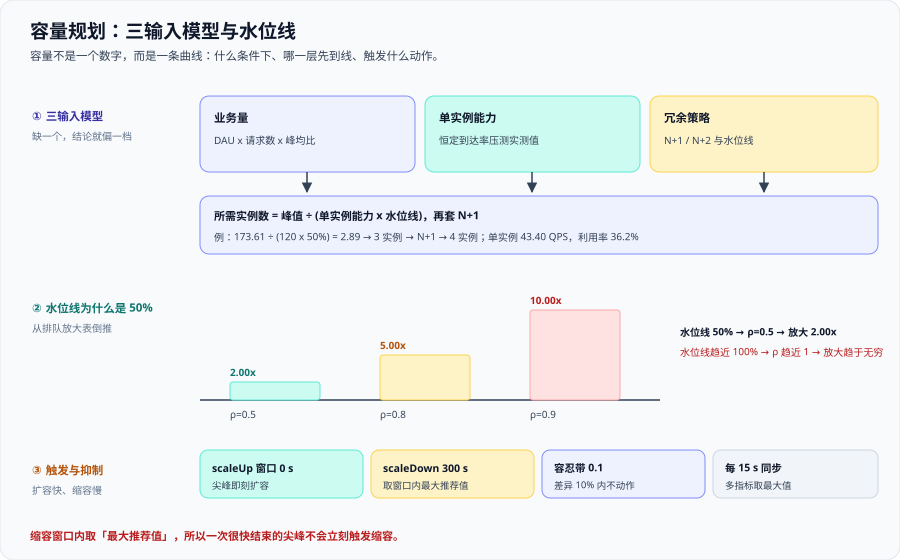

# 容量规划与弹性



容量的输出不是「买多少台机器」，而是**「在什么条件下、哪一层资源先到水位线、触发什么动作」**。一个只能回答「要 4 台」的容量结论是不合格的，因为它没有告诉你**当流量翻倍时先撑不住的是谁**。

这一页把容量从「一个数」变成「一条曲线」：三输入模型 → 逐步算一遍 → 水位线怎么定 → 触发与抑制 → 报告与清单。建模推导见 [定量建模：并发、排队与扩展性](../Modeling/index.md)，单实例能力怎么量见 [压测方法论与工具](../LoadTesting/index.md)。

::: tip 一句话理解
**容量不是一个数字，而是一条曲线。** 这条曲线上至少要有三个点：正常水位、扩容触发点、以及**再往上会先趴下的那一层**。
:::

## 一、三输入模型

容量结论由三个输入决定，缺一个就会偏一档：

| 输入 | 取错的样子 | 后果 |
| --- | --- | --- |
| **业务量** | 用平均负载而不是峰值 | 按平均建容量，峰值一到就排队 |
| **单实例能力** | 用压测最高点，不折算水位线 | 高估能力，实例数偏少 |
| **冗余策略** | 忘记 N+1，或忽略单可用区故障 | 一台挂了就整体过载 |

三者合起来才是结论：`所需实例数 = 峰值 ÷ (单实例能力 × 水位线)`，再按冗余策略向上取整。**注意顺序：先定水位线，再算实例数。** 反过来先定实例数再倒推水位线，等于把延迟放大的代价藏起来。

## 二、逐步算一遍

### 算例 A：从业务量到峰值到达率

已知 10 万 DAU，人均 30 次请求/天：

```text
日均请求数 = 100000 x 30 = 3000000 次/天
平均到达率 = 3000000 / 86400 = 34.72 QPS
峰均比 3  -> 34.72 x 3 = 104.17 QPS
峰均比 5  -> 34.72 x 5 = 173.61 QPS
峰均比 8  -> 34.72 x 8 = 277.78 QPS
```

**关键：容量按峰均比 5（173.61 QPS）建，而不是按平均 34.72 QPS。** 平均只是一个用来对照的基准，它永远不会是你要扛的那个数。

### 算例 B：从峰值到实例数

单实例实测能力 120 QPS（恒定到达率下、延迟仍在阈值内的那一点），按水位线 50% 计：

```text
单实例可用能力 = 120 x 50% = 60 QPS
基础实例数     = 173.61 / 60 = 2.89 -> 向上取整 3 实例
加 N+1 冗余    = 3 + 1 = 4 实例
单实例负载     = 173.61 / 4 = 43.40 QPS
单实例利用率   = 43.40 / 120 = 36.2%
```

**结论：4 实例，单实例 43.40 QPS、利用率 36.2%。** 这里有两个必须写进报告的量：**单实例负载 43.40 QPS**（用来对照水位线）和**利用率 36.2%**（用来判断还有多少余量）。

## 三、水位线为什么是 50% 而不是 100%

水位线不是「留点余量」这么含糊，它有精确的代价函数——**排队放大**。M/M/1 下，等待时间相对服务时间的放大倍数是 `1 / (1 - ρ)`：

| 利用率 ρ | 放大倍数 | 队列中平均排队个数 |
| --- | --- | --- |
| 0.5 | **2.00 ×** | 1 |
| 0.6 | **2.50 ×** | 1.5 |
| 0.7 | **3.33 ×** | 2.33 |
| 0.8 | **5.00 ×** | 4 |
| 0.9 | **10.00 ×** | 9 |
| 0.95 | **20.00 ×** | 19 |
| 0.99 | **100.00 ×** | 99 |

看清这张表就明白了：水位线从 50% 提到 80%，只省下 25% 的机器，代价是**延迟放大从 2.00 倍变成 5.00 倍**；提到 90% 则是 10.00 倍。**水位线不是拍脑袋的 80%，而是从排队放大表倒推的。** 先把你能接受的放大倍数定下来，再反查对应的 ρ。

写容量结论时，「省了几台」和「放大几倍」必须**成对出现**——只给其中一个，等于把取舍藏起来了，这正是水位线最容易被当成「拍脑袋的数」的原因。

## 四、峰值预测

峰值不是「平均乘一个系数」，而是**三重周期叠加**：

1. **日周期**：一天内的波峰波谷（通常晚高峰最高）；
2. **周周期**：工作日与周末的差异；
3. **月/季周期**：月末结算、季度报表这类规律性尖峰。

**取哪一个做容量？用 P99.9，不用均值。** 均值会把尖峰抹平；P99.9 才是「最坏的那 0.1% 时间」的水位。

::: danger 活动型尖峰必须保守外推
1. **按上一轮同类活动的实测峰值 × 1.3 外推。** 促销、开服、发布会这类尖峰没有历史周期可循，只能拿同类活动的实测峰值保守放大；**不要用「上次增长了 20%」这类拍脑袋系数**。
2. **多活动叠加要按相加算，不是按最大的算。** 两个活动同日上线，峰值是两者之和，不是取大者。
3. **外推后要回写进报告并注明依据。** 「1.3 倍」这个系数本身就是可复核的对象，写清来源，下次才能校准。
:::

## 五、扩容触发判据

用三个信号触发扩容，优先级不同：

| 信号 | 观测对象 | 触发特点 | 建议 |
| --- | --- | --- | --- |
| **饱和度** | 队列长度、线程池/连接池占用 | 最早抬头 | **首选**：留出排队前的反应时间 |
| **队列长度** | 待处理请求数、runqueue | 紧随饱和度 | 与饱和度互补 |
| **延迟** | p99 / 阈值计数 | 最晚抬头 | **不作为首选** |

::: danger 为什么「延迟触发扩容」总是太晚
延迟是**最后才涨的**：在排队放大表里，ρ 从 0.5 到 0.8 延迟只放大 2.5 倍，但从 0.8 到 0.99 会放大到 100 倍——**等到 p99 明显上涨，系统早已进入指数区**，此时扩容也来不及在尖峰内生效（扩容本身还要几十秒到几分钟）。正确做法：用**饱和度**触发扩容，把延迟告警留给「已经出问题」的场景。
:::

### 扩容不是无限的：USL 峰值

实例数不是越多越好。按 **USL（Universal Scalability Law，通用可扩展性定律）** `C(N) = N / (1 + α(N−1) + βN(N−1))`，取 α=0.05、β=0.001：

- 峰值点在 **N\* = sqrt((1−α)/β) = 30.82**，数值峰值在 **N=31、C=9.038**；
- C(4)=**3.442**、C(8)=**5.690**、C(16)=**8.040**、C(24)=**8.882**、C(30)=**9.036**；
- 过了峰值：C(48)=**8.562**、C(64)=**7.822**、C(128)=**5.422**；
- 单节点吞吐系数 C(N)/N 依次 **1.0000 / 0.8606 / 0.7112 / 0.5025 / 0.3701 / 0.1784 / 0.0424**。

**读到 0.0424 就该明白：盲目加实例，单节点效率会掉到 4%。** 容量模型里要写明「本系统实测或估算的 USL 峰值在多少节点」——这也是为什么共享数据库、共享锁这类争用会让横向扩容失效。

## 六、HPA 可用配置

以下是可直接使用的 `autoscaling/v2` 配置，含多指标与独立的扩容/缩容行为：

```yaml [k8s/order-api-hpa.yaml]
apiVersion: autoscaling/v2
kind: HorizontalPodAutoscaler
metadata:
  name: order-api
  namespace: prod
spec:
  scaleTargetRef:
    apiVersion: apps/v1
    kind: Deployment
    name: order-api
  minReplicas: 4          # 等于容量算例里的 N+1 结果
  maxReplicas: 12
  metrics:
    - type: Resource
      resource:
        name: cpu
        target:
          type: Utilization
          averageUtilization: 60      # 水位线 50% 的机器口径换算值
    - type: Pods
      pods:
        metric:
          name: http_requests_per_second
        target:
          type: AverageValue
          averageValue: "60"          # 单实例 60 QPS，与算例一致
  behavior:
    scaleUp:
      stabilizationWindowSeconds: 0   # 尖峰即刻扩容
      policies:
        - type: Percent
          value: 100
          periodSeconds: 30
        - type: Pods
          value: 4
          periodSeconds: 30
      selectPolicy: Max               # 两条策略取放大最多的那条
    scaleDown:
      stabilizationWindowSeconds: 300 # 缩容慢：默认就是 300 秒
      policies:
        - type: Percent
          value: 20
          periodSeconds: 60
      selectPolicy: Min               # 两条策略取缩得最少的那条
```

四条判读要点：

1. **多指标取最大值**：CPU 推荐 6 个、QPS 推荐 8 个，最终按 **8** 来——不会「平均一下」。
2. **容忍带默认 0.1**：当前副本数与推荐值差异在 10% 以内时，HPA **不做任何调整**。想让 HPA 更灵敏，调的是这个值，不是同步周期。
3. **控制器默认每 15 秒同步一次**：扩容的滞后来自这里，不是配置哪里写错了。
4. **`ContainerResource` 指标类型可按主容器计算**（排除 sidecar）：sidecar 吃掉的 CPU 不会污染业务容器的口径。

**自定义指标需要适配器**：`Pods` 类型依赖 `http_requests_per_second` 这类自定义指标，通常由 prometheus-adapter 提供；**指标缺失时该条推荐会被跳过**，HPA 退回按 CPU 决策——排障时先确认这条指标真的在。另外，KEDA 内部自建 HPA，**不要再手建 HPA 指向同一 workload**；KEDA 可以缩到 0。

## 七、缩容纪律

- **`stabilizationWindowSeconds` 在缩容方向的工作方式是：HPA 取窗口内推荐副本数的最大值。** 所以一次很快结束的尖峰不会立刻触发缩容——**这是设计如此，不是卡住了**。默认 scale-up 0 秒、scale-down 300 秒。
- **配 `PodDisruptionBudget`（PDB）**：缩容与节点维护都可能同时驱逐多个 Pod，PDB 保证可用副本数不低于阈值。
- **不要同时用手改副本数与 HPA。** 手工改的 `replicas` 会被 HPA 在下一个同步周期覆盖，产生「改了又变回去」的错觉。要临时固定实例数，先停用 HPA。
- **不要手建 HPA 指向 KEDA 管理的 workload。** KEDA 内部自建 HPA，两者会互相打架。

## 八、有状态组件不能用 HPA

HPA 只适合**无状态、可水平复制**的工作负载。数据库、单主集群、缓存集群加副本不会线性提升写能力，反而增加一致性开销（见 USL 的 β 项）。这类组件要做的是**读写分离、分片、连接数治理**，容量按「单主能力 + 只读副本数」单独建。

**连接数公式**：`所需连接数 ≈ 应用实例数 × 每实例并发 ÷ 复用率`。

::: danger 连接池过小的表现是「看起来慢，实际在排队」
假设 4 实例 × 每实例并发 90 ÷ 复用率 3 = **120 个连接**。若下游 `max_connections` 只有 100，那么第 101 个请求开始就在**等待**——服务端指标显示「很闲」，应用的 p99 却一路涨。**这种慢不要优化 SQL，要扩连接池或降低实例数×并发的乘积**，同时核对下游的硬上限。
:::

## 九、存储与保留期容量

以本项目的时序数据实测口径为例，逐步算一遍：

```text
写入速率 = 154.82 B/s
每日写入 = 154.82 x 86400 = 13376448 B ≈ 12.76 MiB/天
15 天保留 = 12.76 x 15 ≈ 191 MiB
每样本约 70 B（即约 2.2 个样本/秒）
```

通用公式：**`总容量 = 每样本大小 × 样本率 × 86400 × 保留天数 × 副本数`**。

::: warning 保留期是容量决策，不是运维偏好
「保留 15 天」这句话背后是一条容量曲线：15 天 = 191 MiB，30 天 ≈ 383 MiB，一年 ≈ 4.7 GiB（单副本）。**改动保留期等于改动容量与成本**，所以它必须写在容量报告里、和其它输入一起评审，而不是某个值班的人在配置里随手调。
:::

## 十、成本三档

| 档位 | 做法 | 代价 | 适用场景 |
| --- | --- | --- | --- |
| **过度预留** | 峰值 × 1.5 的常驻容量 | 账单高、资源长期闲置 | 强 SLA、不可降级的核心链路 |
| **精确** | 按水位线 50% + N+1 精算 | 需要持续维护模型与复核 | 大多数在线服务 |
| **不足** | 按平均负载建容量 | 峰值排队、偶发超时 | 只适合内部工具、可重跑任务 |

**评价容量好坏不看总账单，看单位成本**：每千次请求成本、每 GB 内存承载的 QPS。总账单会随业务量一起涨，单位成本下降才是真的变好。

## 十一、容量报告模板

````markdown [capacity/order-api.md]
# 容量报告：order-api

## 1. 现状
- 当前实例数：4；单实例峰值 43.40 QPS；利用率 36.2%
- 当前水位线：50%；延迟放大 2.00 倍（ρ=0.5）

## 2. 峰值预测
- 日均到达率 34.72 QPS（10 万 DAU x 30 请求/天）
- 峰均比 5 → 峰值 173.61 QPS；活动期按同类实测峰值 x 1.3 外推
- 判据用 P99.9，不用均值

## 3. 单实例能力与依据
- 实测 120 QPS（恒定到达率压测，脚本与配置哈希见附件）
- 水位线 50% → 可用 60 QPS/实例

## 4. 所需实例数与水位
- 173.61 / 60 = 2.89 → 3 实例；N+1 → 4 实例
- 单实例 43.40 QPS，利用率 36.2%

## 5. 触发条件
- 饱和度：连接池占用 > 70% 持续 2 分钟 → 扩容
- 队列长度：待处理队列 > 200 → 扩容
- 延迟：p99 > 800 ms（仅告警，不作为扩容首选）

## 6. 成本
- 每千次请求成本：___；每 GB 内存承载 QPS：___

## 7. 复核周期
- 每季度复核一次；大促前后各一次；架构变更后立即复核

## 8. 责任人
- 服务负责人：___；容量复核人：___
````

## 十二、容量评审清单

- [ ] 业务量用的是**峰值**，不是平均
- [ ] 峰均比有实测依据，不是拍脑袋
- [ ] 单实例能力来自**恒定到达率**压测，且有配置哈希
- [ ] 水位线是从**排队放大表**倒推的，并写明放大倍数
- [ ] 冗余策略是 N+1 还是 N+2 已明确，且覆盖单可用区故障
- [ ] 连接数按 `实例数 × 并发 ÷ 复用率` 算过，且未超下游上限
- [ ] 有状态组件**没有**套用 HPA
- [ ] 扩容用**饱和度**触发，延迟只做告警
- [ ] 缩容窗口与 PDB 已配置，且不会与手工改副本数冲突
- [ ] 保留期与存储容量已按公式算过
- [ ] 单位成本指标已给出，并与上季度对比
- [ ] 复核周期与责任人已写在报告里

## 十三、实战：给 order-api 写一页容量报告

走一遍三输入，产出一页可直接评审的结论：

```text
输入一 业务量      ：10 万 DAU x 30 请求/天 = 34.72 QPS 平均；峰均比 5 → 173.61 QPS
输入二 单实例能力  ：实测 120 QPS；水位线 50% → 60 QPS/实例（依据：恒定到达率压测）
输入三 冗余策略    ：N+1；单可用区故障时仍保留 3 实例可用
--------------------------------------------
结论   ：173.61 / 60 = 2.89 → 3 实例 → N+1 → 4 实例
         单实例 43.40 QPS，利用率 36.2%，延迟放大 2.00 倍
触发   ：连接池占用 > 70% 持续 2 分钟 → 扩容；扩容上限 min(USL 峰值, maxReplicas=12)
护栏   ：缩容窗口 300 s 抑制抖动；PDB 保证可用副本不低于 3
```

**这份报告的三个必读项**：峰值（173.61 QPS）、水位线（50% 对应 2.00 倍）、触发条件（饱和度优先）。缺任何一个，报告就退化成一个孤零零的「4」。

## 十四、五条易错点

::: danger 五条最常踩的容量坑
1. **用平均负载定容量**：平均 34.72 QPS 建的容量，在峰值 173.61 QPS 面前直接排队。正确做法：按**峰值**建，并用 P99.9 而不是均值。
2. **忘记 N+1**：算完 2.89 就买 3 台，一台故障立刻过载。正确做法：基础实例数**先向上取整再加冗余**——2.89 → 3 → 4。
3. **把队列当缓冲**：以为「请求排一会儿队没关系」。正确做法：认清 ρ=0.9 时延迟已经放大 **10.00 倍**，队列不是缓冲，是延迟放大器。
4. **缩容窗口设太短**：为了「省机器」把 `stabilizationWindowSeconds` 调成 30 秒，结果每次尖峰结束都缩容、尖峰再来又扩容，来回抖动。正确做法：保留默认 300 秒，抖动比多几台机器贵。
5. **扩容指标选错**：用延迟触发扩容。正确做法：用**饱和度**触发（最早抬头），延迟只用于告警——延迟涨起来时已经晚了几十秒。
:::

## 十五、验证方式

### 1. 复算三输入，逐项对齐

```shell
python3 - <<'PY'
dau, rpc, peak = 100_000, 30, 5
avg = dau * rpc / 86400
print(f"平均 {avg:.2f} QPS | 峰值 {avg * peak:.2f} QPS")
cap = 120 * 0.5
base = avg * peak / cap
print(f"基础 {base:.2f} -> {int(base) + 1} 实例 -> N+1 -> {int(base) + 1 + 1} 实例")
print(f"单实例 {avg * peak / 4:.2f} QPS | 利用率 {avg * peak / 4 / 120:.1%}")
PY
```

预期输出：`平均 34.72 QPS | 峰值 173.61 QPS`、`基础 2.89 -> 3 实例 -> N+1 -> 4 实例`、`单实例 43.40 QPS | 利用率 36.2%`。**任意一个数对不上，说明输入被改过，先修输入再谈结论。**

### 2. 核对 HPA 的两个方向确实独立

```shell
kubectl get hpa order-api -o jsonpath='{.spec.behavior.scaleUp.stabilizationWindowSeconds}{" / "}{.spec.behavior.scaleDown.stabilizationWindowSeconds}'
```

预期输出：`0 / 300`。**若两个方向的值相同，说明 `behavior` 没被正确应用**——缩容慢、扩容快是这个配置的核心，不能退化成一样。

## 参考资料

- Kubernetes 官方文档 · Horizontal Pod Autoscaling（`autoscaling/v2`、`behavior`、`stabilizationWindowSeconds`、容忍带与多指标取最大值）：https://kubernetes.io/docs/tasks/run-application/horizontal-pod-autoscale/
- Kubernetes API 参考 · HorizontalPodAutoscaler v2（`policies`、`selectPolicy`、`ContainerResource` 指标类型字段定义）：https://kubernetes.io/docs/reference/kubernetes-api/workload-resources/horizontal-pod-autoscaler-v2/
- Kubernetes 官方文档 · Specifying a Disruption Budget for your Application（PDB 与缩容/维护时的可用性下限）：https://kubernetes.io/docs/tasks/run-application/configure-pdb/
- KEDA 官方文档 · Scaling Deployments（KEDA 内部自建 HPA、可缩到 0、不要与手建 HPA 冲突）：https://keda.sh/docs/latest/concepts/scaling-deployments/
- Prometheus 官方文档 · Histograms and summaries（用直方图桶估算分位数与阈值计数，支撑 P99.9 判据）：https://prometheus.io/docs/practices/histograms/
- Wikipedia · Universal Scalability Law（争用 α 与一致性 β 导致的扩容上限）：https://en.wikipedia.org/wiki/Universal_scalability_law
