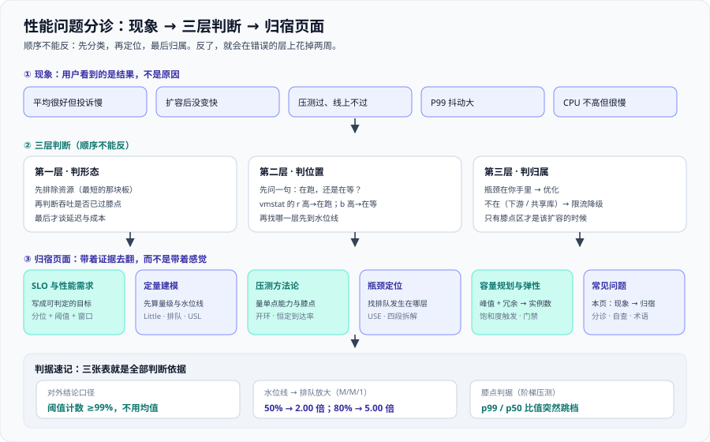

# 常见问题与最佳实践



这一页是本专题的收口。前面六页各自讲一层，这一页只回答一个问题：**当现象摆在你面前、但你还不知道它属于哪一层时，先做什么。** 顺序是先分诊（第一节）、再问答（第二节）、再自查（第三节）、最后用最佳实践、术语与验证收尾（第四~七节）。

::: tip 一句话理解
性能问题里绝大多数「玄学」，本质都是**顺序错了**：先分类，再定位，最后才归属。顺序反了，你会在「延迟调优」上花掉两周，最后发现是数据库连接池只有 20 个。
:::

## 一、现象分诊表：从现象到页

下表按「现象 → 先跑什么 → 最可能的原因 → 去哪一页」组织。**先按这张表走完一圈，再去翻具体页**，能省掉一半排查时间。

| 现象 | 先跑什么（可执行命令） | 最可能的原因 | 去哪一页 |
| --- | --- | --- | --- |
| 平均很好但用户投诉慢 | 按 route 查 P99：`histogram_quantile(0.99, sum by (route) (rate(http_request_duration_seconds_bucket[5m])))` | 尾部被平均抹平：1% 的慢请求把体验拉垮，均值看不出来 | [SLO 与性能需求](../SLO/index.md) + [瓶颈定位](../Bottleneck/index.md) |
| 扩容后没变快 | `vmstat 1 5` 看 `r` / `b`；trace 取一个慢请求的 span | 瓶颈不在你手里（下游 / 共享库），加机器只是把队列挪个地方 | [瓶颈定位](../Bottleneck/index.md) |
| 压测环境达标线上不达标 | 对比数据量、读写比、依赖状态三项是否与线上同量级 | 压测库是空表 / 冷缓存，索引选择性完全不同 | [压测方法论与工具](../LoadTesting/index.md) |
| P99 抖动大、P50 不动 | `pidstat -w 1`、`jstat -gcutil <pid> 1000` | 周期性停顿：GC STW、锁竞争、批任务抢资源 | [瓶颈定位](../Bottleneck/index.md) |
| CPU 不高但很慢 | `vmstat 1 5` 看 `b`；trace 看下游 span | 在等锁 / 连接池 / 下游 / GC——CPU 只反映执行，不反映等待 | [瓶颈定位](../Bottleneck/index.md) |
| 加了缓存更快但数据旧 | 在响应里回显数据的版本号 / 时间戳 | 缓存 TTL 与失效传播窗口，读到了上一版副本 | [总览](../Overview/index.md) |
| 告警天天响但没人处理 | 按燃烧率重算阈值，查错误预算剩余 | 阈值按「绝对值」定，没有绑定错误预算；告警太多等于没有告警 | [SLO 与性能需求](../SLO/index.md) |
| SLO 达标但用户仍不满意 | 核对 SLI 分母是否只算了成功请求、口径是服务端还是端到端 | 分母写错导致达成率虚高；量到的不是用户感受到的那一段 | [SLO 与性能需求](../SLO/index.md) |
| 同一脚本两次压测结果差很多 | 对比配置哈希、数据集规模、发压机资源三行记录 | 变量没锁死 / 环境被共享 / 工具自己先满 | [压测方法论与工具](../LoadTesting/index.md) |
| 内存一直涨 | `ps -o rss=` 连续采样、`vmstat 1` 看 `si` / `so` | 泄漏或缓存无上限；swap 一旦出现不可逆 | [瓶颈定位](../Bottleneck/index.md) |
| 扩容缩容来回抖 | 查看 HPA 两个方向的窗口 | 缩容窗口被调短 / 容忍带没调 / 指标本身在抖 | [容量规划与弹性](../Capacity/index.md) |
| 过载后恢复很慢 | 降回正常到达率，观察 10 分钟的错误率与延迟 | 只测了崩溃点，没测恢复——重启与雪崩恢复都要时间 | [压测方法论与工具](../LoadTesting/index.md) |
| 发布后 P99 突涨、P50 没动 | 按 route 查 P99，再取一个慢请求 trace | 写路径引入大对象（GC）或慢查询，只影响写路径 | [瓶颈定位](../Bottleneck/index.md) |
| 接口慢但数据库很闲 | 看连接池的 `active` / `idle` / `waiting` 与 acquire 等待耗时 | 连接池耗尽：排队发生在你的进程与下游之间 | [容量规划与弹性](../Capacity/index.md) |
| 到某个 QPS 再加压反而不涨 | 看「RPS - 到达率」与「延迟分位 - 时间」两条走向 | 已过膝点或 USL 峰值点，加机器是负收益 | [定量建模](../Modeling/index.md) |
| 不知道从哪一页入手 | 先回答：「我们最核心的链路，多快算够？」 | 答不出「分位 + 阈值 + 窗口」三要素，说明还停在 L0 / L1 | [总览](../Overview/index.md) |

::: warning 分诊的前提
分诊表能用的前提是**你手上有能区分的数据**。至少要能回答三个问题：慢的是全部还是某条 route（按标签分组的 P99）、是在跑还是在等（`vmstat` 的 `r` 与 `b`）、下游等了多久（trace 的下游 span）。三个都答不上来时，**第一件事不是优化，是先把观测点加上**。
:::

## 二、高频十二问

### Q1：平均值能不能当结论？

不能。平均值会把尾部抹平：100 个请求里 99 个 10 ms、1 个 900 ms，均值是 18.9 ms，看着很健康，但那个 900 ms 的用户体验是彻底失败。对外结论只认两种口径——**阈值计数**（`≤ 300 ms 的比例 ≥ 99%`）或**分位数**（`p99 ≤ 300 ms`）。前者能直接当目标，后者只适合当诊断。

**判据**：跑一次阈值计数，输出必须是 0~1 的小数。

```shell
curl -sG 'http://localhost:9090/api/v1/query' \
  --data-urlencode 'query=sum(rate(http_request_duration_seconds_bucket{le="0.3"}[5m])) / sum(rate(http_request_duration_seconds_count[5m]))' \
  | jq -r '.data.result[0].value[1]'
```

预期输出：`0.9987` 这样的数，表示 `≤ 300 ms` 的比例是 99.87%。**这个数才是结论，均值不是。**

### Q2：分位数取 P95 还是 P99？

看承诺强度，不看喜好。P95 覆盖「大多数人的大多数请求」，P99 才是尾部——用 P95 当门槛会放过 1% 的糟糕体验，用 P99 当目标又会让每周的抖动都触发告警。正确组合是：**目标用阈值计数，面板上同时画 P50 / P95 / P99**，短窗口用于告警触发、长窗口用于目标判定，两者分图、不混用。

**判据**：脚本里同时写两条阈值，不达标即非零退出码。

```javascript
'thresholds': { 'http_req_duration': ['p(95)<300', 'p(99)<800'] }
```

### Q3：压测要压多久？

按类型定，不是一个固定时长。**冒烟** 3~5 分钟、**负载** 30~60 分钟、**压力** 每档 5~10 分钟、**稳定性** 数小时至数天。前 1~2 分钟是预热段（类加载、连接池、JIT、缓存冷启动），**不计入统计**；跑够时长再取数。用 10 分钟替代数小时的稳定性测试，测不出慢速泄漏。

**判据**：负载测试的 `duration` 至少覆盖一个完整业务周期（≥ 30 分钟），且报告里标明预热段被剔除。

### Q4：要不要做全链路压测？

先问一句：**瓶颈可能在不在链路下游。** 单接口压测只量「一个实例的能力」，跨服务的排队、限流、连接池耗尽在单机压测里根本暴露不出来。若这条链路要签字，就要做受控的全链路压测，或线上**只读影子流量**（限速、带标记、可随时停）。不做全链路时，至少要能用 trace 把一次请求拆成四段。

**判据**：确认脚本用的是开环执行器，而不是拿并发数冒充负载。

```shell
grep -n "executor\|rate:" k6/order-api.js
```

预期输出：命中 `executor: 'constant-arrival-rate'` 与显式的 `rate` / `timeUnit`。**看到 `constant-vus` 就是闭环，测不出能力点。**

### Q5：排队时间算不算响应时间？

算，但必须写清口径。服务端耗时（`http_request_duration_seconds`）从请求进进程开始计时，**网关排队与连接建立不在里面**；用户感受到的是端到端，包含这些。在移动网络下这一段可以轻松占掉 100 ms 以上。所以 SLO 文档里必须写明量的是服务端还是端到端——**「服务端 P99 是 80 ms」和「用户感受到 80 ms」是两句话。**

**判据**：分段之和必须闭环。

```text
网关排队 + 服务执行 + 下游等待 + 客户端 = 端到端
示例：38 ms + 22 ms + 30 ms + 10 ms = 100 ms
```

对不上，说明你在把不同时间窗的数字拼在一起。

### Q6：SLO 定几个 9 合适？

从用户能感知的差距倒推，不要拍脑袋。对外同步接口 99%（30 天允许 7.2 小时）、内部依赖 99.9%、批处理用「窗口内完成率 ≥ 99.5%」。**目标不能定 100%**：一次抖动就违约，还会逼团队去放宽分母。另外 **SLA 必须比 SLO 松**，两者相等等于没有缓冲。

**判据**：把预算算出来。

```text
错误预算 = 1 - SLO 目标
99% 目标、30 天窗口 → 720 小时 x 1% = 7.2 小时 = 432 分钟
```

### Q7：容量该按峰值还是均值？

按峰值。均值只用来对照，**永远不会是你要扛的那个数**。峰值也不是「均值乘一个系数」，而是日 / 周 / 月三重周期叠加，取 **P99.9**；活动型尖峰按上一轮同类活动实测峰值 **× 1.3** 外推，多个活动叠加时按**相加**算，不是取大者。

**判据**：容量报告里必须出现峰值这一步换算。

```text
日均 34.72 QPS x 峰均比 5 = 173.61 QPS  ← 按这个数建容量
```

### Q8：HPA 是不是容量规划？

不是。HPA 是**弹性执行器**，回答「什么时候加机器」；容量规划回答「需要几台、卡在哪一层水位线、加到多少就不划算」。没有容量模型时开 HPA，只是把「该买多少」的问题变成「抖动多久」的问题。另外**有状态组件不能用 HPA**——加副本不会线性提升写能力。

**判据**：核对两个方向确实独立。

```shell
kubectl get hpa order-api -o jsonpath='{.spec.behavior.scaleUp.stabilizationWindowSeconds}{" / "}{.spec.behavior.scaleDown.stabilizationWindowSeconds}'
```

预期输出：`0 / 300`。**两个值相同，说明 `behavior` 没被正确应用。**

### Q9：三个指标该监控哪几个？

至少同时看三组，缺一组就有盲区：**延迟**（P50 / P95 / P99 + 阈值计数）、**流量与错误**（到达率 + 错误率）、**饱和度**（每一层的队列长度与池占用）。记住优先级：**饱和度最早抬头，延迟最晚抬头**——扩容用饱和度触发，延迟只留给告警。

**判据**：压测结束后四张图都能画出来。缺一张就是盲区。

```text
RPS-时间 | 延迟分位-时间 | 错误率-时间 | 资源-时间
```

### Q10：瓶颈定位先用哪个工具？

按成本从低到高，顺序不能颠倒：先用**资源视角**（`mpstat` / `vmstat` / `iostat` / `ss`）看哪一层贴顶，再用**链路视角**（trace）把慢请求分段，最后才用**代码视角**（profile / 火焰图）看热点函数。顺序反了，你会花大力气优化一个只占 5% 的函数。

**判据**：第一刀只回答一句——在跑，还是在等？

```shell
vmstat 1 5
```

看 `r`（可运行）与 `b`（阻塞）两列：**`r` 高说明在跑（排队在 CPU），`b` 高说明在等（排队在资源）。** 这一刀切下去，「CPU 不高但很慢」的七种可能性立刻减半。

### Q11：水位线为什么是 50%？

水位线来自**排队放大表**，不是「留点余量」。M/M/1 下 `W / Ws = 1 / (1 - ρ)`：ρ = 0.5 时放大 2.00 倍、0.8 时 5.00 倍、0.9 时 10.00 倍。取 50% 是这笔账算完的结果——**从 50% 提到 80% 只省 25% 的机器，却把延迟放大从 2 倍变成 5 倍。**

**判据**：写容量结论时，「省了几台」与「放大几倍」必须成对出现；只给其中一个，等于把取舍藏起来了。

### Q12：压测数据怎么造？

按**生产同量级、同分布**造。空表的查询是骗人的（表里只有 100 行时，全表扫描比走索引还快，测出的延迟与线上毫无关系）；数据倾斜必须放进数据里（让 10% 的键承载大部分访问，才能压出热点行的锁竞争）。一句话：**数据量决定索引选择性，索引选择性决定延迟。**

**判据**：压测库数据量与生产同量级，且统计信息已更新。做不到这两条，容量结论会系统性偏大。

## 三、上线自查清单

清单按「可被机器或人工明确判定」写。**能全勾上再开生产流量。**

- [ ] 最核心的链路已写出「多快算够」：分位 / 阈值 + 统计窗口，这句话能被判定真假
- [ ] SLI 的分母是「全部有效请求」，剔除规则写死并落在文档里
- [ ] 对外承诺的口径已写明：服务端耗时，还是端到端
- [ ] 单实例能力来自**恒定到达率**（开环）压测，不是并发数
- [ ] 压测脚本的通过判据写进 `thresholds`，退出码非零即阻断发布
- [ ] 压测报告表头记录了应用版本、配置哈希、数据集规模、镜像 tag
- [ ] 压测库数据量与生产同量级，且统计信息已更新
- [ ] 压测期间声明独占环境，或使用线上只读影子流量并限速
- [ ] 发压机自身资源已记录，排除了「工具自己先满」的假象
- [ ] 做过一轮超载测试，并记录恢复时间（降回正常到达率后观察 10 分钟）
- [ ] 每轮只改一个变量，复测用同一份脚本与同一数据集
- [ ] 容量按峰值（P99.9 + 峰均比）建，不是按平均负载建
- [ ] 水位线从排队放大表倒推，并写明对应的放大倍数
- [ ] 冗余策略明确为 N+1 还是 N+2，且覆盖单可用区故障
- [ ] 连接数按 `实例数 × 每实例并发 ÷ 复用率` 算过，且未超下游硬上限
- [ ] 扩容用**饱和度**触发，延迟只做告警
- [ ] 有状态组件**没有**套用 HPA
- [ ] 缩容窗口为 300 秒并配了 PDB，且不与手工改副本数冲突
- [ ] 保留期与存储容量已按公式算过，并写进容量报告
- [ ] 单位成本指标（每千次请求成本）已给出，且可与上季度对比
- [ ] 有限流 / 降级 / kill switch 动作，过载时不至于整体崩溃

## 四、最佳实践十二条

每条一句话结论加一句为什么，可以直接当评审清单用。

1. **结论用阈值计数，不用平均值。** 因为均值抹平尾部，而分位数又不能直接求平均——只有「先累加分子分母再求比例」是可聚合的。
2. **一次只动一个变量。** 因为同时改多个变量，涨了也没法归因，结论等于没测。
3. **测容量只用开环（恒定到达率）。** 因为闭环会因协调遗漏系统性低估 P99，**系统越卡，数字越好看**。
4. **目标留预算，别定 100%。** 因为 100% 没有容错空间，还会逼团队去放宽分母。
5. **容量按峰值乘以水位线算，不按均值。** 因为按平均建的容量，峰值一到就开始排队。
6. **先定位排队层，再决定优化还是扩容。** 因为瓶颈不在你手里时，加机器只是把队列挪个地方。
7. **扩容用饱和度触发，延迟只做告警。** 因为延迟最后才涨，等它明显上涨时系统早已进入指数区。
8. **水位线与延迟放大成对写出来。** 因为只给一个数，等于把取舍藏起来了。
9. **压测判据写进脚本、用退出码判定。** 因为人眼会「差不多就行」，退出码不会。
10. **先无侵入定范围，再有侵入定函数。** 因为这样成本最低，也能避免去优化只占 5% 的热点。
11. **数据量决定索引选择性，索引选择性决定延迟。** 因为空表上的延迟与线上毫无关系。
12. **看单位成本，不看总账单。** 因为总账单会随业务量一起涨，只有单位成本下降才是真的变好。

## 五、术语表

本专题最容易望文生义的词。**统一口径是后面所有讨论的前提。**

| 术语 | 一句话定义 | 最容易错的理解 |
| --- | --- | --- |
| **SLI** | 衡量「好不好」的比率：窗口内好事件占总事件的比例 | 分母只算成功请求——达成率永远 100% |
| **SLO** | 内部目标，例如「30 天内 99% 的请求 ≤ 300 ms」 | 定成 100%，或只写一句没有预算策略的口号 |
| **错误预算** | `1 - SLO 目标`，允许的失败额度（99% / 30 天 = 7.2 小时） | 当成「可以用掉 7.2 小时」而不是一种需要管理的资源 |
| **燃烧率** | 当前错误率相对允许错误率的倍数（14.4 / 6 / 1 三档） | 当成绝对值；其实是相对值，与窗口长短无关 |
| **水位线** | 规划时允许达到的最高利用率（如 50%） | 当成「留点余量」；它由排队放大表倒推而来 |
| **峰均比** | 峰值流量与平均流量的倍数（本专题算例取 5） | 当成拍脑袋的系数；它必须有实测依据 |
| **Little 定律** | `L = λ × W`，并发 = 到达率 × 驻留时间 | 用空载平均延迟代入，系统性高估容量 |
| **USL** | 通用可扩展性定律，解释「加机器加到一定程度会变慢」 | 当成 Amdahl——Amdahl 只解释上限，不解释下降 |
| **开环压测** | 控制恒定到达率，到达率与响应时间无关 | 与「恒定并发」混用，测不出能力点 |
| **闭环压测** | 控制恒定并发，响应变慢则发压速率自动下降 | 拿它测容量；得到的是「给定并发下」的延迟分布 |
| **协调遗漏** | 闭环下长停顿只被记成极少数样本，导致 P99 偏低 | 以为它在报错——它不报错，只会让数字变漂亮 |
| **USE 方法** | 对每类资源问三件事：利用率、饱和度、错误 | 只看利用率，漏掉整个饱和度维度 |
| **队列延迟** | 请求在执行位之前排队的等待时间 | 与服务时间混在一起，导致优化方向选错 |
| **尾延迟** | 分布尾部的延迟（P95 / P99 及以后） | 用均值代表整体；尾部恰恰决定用户投诉 |
| **膝点** | 吞吐还在涨、延迟开始超线性上升的拐点 | 把「能扛住」的点当膝点；只有膝点区才该扩容 |
| **饱和度** | 排队排到什么程度（队列长度、等待时间、拒绝比例） | 与利用率混为一谈；低利用率也能已饱和 |
| **阈值计数** | 数出落在阈值内的请求个数求比例 | 与分位数混用；两者不可互相替代 |
| **端到端延迟** | 用户感受到的完整耗时（含网关排队与网络） | 拿服务端耗时当端到端，漏掉入队与传输 |

## 六、验证方式

本页给三条可执行验证，从「最小压测」到「快速冒烟」。**需要本机安装的工具有：`k6`（2.3.0）、`curl`、`jq`；可选 `wrk` 或 `hey`。** 拉指标那条还需要一个可查询的 Prometheus。

### 1. 用 k6 跑一次最小恒定到达率脚本

```javascript [k6/faq-smoke.js]
import http from 'k6/http';
import { check } from 'k6';

export const options = {
  scenarios: {
    smoke: {
      executor: 'constant-arrival-rate', // 开环：到达率与响应时间无关
      rate: 20,                          // 每秒 20 个请求
      timeUnit: '1s',
      duration: '30s',
      preAllocatedVUs: 10,
      maxVUs: 50,
    },
  },
  thresholds: {
    // 通过判据写进脚本：不达标 -> 进程非零退出码
    'http_req_duration{scenario:smoke}': ['p(95)<300', 'p(99)<800'],
    'http_req_failed': ['rate<0.01'],
  },
  // 不显式列出，默认只输出 avg/p95
  summaryTrendStats: ['avg', 'min', 'med', 'p(90)', 'p(95)', 'p(99)', 'max'],
};

export default function () {
  const res = http.get('http://127.0.0.1:8080/api/orders?page=1', {
    tags: { name: 'order-list' },
  });
  check(res, { 'status is 200': (r) => r.status === 200 });
}
```

```shell
k6 run k6/faq-smoke.js ; echo "exit=$?"
```

预期输出（通过时 `checks` 全 `✓`、退出码 0）：

```text
     checks.........................: 100.00% ✓ 600  ✗ 0
     http_req_duration..............: avg=41.3ms med=36ms p(90)=74ms p(95)=98ms p(99)=241ms max=610ms
     http_req_failed................: 0.00%  ✓ 0  ✗ 600
     http_reqs......................: 600 20/s
exit=0
```

不达标时逐行 `✗`，并给出**非零退出码**（CI 里就是这一步变红）：

```text
     ✗ http_req_duration..............: p(95)=412ms
ERRO[0000] thresholds on metrics 'http_req_duration' have been crossed
exit=99
```

### 2. 用 curl 拉一次 SLO 达成率指标

```shell
curl -sG 'http://localhost:9090/api/v1/query' \
  --data-urlencode 'query=sum(rate(http_request_duration_seconds_bucket{le="0.3"}[5m])) / sum(rate(http_request_duration_seconds_count[5m]))' \
  | jq -r '.data.result[0].value[1]'
```

预期输出：`0.9987` 这类 0~1 的小数（表示 `≤ 300 ms` 的比例是 99.87%）。**若输出 `null` 或报错，先确认 `http_request_duration_seconds_bucket` 这个直方图真的在导出**——指标不在，比数值不达标更常见。

### 3. 用 wrk / hey 做一次快速冒烟

```shell
# wrk（需本机已安装 wrk）
wrk -t2 -c20 -d30s --latency 'http://127.0.0.1:8080/api/orders?page=1'
# hey 对照（需本机已安装 hey）
hey -z 30s -c 20 'http://127.0.0.1:8080/api/orders?page=1'
```

预期输出：结尾出现 `Latency`、`Req/Sec` 与分位分布（`50%` / `75%` / `90%` / `99%`），且无 socket 错误。

```text
  2 threads and 20 connections
  Latency Distribution
     50%   36.12ms
     99%  241.07ms
  Requests/sec:   482.31
```

::: danger wrk / hey 只能冒烟，不能测容量
两者都是**闭环**模型（恒定连接数），响应变慢时发压速率会自动下降，因此会因协调遗漏**低估 P99**。它们适合「脚本能不能跑通、接口有没有 500」，**不适合报容量结论**。要测能力点，回到第 1 条的恒定到达率脚本。
:::

## 参考资料

- Google SRE Book · Service Level Objectives（SLI / SLO / SLA 与「目标不要定 100%」的原始论述）：https://sre.google/sre-book/service-level-objectives/
- Google SRE Workbook · Alerting on SLOs（双窗口多燃烧率告警，14.4 / 6 / 1 三档的来源）：https://sre.google/workbook/alerting-on-slos/
- Google SRE Workbook · Managing Load（过载时的排队、拒绝与降级取舍）：https://sre.google/workbook/managing-load/
- Google SRE Book · Monitoring Distributed Systems（四黄金信号：延迟、流量、错误、饱和度）：https://sre.google/sre-book/monitoring-distributed-systems/
- Grafana k6 官方文档 · Thresholds（把性能判据写进脚本、用退出码判定）：https://grafana.com/docs/k6/latest/using-k6/thresholds/
- Grafana k6 官方文档 · Constant Arrival Rate 执行器（开环模型与 `preAllocatedVUs` / `maxVUs`）：https://grafana.com/docs/k6/latest/using-k6/scenarios/executors/constant-arrival-rate/
- Kubernetes 官方文档 · Horizontal Pod Autoscaling（`autoscaling/v2`、`behavior`、容忍带与多指标取最大值）：https://kubernetes.io/docs/tasks/run-application/horizontal-pod-autoscale/
- Brendan Gregg · The USE Method（利用率 / 饱和度 / 错误三问的原始定义）：https://www.brendangregg.com/usemethod.html
- Brendan Gregg · Linux Performance（性能工具全景图与 60 秒快速排查清单）：https://www.brendangregg.com/linuxperf.html
- Wikipedia · Little's law（并发、到达率、驻留时间三者互推）：https://en.wikipedia.org/wiki/Little%27s_law
- Wikipedia · Universal Scalability Law（争用 α 与一致性 β 导致的扩容上限）：https://en.wikipedia.org/wiki/Universal_scalability_law
- Prometheus 官方文档 · Histograms and summaries（直方图桶、分位数与阈值计数）：https://prometheus.io/docs/practices/histograms/
- Vegeta 官方仓库（以恒定速率发送请求的开环压测工具）：https://github.com/tsenart/vegeta
