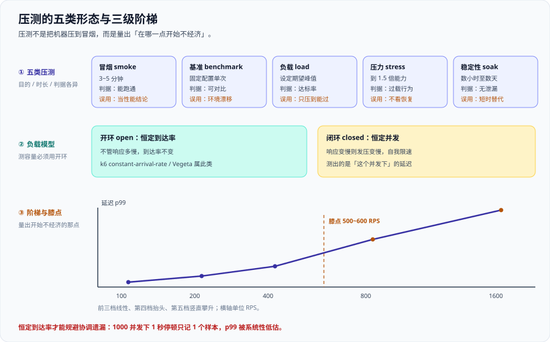

# 压测方法论与工具



压测不是把机器压到冒烟，而是**量出「在哪一点开始不经济」**。它交付的不是一个「最大 QPS」，而是两个位置：**延迟开始发散的那一点**、**错误率开始抬头的那一点**。

这一页讲方法、模型、工具与判读纪律，适用于要给线上服务定容量、写验收单、挂流水线门禁的人。算量与建模的推导见 [定量建模：并发、排队与扩展性](../Modeling/index.md)，目标怎么写成可判定的话见 [SLO 与性能需求](../SLO/index.md)。

::: tip 一句话理解
压测的产出必须是**两条线**：一条是「到达率 → 延迟分位」，一条是「到达率 → 错误率」。只报一个最大值的压测，等于没压。
:::

## 一、压测到底在测什么

压测是一次**受控的极限探索**，它回答三个问题：单实例能力是多少（某到达率下延迟仍在阈值内）、膝点在哪里（再往上收益小于代价）、过载后会发生什么（排队、拒绝还是崩溃）。

一句合格的结论**必须带前缀**：「`order-api` 在 2 核 4 GB、连接池 20 的配置下，到达率 600 RPS 时 p99 为 210 ms；到达率 800 RPS 时 p99 升至 640 ms——**膝点在 600 RPS 附近**」。没有配置、没有分位、没有「开始变差的那一点」，就不是压测结论。

**「压到不报错」是一个危险的成功**：工具不报错，可能只是**工具自己先撑不住了**——发压机 CPU 打满、连接被限，压力根本没上去。所以判读时永远同时看发压侧资源：**发压机自己是不是瓶颈**。

## 二、五类压测

五类压测不是「五种强度」，而是**五个不同的问题**。混用它们，就会得出错误结论。

| 类型 | 目的 | 典型时长 | 通过判据 | 常见误用 |
| --- | --- | --- | --- | --- |
| **冒烟（smoke）** | 确认脚本能跑通、环境可达 | 3~5 分钟 | 请求有响应、无脚本报错 | 拿冒烟的延迟当性能结论 |
| **基准（benchmark）** | 记录一个**可对比**的基线 | 单次固定配置 | 结果可与历史逐项对齐 | 环境变了还拿旧基线比 |
| **负载（load）** | 验证期望峰值下是否达标 | 30~60 分钟 | 达到 SLO 阈值比例 | 只压到「刚好能过」的点就停 |
| **压力（stress）** | 找到过载点并观察行为 | 每档 5~10 分钟 | 过载后能降级/恢复 | 只记录崩溃，不记录恢复时间 |
| **稳定性（soak）** | 暴露泄漏与慢性劣化 | 数小时至数天 | 内存/句柄/连接数不单调上涨 | 用 10 分钟替代数小时 |

**压力测试最容易被跳过的那半段**：价值不在「它崩了」，而在**崩了之后多久能回来**——到达率设到能力的 1.5 倍跑 5 分钟，再**降回正常水平观察 10 分钟**，记录错误率何时归零、延迟何时回到基线、有没有实例需要重启。

## 三、开环与闭环：全页最重要的一次选择

负载模型只有两种，选错一种，数字就系统性偏错：**开环（open model）**控制**恒定到达率**，到达率与响应时间无关，能测出「能力点」（k6 `constant-arrival-rate`、Vegeta 属此类）；**闭环（closed model）**控制**恒定并发**，响应变慢则发压速率自动降低，测出的是「给定并发下」的延迟分布（`constant-vus`、JMeter 线程组属此类）。

### 为什么测容量必须用恒定到达率

闭环模型里，虚拟用户发完一个请求、收到响应、再发下一个；**响应一慢，发压速率自动下降**，工具「体贴」地减少了压力，于是你永远看不到系统真正的过载形态。而真实世界不是这样：用户不会因为你的接口变慢就少点两下。**真实流量是开环的，所以测容量必须用开环。**

### 协调遗漏（coordinated omission）

闭环模型有一个更隐蔽的后果，叫**协调遗漏（coordinated omission）**：当被测系统发生一次长停顿时，工具因为「在等上一个响应」而**不发新请求**，于是这次停顿只被记录成很少的样本。

量化一下：**1000 并发、每用户每 1 秒发一次请求**时，一次持续 **1 秒**的停顿本应影响 **1000 个**请求样本，但在闭环模型里**只会被记录成 1 个样本**。结果就是——**p99 被系统性低估**，系统越卡，数字越好看。

::: danger 协调遗漏的三条硬事实（记不住就会得出错结论）
1. **它不会报错，只会让数字变漂亮。** 一次 1 秒停顿在 1000 并发下被记成 1 个样本，受影响的本应是 1000 个；p99 因此偏低，而且没人会发现。
2. **开环模型天然规避它。** 到达率与响应时间解耦，停顿期间请求照常到达并堆积，延迟被如实记录。Vegeta 以**恒定速率**发送，k6 的 `constant-arrival-rate` 也是开环，两者都天然规避协调遗漏。
3. **不要用「加压到工具报超时」来判断过载。** 正确做法是固定到达率、观察延迟分位与错误率随时间的走向，让判据写在脚本里。
:::

## 四、压测必须锁死的六个变量

压测结论只有在**变量被锁死**时才可复现。下面六个变量，任何一个漂移，前后两次结果就不可比。

| 变量 | 含义 | 漂移后的后果 |
| --- | --- | --- |
| **到达率** | 每秒发起多少请求 | 直接改变负载，结论整体平移 |
| **并发** | 同时在途的请求数 | 影响排队，改变延迟分位 |
| **数据量** | 被查询的数据规模 | 索引选择性变化，延迟级联变化 |
| **读写比** | 读与写各占多少 | 写会带锁与刷盘，放大延迟 |
| **payload** | 请求/响应体大小 | 影响序列化、网络与 GC |
| **依赖状态** | 下游是热缓存还是冷缓存 | 冷缓存下延迟可差数倍 |

**一条铁律：一次只动一个变量**——同时改到达率和数据量，涨了 3 倍延迟，**你无法判断是谁造成的**。按 [Little 定律](https://en.wikipedia.org/wiki/Little%27s_law) L = λ·W 先把并发估出来：200 QPS × 80 ms → **16**；1000 QPS × 50 ms → **50**；500 QPS × 120 ms → **60**；目标 2000 QPS × 平均 45 ms → **90** 并发。压测的 `preAllocatedVUs` 至少不该低于这个数，否则工具会成为瓶颈。

## 五、think time 与 pacing

**think time** 是「一个虚拟用户在两次操作之间的思考等待」；**pacing** 是「两次迭代之间固定间隔多久开始」。

- **浏览器型负载必须给 think time**：真实用户看完页面才会点下一步。不给，等于把用户的浏览时间全压进服务器，测出的是机器最大吞吐，不是用户感受到的负载。
- **API 型负载通常不给 think time**：上游服务调用你的接口时没有「思考」，到达率才是它真实的形态。
- **pacing 与到达率的关系**：`到达率 ≈ 并发 ÷ (服务时间 + think time)`。所以同样是 100 并发，加了 1 秒 think time 后到达率会大幅下降——**并发数不是负载强度**。

**「我开了 500 并发」不是一句负载描述**：500 并发、think time 0、服务 20 ms → 约 **25000 RPS**；同样 500 并发、加 1 秒 think time → 约 **490 RPS**，**相差 50 倍**。所以描述负载时永远说到达率，不说并发数。

## 六、环境与数据的可信度

同一份脚本，在不同环境跑出的数字可信度完全不同。

| 环境 | 可信度 | 代价 | 能得出什么结论 |
| --- | --- | --- | --- |
| **本地** | 低 | 几乎为零 | 只验证脚本语法与逻辑，**不能**报性能数 |
| **预发（隔离同构）** | 中高 | 需要环境与数据准备 | 单实例能力、膝点位置、配置对比 |
| **线上影子流量** | 高 | 需要流量复制与隔离 | 真实流量形态下的容量与过载行为 |

::: danger 数据量这一条，比环境更常被忽略
1. **空表的查询是骗人的。** 表里只有 100 行时，全表扫描比走索引还快，测出的延迟与线上毫无关系。正确做法：压测库的数据量至少与生产**同量级**，并且统计信息要更新过。
2. **数据倾斜要在数据里。** 只放均匀分布的数据，测不出热点行的锁竞争。正确做法：按生产分布构造热门键，让 10% 的键承载大部分访问。
3. **一句话记住：数据量决定索引选择性，索引选择性决定延迟。** 压测库不能是空表——这一条比「机器配置要一样」更重要。
:::

## 七、工具选型

| 工具 | 语言 | 协议面 | 分布式 | 阈值退出码 | 许可 | 一句话适用场景 |
| --- | --- | --- | --- | --- | --- | --- |
| **k6 2.3.0** | JavaScript | HTTP/WS/gRPC | 需 k6 operator 或云版 | **是**（`thresholds` 不达标即非零） | AGPL-3.0 | 脚本化、进 CI、要退出码的默认选择 |
| **Apache JMeter 5.6.3** | Java/Groovy | 最广（JDBC/JMS/...） | 主从模式 | 否（需 Taurus 等包装） | Apache-2.0 | 协议面广、团队已有存量脚本 |
| **Locust 2.46.6** | Python | HTTP/自定义 | 主从模式 | 否（需自行断言） | MIT | 用 Python 写业务逻辑、要读代码即压测 |
| **Gatling 3.15.1** | Scala/Java DSL | HTTP/WS | **开源版不含跨机器编排** | 是（`assertions`） | Apache-2.0 | 高并发单机、报告精美、DSL 表达强 |
| **Artillery 2.0.32** | Node.js | HTTP/WS/Socket.IO | 有限 | 是（`ensure`） | MPL-2.0 | Node 生态、快速写小规模压测 |
| **Vegeta 12.13.0** | Go（单二进制） | HTTP | 无 | 否（管道到 report 自行判断） | MIT | 恒定速率、天然规避协调遗漏 |
| **Grafana Cloud k6** | JavaScript | HTTP/WS/gRPC | **托管分布式** | 是（同 k6） | 商业服务 | 要跨地域大规模施压且不想自建集群 |

::: info 版本与许可（2026-10 口径，已核对）
- k6 **2.3.0**（2026-09-21 发布）；**2.0 于 2026-05-11 GA**，引入 AI 辅助测试流程与 `k6 x agent` / `x mcp` / `x docs` / `x explore` 子命令、扩展目录；**1.0 于 2025-05-06 引入 TypeScript 支持**；许可 AGPL-3.0。
- Apache JMeter **5.6.3**，需 Java 8+，官方推荐 Java 17+；**下一个大版本要求 Java 17+**；许可 Apache-2.0。
- Locust **2.46.6**（2026-09-17 发布），自 **2.46.1（2026-07-21）** 起要求 **Python ≥ 3.11**；许可 MIT。
- Gatling **3.15.1**（2026-05-25）；开源版**不含跨机器编排**，那是 Enterprise 的能力；许可 Apache-2.0。
- Artillery **2.0.32**（MPL-2.0）；Vegeta **12.13.0**（MIT，以**恒定速率**发送）。
:::

## 八、k6 的最小可用示例

这是本页最该照抄的一段：**恒定到达率 + 阈值断言 + 分位统计**三件套齐全。

```javascript [k6/order-api.js]
import http from 'k6/http';
import { check } from 'k6';

export const options = {
  scenarios: {
    // 开环：恒定到达率。测「能力点」，不是「并发点」
    steady: {
      executor: 'constant-arrival-rate',
      rate: 200,            // 每秒发起 200 个请求
      timeUnit: '1s',
      duration: '10m',      // 持续 10 分钟 -> 共 12 万请求
      preAllocatedVUs: 100, // 预留虚拟用户（按 Little 定律估）
      maxVUs: 400,          // 允许临时扩到的上限
    },
  },
  thresholds: {
    // 通过判据写在脚本里：不达标 -> 进程非零退出码
    'http_req_duration{scenario:steady}': ['p(95)<300', 'p(99)<800'],
    'http_req_failed': ['rate<0.01'],
    'checks': ['rate>0.99'],
  },
  // 一定要显式列出来，否则默认只输出 avg/p95
  summaryTrendStats: ['avg', 'min', 'med', 'p(90)', 'p(95)', 'p(99)', 'max'],
};

export default function () {
  const res = http.get('http://127.0.0.1:8080/api/orders?page=1', {
    tags: { name: 'order-list' },
  });
  check(res, {
    'status is 200': (r) => r.status === 200,
    'body not empty': (r) => r.body && r.body.length > 0,
  });
}
```

运行命令：

```shell
k6 run k6/order-api.js
```

预期输出（通过时逐行 `✓`；不通过时逐行 `✗`，并给出**非零退出码**——CI 里就是这一步变红）：

```text
# 通过（退出码 0）
     checks.........................: 100.00% ✓ 240000  ✗ 0
     http_req_duration..............: avg=45.2ms med=38ms p(90)=78ms p(95)=112ms p(99)=286ms max=1.2s
     http_req_failed................: 0.00%   ✓ 0       ✗ 120000
     http_reqs......................: 120000 200/s

# 不通过（退出码非 0）
     ✗ http_req_duration..............: p(95)=412ms
     ✗ http_req_failed................: 3.10%  ✓ 3720 / ✗ 120000
ERRO[0000] thresholds on metrics 'http_req_duration, http_req_failed' have been crossed
```

**为什么把判据放进 `thresholds` 而不是人眼看报告**：人眼会「差不多就行」，**退出码不会**。阈值一旦写进脚本，性能回归就变成流水线门禁：`0` 通过、非 `0` 阻断发布——见 [CI/CD](../../../Tools/CICD/index.md) 里性能门禁该挂在哪一步。

## 九、另外两个工具的最小对照

**JMeter 非 GUI 命令行**（生产压测永远不要开图形界面）：

```shell
# -n 非 GUI；-t 测试计划；-l 结果文件；-e -o 生成 HTML 报告目录
jmeter -n -t plans/order-api.jmx -l results/run.jtl -e -o results/html/
```

预期输出末尾出现 `... summary = ...` 与 `... summary + ...`，并在 `results/html/` 下生成报告。注意 JMeter **原生没有阈值退出码**，要在 CI 里自己判断 jtl，或接 Taurus。

**Locust 无头模式**：

```shell
# 注意：自 2.46.1 起要求 Python >= 3.11
locust --headless -u 100 -r 10 --run-time 5m --csv=results
```

`-u 100` 是**并发用户数**，`-r 10` 是每秒启动 10 个用户。`--csv=results` 会产出四个文件：`results_stats.csv`（聚合统计）、`results_stats_history.csv`（按时间切片，用来画曲线找膝点）、`results_failures.csv`（失败分类）、`results_exceptions.csv`（脚本异常）。

::: warning Locust 的 `-u` 是闭环
Locust 默认是**闭环**模型（恒定并发）。要测容量，得靠自定义 `shape` 把用户数按到达率换算着爬，或者改用开环工具。**别把 `-u 100` 直接当成 100 RPS。**
:::

## 十、如何读结果

压测结束后必须看**四张图**，缺一张就会有盲区。

| 图 | 横轴 | 看什么 | 判据 |
| --- | --- | --- | --- |
| **RPS-时间** | 时间 | 实际发压是否达标（有没有被工具拖住） | 实际 RPS ≈ 目标到达率 |
| **延迟分位-时间** | 时间 | p50/p95/p99 三条线的走向 | p99 是否在某点开始发散 |
| **错误率-时间** | 时间 | 错误是否与时间/负载相关 | 是否越过 1% 阈值 |
| **资源-时间** | 时间 | 哪一层先到水位线 | 最短的那块板是否贴顶 |

**通过判据要写在脚本里，不写在人眼里**：「我觉得曲线还行」不是判据。把 `p(95)<300`、`rate<0.01`、`checks>0.99` 写成 `thresholds`，让**退出码**决定通过与否；人在评审会上只做一件事——**读曲线，解释它为什么长这样**。

## 十一、压测纪律十条

前四条标 **硬纪律**：不做，就会得出**错误结论**（不是「不够好」，是「错的」）。

| # | 纪律 | 说明 |
| --- | --- | --- |
| 1 | **测容量只用恒定到达率**（硬） | 闭环会因协调遗漏低估 p99；结论直接错 |
| 2 | **一次只动一个变量**（硬） | 同时改多个变量，无法归因，结论无效 |
| 3 | **压测库必须有真实量级的数据**（硬） | 空表数据让延迟失真，容量结论偏大 |
| 4 | **压测配置必须记录哈希**（硬） | 配置没记，结论不可复现，也无法定位回归 |
| 5 | 通过判据写进脚本，用退出码判定 | 人眼判读不可复现 |
| 6 | 每轮都记录发压侧资源 | 排除「工具自己先满」的假象 |
| 7 | 预热后再计时，跑够时长再取数 | JIT、连接池、缓存都需要预热 |
| 8 | 先跑基准，再跑负载与压力 | 没有基线，无法判断退化的方向 |
| 9 | 压力测试必须包含恢复观察段 | 只看崩溃看不出可用性 |
| 10 | 结论带前缀（配置 + 分位 + 膝点） | 没有前缀的结论无法被复核 |

## 十二、实战：只读接口的五级阶梯压测

场景：一个只读的 `GET /api/catalog`，要量出它在哪一级开始不经济。

```javascript [k6/ladder.js]
import http from 'k6/http';
import { check } from 'k6';
const RATE = Number(__ENV.RATE || 100); // 用环境变量传档位，五档复用同一份脚本
export const options = {
  scenarios: {
    ladder: {
      executor: 'constant-arrival-rate',
      rate: RATE,
      timeUnit: '1s',
      duration: '5m',
      preAllocatedVUs: Math.max(50, Math.ceil(RATE / 2)),
      maxVUs: RATE * 4,
    },
  },
  thresholds: {
    'http_req_duration': ['p(95)<300', 'p(99)<800'],
    'http_req_failed': ['rate<0.01'],
  },
  summaryTrendStats: ['avg', 'med', 'p(90)', 'p(95)', 'p(99)', 'max'],
};
export default function () {
  const res = http.get('http://127.0.0.1:8080/api/catalog?page=1');
  check(res, { 'status is 200': (r) => r.status === 200 });
}
```

```shell
# 逐档加压，每档 5 分钟；跑完一档立刻看四张图再做下一档
for r in 100 200 400 800 1600; do
  k6 run --env RATE=$r k6/ladder.js
done
```

结果表（同一实例、同一数据集，2 核 4 GB）：

| 档位 | 到达率(RPS) | p50 | p95 | p99 | 错误率 | CPU 利用率 | 判读 |
| --- | --- | --- | --- | --- | --- | --- | --- |
| L1 | 100 | 12 ms | 28 ms | 45 ms | 0% | 22% | 线性区 |
| L2 | 200 | 13 ms | 31 ms | 52 ms | 0% | 41% | 线性区 |
| L3 | 400 | 16 ms | 42 ms | 88 ms | 0% | 74% | 开始抬头 |
| L4 | 800 | 41 ms | 210 ms | 640 ms | 0.3% | 92% | 已过膝点 |
| L5 | 1600 | 380 ms | 1900 ms | 4200 ms | 8.7% | 98% | 已过载 |

**推测膝点落在 500~600 RPS 之间**（L3 与 L4 之间）——这正是「开始不经济」的那一点。

### 怎么从表里读出膝点

1. **看 p99 相对 p50 的放大倍数。** L1~L3 这个比值都在 6 倍以内；L4 一下变成 **15.6 倍**（640 ÷ 41）。**比值突然跳档，就是排队开始主导的信号。**
2. **看利用率与到达率的非线性。** 到达率从 400 翻到 800（2 倍），利用率只从 74% 到 92%，但 p99 涨了 7 倍多。**「投入翻倍、收益不到一半」就是过了膝点。**
3. **看错误率从 0 变成非 0 的第一个点。** L4 的 0.3% 是唯一一个「还能用但已经在漏」的位置，它比 L5 的 8.7% 更有价值——**容量结论要落在「还没崩、但已经不好」的那一档上。**

**阶梯档位为什么按 2 倍递增**：按 2 倍递增（100/200/400/800/1600）能用最少的轮次覆盖 16 倍量程。找到膝点所在区间后，**再在该区间内以 1.25 倍加密**（例如 400 到 800 之间补测 500、600、700）——**阶梯压测是两轮：先粗定位，再细定位**。

## 十三、五条易错点

::: danger 五条最常踩的压测坑
1. **用平均延迟当结论**：「平均 45 ms，性能很好」——平均值会把尾部抹平。正确写法：同时给出 p50 / p95 / p99，并说明「≤ 300 ms 的比例」是多少。
2. **在共享环境里压测**：别人也在跑 CI、跑批任务，你的数字里混着别人的负载。正确写法：用隔离的同构环境，或至少在压测期间声明独占；线上压测必须走只读影子流量并限速。
3. **只压不记录配置哈希**：跑完三周后没人知道当时是哪版配置，回归无法定位。正确写法：把应用版本、配置哈希、数据集规模、镜像 tag 一起写进压测报告的表头。
4. **拿压测数字直接当容量**：压出 800 RPS 不等于能承载 800 RPS。正确写法：`容量 = 单实例能力 × 水位线 × 冗余后实例数 ÷ 峰均比`，换算过程见 [容量规划与弹性](../Capacity/index.md)。
5. **忘记预热与 JIT**：前 30 秒的高延迟来自类加载、连接池冷启动与 JIT 编译，却被当成稳态数据。正确写法：先跑 1~2 分钟预热，**预热段不纳入统计**，且跑够时长再取数。
:::

## 十四、验证方式

### 1. 确认脚本用的是开环执行器

```shell
# 期待输出里出现 constant-arrival-rate，且 rate/timeUnit 已显式给出
grep -n "executor\|rate:\|timeUnit" k6/order-api.js
```

预期输出：`executor: 'constant-arrival-rate'` 一行命中。**若看到 `constant-vus`，说明你用的是闭环，测不出能力点。**

### 2. 确认门禁有效、且结果可复现

```shell
# 阈值故意调到不可能达到，验证退出码；再记录版本与配置哈希，写进报告表头
k6 run --env RATE=200 k6/order-api.js ; echo "exit=$?"
k6 version && git rev-parse --short HEAD && sha256sum config/application.yaml
```

预期输出：第一条命令末尾出现 `thresholds ... have been crossed` 且 `exit=99`（非零）——**先证明它会红，再去调它变绿**；后一条输出三行可粘贴进报告的标识——**没有这三行，这份结果三个月后没人能复现**。

## 与「压测与容量验收」章节的分工（第 148 天补充）

[压测与容量验收](/project/Complete/TeamBoard/CapacityTest/index.md)（属[在线协作任务看板](/project/Complete/TeamBoard/index.md)）是本页方法论的**一次完整落地**，两者分工如下：

| 边界问题 | 归本页 | 归该章节 |
| --- | --- | --- |
| 压测方法与工具选型 | 给开环 / 闭环、执行器与生成器选型、阈值判定机制（k6 `thresholds`） | 只给**四个场景的到达率与混合比例**（写 40 / 读 120 / 拖动 30 / 长连接 1 万） |
| 容量结论怎么表述 | 给「结论必须带前提」这条通用要求 | 给四个具体前提（硬件 / 数据量 / 混合比例 / SLO）与「少了它会怎样」 |
| 瓶颈怎么定位 | 给分层定位的方法与常见误判 | 给该项目**特有**的第 4 层：广播放大系数与出站消息量 |
| 「并发正确性」与「容量」的关系 | 一般性说明两者不可互相替代 | 写死分工的**两个方向**：压测全绿不证明幂等生效；并发一成一败不证明容量够 |

一句话：**本页讲「怎么量」；该章节讲「看板这类带广播扇出的系统，量出来该长什么形状」。**
## 与「数据库参数与内核调优」专题的分工（第 199 天补充）

本页讲**怎么压**：压测方案、并发档位、指标口径、结果怎么解读；「压出来的两组数怎么判成有效还是噪声」归 [数据库参数与内核调优](../../../DB/ParameterTuning/index.md) 的[压测驱动的调参](../../../DB/ParameterTuning/BenchmarkLoop/index.md)。

| 问题 | 本页（怎么压） | 参数专题（怎么判） |
| --- | --- | --- |
| 压测脚本、并发档位、指标采集 | ✅ 讲清 | 直接复用 |
| 两次读数差 2%，算不算优化 | — | ✅ 先测噪声带，再谈幅度 |
| 参数改动的验收判据怎么定 | 给指标口径 | ✅ 给主指标 / 护栏 / 回滚条件 |

**这一页特有的一个坑**：不测噪声带就直接比较两次读数。本机实测（PostgreSQL 18.6，同一容器、同一配置、`pgbench -S -c 8 -T 10` 连跑五次）TPS 分别是 **25,573 / 24,985 / 23,423 / 21,598 / 20,685**——极差 **23.6%**、变异系数 **7.8%**。也就是说：任何小于 8% 的「提升」都需要更多次测量才能分辨；而 10 秒的窗口往往会跨过一次检查点，读数被单个事件支配。

## 参考资料

- Grafana k6 官方文档 · Constant Arrival Rate 执行器（开环模型与 `preAllocatedVUs` / `maxVUs`）：https://grafana.com/docs/k6/latest/using-k6/scenarios/executors/constant-arrival-rate/
- Grafana k6 官方文档 · Thresholds（把性能判据写进脚本、用退出码判定）：https://grafana.com/docs/k6/latest/using-k6/thresholds/
- Grafana k6 官方文档 · Scenarios（开环与闭环执行器的完整清单）：https://grafana.com/docs/k6/latest/using-k6/scenarios/
- Apache JMeter 官方文档 · Getting Started（非 GUI 模式 `-n -t -l -e -o` 命令行用法）：https://jmeter.apache.org/usermanual/get-started.html
- Locust 官方文档 · Running Locust without the web UI（`--headless` 与 `--csv` 四个输出文件）：https://docs.locust.io/en/stable/running-without-web-ui.html
- Vegeta 官方仓库 · 以恒定速率发送请求的开环压测工具（README 与用法）：https://github.com/tsenart/vegeta
