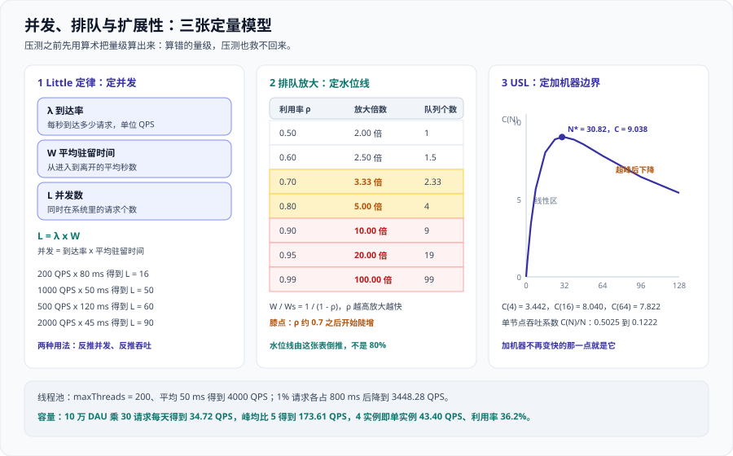

# 定量建模：并发、排队与扩展性



这一页的立场很直接：**在压测之前先用算术把数量级算出来**。算错的量级，压测也救不回来——你只会得到一条「不知道对不对」的曲线。

三张模型分工明确：**Little 定律**定并发，**排队论**定水位线，**USL** 定「加到几个就不能再加」。

## 一、Little 定律 L = λ · W

三个变量，知道任意两个就能推出第三个：**λ（lambda）**是到达率（QPS），**W** 是平均驻留时间（秒），**L** 是并发数（个，即同时存在于系统中的请求数）。它们的关系是一行公式：

```text
L = λ x W
```

| λ 到达率 | W 平均驻留时间 | L 并发数 |
| --- | --- | --- |
| 200 QPS | 80 ms | **16** |
| 1000 QPS | 50 ms | **50** |
| 500 QPS | 120 ms | **60** |
| 50 QPS | 400 ms | **20** |
| 2000 QPS | 45 ms | **90** |

::: tip 两条最常用的用法
1. **由目标吞吐与延迟反推需要多少并发**：目标 2000 QPS、平均延迟 45 ms → 需要 `2000 x 0.045 = 90` 个并发。这就是线程池、连接池的最小规模依据。
2. **由并发与延迟反推实际吞吐**：线程池只有 50 个、平均延迟 120 ms → 实际吞吐上限是 `50 / 0.12 = 416.67 QPS`。达不到目标时先算这一条，比调参数有用。
:::

::: warning 一个必须避开的坑
`W` 是**驻留时间**，不是「空载时接口的耗时」。系统一旦开始排队，`W` 就会变大；而 `L` 是固定的（线程池大小固定），于是 `λ` 必然下降。**这就是「加了并发反而吞吐更低」的数学解释**，下一节算给你看。
:::

## 二、线程池的容量换算

```text
吞吐上限 = maxThreads / 平均服务时间
```

**算例一（干净的平均值）**：`maxThreads = 200`、平均服务时间 50 ms，每个线程每秒处理 `1 / 0.05 = 20` 个请求，200 个线程就是 `200 / 0.05 = 4000 QPS`。

**算例二（加上 p99 的尾巴）**：假设有 **1% 的请求各占 800 ms**（命中慢查询，或下游偶发超时），平均服务时间变成 `50 ms + 1% x 800 ms = 58 ms`，吞吐上限降到 `200 / 0.058 = 3448.28 QPS`。

::: danger 为什么 p99 会拉低「整体」上限
线程池里的线程是**共享资源**。一个请求占着线程 800 ms，其他 199 个线程能干的活就少了一份。按 Little 定律：`L` 固定，`W` 变大，`λ` 只能变小——没有任何调度技巧能改变这个不等式。

1. **隔离**：把慢接口拆到独立线程池，别和快接口抢同一个池。
2. **减时**：把那个 800 ms 慢查询本身优化掉，这是最治本的一条。
3. **扩容同时看水位**：扩容能缓解，但边际收益会被 `W` 的上升吃掉一部分。
:::

协程 / 事件循环的对照：

| 维度 | 线程池（thread pool） | 协程 / 事件循环（coroutine / event loop） |
| --- | --- | --- |
| 并发上限由什么决定 | 线程数量 | 挂起任务数量（受内存与调度开销限制） |
| 单并发内存占用 | 每线程独立栈，通常 MB 级 | 每个任务只保存状态，通常 KB 级 |
| 阻塞式下游调用的影响 | 一个慢调用占住一个线程 | **同样被占住**——阻塞调用会卡死事件循环 |
| 适用前提 | 通用 | 上下游必须是**非阻塞**客户端（异步 IO） |

**协程解决的是「同一时刻能挂起多少等待」，不解决「下游真的很慢」。** 如果数据库驱动是阻塞的，协程数量再多，`W` 还是那个 `W`，`λ` 还是上不去。

## 三、排队为什么不可忽略

单服务台、泊松到达、指数服务的经典模型（M/M/1）下，`ρ` 是利用率、`Ws` 是纯服务时间（没有排队时的耗时），延迟放大倍数是一条公式：`W / Ws = 1 / (1 - ρ)`。

| 利用率 ρ | 延迟放大 W / Ws | 队列中平均等待个数 ρ/(1−ρ) |
| --- | --- | --- |
| 0.50 | **2.00 倍** | 1 |
| 0.60 | **2.50 倍** | 1.5 |
| 0.70 | **3.33 倍** | 2.33 |
| 0.80 | **5.00 倍** | 4 |
| 0.90 | **10.00 倍** | 9 |
| 0.95 | **20.00 倍** | 19 |
| 0.99 | **100.00 倍** | 99 |

::: danger 水位线不是拍脑袋的 80%，而是从这张表倒推的
看 ρ 从 0.70 到 0.90 这一段：利用率只涨了 0.2，延迟放大从 3.33 倍涨到 10.00 倍。曲线开始拐弯的位置叫**膝点（knee）**。

水位线的定义因此是：**在你选定的水位之上，延迟放大倍数还不超过你能接受的上限。**

1. 若要求「P99 不超过服务时间的 3 倍」→ 水位取 0.70。
2. 若允许 5 倍 → 水位可以取到 0.80。
3. 取 0.90 意味着你默认接受 **10 倍**放大，那么压测测到的延迟必须是放大后的值，不是空载值。

**「我们按 80% 水位规划」这句话本身没有信息量，除非你同时说出「80% 对应 5.00 倍放大，可接受」。**
:::

**为什么水位线按「平均」看、规划时却按「峰值」算**：公式里的 ρ 是平均利用率，而峰值瞬间的利用率远高于平均值。这正是容量规划要用**峰均比**把平均值放大成峰值、再让峰值落在水位线以下的原因。用平均利用率直接对照这张表，会系统性低估排队。

## 四、USL（通用可扩展性定律）

**USL（Universal Scalability Law，通用可扩展性定律）**回答 Amdahl 定律答不了的问题：**为什么加机器加到一定程度，吞吐会开始下降**。它的形式是 `C(N) = N / (1 + α(N - 1) + βN(N - 1))`。

| 系数 | 名称 | 物理含义 | 对曲线的影响 |
| --- | --- | --- | --- |
| **α**（alpha） | 争用（contention） | 必须串行化的部分，例如抢锁、抢连接 | 使增长变慢，但**不会**导致下降 |
| **β**（beta） | 一致性（coherency） | 节点间的同步、缓存失效、共识开销 | **会导致下降**——成本随节点数**平方**增长 |
| **N** | 并行度 | 进程 / 线程 / 实例的有效并行数 | 曲线横轴 |

取 `α = 0.05`、`β = 0.001`，理论峰值点是 `N* = sqrt((1 - α) / β) = sqrt(0.95 / 0.001) = 30.82`。

| N | C(N) | C(N)/N 单节点吞吐系数 |
| --- | --- | --- |
| 4 | **3.442** | 0.8606 |
| 8 | **5.690** | 0.7112 |
| 16 | **8.040** | 0.5025 |
| 24 | **8.882** | 0.3701 |
| 32 | **9.034** | 0.2823 |
| 48 | **8.562** | 0.1784 |
| 64 | **7.822** | 0.1222 |
| 96 | **6.456** | 0.0672 |
| 128 | **5.422** | 0.0424 |

其余关键点：`C(30) = 9.036`、数值峰值为 `N = 31` 时 `C = 9.038`、`C(40) = 8.869`。

::: warning 两条判据（USL 只需要记住这两条）
1. **加机器不再变快的那一点**：C(N) 的极大值点。从 16 个并行度加到 31 个（C 从 8.040 到 9.038），收益只有 12.4%。
2. **超峰点后吞吐会下降**：N = 32 时 C = 9.034，N = 48 时是 8.562，N = 128 时只剩 5.422。**加机器是负收益**，而且这不是「不稳定」，是模型预测的正常行为。
:::

## 五、Amdahl 与 USL 的区别

| 维度 | Amdahl 定律 | USL |
| --- | --- | --- |
| 建模的阻碍 | **串行比例**（serial fraction） | **争用 α + 一致性 β** |
| 曲线形状 | 单调上升，**渐近于上限** | 上升 → 到峰 → **下降** |
| 能否解释「加机器变慢」 | **不能** | 能 |
| 适用场景 | 纯计算并行化（批处理分片、编译并行） | 有共享状态的系统（数据库、缓存、有协调者的集群） |
| 典型用法 | 判断「理论上限在哪」 | 判断「最优并行度在哪」 |

| Amdahl 参数 | 结果 |
| --- | --- |
| p = 0.8，s → ∞ | **5.000 倍** |
| p = 0.8，s = 4 | **2.500 倍** |
| p = 0.95，s → ∞ | **20.000 倍** |
| p = 0.95，s = 8 | **5.926 倍** |
| p = 0.99，s → ∞ | **100.000 倍** |

**Amdahl 只解释「上限」不解释「下降」**：它的模型里没有「节点之间要互相沟通」这一项，只要把串行部分压得足够小，并行度可以无限增加、收益无限接近 `1 / (1 - p)`。真实系统里每多一个节点就多一份同步成本，USL 的 β 项正是在补这一条。

::: tip 选用原则
**离线批处理、无共享状态的并行计算：用 Amdahl。线上服务、共享数据库、有协调者的集群：用 USL。** 判断标准是问一句「多一个节点，会不会多一次跨节点同步」——会就用 USL。
:::

## 六、吞吐与延迟的三种关系形态

| 区间 | 现象 | 能否再加流量 | 该不该扩容 | 过载时的正确行为 |
| --- | --- | --- | --- | --- |
| **线性区** | 延迟基本不变，吞吐随负载线性上升 | **能** | 不需要，先看水位线 | 不适用 |
| **膝点区** | 吞吐还在涨，延迟开始超线性上升 | 谨慎，先算排队放大 | **该扩**——扩容唯一的正确时机 | 开始限流，保住已有请求 |
| **崩溃区** | 吞吐不涨反跌，延迟发散甚至超时雪崩 | **不能** | 扩了也来不及（等实例就绪） | **拒绝**或快速失败，比排队好 |

::: danger 崩溃区最危险的认知偏差
崩溃区的现象是「延迟涨了、错误率也涨了」，直觉会指向「服务有缺陷，去查代码」，但根因是**负载超过了能力点**，代码没变。

**判据：如果错误率随到达率单调上升，且降回原到达率后自动恢复，那就是容量问题，不是缺陷。**
:::

## 七、排队发生在哪一层

端到端延迟是各段之和，**最慢的一段决定体验**。找到排队位置比优化任何单层都重要。

| 层 | 可见信号 | 队列满时的表现 |
| --- | --- | --- |
| **入口网关** | 连接数、排队请求数、`499` / 限流响应码 | 直接拒绝新连接，返回 503 或 429 |
| **应用线程池** | 活跃线程数、队列长度、拒绝计数 | 抛拒绝异常，或队列无限增长直到 OOM |
| **数据库连接池** | 等待获取连接的耗时、池内空闲数 | 获取连接超时；**数据库本身很闲** |
| **下游 RPC** | 调用耗时分布、超时率、重试率 | 超时后重试，进一步放大下游负载 |
| **磁盘** | IO 等待时间、队列深度 | 写放大、fsync 变慢，表现为「偶发卡顿」 |
| **网络** | 重传率、RTT 分位、带宽占用 | 丢包重传，延迟呈锯齿状波动 |

三个最容易误判的地方：**连接池排队**表现为「接口慢」但数据库 CPU 只有 15%，要先看池的等待耗时；**下游排队**表现为「我们慢」但我们所有指标都正常，要看下游的超时率与重试率；**磁盘排队**表现为「偶发、不可复现的卡顿」，要看 IO 等待时间而不是 IOPS。

## 八、重试放大

重试是**正反馈**：下游越慢，重试越多；重试越多，下游越慢。

设定 1000 个并发用户、每人每 1 秒发一次请求（1000 QPS），下游超时阈值 1 秒，客户端 / 网关 / SDK **各配置一次重试**：

```text
单次用户请求在下游产生的最大调用次数 = 2 x 2 x 2 = 8 次
下游全挂时看到的负载 = 1000 x 8 = 8000 QPS（放大 8 倍）
只有 20% 请求失败时 = 1000 x (0.8 x 1 + 0.2 x 4) = 1600 QPS（放大 1.6 倍）
```

::: danger 重试放大必须配的三样东西
1. **退避（backoff）**：间隔随次数增长。立刻重试等于给已经过载的下游再补一刀。正确写法：指数退避，如 100 ms、200 ms、400 ms。
2. **抖动（jitter）**：在退避间隔上加随机量，避免所有客户端在同一毫秒同时重试。正确写法：`sleep = base x 2^n x random(0.5, 1.5)`。
3. **预算**：给重试总量设上限（如「重试量不超过总请求量的 10%」）。正确写法：按**调用方维度**限制总量，不是只按单次请求限制次数。
:::

## 九、可运行的估算脚本

```python [scripts/estimate.py]
"""容量估算：从 DAU 推到实例数。用法：python3 scripts/estimate.py [水位线]"""
import math
import sys

DAU = 100_000                 # 日活用户数
REQ_PER_DAY = 30              # 每用户每天请求数
SECONDS_PER_DAY = 86_400
PEAK_FACTORS = (1, 3, 5, 8)   # 峰均比候选
CAPACITY_PER_INSTANCE = 120.0 # 单实例实测能力（恒定到达率测得）
SPARE_INSTANCES = 1           # N+1 冗余

def report(watermark: float, peak_factor: int = 5) -> None:
    per_day = DAU * REQ_PER_DAY
    avg_qps = per_day / SECONDS_PER_DAY
    print(f"日均请求 = {DAU} x {REQ_PER_DAY} = {per_day} 次/天")
    print(f"平均 QPS = {per_day} / {SECONDS_PER_DAY} = {avg_qps:.2f}")
    peaks = {f: avg_qps * f for f in PEAK_FACTORS}
    for f in PEAK_FACTORS:
        print(f"  峰均比 {f} 峰值 {peaks[f]:.2f} QPS")
    peak = peaks[peak_factor]
    usable = CAPACITY_PER_INSTANCE * watermark
    need = peak / usable
    base = math.ceil(need)
    total = base + SPARE_INSTANCES
    per_instance = peak / total
    utilization = per_instance / CAPACITY_PER_INSTANCE
    print(f"单实例 {CAPACITY_PER_INSTANCE:.0f} QPS，水位 {watermark:.0%} 可用 {usable:.0f} QPS")
    print(f"需要实例 = {peak:.2f} / {usable:.0f} = {need:.2f} 向上取整 {base}")
    print(f"加 N+{SPARE_INSTANCES} 冗余 {total} 实例")
    print(f"单实例负载 = {peak:.2f} / {total} = {per_instance:.2f} QPS")
    print(f"利用率 = {per_instance:.2f} / {CAPACITY_PER_INSTANCE:.0f} = {utilization:.1%}")

if __name__ == "__main__":
    watermark = float(sys.argv[1]) if len(sys.argv) > 1 else 0.50
    print(f"=== 水位线 {watermark:.0%} ===")
    report(watermark)
```

执行 `python3 scripts/estimate.py`，预期输出：

```text
=== 水位线 50% ===
日均请求 = 100000 x 30 = 3000000 次/天
平均 QPS = 3000000 / 86400 = 34.72
  峰均比 3 峰值 104.17 QPS
  峰均比 5 峰值 173.61 QPS
  峰均比 8 峰值 277.78 QPS
单实例 120 QPS，水位 50% 可用 60 QPS
需要实例 = 173.61 / 60 = 2.89 向上取整 3
加 N+1 冗余 4 实例
单实例负载 = 173.61 / 4 = 43.40 QPS
利用率 = 43.40 / 120 = 36.2%
```

## 十、实战：给定 SLO 反推并发与实例数

设定 SLO：**峰值 2000 QPS、平均延迟不超过 45 ms、`≤ 300 ms` 的比例不低于 99%**。走一遍完整推导。

| 步骤 | 计算 | 结果 |
| --- | --- | --- |
| ① 用 Little 定律求并发 | `2000 x 0.045` | **90 并发** |
| ② 线程池校验（平均 50 ms） | `200 / 0.05` | 理论上限 **4000 QPS** |
| ③ 线程池校验（含 1% 的 800 ms 尾巴） | `200 / 0.058` | 实际上限 **3448.28 QPS** |
| ④ 线程池占用率 | `2000 / 3448.28` | **58.0%**，尚有空间 |
| ⑤ 单实例可用能力 | `120 x 0.50` | **60 QPS** |
| ⑥ 基础实例数 | `2000 / 60 = 33.33` → 向上取整 | **34 实例** |
| ⑦ 加 N+1 冗余 | `34 + 1` | **35 实例** |
| ⑧ 复核单实例负载 | `2000 / 35` | **57.14 QPS** |
| ⑨ 复核利用率 | `57.14 / 120` | **47.6%**，低于 50% 水位线 |

::: tip 第 ⑨ 步才是收尾
如果 ⑨ 的结果高于水位线，说明取整与冗余后仍然不够，**要回到 ⑥ 再加一个实例**。取整方向错了 1 个实例，水位线就破了。
:::

**90 个并发，为什么线程池要 200 个**：Little 定律算出的 90 是**平均并发**，不是峰值。线程池必须覆盖帕累托效应（少数请求占用时间长）、GC 与慢查询造成的抖动、以及重试与超时的叠加。经验规则是取平均并发的 2 倍左右，再用压测验证峰值时的队列长度。

## 十一、四条易错点

::: danger 四条最容易算错的建模细节
1. **把 CPU 利用率当能力**：CPU 只跑到 30% 不等于还有 70% 余量。正确做法：逐层量水位线（线程池占用、连接池等待、下游配额、磁盘 IO），**最短的那块板**才是能力上限。
2. **用平均延迟代入 Little 定律**：空载平均值会系统性高估容量。正确做法：代入**压测中实测的驻留时间**（含排队），或目标水位下的实测值。
3. **忽略重试放大**：`1000 QPS x 0.2 失败 x 4 次重试` 就是 1.6 倍放大，三层叠加最坏到 8 倍。正确做法：把重试放大系数显式写进容量参数，并配退避、抖动与重试预算。
4. **用「加机器」当默认答案**：在 USL 峰点右侧加机器是负收益；排队瓶颈不属于你时，加机器只是把队列挪走。正确做法：先定位排队层，再判断处在哪个区间——**只有膝点区才该扩容**。
:::

## 十二、验证方式

### 1. 脚本输出与手算逐行一致

```shell
python3 scripts/estimate.py 0.50
```

预期输出中必须出现这几个数：`34.72`、`104.17`、`173.61`、`277.78`、`60`、`2.89`、`3`、`4`、`43.40`、`36.2%`。**任意一个对不上，说明脚本参数被改过，先修参数再谈结论。**

### 2. 把水位线从 50% 调到 80% 的对照算例

```shell
python3 scripts/estimate.py 0.80
```

| 项 | 水位线 50% | 水位线 80% | 变化 |
| --- | --- | --- | --- |
| 单实例可用能力 | 60 QPS | **96 QPS** | 提升 60% |
| 基础实例数（取整前） | 2.89 | **1.81** | 下降 37.4% |
| 加 N+1 后总实例数 | 4 | **3** | 少 1 个 |
| 单实例负载 | 43.40 QPS | **57.87 QPS** | 上升 33.3% |
| 单实例利用率 | 36.2% | **48.2%** | 上升 12 个百分点 |
| 对应排队放大（M/M/1） | 2.00 倍 | **5.00 倍** | 延迟放大 2.5 倍 |

**把水位线从 50% 提到 80%，能省下 25% 的机器，代价是延迟放大从 2.00 倍变成 5.00 倍。** 所以「水位线取多少」不是技术配置，而是一次明确的取舍：写容量结论时必须同时给出「省了多少机器」与「延迟放大多少倍」，只给其中一个，等于把取舍藏起来了。

## 参考资料

- Wikipedia · Little's law（并发、到达率、驻留时间三者互推的完整表述）：https://en.wikipedia.org/wiki/Little%27s_law
- Wikipedia · Universal Scalability Law（争用 α 与一致性 β 的原始模型）：https://en.wikipedia.org/wiki/Universal_scalability_law
- Wikipedia · Amdahl's law（串行比例与渐近上限）：https://en.wikipedia.org/wiki/Amdahl%27s_law
- Grafana k6 官方文档 · Constant Arrival Rate（恒定到达率场景，用于测「能力点」而非「并发点」）：https://grafana.com/docs/k6/latest/using-k6/scenarios/executors/constant-arrival-rate/
- Kubernetes 官方文档 · Horizontal Pod Autoscaling（用 HPA 实现水位线触发扩容时的容忍带与稳定窗口）：https://kubernetes.io/docs/tasks/run-application/horizontal-pod-autoscale/
- Google SRE Workbook · Managing Load（过载时的拒绝、排队与降级取舍）：https://sre.google/workbook/managing-load/
