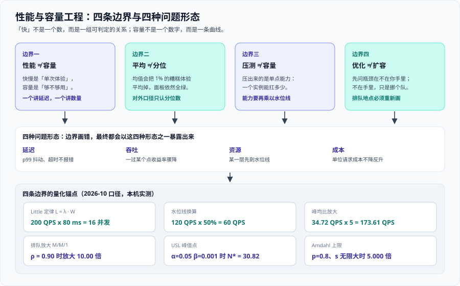

# 总览：性能与容量的四条边界



这一页回答四个边界问题：**「快」和「够用」是同一件事吗**；**平均值能不能当结论**；**压测压出来的到底是什么**；以及**优化和扩容该先做哪一个**。四条边界画错了，后面所有的测量、建模、门禁都在放大错误。

适用对象：需要为线上服务签字的后端、运维、SRE，以及要在验收单上写「性能达标」的技术负责人。本页不含脚本细节，它是本专题其余页面的**地图**。

::: tip 一句话理解
性能工程最大的敌人不是慢，而是**平均值**与「**我觉得快了**」。凡是不能被判定真假的性能结论，都是情绪。
:::

## 一、四条边界

| 边界 | 一句话 | 最常被混淆成什么 |
| --- | --- | --- |
| **性能 ≠ 容量** | 快慢是「单次体验」，容量是「够不够用」 | 「接口 P99 只有 30 ms，所以不用扩容」 |
| **平均 ≠ 分位** | 均值会让 1% 的糟糕体验消失 | 「平均响应 80 ms，性能很好」 |
| **压测 ≠ 容量** | 压出来的是**单点能力**，不是能承载多少 | 「压到 800 QPS 没报错，我们能扛 800 QPS」 |
| **优化 ≠ 扩容** | 先问瓶颈在不在你手里 | 「先加机器，回头再优化」 |

### 边界一：性能 ≠ 容量

**性能**回答「一次请求有多快」，**容量**回答「在给定水位与冗余下能承载多少请求」。这两件事的测量对象完全不同：前者测的是延迟分布，后者测的是**资源到水位线的距离**。

一个接口可以 P99 只有 30 ms，同时容量只剩 12%——因为它的下游连接池已经排到了水位线。反过来，一个接口平均 400 ms 也可能容量很宽裕。**说的不是一个数，就不要写在同一个结论里。**

### 边界二：平均 ≠ 分位

假设 100 个请求里 99 个耗时 10 ms、1 个耗时 900 ms，平均值是 18.9 ms。这个数字看起来非常健康，但那个 900 ms 的用户体验是**彻底失败**。

平均值天然把尾部抹平。**只要你的结论里出现「平均」，就要立刻追问：分布的另一头是什么样。** 对外的性能口径只认两种：分位数（`p99 ≤ 300 ms`）或阈值计数（`≤ 300 ms 的比例 ≥ 99%`）。为什么后者更适合当目标，[SLO 与性能需求](../SLO/index.md) 一页会算给你看。

### 边界三：压测 ≠ 容量

压测给出的结论只有一个：**一个实例、在当前配置下、跑到某个水位线时的处理能力**。它是一个**单点能力值**，不是一个「系统能承载多少」。

把单点能力变成容量，中间至少要过三道换算：乘以**水位线**（留出排队余量）、乘以**冗余策略**（N+1 还是 N+2）、再除以**峰均比**（峰值不是平均值）。少任何一道，结论都会偏出一到两倍。

### 边界四：优化 ≠ 扩容

优化与扩容的差别不在于「哪个更省钱」，而在于**瓶颈在不在你手里**。

- 瓶颈在你手里（自己的代码、自己的连接池、自己的索引）：优化直接抬升上限。
- 瓶颈不在你手里（下游 RPC、共享数据库、第三方接口）：优化只是**把排队挪个地方**，端到端延迟不变，只是从你的队列挪到别人的队列。

所以顺序永远是：先把**排队位置**找出来，再决定是优化还是扩容。

## 二、性能问题的四种形态

同一个「慢」，可能属于四类完全不同的毛病。**先分类，再动手**——分类错了，解决办法一定错。

| 形态 | 典型症状 | 首先看什么 | 常见误判 |
| --- | --- | --- | --- |
| **延迟** | P99 抖动、个别请求超时但成功率不掉 | 分位数分布、尾部请求的共同特征 | 拿平均值解释尾部；把抖动归因于「网络」 |
| **吞吐** | 一过某个点收益率骤降，加并发不涨反跌 | 排队放大倍数、USL 曲线峰值点 | 认为「再加机器就好了」 |
| **资源** | 某一层先到水位线，其他层很闲 | 各层利用率对比、最短板那一层 | 盯 CPU，忽略连接池与下游配额 |
| **成本** | 单位请求成本不降反升 | 单位成本曲线、闲置资源比例 | 只看总账单，不看单请求成本 |

::: warning 四种形态的排序原则
先排除**资源**（最短的那块板），再判断**吞吐**（是否已过膝点），然后才谈**延迟**（尾部来自哪里），最后才看**成本**。顺序反了，就会在「延迟调优」上花掉两周，最后发现是数据库连接池只有 20 个。
:::

## 三、「快」的四个层次

「快」不是一个数。同样是 200 ms，在不同的负载下含义完全不同。

| 层次 | 问的问题 | 判据 | 典型误区 |
| --- | --- | --- | --- |
| **单请求延迟** | 一次调用要多久 | 分位数（P50 / P90 / P99） | 用开发机单次调用的耗时当结论 |
| **并发下的延迟** | 1000 个并发时还要多久 | 同一到达率下的延迟分布 | 用压测工具的「并发数」当作真实并发 |
| **稳态吞吐** | 单位时间能稳定处理多少 | 恒定到达率下不积压的最大速率 | 把「瞬时峰值」当稳态 |
| **过载后的行为** | 超出能力时发生什么 | 排队、拒绝，还是整体崩溃 | 只测到能力点，不测超载点 |

**最后一层才是真正的分水岭**：过载时是**排队**（延迟无限增长但请求还在处理）、是**拒绝**（快速失败、保住已有用户的体验）、还是**全崩**（连健康检查都超时，恢复要重启）。前两层答得再漂亮，第四层答成「全崩」，这个系统在容量上就是不成立的。

::: info 为什么第四层最容易被跳过
因为压测通常在「能扛住」的负载下停手——再往上加压，工具自己就会报超时，看起来像是「工具的错」。正确的做法是**专门做一轮超载测试**：把到达率设到能力的 1.5 倍，只观察三件事：错误率怎么变、延迟怎么变、恢复需要多久。
:::

## 四、什么时候不需要做容量工程

容量工程有成本：要建模型、要跑压测、要维护门禁。下面五种情况，做了就是浪费。

| 情况 | 判断 | 建议 |
| --- | --- | --- |
| 内部一次性工具 | 生命周期以周计，用户是自己人 | 有观测即可，不必定 SLO |
| 纯离线批处理 | 无在线用户等待，可重跑 | 关注「窗口内是否跑完」，不关注延迟分位 |
| 流量可预测且远低于能力 | 峰值只有能力的 20%，且一年内不变 | 设一条水位告警就够，不做容量模型 |
| 没有成本压力 | 资源免费、账单无人看 | 只做可用性，不做单位成本治理 |
| 系统还没到需要保 SLA 的阶段 | 还在验证需求，用户量在百级 | 先把功能跑通，容量留到有真实流量再谈 |

::: warning 一个反面判断
「我们现在量很小，将来一定会大」**不是**现在就做容量工程的理由。正确的做法是：量小的时候把**观测口径**建对（分位数、到达率、水位线三个抓手），等流量真的上来时再补模型。口径建对是廉价的，模型维护是昂贵的。
:::

## 五、最小起步三步

不要一上来就建全套容量模型。按「先能判定，再能计算，最后能拦住」推进：

1. **给一件事定 SLO**——一个 SLI、一个分位目标、一个统计窗口。通过标准：这句话能被判定真假，例如「滚动 30 天内，HTTP 请求中「非 5xx 且服务端耗时不超过 300 ms」的比例不低于 99%」。
2. **量一次单实例能力**——用**恒定到达率**（constant arrival rate）的模型压，找到它在什么速率下开始积压。通过标准：能报出「这个配置在 X QPS 时 P99 还是 200 ms，在 Y QPS 时开始发散」两个具体数字。
3. **留一条回归门禁**——把阈值写进脚本，让**退出码**说了算，而不是让评审会说了算。通过标准：故意引入一次性能退化，流水线必须变红。

```shell
# 第一步：确认压测工具与版本（本专题以 Grafana k6 2.3.0 为例）
k6 version
# 预期输出：k6 v2.3.0 (...)，2026-09-21 发布

# 第二步：用恒定到达率模型量单实例能力（脚本见压测一页）
k6 run --env RATE=60 --env DURATION=5m scripts/load.js
# 预期输出：checks 全部通过、http_req_failed 接近 0，且 p(99) 稳定在阈值内
```

## 六、与相邻专题的分工

边界写死，避免两页讲同一件事、又都讲不透。

| 相邻专题 | 那个专题讲什么 | 本专题讲什么 |
| --- | --- | --- |
| [监控与告警](../../Monitoring/index.md) | 怎么把指标、日志、链路**采上来** | 采上来之后，**凭什么判定够不够** |
| [云架构](../../CloudArchitecture/index.md) | 怎么把云资源**编排**起来（网络、负载均衡、可用区） | 需要**几个**实例、卡在**什么水位线** |
| [云成本](../../CloudArchitecture/Cost/index.md) | 账单**怎么算**、钱花在哪 | **单位成本怎么降**、性能与成本怎么换算 |
| [故障响应](../../IncidentResponse/index.md) | 故障**来了怎么应急**（分级、通报、止损） | 故障**来临前怎么算出余量**、剩多少冗余 |
| [混沌工程](../../ChaosEngineering/index.md) | 主动**制造故障**，测韧性 | 施加**真实负载**，量能力——同为「施加压力」，判据完全不同 |
| [边缘与 CDN](../../EdgeCDN/index.md) | 把流量**卸载到边缘** | 卸载之后，**回源还剩多少**、源站要按什么规模建 |
| [高性能 Java](../../../Backend/HighPerformanceJava/index.md) | 代码层**怎么变得更快** | 变快之后，**能换回多少容量** |
| [SQL 优化](../../../DB/Relational/SQLOptimization/index.md) | 单条 SQL **怎么优化** | 数据库**连接数与并发怎么算** |
| [CI/CD](../../../Tools/CICD/index.md) | 流水线**怎么搭** | 性能门禁**挂在流水线哪一步**、退出码怎么定 |
| [项目交付](../../../Others/ProjectDelivery/index.md) | 交付全链路的方法与模板 | 性能与容量这条**非功能需求怎么定量** |

::: tip 一句话记住分工
**采数据**归监控，**编排资源**归云架构，**应急**归故障响应，**制造故障**归混沌工程。本专题只做一件事：**把「多快算够」和「凭什么够」算清楚**。
:::

## 七、专题地图


三个入口对应三类诉求：

- **要定指标**：先看 [SLO 与性能需求](../SLO/index.md)，把「要快」写成可判定的话。
- **要算容量**：看 [定量建模：并发、排队与扩展性](../Modeling/index.md)，用算术在压测之前把量级算出来。
- **要量真值**：看压测一页，用恒定到达率模型量出单点能力，并避免协调性遗漏（Coordinated Omission）。

## 八、事实与规格速览（2026-10 口径）

| 工具 / 能力 | 当前版本 | 许可 | 必须记住的事实 |
| --- | --- | --- | --- |
| Grafana k6 | **2.3.0**（2026-09-21） | AGPL-3.0 | 2.0 于 2026-05-11 GA，引入 AI 辅助测试流程与 `k6 x agent` / `x mcp` / `x docs` / `x explore` 子命令、扩展目录；1.0（2025-05-06）引入 TypeScript 支持 |
| Apache JMeter | **5.6.3** | Apache-2.0 | 需 Java 8+，官方推荐 Java 17+；下一个大版本要求 Java 17+ |
| Locust | **2.46.6**（2026-09-17） | MIT | 自 2.46.1（2026-07-21）起要求 Python ≥ 3.11 |
| Gatling | **3.15.1**（2026-05-25） | Apache-2.0 | 开源版**不含跨机器编排**，那是 Enterprise 的能力 |
| Artillery | **2.0.32** | MPL-2.0 | Node.js 生态，适合快速起量的小规模压测 |
| Vegeta | **12.13.0** | MIT | 恒定速率模型，天然规避 Coordinated Omission |
| Kubernetes HPA | `autoscaling/v2` | Apache-2.0（K8s 本体） | `behavior.scaleUp` / `scaleDown` **各自独立**；`stabilizationWindowSeconds` 默认 **scale-up 0 秒 / scale-down 300 秒** |
| HPA 控制器行为 | — | — | 控制器**默认每 15 秒**同步一次；容忍带（tolerance）**默认 0.1**；多指标时**取各指标推荐副本数的最大值** |
| HPA 指标类型 | — | — | `ContainerResource` 可按主容器算（排除 sidecar）；HPA 与 VPA 在**同一指标**上会冲突 |
| KEDA | — | Apache-2.0 | 内部自建 HPA，**不要再手建 HPA 指向同一 workload**；可以缩到 0 |

::: warning HPA 的两个默认值最常被忽略
1. `scaleDown.stabilizationWindowSeconds` **默认 300 秒**——缩容慢是设计如此，不是卡住了；觉得「缩不下来」先看这个值。
2. 容忍带**默认 0.1**——当前副本数与推荐值的差异在 10% 以内时**不做任何调整**。想让 HPA 更灵敏，调的是这个值，不是同步周期。
:::

## 九、成熟度五档

| 档位 | 状态 | 判定依据 | 下一步 |
| --- | --- | --- | --- |
| **L0** | 靠感觉 | 无法回答「多快算够」，也没有分位数据 | 先把分位数采集起来 |
| **L1** | 有观测无判据 | 有 P99 曲线，但没人能说清多少算合格 | 给一条关键路径定一个 SLO |
| **L2** | 有 SLO 与单点能力 | 能报出 SLO 达成率与单实例能力两个数字 | 建容量模型，把能力换算成实例数 |
| **L3** | 有容量模型与门禁 | 容量输出是「什么负载下哪层先到水位线」，且有回归门禁 | 接入成本维度，做单位成本治理 |
| **L4** | 有成本与趋势治理 | 单位成本有趋势线，容量按季度滚算并预留 | 保持，并定期复核 SLO 目标 |

::: info 大多数团队卡在 L1
不是因为缺工具，而是因为**没人愿意写下一个带数字的目标**。写目标意味着以后可能因为没有达标而被追问——这一步的阻力从来不是技术阻力。
:::

## 十、学习路径

三条路径按诉求选，不用都走：

- **要定指标**：本页 → [SLO 与性能需求](../SLO/index.md)。产出是一份可判定的 SLO 文档与错误预算策略。
- **要算容量**：本页 → [定量建模：并发、排队与扩展性](../Modeling/index.md)。产出是一份「什么负载下哪层先到水位线」的容量结论。
- **要建防线**：本页 → 压测一页 → 门禁与治理一页。产出是一条会变红的流水线。

## 十一、最容易搞错的四个直觉

::: danger 四条看起来对、实际全错的直觉
1. **「平均响应时间 80 ms，性能没问题」**——平均值会把 1% 的糟糕体验抹平。正确写法：给出**分位数 + 阈值计数**，例如「`≤ 300 ms` 的比例 ≥ 99%」，并对这个目标设**错误预算**。
2. **「压测跑到 800 QPS 没报错，我们能扛 800 QPS」**——你压出来的是**一个实例**的能力，不是系统的容量。正确写法：`容量 = 单实例能力 × 水位线 × 冗余后实例数`，再除以峰均比得到「能承载的峰值流量」。
3. **「CPU 才 30%，说明还有 70% 的余量」**——CPU 不是唯一的资源。正确写法：对每一层分别找**水位线**（线程池占用、连接池占用、下游配额、磁盘 IO），**最短的那块板**才是余量。
4. **「先把机器加上去，性能问题以后再说」**——如果瓶颈在下游共享资源，加机器只会**把排队放大到下游**，延迟不会变好。正确写法：先定位排队发生在哪一层，**在你自己手里**的部分做优化，不在你手里的部分做限流与降级。
:::

## 十二、验证方式

本页是纯文档页，验证方式写成「读者可执行的自查」。

1. 用一句话回答：「我们最核心的那条链路，多快算够？」——答不出**分位 + 阈值 + 窗口**三要素，说明还停在 L0/L1。
2. 检查现有面板里有多少「平均值」口径的性能指标：

   ```shell
   # 在监控配置或面板 JSON 里找平均值口径
   grep -rn "avg\|mean" --include=*.json --include=*.yaml dashboards/ 2>/dev/null | wc -l
   ```

   预期输出：一个具体数字。**数字本身不重要，重要的是逐条确认：这个平均值是否有一个对应的分位数指标**。只报平均、不报分位的那几条，就是边界二被违反的地方。
3. 检查容量结论是否落在纸面上：

   ```shell
   # 在容量文档里找「水位线」「峰均比」「冗余」三个词
   grep -rn "水位线\|峰均比\|N+" docs/ capacity/ 2>/dev/null | wc -l
   ```

   预期输出：三个词都能命中。**只要缺一个，你的容量结论就还是「一个数字」，不是一条曲线。**

## 参考资料

- Grafana 官方文档 · k6 文档总入口（含恒定到达率场景与 `k6 x` 子命令）：https://grafana.com/docs/k6/latest/
- Kubernetes 官方文档 · Horizontal Pod Autoscaling（`autoscaling/v2`、`behavior`、`stabilizationWindowSeconds`）：https://kubernetes.io/docs/tasks/run-application/horizontal-pod-autoscale/
- Google SRE Book · Service Level Objectives（SLI / SLO / SLA 的原始定义）：https://sre.google/sre-book/service-level-objectives/
- Brendan Gregg · The USE Method（利用率、饱和度、错误三问）：https://www.brendangregg.com/usemethod.html
- Wikipedia · Little's law（并发、到达率、驻留时间三者互推）：https://en.wikipedia.org/wiki/Little%27s_law
- Wikipedia · Universal Scalability Law（争用与一致性导致的下降）：https://en.wikipedia.org/wiki/Universal_scalability_law
