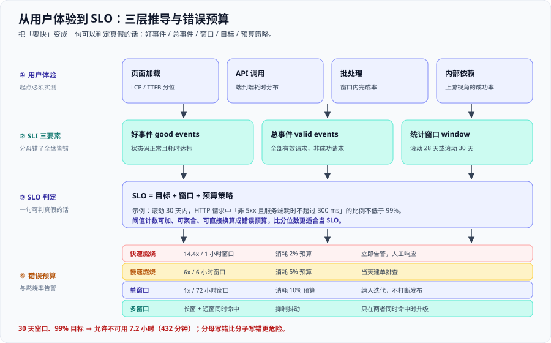

# SLO 与性能需求



这一页只做一件事：把「要快」变成一句**可以判定真假**的话。做完之后，性能讨论不再依赖语气，而是依赖一个百分比和一个窗口。

适用于需要把性能写进需求、写进验收单、写进告警规则的人。

::: tip 一句话理解
**SLO 不是「尽快」，而是「在 30 天内，99% 的请求必须落在 300 ms 以内」**。前者无法反驳也无法验证，后者可以算出还剩多少额度。
:::

## 一、SLI 的三要素

**SLI（Service Level Indicator，服务水平指标）**是用来衡量「好不好」的那个比率。任何一个合格的 SLI 都能写成一句话：

> 在 **[窗口]** 内，**[好事件]** 占 **[总事件]** 的比例。

这三个空必须同时填上，缺一个就不是 SLI。

| 要素 | 英文 | 定义 | 填错的表现 |
| --- | --- | --- | --- |
| **好事件** | good events | 满足成功且耗时达标的那部分请求 | 把「非 5xx 但超时 60 s」也算好事件 |
| **总事件** | valid events | **全部有效请求**，不是「成功请求」 | 分母只统计成功请求，达成率永远 100% |
| **统计窗口** | window | 滚动窗口，例如 28 天或 30 天 | 窗口换来换去，历史达成率无法对比 |

::: danger 分母写错比分子写错更危险
分子写错，达成率会偏低——你会被提醒。**分母写错，达成率会虚高，而且永远不会被发现。**

举个例子：某天接口全挂，1000 个请求里只有 200 个成功返回、180 个达标。按「成功请求」做分母，达成率是 `180 / 200 = 90%`；按「全部有效请求」做分母，达成率是 `180 / 1000 = 18%`。第二种才是用户真实感受到的那个数字。

正确写法：**分母必须是到达系统的全部有效请求**，包括超时、包括被拒绝、包括返回 5xx 的那些。只有明确不属于服务范围的（例如客户端参数错误 4xx 中的一部分、健康检查探针）才可以从分母里剔除，并且**必须在 SLO 文档里写明剔除规则**。
:::

## 二、两种延迟口径

同一个目标有两种写法，它们不等价：

| 口径 | 写法 | 含义 | 适合当 SLO |
| --- | --- | --- | --- |
| **阈值计数** | `≤ 300 ms 的比例 ≥ 99%` | 数出落在阈值内的请求个数，求比例 | **是** |
| **分位数** | `p99 ≤ 300 ms` | 估算分布的第 99 百分位点 | 不适合当目标，适合当诊断 |

### 为什么阈值计数更适合当 SLO

1. **可加性**：两个实例的比例可以直接加权合并；两个分位数**不能**直接取平均（见下一节）。
2. **可聚合**：按机房、按版本、按客户端版本聚合时，分子分母分别相加即可，结果依然正确。
3. **可算预算**：`1 - 99% = 1%`，直接就是错误预算。而 `p99 ≤ 300 ms` 无法直接告诉你「还能坏多久」。
4. **与用户体验对齐**：用户在意的是「这次请求超没超 300 ms」，不是全局第 99 百分位点在哪。

::: warning 分位数不是没用，是不能当目标
分位数用来**诊断**非常合适：「P99 涨了，但阈值计数没掉」说明尾部变长了但还没越线；「阈值计数掉了，P99 却没动」说明有一批请求直接失败了，还没进入延迟统计。

**结论：SLO 用阈值计数，面板上两个都要有。**
:::

## 三、分位数的三条纪律

| 常见写法 | 后果 | 正确做法 |
| --- | --- | --- |
| 对多个实例的 P99 **再求平均** | 数学上无意义，结果可能比所有实例的真值都小 | 先合并**直方图桶**，再算分位数：`histogram_quantile(0.99, sum by (le) (rate(..._bucket[5m])))` |
| 把 **30 天窗口**和 **5 分钟窗口**的分位数画在同一张图对比 | 短窗口样本少、抖动大，看起来「今天比上月差 3 倍」 | 长窗口用于**目标判定**，短窗口用于**告警触发**，图形分开、标注清楚 |
| 把**服务端耗时**和**端到端耗时**混在一张图 | 两者相差一个网络往返，结论相互矛盾 | 明确区分并在图例与 SLO 文档中写死口径；对外承诺用端到端或明确声明是服务端口径 |

::: info 第三条纪律最容易被忽略
`http_request_duration_seconds` 记录的是**服务器处理时间**。用户手机上感受到的时间还要加上：DNS、TCP/TLS 握手、请求排队（网关）、响应传输。在移动网络下这一段可以轻松占掉 100 ms 以上。

所以「服务端 P99 是 80 ms」和「用户感受到 P99 是 80 ms」是两句话。**写在 SLO 里的那个口径，必须是你真的在量的那个口径。**
:::

## 四、SLI / SLO / SLA 三者关系

| 名称 | 谁定 | 给谁看 | 违约后果 |
| --- | --- | --- | --- |
| **SLI** | 工程团队 | 团队内部 | 没有后果，它只是测量 |
| **SLO** | 工程团队 + 业务方 | 团队内部 + 相关方 | 触发**冻结发布**、资源重新分配等内部机制 |
| **SLA** | 法务 / 商务 + 业务方 | 客户、合同 | **赔钱、退款、合同条款** |

三者的顺序是：**先有 SLI，再定 SLO，最后才谈 SLA**。常见的错误顺序是先签 SLA 再回头补测量口径，结果合同里的「可用性 99.9%」在系统里根本没有对应的指标。

::: warning 一条硬约束
**SLA 里的数字必须比 SLO 松**。SLO 是内部目标，SLA 是对外承诺。如果两者相等，那你没有任何缓冲——每一次内部目标未达成就等于对外违约。
:::

## 五、错误预算与燃烧率告警

**错误预算（error budget）**就是 SLO 目标允许的失败额度：

```text
错误预算 = 1 - SLO 目标
30 天窗口、99% 目标 → 允许不可用 720 小时 x 1% = 7.2 小时 = 432 分钟
```

**燃烧率（burn rate）**是「当前消耗错误预算的速度相对于目标速度的倍数」。燃烧率 1 表示「刚好会在窗口结束时用光预算」，燃烧率 14.4 表示「按这个速度 1 小时就会消耗 2% 的总预算」。

| 类型 | 燃烧率与窗口 | 消耗的预算 | 处置动作 |
| --- | --- | --- | --- |
| **快速燃烧** | 14.4 倍，短窗 1 小时 | 约 2% | **立即告警**，人工响应，先止损再看原因 |
| **慢速燃烧** | 6 倍，中窗 6 小时 | 约 5% | 建单跟进，当天排查，不阻断发布 |
| **单窗口** | 1 倍，长窗 72 小时 | 约 10% | 常规工单，纳入迭代排期 |
| **多窗口** | 长窗与短窗**同时**命中 | 抑制抖动 | 只在两者同时命中时才升级告警 |

::: tip 与监控告警专题的分工
**那边讲告警怎么送出去**（通知渠道、分组、抑制、静默），见 [监控与告警](../../Monitoring/Alerting/index.md)；**这边讲阈值凭什么定这个数**（为什么是 14.4 而不是 5）。

一句话：告警工程的输入是本页的输出。**阈值算错了，通道再顺也只是在准确地打扰人。**
:::

## 六、从用户体验反推 SLO 的四条路径

反推的起点永远是**实测**，不是会议室里的估计。

| 路径 | 起点测量方式 | 常见目标量级 | 定这个数的理由 |
| --- | --- | --- | --- |
| **页面加载** | 采集 LCP / TTFB 分位数（真实用户监控） | `LCP ≤ 2.5 s` 的比例 ≥ 75%，其中 TTFB 单独设阈值 | 用户在前 2.5 秒内看到主体内容，才不至于离开；把 TTFB 拆出来是为了定位是网络还是后端 |
| **API 调用** | 网关或服务端直方图，按接口分组 | `≤ 300 ms` 的比例 ≥ 99%（同步接口） | 300 ms 是「感觉即时」的经验上界，99% 留出 1% 的尾部空间做重试 |
| **批处理** | 统计每次任务的实际耗时分布 | 窗口内完成率 ≥ 99.5%（如「每日 06:00 前跑完」） | 批处理看的是**截止时间**，不是单次快慢；用完成率才能表达「偶尔跑慢一点没关系，但不能迟到」 |
| **内部依赖** | 上游视角的成功率与耗时 | 成功率 ≥ 99.9%，`≤ 100 ms` 的比例 ≥ 99% | 内部依赖会被多处调用，尾部延迟会被**调用次数放大**，所以目标要更紧 |

::: warning 内部依赖的目标必须比对外接口更紧
假设对外接口 1 次请求会调用内部依赖 20 次。若内部依赖的失败率是 0.1%，那么对外接口的失败率上限就是 `1 - 0.999^20 ≈ 1.98%`——已经吃掉了 99% 目标下的全部预算。

**这就是「调用次数放大」**：内部依赖的可用性目标，必须按调用倍数反推。
:::

## 七、非功能需求的四类

性能只是一类非功能需求。四类都要写成**可验证的条件**，而不是形容词。

| 类别 | 怎么写进验收条件 | 判据示例 |
| --- | --- | --- |
| **性能** | 给定到达率下，达标请求的比例不低于目标 | 峰值 2000 QPS 下，`≤ 300 ms` 的比例 ≥ 99% |
| **容量** | 给定负载下，各层资源不越过水位线 | 峰值 173.61 QPS 下，实例数 ≥ 4，单实例利用率 ≤ 50% |
| **可用性** | 滚动窗口内的成功率与恢复时间 | 滚动 30 天成功率 ≥ 99.9%，单点故障不影响 |
| **成本** | 单位业务量的资源成本上限 | 每万次请求的实例成本不超过基线 |

写成 `Given / When / Then` 的形状最省事：

```text
Given 峰值到达率 2000 QPS、平均延迟 45 ms
When  持续压测 30 分钟
Then  「非 5xx 且服务端耗时不超过 300 ms」的比例 ≥ 99%
And   任一层资源利用率不超过 50% 水位线
```

::: info 完整的需求拆分与验收模板
非功能需求的整体写法（包括可用性、成本怎么和功能需求并列）见 [需求拆分与验收条件](../../../Others/ProjectDelivery/Requirements/index.md)，本页只负责把「性能与容量」这两类的数字算出来。
:::

## 八、一份 SLO 文档模板

直接复制，把示例值换成你自己的。**不需要写 frontmatter，也不需要写额外的工具。**

```markdown [slo/order-api.md]
# SLO：order-api（订单同步接口）

## 1. 服务与责任人
- 服务名：order-api
- 责任人：后端一组（oncall 轮值，见值班表）
- 上游：H5 下单页、App 下单页、开放平台
- 下游：用户服务、库存服务、MySQL 主库

## 2. SLI 定义
- 好事件：HTTP 状态码非 5xx，且服务端耗时不超过 300 ms 的请求
- 总事件：到达网关的全部有效请求，剔除规则见第 6 节
- 数据来源：网关直方图 http_request_duration_seconds_bucket，按 route 标签分组
- 口径：服务端耗时（不含客户端网络耗时），与用户侧口径的差距见附录

## 3. 目标与窗口
- 目标：99.0%
- 窗口：滚动 30 天
- 允许不可用：7.2 小时（432 分钟）

## 4. 预算策略
- 预算消耗 50%：暂停非紧急的性能相关变更
- 预算消耗 75%：仅允许修复类变更，性能相关变更需负责人审批
- 预算耗尽：冻结发布，直到滚动窗口内的消耗回落
- 一个月内预算全部未用完：考虑收紧目标或投入技术债偿还

## 5. 触发条件（燃烧率告警）
- 14.4 倍 / 1 小时窗口 → 立即告警，人工响应
- 6 倍 / 6 小时窗口 → 建单跟进，当天排查
- 长窗与短窗同时命中 → 升级告警；仅单窗命中 → 不告警

## 6. 剔除规则（写死，不允许临时改）
- 剔除：健康检查探针、压测流量（带固定 header）、客户端 4xx 且未被服务端计入
- 不剔除：超时请求、被限流的请求、返回 5xx 的请求

## 7. 复核周期
- 每季度复核一次目标是否需要收紧或放宽
- 每次重大架构变更后立即复核分母口径是否仍然成立
```

::: tip 模板里最有价值的两节
**第 4 节的预算策略**和**第 6 节的剔除规则**。前者决定了 SLO 会不会真的影响决策，后者决定了达成率有没有被人为做高。其他几节都是描述，只有这两节是约束。
:::

## 九、可执行的验算

用一段纯 Python 复算窗口预算与燃烧率的关系，不依赖任何外部服务。

```python [scripts/slo_budget.py]
WINDOW_DAYS = 30
HOURS_PER_DAY = 24
TARGET = 0.99

window_hours = WINDOW_DAYS * HOURS_PER_DAY
budget_hours = window_hours * (1 - TARGET)

print(f"窗口 {WINDOW_DAYS} 天 = {window_hours} 小时")
print(f"目标 {TARGET:.2%}：允许不可用 {budget_hours:.1f} 小时 = {budget_hours * 60:.0f} 分钟")

print("\n预算消耗与剩余：")
for consumed in (0.25, 0.50, 0.75, 1.00):
    remain_h = budget_hours * (1 - consumed)
    print(f"  已消耗 {consumed:.0%} 剩余 {remain_h:.2f} 小时 = {remain_h * 60:.0f} 分钟")

print("\n燃烧率门槛（燃烧率 = 当前错误率 / 允许错误率）：")
for burn, hours in ((14.4, 1), (6, 6), (1, 72)):
    used = burn * hours / window_hours
    print(f"  {burn}x 持续 {hours} 小时 消耗 {used:.2%} 预算")
```

执行与预期输出：

```shell
python3 scripts/slo_budget.py
```

```text
窗口 30 天 = 720 小时
目标 99.00%：允许不可用 7.2 小时 = 432 分钟

预算消耗与剩余：
  已消耗 25% 剩余 5.40 小时 = 324 分钟
  已消耗 50% 剩余 3.60 小时 = 216 分钟
  已消耗 75% 剩余 1.80 小时 = 108 分钟
  已消耗 100% 剩余 0.00 小时 = 0 分钟

燃烧率门槛（燃烧率 = 当前错误率 / 允许错误率）：
  14.4x 持续 1 小时 消耗 2.00% 预算
  6x 持续 6 小时 消耗 5.00% 预算
  1x 持续 72 小时 消耗 10.00% 预算
```

::: warning 燃烧率是「相对值」，不是「绝对值」
`14.4x` 的含义是「当前的错误率是允许错误率的 14.4 倍」，与窗口长短无关。这也是它比「错误率超过 1% 就告警」更好用的原因：**同一个阈值在 30 天窗口和 28 天窗口下都成立**。
:::

## 十、实战：给三类典型接口定 SLO

| 接口类型 | SLI | 目标 | 窗口 | 为什么定这个数 |
| --- | --- | --- | --- | --- |
| **同步 API**（下单、支付回调） | 非 5xx 且服务端耗时 `≤ 300 ms` 的比例 | 99.0% | 滚动 30 天 | 300 ms 是「感觉即时」的经验上界；99% 留出 1% 的尾部空间给重试与抖动。**不能定 100%**，下游偶发慢请求不可消除 |
| **列表查询**（订单列表、商品列表） | 非 5xx 且服务端耗时 `≤ 800 ms` 的比例 | 99.5% | 滚动 30 天 | 带分页与排序，耗时天然更高，阈值放到 800 ms；但它是**读多写少**的路径，可优化空间大，目标反而更紧 |
| **报表导出**（异步任务） | 「提交后 60 秒内完成」的任务比例 | 99.5% | 滚动 7 天 | 用户等待的不是单次请求而是「60 秒内出结果」。窗口用 7 天而非 30 天，因为导出量按周波动大，长窗会被大促周的堆积拉平 |

三者的 SLI 都是**阈值计数**而非分位数，窗口都是**滚动窗口**而非自然月。这两条一致性比具体数字重要得多——**口径统一才能横向对比**。

## 十一、五条易错点

::: danger 五条最常踩的 SLO 坑
1. **把 P99 当 P50 用**：看到「P99 是 300 ms」就说「一般 300 ms 左右」。P99 是**百分位点**，不是平均值。正确做法：同时看 P50 / P90 / P99 三条线，并明确说出「一半请求在 X 以内，1% 的请求超过 Y」。
2. **目标定成 100%**：定 100% 意味着没有任何容错空间，一次抖动就违约，而且会逼团队去**放宽分母**。正确做法：目标留出至少 0.1% 的预算，并让预算成为一种**可用资源**。
3. **只有一条 SLO，没有预算策略**：SLO 只是一句话，没有预算策略就不会影响任何决策，最终沦为墙上的口号。正确做法：把「消耗 50% 时暂停什么、耗尽时冻结什么」写进文档，并让它在评审会上被引用。
4. **用平均值算达成率**：把每分钟的达成率求平均，得到 `(1 + 0.9 + 0 + 0.4) / 4` 这类数字，完全无意义。正确做法：**先把分子分母分别累加，再求比例**——这是阈值计数最大的好处。
5. **拿服务端指标当用户侧 SLI**：服务端 80 ms 不代表用户 80 ms，中间还有网络与传输。正确做法：明确写下口径，并同时采集真实用户监控（RUM）数据做对照；若两者差距长期超过阈值，说明有个不在你手里的环节在劣化。
:::

## 十二、验证方式

### 1. 查 P99（先合并桶，再算分位）

```text
histogram_quantile(0.99, sum by (le) (rate(http_request_duration_seconds_bucket[5m])))
```

逐段解释：

| 片段 | 作用 |
| --- | --- |
| `http_request_duration_seconds_bucket` | 直方图的累积计数序列，每个 `le` 是一个阈值桶 |
| `rate(...[5m])` | 把累积计数转成每秒增量，得到「单位时间落入各桶的请求速率」 |
| `sum by (le)` | 把所有实例、所有方法、所有路径**按桶边界汇总**——这一步是「先合并桶」的关键 |
| `histogram_quantile(0.99, ...)` | 在汇总后的桶之间做线性插值，估算第 99 百分位点 |

::: warning 不要写成 `avg(histogram_quantile(...))`
那样做就是对分位数再求平均，属于本节第三条纪律明令禁止的写法。正确做法是**先 `sum by (le)` 汇总桶，再套 `histogram_quantile`**。
:::

### 2. 查阈值计数达成率（这才是 SLO 的判定式）

```shell
curl -sG 'http://localhost:9090/api/v1/query' \
  --data-urlencode 'query=sum(rate(http_request_duration_seconds_bucket{le="0.3"}[5m])) / sum(rate(http_request_duration_seconds_count[5m]))' \
  | jq -r '.data.result[0].value[1]'
```

预期输出：一个 0 到 1 之间的小数，例如 `0.9987`，表示 `≤ 300 ms` 的比例是 99.87%。**这个数才是你的 SLO 达成率**——分子是达标请求速率，分母是全部有效请求速率。

### 3. 查错误预算剩余

```text
1 - (
  (1 - sum(rate(http_request_duration_seconds_bucket{le="0.3"}[30d]))
       / sum(rate(http_request_duration_seconds_count[30d])))
  / (1 - 0.99)
)
```

预期输出：预算剩余比例。**结果接近 0 表示预算即将耗尽，此时应该触发第 4 节的预算策略**，而不是继续按原节奏发布。

## 与「客服工单与 SLA 履约工程」的分工（第 209 天补充）

本页的 SLO 是**系统对自己**的承诺（可用性 99.9%、P95 延迟 300ms），对象是流量；客服的 SLA 是**公司对客户**的承诺（8 营业小时内首响），对象是人。两者共享「错误预算」的思路，但计算方式完全不同：SLO 按请求数算比例，SLA 按**工单**算比例，而工单的「有效时间」还要经过日历与暂停的折算。

具体分工：本页管**性能目标怎么从体验推导出来**（三层推导、错误预算、燃烧率）；[客服工单与 SLA 履约工程 · SLA 时钟](../../../Backend/SupportTicket/SLAClock/index.md)管**承诺时间怎么算**：营业小时与日历小时、暂停与顺延、夏令时、重开与多周期。

一个针对本页的坑：**把 SLO 的「按请求比例」直接套到 SLA 上**。可用性 99.9% 允许每千次请求错一次，错误是均匀的；而 SLA 的违约是**聚集**的——一次系统宕机可能让 3,000 张单同时违约，达标率一夜之间从 96% 掉到 61%。所以 SLA 报表必须同时给「违约单数」与「最老未关闭单的年龄」，否则一次事故就会被月度平均值抹平，直到客户集体流失才被发现。

## 参考资料

- Google SRE Book · Service Level Objectives（SLI / SLO / SLA 与「目标不要定 100%」的原始论述）：https://sre.google/sre-book/service-level-objectives/
- Google SRE Workbook · Alerting on SLOs（双窗口多燃烧率告警的完整推导，14.4 / 6 / 1 三档的来源）：https://sre.google/workbook/alerting-on-slos/
- Prometheus 官方文档 · `histogram_quantile`（桶合并与插值的实现说明）：https://prometheus.io/docs/prometheus/latest/querying/functions/#histogram_quantile
- Grafana k6 官方文档 · Thresholds（把性能阈值写进脚本、用退出码判定）：https://grafana.com/docs/k6/latest/using-k6/thresholds/
- OpenTelemetry 官方文档 · HTTP 指标语义约定（直方图桶与属性命名）：https://opentelemetry.io/docs/specs/semconv/http/http-metrics/
- web.dev · Core Web Vitals（LCP / INP 阈值与「2.5 秒」的来源）：https://web.dev/articles/vitals
