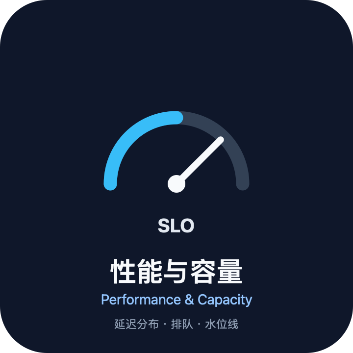
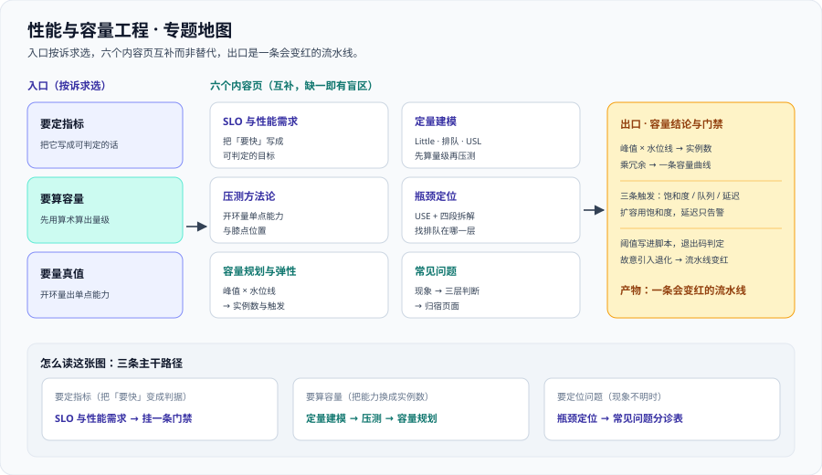

# 性能与容量工程

性能与容量工程回答的是两个**经常被当成一个问题**的问题：**「一次请求有多快」**和**「这套系统还能扛多少」**。前者是延迟分布，后者是资源到水位线的距离。把它们混在一起，就会出现本领域最典型的两句话——「接口 P99 只有 30 ms，所以不用扩容」和「压到 800 QPS 没报错，我们能扛 800 QPS」。

本专题讲的是**从「要快」到「可签字」的完整链路**：怎么把模糊的诉求写成可判定的 SLO、怎么先用算术算出量级再决定要不要压测、怎么用开环压出一个可信的单点能力、怎么在系统层面找到排队发生在哪一层、怎么把单点能力换算成容量结论，以及**怎么把这一整套变成流水线上会变红的门禁**。

它不讲单个语言或框架的调优细节（Java 侧在 [高性能 Java](../../Backend/HighPerformanceJava/index.md)、数据库侧在 [PostgreSQL · 性能](../../DB/Relational/PostgreSQL/Performance/index.md)、浏览器侧在 [前端 · 性能优化](../../Frontend/Others/PerformanceOptimization/index.md)），也不讲告警规则怎么写（那是 [监控告警](../Monitoring/index.md) 的职责）。

::: tip 一句话理解
性能工程最大的敌人不是慢，而是**平均值**与「**我觉得快了**」。
**凡是不能被判定真假的性能结论，都是情绪。** 本专题每一页都在做同一件事：把一句情绪，换成一条能被机器判定的判据。
:::

## 与相邻专题的分工

「性能」「容量」「监控」「压测」「调优」经常混着用，边界必须写死：

| 专题 | 讲什么 | 与本专题的关系 |
| --- | --- | --- |
| 本专题 | **从需求到门禁**：SLO 与性能需求、定量建模、压测方法、瓶颈定位、容量规划、常见问题 | —— |
| [监控告警](../Monitoring/index.md) | 指标模型、抓取、告警规则方法论 | 那边回答「**有没有出事、要不要叫人**」，本专题回答「**一次请求有多快、还能扛多少**」；**同一批指标，两种结论，不可互换** |
| [监控告警 · 告警规则](../Monitoring/Alerting/index.md) | 规则怎么写、怎么分组抑制、怎么不吵 | 本专题只回答一件事：**阈值是从哪来的**（错误预算与燃烧率） |
| [云上架构 · 弹性伸缩](../CloudArchitecture/AutoScaling/index.md) | 用哪个信号扩缩容、怎么配、冷却与容忍带 | 那边决定**怎么扩**，本专题决定**需要几个**；**HPA 触发不等于容量规划** |
| [Kubernetes](../Kubernetes/index.md) | 编排、`requests` / `limits`、副本与探针 | 副本数与 `requests` 的取值依据来自容量模型；给错 `requests` 会让整台机器的容量结论失效 |
| [高性能 Java](../../Backend/HighPerformanceJava/index.md) | **单机 / 单进程**：JMH 基准、JIT、对象布局、锁 | 那边管「这一个方法有多快」，本专题管「这套系统还能扛多少」；**「JFR 显示某方法慢」推不出「需要扩容」** |
| [响应式编程](../../Backend/ReactiveProgramming/index.md) | 流、背压、事件循环 | 背压解决「**上游发得太快**」，容量回答「**下游能被推多快**」；两者都做才能算出一条真实的能力曲线 |
| [分布式缓存 · 可观测](../../Backend/DistributedCache/Observability/index.md) | 缓存命中率与分层指标 | 命中率变化会**直接改写容量结论**（回源量是容量模型的一个输入） |
| [PostgreSQL · 性能](../../DB/Relational/PostgreSQL/Performance/index.md) | 单库的查询、索引、执行计划 | 数据库是容量模型里的**一个排队环节**，不是「一个更快的盒子」 |
| [前端 · 性能优化](../../Frontend/Others/PerformanceOptimization/index.md) | 浏览器侧指标与产物优化 | 端到端 SLO 的**最前一段**；前端指标达标不能推出后端容量够 |
| [故障应急体系](../IncidentResponse/index.md) | 值班、定级、预案、演练 | 本专题的 SLO 与燃烧率是它**定级的输入**；定级不反过来决定 SLO |
| [日志体系](../LogSystem/index.md) | 采集、检索、留存 | 瓶颈定位里的第四类证据；指标回答「哪里慢」，日志回答「为什么慢」 |
| [CI/CD · 测试](../../Tools/CICD/Testing/index.md) | 功能侧测试与门禁 | 性能门禁挂在**同一条流水线**上，但判据对象不同：一个判对不对，一个判快不快 |
| [完整项目交付](../../Others/ProjectDelivery/index.md) | 验收清单的通用模板 | 本专题提供验收清单里「**性能达标**」那一条的可执行版本 |
| [在线协作任务看板](/project/Complete/TeamBoard/index.md) | 一个把容量结论落到项目里的实例 | 那边是实例，本专题是方法；实例里的一切数字都要能追回本专题的定义 |

## 专题地图

| 页面 | 内容 | 适合谁读 |
| --- | --- | --- |
| [总览：性能与容量的四条边界](./Overview/index.md) | 性能 ≠ 容量、平均 ≠ 分位、压测 ≠ 容量、优化 ≠ 扩容 | 所有人，先读 |
| [SLO 与性能需求](./SLO/index.md) | SLI 三要素、两种延迟口径、分位数纪律、错误预算与燃烧率、非功能需求四类 | 要签字的人，**重点读** |
| [定量建模：并发、排队与扩展性](./Modeling/index.md) | Little 定律、线程池换算、排队放大、USL、重试放大、可运行估算脚本 | 想在压测前先有数量级的人 |
| [压测方法论与工具](./LoadTesting/index.md) | 开环与闭环、必须锁死的六个变量、k6 最小示例、结果怎么读、压测纪律十条 | 要动手压的人，**重点读** |
| [瓶颈定位](./Bottleneck/index.md) | USE 方法、等待与服务时间、四层拆解、五种应用层瓶颈、无侵入观测清单 | 正在排障的人 |
| [容量规划与弹性](./Capacity/index.md) | 三输入模型、水位线为什么是 50%、峰值预测、扩容触发判据、有状态组件例外 | 负责人与开发 |
| [常见问题与最佳实践](./FAQ/index.md) | 现象分诊表、高频十二问、上线自查清单、术语表 | 所有人，收尾读 |

## 事实与规格速览（2026-10 口径）

下表是**定义与口径**级的事实（不是某家厂商的价格），它们决定了本专题所有算例的算法：

| 项 | 当前口径 | 对判断的影响 |
| --- | --- | --- |
| 压测工具 | **Grafana k6 2.3.0（2026-09-21）**；开环压测用 `constant-arrival-rate` 执行器 | 用固定并发（闭环）量出来的数字**偏乐观**，它测的是「并发点」而不是「能力点」 |
| 时间换算基准 | 「3 个 9」= 每月约 **43.2 分钟**；**99% × 30 天 = 7.2 小时 = 432 分钟** | 定 SLO 前先做这一次换算，否则「99%」会被当成「几乎不出事」 |
| 错误预算 | **（1 − SLO）× 窗口**；99% 且窗口 30 天 → 预算 **432 分钟** | 预算用完之后该冻结发布还是继续发，**必须先决定再出事** |
| 燃烧率（burn rate） | 多窗口三档 **14.4 / 6 / 1**（对应短窗口快燃烧、中窗口、长窗口慢燃烧） | 只有慢档 → 发现太迟；只有快档 → 告警过吵 |
| 排队放大（M/M/1） | 利用率 **0.5 → 等待 2.00 倍**；**0.8 → 5.00 倍**；**0.9 → 10.00 倍** | 这是「水位线留 50%」这条纪律的算术来源，不是经验之谈 |
| 扩展性上限（USL） | 加机器到某个点之后**总吞吐开始下降**（一致性开销） | 「性能不行就加机器」只在争用与一致性开销可忽略时成立 |
| 分位数怎么算 | 必须用**直方图 / 摘要**估算；**不要对平均值求分位数** | 平均值会抹平尾部，用它算出来的 P99 是假的 |
| 容量换算三件套 | 单点能力 × **水位线** × **冗余策略** ÷ **峰均比** | 少任何一件，容量结论会偏出一到两倍 |

::: info 版本组织说明
本专题**不另开版本目录**。性能与容量是**方法论 + 少量工具**，不存在会破坏写法的「主版本」边界：工具换版本通常只影响命令与执行器名，不影响判据。

仓库里需要按版本目录组织的是**框架与语言**类主题，可以直接对照 [Spring5](../../Backend/Java/Frame/Spring/Spring5/index.md) / [Spring6](../../Backend/Java/Frame/Spring/Spring6/index.md)、Vue [Vue2](../../Frontend/Frame/Vue/Vue2/index.md) / [Vue3](../../Frontend/Frame/Vue/Vue3/index.md)、Spring Boot [v2](../../Backend/Java/Frame/SpringBoot/v2/index.md) / [v3](../../Backend/Java/Frame/SpringBoot/v3/index.md) / [v4](../../Backend/Java/Frame/SpringBoot/v4/index.md)——**旧版本文档一律保留并标注维护状态、不覆盖**。
:::

## 成熟度五档

性能这件事最容易「上一半」：有监控面板，但没人知道还能扛多少。按下面五档对照自己：

| 档位 | 特征 | 只补一件事 |
| --- | --- | --- |
| L0 | 只有「快 / 慢」的口头判断，没有数字 | 先量一次分位数（P95 / P99）与阈值计数，作为后面所有对比的基线 |
| L1 | 有分位数与阈值计数，能回答「快不快」 | 把它写成 **SLO**（窗口 + 目标 + 口径），让「快」有判定标准 |
| L2 | 有 SLO 与错误预算，能回答「够不够好」 | 补**容量模型**：单点能力、水位线、冗余与峰均比，算出「需要几个」 |
| L3 | 有容量模型与压测基线，能回答「还能扛多少」 | 把容量结论接到**扩容触发判据**与**发布前复核**上 |
| L4 | 有性能门禁与定期复核，容量结论会随版本与数据量自动更新 | 定期做一次「**关掉一半冗余会怎样**」的推演，验证容量结论还成立 |

## 学习路径

1. **先读 [总览](./Overview/index.md)**：四条边界与四种性能问题形态。跳过它最常见的后果是把「快」的结论当成「够」的结论。
2. **要签字的人先读 [SLO 与性能需求](./SLO/index.md)**：把「要快」写成可判定的目标，并定下错误预算的用法。
3. **要压测的人按顺序读 [定量建模](./Modeling/index.md) → [压测方法论](./LoadTesting/index.md)**：先算量级，再决定压到哪、压多久。顺序颠倒的典型结果是「压出一个漂亮的数字，却不知道它对应生产里的什么水位」。
4. **压完之后读 [瓶颈定位](./Bottleneck/index.md)**：把「慢」拆到能追责的粒度（哪一层排队、谁在等谁）。
5. **最后读 [容量规划与弹性](./Capacity/index.md)**：把单点能力换算成实例数与触发条件，并给有状态组件单列规则。
6. **上线前用 [常见问题](./FAQ/index.md) 的自查清单扫一遍**，再把它接进流水线当门禁。

## 参考资料

- Google SRE Book · Monitoring Distributed Systems（四黄金信号：延迟、流量、错误、饱和度）：https://sre.google/sre-book/monitoring-distributed-systems/
- Google SRE Workbook · Alerting on SLOs（多窗口燃烧率告警的原始口径）：https://sre.google/workbook/alerting-on-slos/
- Google SRE Workbook · Managing Load（过载时拒绝、排队与降级的取舍）：https://sre.google/workbook/managing-load/
- Brendan Gregg · The USE Method（利用率、饱和度、错误三问）：https://www.brendangregg.com/usemethod.html
- Wikipedia · Little's law（并发、到达率、驻留时间三者互推）：https://en.wikipedia.org/wiki/Little%27s_law
- Wikipedia · Universal Scalability Law（争用与一致性导致的扩容上限）：https://en.wikipedia.org/wiki/Universal_Scalability_Law
- Grafana k6 官方文档 · Constant Arrival Rate（恒定到达率场景，量「能力点」）：https://grafana.com/docs/k6/latest/using-k6/scenarios/executors/constant-arrival-rate/
- Grafana k6 官方文档 · Thresholds（把性能阈值写进脚本并用退出码判定）：https://grafana.com/docs/k6/latest/using-k6/thresholds/
- Prometheus 官方文档 · Histograms and summaries（直方图桶与分位数估算）：https://prometheus.io/docs/practices/histograms/
- Kubernetes 官方文档 · Horizontal Pod Autoscaling（容忍带、稳定窗口与多指标行为）：https://kubernetes.io/docs/tasks/run-application/horizontal-pod-autoscale/
- web.dev · Core Web Vitals（LCP / INP 阈值与端到端 SLO 的最前一段）：https://web.dev/articles/vitals
