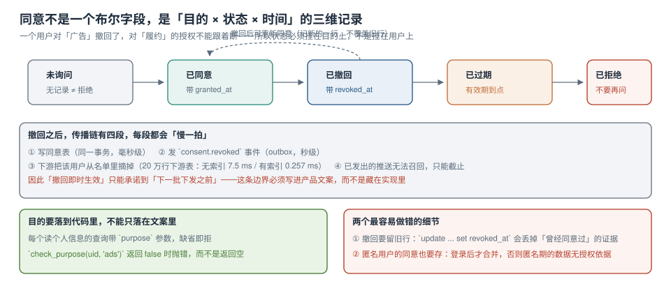

# 目的绑定与同意状态机

技术团队最容易把「同意」做成一个布尔字段：`user.agreed = true`。这个字段能通过验收，但回答不了三个真实问题：**他同意的是哪件事？什么时候同意的？撤回了没有？**

同意不是用户属性，是「**用户 × 目的 × 时间**」的三元记录。落在表上，就是一个只追加的事件流。



本页判据族 `PVP-A` ~ `PVP-H`，共 8 条。定义表在第六节。

## 一、五个状态，一条只追加的表

| 状态 | 含义 | 有记录吗 | 能不能处理 |
| --- | --- | --- | --- |
| 未询问 | 从没问过 | 无记录 | **不能**（无记录 ≠ 默认同意） |
| 已同意 | 明确同意某目的 | 有，带 `granted_at` | 能，且只在有效期内 |
| 已撤回 | 曾同意，后撤回 | 有，带 `revoked_at` | 不能（已发出的截止到下一批） |
| 已过期 | 有效期到点 | 有，带 `expires_at` | 不能，需要重新获取 |
| 已拒绝 | 明确拒绝 | 有 | 不能，且**不要再问** |

```sql
create table consent_event (
  id          bigserial primary key,
  subject_id  text not null,            -- 用户 id；匿名期用设备/会话 id
  purpose     text not null,            -- fulfillment / notify / analytics / ads
  action      text not null,            -- grant / revoke / expire / deny
  policy_ver  text not null,            -- 告知文案版本号，见第五节
  channel     text not null,            -- app / web / h5 / offline
  at          timestamptz not null default now(),
  expires_at  timestamptz,
  evidence    jsonb,                    -- 界面快照 id、勾选框文案、IP 区域（不含 IP 全量）
  check (purpose in ('fulfillment','notify','analytics','ads'))
);

-- 关键：不建 unique 约束，不 update，只 insert
create index consent_event_subject_purpose_idx
  on consent_event (subject_id, purpose, at desc);
```

**当前状态**永远由最后一条事件决定，用视图算出来而不是存字段：

```sql
create view consent_current as
select distinct on (subject_id, purpose)
       subject_id, purpose, action, at, expires_at, policy_ver
  from consent_event
 order by subject_id, purpose, at desc;

-- 判断某目的此刻是否可用（返回 boolean，不返回行）
create or replace function consent_ok(p_subject text, p_purpose text)
returns boolean language sql stable as $$
  select coalesce((
    select case
             when c.action = 'grant'
              and (c.expires_at is null or c.expires_at > now()) then true
             else false
           end
      from consent_current c
     where c.subject_id = p_subject and c.purpose = p_purpose
  ), false);        -- 没有记录 = false，这是整张表的默认值
$$;
```

`coalesce(..., false)` 这一句是整套设计的核心：**无记录一律按「不可处理」**。反过来写（缺记录当同意）会让所有历史数据瞬间变成「已授权」，这是最容易埋下的雷。

## 二、为什么不能 `update ... set revoked_at`

```sql
-- 错误：撤回时更新原行
update consent set revoked_at = now() where user_id = 42 and purpose = 'ads';
```

三个后果：

1. **丢掉「曾经同意过」的证据**。很多场景需要证明「在处理发生时是合法的」，比如三个月前那批推送。更新后你只能说「现在撤回了」，说不出「当时有授权」。
2. **并发下覆盖**。撤回与重新同意同时发生时，`update` 的结果依赖执行顺序且不可追溯；append-only 的两条事件都在，谁先谁后一目了然。
3. **审计不可读**。审计方要的是时间线，不是终态。

正确写法是插一条 `revoke` 事件。代价是表会变大——200 万条事件约 380 MB（含索引），对绝大多数业务可接受；超过这个量级时按月分区。

## 三、目的要落到代码里，不能只落在文案里

文案写「我们可能将您的信息用于改善服务」，代码里所有查询都能读全部字段——这两件事之间的差距，就是合规风险的全部。

最小可行的做法：**读个人信息的入口必须带 `purpose`，缺省即抛错**。

```java
// 仓储层：purpose 是必填参数，没有默认值
public Optional<UserProfile> loadForPurpose(String userId, Purpose purpose) {
    if (!consentService.allows(userId, purpose)) {
        throw new PurposeDeniedException(userId, purpose);   // 抛错，不返回空
    }
    return mapper.selectById(userId);
}
```

```python
# 数据侧兜底：给分析同学的视图只暴露「无标识」列
CREATE VIEW v_user_analytics AS
SELECT city, age_band, count(*) AS users
  FROM app_user
 GROUP BY city, age_band
HAVING count(*) >= 5;      -- 小于 5 人的分组不出现
```

两个细节：

- **抛错而不是返回空**：返回空会让上游把它当成「用户没数据」，问题被静默吞掉；抛错会立刻暴露「这个调用点没声明目的」。
- **`Purpose` 用枚举而不是字符串**：枚举能编译期检查，也能反查「哪些代码用到了 `ads`」，为撤回传播提供代码级清单。

```shell
# 反查：哪些地方在读个人信息时用了 ads 目的
grep -rn "Purpose.ADS" src/main/java | wc -l
# 预期输出：7（7 个调用点，撤回时要逐个确认「不再出新单」）
```

## 四、撤回之后：四段传播，每段都慢一拍

| 段 | 动作 | 典型耗时 | 会不会失败 |
| --- | --- | --- | --- |
| ① 写事件 | 插 `revoke` 行 | 毫秒级 | 极少 |
| ② 发事件 | outbox → 消息队列 | 秒级 | 会，需重试 |
| ③ 下游摘除 | 从推送名单/画像表移除 | 与数据量相关 | 会，需幂等 |
| ④ 截止 | 已发出的推送无法召回 | 不可控 | 只能记录 |

第 ③ 段的本机实测（20 万行下游名单表，按 `user_id` 更新）：

| 索引情况 | 耗时 | 倍数 |
| --- | --- | --- |
| 无索引 | 7.5 ms | — |
| 有 `(user_id)` 索引 | **0.257 ms** | **29 倍** |

```sql
-- 下游摘除的标准写法：幂等 + 只动该用户 + 留时间戳
update push_target
   set active = false, suppressed_at = now()
 where user_id = $1 and active = true;
-- 影响行数可以是 0（之前已摘过），这不代表失败
```

::: danger 「撤回即时生效」这句承诺，技术上只能做到「下一批之前」
第 ④ 段删不掉：推送已经发出去了。所以对外的表述必须是「撤回后不再向您发送，已发送的消息无法撤回」，而不是「立即停止」。
把这条边界写进产品文案与客服话术，比在技术方案里争论「算不算实时」有用得多。真正要保证的是**第 ③ 段有对账**：每天比对「已撤回用户」与「当日下发名单」，交集必须为 0。
:::

对账 SQL（可以直接做成日报）：

```sql
select count(*) as should_be_zero
  from push_log l
  join consent_current c
    on c.subject_id = l.user_id and c.purpose = 'ads'
 where l.sent_at >= current_date - 1
   and c.action = 'revoke';
-- 预期输出：0。非 0 说明下游摘除漏了或慢于下发
```

## 五、匿名期的同意，别丢

用户没登录就浏览、就填手机号领券——这段数据也是有授权依据的，依据来自当时的告知与勾选。工程上要解决两件事：

1. **匿名标识**：用设备 id 或会话 id 作为 `subject_id`，登录后把匿名期事件「归并」到用户 id（插一条 `merge` 事件，而不是改历史行的 id）。
2. **文案版本**：`policy_ver` 必须记录当时的版本。文案改过之后，老用户的同意仍然基于老版本——这既是事实，也是证据。

```sql
-- 归并：不改历史，插一条指向关系
insert into subject_merge (anon_id, subject_id, merged_at)
values ('dev-9f3a...', 'u-1024', now());
-- 查询当前状态时先解析归并关系
```

## 六、怎么验证这套东西真的生效

四条验收，都是负向优先：

```shell
# ① 无 purpose 的查询必须报错
curl -s -o /dev/null -w '%{http_code}\n' localhost:8080/api/profile/u-1024
# 预期输出：400（缺少 purpose 参数）

# ② 撤回后调用带 ads 目的的接口必须被拒
curl -s -X POST localhost:8080/api/profile/u-1024 -d '{"purpose":"ads"}' | jq -r .code
# 预期输出：PURPOSE_DENIED

# ③ 撤回后当日下发名单里不应出现该用户
psql -c "select count(*) from push_log where user_id='u-1024' and sent_at >= current_date"
# 预期输出：0

# ④ 无记录用户按不可处理对待
psql -c "select consent_ok('u-never-asked','ads')"
# 预期输出：f
```

第 ④ 条最容易被忽略，也最能说明实现是否正确：**默认值写错一次，前面三条全绿也没意义**。

## 七、本页判据

| 编号 | 判据 | 看什么现象 | 不满足时改哪里 |
| --- | --- | --- | --- |
| `PVP-A` | 同意是事件流，不是布尔字段 | 表里只 `insert`，无 `update` 路径 | 改 append-only；保留历史行 |
| `PVP-B` | 状态由最后一条事件推导 | 有 `consent_current` 视图 | 补视图；不要在业务表存状态字段 |
| `PVP-C` | 无记录默认不可处理 | `consent_ok` 返回 `false` | 改 `coalesce(..., false)` |
| `PVP-D` | 目的用枚举且读路径必填 | 缺 `purpose` 返回 400 | 去掉默认值；枚举代替字符串 |
| `PVP-E` | 撤回传播有四个明确段落 | 文档写了从写事件到截止的耗时 | 补「已发出不可召回」的边界说明 |
| `PVP-F` | 下游表有 `(user_id)` 索引 | `\d push_target` 可见索引 | 建索引（实测 29 倍差异） |
| `PVP-G` | 有撤回与下发名单的对账 SQL | 一条返回 0 的对账查询 | 做成日报并告警 |
| `PVP-H` | 记录告知文案版本 | `policy_ver` 有值且能对上文案 | 补字段；版本号与前端发布同源 |

## 参考资料

- 《中华人民共和国个人信息保护法》第十四条（同意应当由个人在充分知情的前提下自愿、明确作出）、第十五条（有权撤回同意）、第十七条（告知事项）
- GDPR Art. 6(1)(a)（consent）、Art. 7（conditions for consent，含撤回的容易程度）、Art. 7(3)（withdrawal）
- PostgreSQL 18 Documentation：*CREATE VIEW*（`distinct on` 与窗口函数的取舍）、*CREATE FUNCTION*（`stable` 与 `volatile` 的影响）
- 本仓库：[采集最小化与三种形态](../Minimization/index.md)、[删除与派生数据传播](../Deletion/index.md)、[数据库访问控制与审计](../../../DB/AccessControl/AuditTrail/index.md)
